# 无人机巡检平台后端 · 六周直读复习手册

本文核对分支的提交及对应工作树，不能只以HEAD当最新实现。**自动建模主线采用v2.5当前工作树的统一碰撞接入** ，并将旧提交、v3 SELF与EXTERNAL分别说明。工作树改动尚未提交，不代表已经部署；本次仅修订手册，未改动或提交业务仓库。

| 代码口径 | 核对版本 | 航线校验与调度 |
| --- | --- | --- |
| **v2.5 当前工作树（未提交碰撞接入）** | 基于 `e19920ee3`，2026-10-14读取10个差异文件 | 已删除本地JTS冲突服务及组合搜索；创建做静态校验，真实下发前统一检测、登记并查询确认 |
| v2.5 已提交旧版本 | `e19920ee3e17bf21eb186a2a3e05a1649d75be5b` | 创建Mission时已有统一检测/活跃记录检查；本地JTS仍参与调度，尚非新的延迟登记链路 |
| v3 当前已提交版本 | `b94fa4203e1855dacf06b28c579612985837b5eb` | SELF创建建模Mission保留静态检测，本地JTS仍参与筛选；未见新增checkAndRegisterBeforeDispatch调用。另有EXTERNAL外部调度 |
| 独立智能体、违停与工作流 | 见各节补充版本 | 平台Action/Lua/资产、独立Channel、Agent事件及Temporal分开解释 |

**当前接入的完整链路：** `createOrUpdateModelingMission → checkRouteBeforeMissionCreate`做模型/障碍物及限高检查、不占活跃空域；`doDispatchTaskAreaRoute → checkAndRegisterBeforeDispatch → checkRouteSafety → CollisionWarningGateway.routeSafeCheck`在实际IoT之前进行动态检测及登记，必要时查询确认登记结果。不是“只有本地JTS”。JTS原理与组合搜索仍保留为旧提交/v3 SELF的对照及八股扩展。

本文将内容标为**代码事实、故障推演、改进方案和八股扩展** 。固定提交行号与工作树行号分列。工作树快照差异SHA256：`7e5e0678c6c27a999c42fd95d50030ada7b38a0d5027c8c2878f300994f5d5de`；后续工作树变化须重新核对。运行配置、远端内部原子性、个人贡献和效果提升不能仅由客户端代码证明。

## 代码定位与核对范围

下表是已提交旧版本对照，不是v2.5当前工作树。行号以固定提交为准，不随后续分支移动自动更新。源码摘录省略包名、日志与无关参数；教学SQL/伪代码/状态模型已标注，不能直接当完整生产实现。

| 类 / 方法（以下为提交快照对照） | v2.5旧提交行号 | v3提交行号 | 核对点 |
| --- | --- | --- | --- |
| `ModelingAreaService.splitAndSaveAreas` | 52 | 52 | 拆分锁与本地事务 |
| `ModelingTaskServiceImpl.startAsyncRoutePlanning` | 211 | 214 | 异步规划入口 |
| `ModelingTaskServiceImpl.finalizeDispatchStatus` | 383 | 386 | 规划收口及SELF/EXTERNAL分流 |
| `ModelingDockResolver.buildTwoDimensionalAssignment` | 142 | 168 | 本地机库评分/优化 |
| `ModelingQueueManager.onTaskPrepared` | 89 | 91 | 规划完成触发 |
| `ModelingQueueManager.reconcileActiveShowrooms` | 106 | 108 | 每实例fixedDelay补偿 |
| `ModelingQueueManager.scheduleShowroom` | 568 | 624 | 两段锁与逐条下发 |
| `ModelingQueueManager.reserveDispatchCandidates` | 631 | 687 | 占用/JTS筛选及不提前预占 |
| `ModelingQueueManager.findDispatchCandidatesForShowroom` | 747 | 803 | 全样板间跨task候选 |
| `ModelingQueueManager.findMaximumCompatibleSet` | 801 | 859 | 冲突矩阵及分组搜索 |
| `ModelingQueueManager.searchCompatibleByDock` | 849 | 907 | 重试/预计轮次/并发/间距目标 |
| `ModelingRouteConflictService.checkConflict` | 121 | 121 | 本地占用航迹检查 |
| `ModelingQueueManager.doDispatchTaskAreaRoute` | 1369 | 1428 | 最终复检、区域CAS、IoT及结果分类 |
| `ModelingQueueManager.executeWithShowroomScheduleLock` | 1613 | 1673 | lockInterruptibly及finally |
| `ModelingQueueManager.requeueStaleDispatching` | 1071 | 1129 | 按本地状态超时恢复 |
| `ModelingQueueManager.requeueStaleAreaToPending` | 1314 | 1372 | 状态回退/ABA窗口 |
| `ModelingQueueManager.updateDispatchSuccess` | 1653 / 1657 | 1713 / 1717 | 按routeCode回写，未带尝试代际 |
| `ModelingTaskStatusService.updateForward` | 129 | 148 | 批次单向/终态条件更新 |
| `MissionOdmTaskRelationServiceImpl.doModeling` | 295 | 295 | 组锁、状态与projectId窗口 |
| `SwarmDispatchService.submitTaskGroup` | — | 145 | v3远端提交 |
| `VoiceAssistantBusinessServiceImpl.initInstructionStatus` | 149 | 149 | 普通SET初始化 |
| `VoiceAssistantInstructionDispatcher.handle` | 47 | 47 | 指令重复受理入口 |
| `AgentSceneMemoryServiceImpl.checkNameUnique` | 371 | 371 | 同名先查后插 |

**v2.5当前工作树补充定位（未提交）：**
| 类 / 方法 | 工作树行号 | 核对点 |
| --- | --- | --- |
| `StationCommonHandler.createOrUpdateModelingMission` | 1070 | 建模专用静态检查入口 |
| `MissionRouteSafetyServiceImpl.checkRouteBeforeMissionCreate` | 65 | taskDispatch=false；创建不登记 |
| `MissionRouteSafetyServiceImpl.checkAndRegisterBeforeDispatch` | 100 | 下发前检查/登记并查证 |
| `ModelingQueueManager.reserveDispatchCandidates` | 667 | 基础筛选，返回顺序候选 |
| `ModelingQueueManager.doDispatchTaskAreaRoute` | 1224 | 最终复检、CAS、碰撞准入、IoT |
| `ModelingQueueManager.requeueStaleAreaToPending` | 1173 | 超时回退仍存在 |
| `ModelingQueueManager.executeWithShowroomScheduleLock` | 1494 | 两段锁及watchdog |
| `ActiveRouteProcessService.onMissionFinished` | 30 | 最高优先级清理登记 |

**补充证据范围：** 独立Java Agent的RunEvents及事件补拉（固定提交860b732）、Python Agent的RunEventEmitter（5f4adc0）、Channel（2ea6729）、违停平台（ade75009e）及Temporal编排（9f755ae）。外部调度服务、IoT/设备执行端、线上DDL、配置中心、容量与实际GC停顿没有运行验证。
**完整性检查：** 同时核对提交快照和v2.5工作树的碰撞接入，调度、控制、状态聚合、配置、图片组级建模及指令/Lua/位置资产按各自路径解释；仅修改文档。

## 使用说明

部分长答题附有“记忆关键词”。先顺着关键词复述，再补机制、例子和边界；它是回答提纲，不是完整答案。HTML 可用“展开全部”扫关键词，再“收起全部”看题自测。

六周并不是要求你完成额外作业，而是帮你控制复习顺序：

- 第 1 周：先读1.1–1.9建立主线，再精读1.10–1.15的机库分配手算、代码与调度图；这部分优先复述。
- 第 2 周：理解并发控制、任务预占和分布式一致性。
- 第 3 周：理解状态机、事件补偿、暂停继续取消和断点续飞。
- 第 4 周：结合项目复习 Java、MySQL、Redis、Spring。
- 第 5 周：复习 AI 工程化和智能体业务侧集成。
- 专题：违章停车多轮复核（配合第 5 周阅读，简历新增模块，面试追问概率高）。
- 第 6 周：直接阅读完整项目话术和高频面试答案。

仓库能够验证你的工程实现，但不能验证“召回率 85%”“效果从 30% 提升到 80%”“速度提升 4 倍”等数据，因此本文不会使用这些数字。

---

# 第 1 周：自动建模链路、机库分配与统一碰撞准入

## 1.1 先理解整个业务

**当前主线：v2.5工作树。** task是数据库批次，taskArea是子区域任务，Mission是飞行任务；任务不归创建节点独占。统一碰撞接入在工作树中已经实现，但尚未提交。

```text
圈定区域 → 拆分/持久化 → 配机库 → 并行规划
→ createOrUpdateModelingMission
→ checkRouteBeforeMissionCreate：静态模型/障碍物/限高，不登记活跃航线
→ 样板间基础候选扫描（不再本地组合搜索）
→ 每条最终锁：批次/机库链/Mission/电池复检
→ PENDING条件更新DISPATCHING
→ checkAndRegisterBeforeDispatch：统一碰撞检测/活跃登记/查询确认
→ 确认后execMission调用IoT → 飞行/续飞/图片 → 父子组建模 → projectId

v3 SELF提交版：静态创建检查 + 本地JTS筛选组合 + 最终CAS/IoT。
v3 EXTERNAL：远端分配 → 本地规划/Mission准备 → submitTaskGroup → 外部派飞。
```

### 整体业务时序图

**整体业务时序图（Mermaid）：** 先沿四个阶段读完整闭环，再进入后面的分配算法与调度源码。按2026-10-15复核的v2.5工作树绘制；v3 SELF的JTS筛选与EXTERNAL外部派飞见1.9，不混入本图。图中泳道是逻辑职责，不代表全部独立部署；open-api及设备内部只画已核对的交互边界。

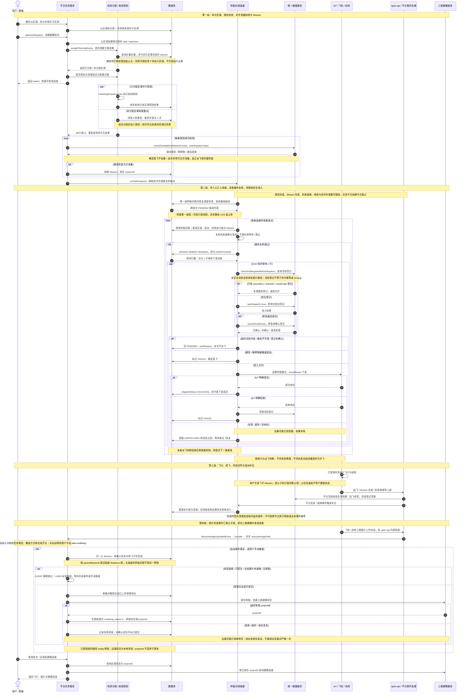

[独立查看完整时序图（SVG）](auto-modeling-business-sequence.svg) · [下载 Mermaid 源文件](auto-modeling-business-sequence.mmd)。HTML图可横向滚动，下方可展开复制完整源码。

**读图要点：** ① dockSn绑定不等于机库占用；② 调度有两段样板间锁，CAS只领取当前区域；③ 活跃登记查证后派飞，IoT未知不当明确失败；④ 续飞父子链与组级图片就绪分别判断；⑤ 最终projectId表示建模项目已提交，仍需查询生成进度。图片完成事件可能重复，组锁及状态检查不等于跨系统严格一次。

### 面试官问：请介绍一下自动建模模块

> **记忆关键词：** 拆分 → 配机库 → 规划 → 静态检查 → 动态登记 → 飞行建模

> 自动建模从用户圈定区域开始，保存子区域和任务，为区域分配机库并通过线程池并行规划。准备Mission时调用统一碰撞服务做静态模型/障碍物和限高检测，不提前登记活跃航线，避免尚未飞行的任务占用空域。
>
> 当前v2.5工作树已把实时空域判断迁到真正下发前：先复检批次、同库链、Mission与电池，单行CAS领取后调用checkAndRegisterBeforeDispatch，检测并登记活跃航线，确认后才下发IoT。按顺序扫描候选，暂时冲突可以等待并继续后续候选。
>
> 调度入口仍有规划完成、设备事件、继续和定时补偿，多节点用样板间锁协调。远端登记不是设备命令幂等或旧执行者fencing；结果未知、锁失效与状态回退仍需查证。图片阶段按父子组做就绪和提交去重。v3的SELF旧提交及EXTERNAL模式另列，不能混用实现结论。

**八股扩展：** 线程池收口、资源互斥、CAS、远端准入、幂等和最终一致性。每种机制必须明确其存储与副作用边界。

## 1.2 为什么要拆分区域

一个大区域直接生成一条航线，可能超过单块电池的飞行能力，也无法让多个机库并行工作。因此系统把父区域拆成多个子区域，每个子区域作为后续航线规划、机库分配、任务执行和失败恢复的最小单元。

并发拆分时可能出现两个请求同时删除旧子区域并创建新子区域的问题。代码使用父区域 ID 构造 Redisson 锁，让同一个父区域的拆分操作串行执行，避免生成重复子区域。

### 面试官问：为什么不直接为整个区域生成一条航线

> 大区域可能无法由一次飞行完成，也不利于多机库并行调度。拆成子区域后，可以把飞行负载分散到不同机库；单个区域规划失败时也只影响局部任务，不需要让整个批次全部失败。同时，子区域任务为暂停、恢复和进度聚合提供了清晰粒度。

**八股扩展：** 业务分片与资源粒度。父区域替换使用分布式锁协调两个请求、TransactionTemplate保证删除旧子区域和插入新子区域的数据库原子性；两者职责不同。单批次拆小便于失败隔离，但不能据分片推断互不争资源。

## 1.3 为什么航线规划使用线程池

每个子区域的航线规划相对独立，而且包含外部规划和航线保存操作。如果串行执行，总耗时接近所有子区域规划耗时之和。

当前代码将每个已分配机库的区域提交到 `modelingRouteExecutor`，通过 `CompletableFuture.runAsync` 并行执行，再使用 `CompletableFuture.allOf` 等待一批任务结束。单区域异常在自己的异步任务中捕获并写入失败状态，不会直接中断其他区域。

### 面试官问：使用线程池后怎么处理异常

> 每个区域的规划任务独立捕获异常，失败时只把对应区域的 routeStatus 标记为 FAILED，并记录失败原因。`allOf` 负责等待整批异步任务收口；收口时重新查询数据库中的最新区域状态，再为规划成功的航线创建 Mission。因此一个区域失败不会把其他已成功区域一起回滚。

### 面试官问：线程池能防止任务重复执行吗

> 不能。线程池管理执行资源，防重依赖业务身份和数据裁决。当前批次创建在父区域锁内检查活跃批次，正式下发有样板间锁和区域状态条件更新；锁失效、创建锁固定租约耗尽及远端重复指令仍要单独处理。不要说“线程池保证任务一条都不丢”。

### 面试官问：这些参数为什么这么设

> 代码默认核心5、最大10、队列100，是一组待压测的资源配置。JDK执行器通常先使用核心线程，再入队，队列满后才继续扩到最大线程；不能把最大10理解成每一批都启动10个线程。批次规模与共享队列的剩余空间也要分别看，不能据单批大小保证总能入队。
>
> 池饱和且尚未关闭时，CallerRunsPolicy把任务交给提交线程执行，形成提交侧反压；这些执行不计入池内最大线程数。实际下游并发可能超过10，若要求硬上限，应在远程调用边界统一使用许可控制，并让所有调用路径遵守。
>
> [JDK CallerRunsPolicy契约](https://docs.oracle.com/en/java/javase/21/docs/api/java.base/java/util/concurrent/ThreadPoolExecutor.CallerRunsPolicy.html)还明确：执行器关闭后，拒绝任务会被丢弃。停机时的受理、任务记录和恢复流程需另外验证，不能把该策略当可靠任务队列。

### 面试官问：拒绝策略为什么选 CallerRunsPolicy

> **记忆关键词：** 运行期反压 · 提交线程执行 · 下游非硬上限 · 关闭后可丢任务

> 当前配置在运行期池满时让提交线程执行任务，用变慢的提交产生反压。这会占用Web请求线程，也可能增加下游并发。Abort会显式抛出拒绝异常，调用方可以记录失败或补偿；不能笼统断言选Abort就必然无法恢复。
>
> 关闭后CallerRunsPolicy不执行被拒绝的任务。若用CompletableFuture封装，执行器静默丢弃Runnable可能使对应Future无法完成；allOf也不能替你恢复任务。因此批次受理记录、停机拒绝处理、持久化状态和补偿各有职责。
>
> ```java
> var ran = new java.util.concurrent.atomic.AtomicBoolean();
> var pool = new java.util.concurrent.ThreadPoolExecutor(
>     1, 1, 0, java.util.concurrent.TimeUnit.SECONDS,
>     new java.util.concurrent.ArrayBlockingQueue<Runnable>(1),
>     new java.util.concurrent.ThreadPoolExecutor.CallerRunsPolicy());
> pool.shutdown();
> pool.execute(() -> ran.set(true));
> assert !ran.get(); // JDK策略在关闭后丢弃拒绝任务，不抛拒绝异常。
> ```
>
> 这个片段只演示JDK策略；Spring执行器的实际停机顺序还要按所用版本、配置和并发提交场景验证。

### 面试官问：异步规划里的登录用户上下文怎么处理

> **记忆关键词：** 显式 set → finally 清理；CallerRuns 在提交线程要恢复旧值

> runAsync通常在池线程执行，请求ThreadLocal不会自动安全继承。当前代码显式setUser并在finally里clear，用于避免池线程复用串身份。但CallerRunsPolicy可能让任务在提交线程执行，此时clear会清掉提交者已有上下文；应验证保存并恢复旧上下文的边界，不能把“有finally”概括为所有线程路径都安全。

### 面试官问：收口时为什么重查数据库，不直接用内存里的结果

> 每个区域的规划任务各自写库，机库分配的延迟重试链还会中途补进区域，allOf 只承诺“这批 Future 都结束了”，不承诺“提交前的内存快照等于最终状态”。收口后按 taskId 重查全量区域、只取 routeStatus=SUCCESS 的航线创建 Mission，是以数据库为事实源的聚合，天然容忍重试链的补写。

### 面试官问：为什么不用虚拟线程

> 当前平台线程池提供任务排队、池内线程复用和运行期提交反压，保持它是可解释的工程选择。虚拟线程每任务执行器本身不限制下游并发，直接替换需要重新设计准入；但当前CallerRunsPolicy同样不能给远程调用提供严格的10并发上限。
>
> 平台线程和虚拟线程都可以结合Semaphore等许可控制下游，关键是把并发上限与执行器类型分开。是否迁移取决于真实等待占比、并发规模、下游容量及监控证据，不能由“JDK25可用”或“虚拟线程一定更快”直接推出结论。

**代码定位：** ModelingRouteThreadPoolConfig、startAsyncRoutePlanning、planTaskAreasAsync、completeAsyncRoutePlanning。** 八股扩展：** 执行器容量、CompletableFuture编排、反压、拒绝、ThreadLocal及取消边界；详细追问见4.1、4.7。

## 1.4 机库分配逻辑

系统先为每个子区域查询候选机库，考虑机库是否在线、距离范围、规划数据是否完整、绑定飞机和吊舱能力是否满足要求。

分配时优先处理候选机库较少的区域，让选择较多的区域根据前面确定的分配调整负载与空间关系；当前没有一库只分一个区域的容量限制。

完整图解、手算和源码精读见1.10–1.15。当前二维分配评分顺序是：

1. 机库最终负载差值更小。
2. 机库到区域的连接线交叉数量更少。
3. 机库忙碌惩罚更低。
4. 总距离更短。

初始分配后，系统通过有界的单区域移动和两区域交换寻找更优方案。二维数据不完整时，再回退为简单的负载均衡分配。

### 机库分配的演进：从主轴单调到负载优先

当前算法是第二版。早期版本（提交 `264029414` 之前）是"主轴单调分配"：

1. 选主轴：比较区域群的经度跨度（乘以 cos 平均纬度折算成真实距离）与纬度跨度，取更长的方向作为主轴，即区域分布的长轴方向。
2. 区域和机库都按主轴上的投影排序。
3. 用动态规划求总代价最小的分配，单项代价 = haversine 距离 + 位置惩罚 + 负载惩罚 + 忙碌惩罚。其中位置惩罚等于"机库序号与期望序号差值的绝对值 × 2000 米"，期望序号按 areaIndex × dockCount / areaCount 计算——区域序列沿主轴被均分成机库数量的段，每段连续区域的期望机库是同一个。

这套设计通过主轴排序、单调指派和位置惩罚偏好空间上的连续分配，能减少沿主轴来回跳转。位置惩罚是代价偏好，并不强制所有相邻区域同机库；单轴投影有序也不能保证二维连接线零交叉，更不能代替真实航迹、时间和高度维度的碰撞检测。

被替换的原因是优先级反了：主轴指派单调，位置连续性是代价偏好，负载均衡只是每任务 1000 米的软惩罚，还排在位置惩罚（每格 2000 米）之后。区域沿主轴分布不均时（例如一堆区域挤在某一侧），近侧机库照单全收、远侧机库闲置，任务量差距拉不开；某个区域的期望机库不在它的候选列表里时，只能在惩罚下被迫偏离，动态规划的单调约束还会连锁劣化。现方案把优先级倒了过来：负载极差成为字典序第一目标，二维连接线交叉作为显式计数的软目标，交给贪心初始解加移动/交换的局部优化尝试减少，先优化负载分布，再兼顾空间质量；实际飞行并发仍受机库和航迹约束。

### 面试官问：机库分配方案做过什么演进，为什么放弃主轴单调分配

> **记忆关键词：** 主轴有序非零交叉 · 负载优先 · 显式计数 · 有界局部优化

> 早期方案按区域分布的主轴排序，以动态规划和期望机库序号的距离惩罚偏好连续分配。后来将负载极差提升为字典序第一目标，二维连接线交叉改为显式计数的软目标，再做有限移动与交换。它是在负载与空间偏好之间调整优化目标，不是从“严格零交叉”降级。
>
> ```java
> // 两个机库与两个区域都按x递增，指派仍会在二维平面相交。
> double[] d1 = {0, 0}, d2 = {1, 1.5};
> double[] a = {2, 2}, b = {6, 0};
> assert d1[0] < d2[0] && a[0] < b[0];
> assert java.awt.geom.Line2D.linesIntersect(
>     d1[0], d1[1], a[0], a[1], d2[0], d2[1], b[0], b[1]);
> // 交点为(18/13,18/13)；区域x跨度4大于y跨度2，主轴仍可选x。
> ```
>
> 这只是局部平面教学反例。分配评分的二维连接线也只是代理指标，当前v2.5最终仍要检查机库、Mission与电池，并经过统一碰撞准入；JTS筛选仅指旧提交/v3 SELF。

### 面试官问：为什么不直接选择最近机库

> 只选择最近机库可能让大量任务集中到同一个机库，其他机库空闲，反而延长总完成时间。系统首先平衡任务量，再考虑空间交叉、设备忙碌程度和总距离，是对整体完成效率和后续飞行安全的综合权衡。

### 面试官问：这个分配算法是全局最优吗

> 不是严格的全局最优。代码先贪心生成初始分配，再通过有限轮次的移动和交换做局部优化，优点是实现清晰、计算规模可控。适用规模须按实际候选数、计算耗时和质量实测判断。如果未来规模明显增大，或者业务要求严格最优，可以考虑整数规划或更完整的组合优化算法。

### 面试官问：分不到机库的区域怎么处理

> 初次分配没拿到机库的区域不会立即失败，而是进入延迟重试链：间隔 6 秒、最多重试 2 次，重试同样复用 modelingRouteExecutor（delayedExecutor）。每次重试前先重查数据库，只处理仍为 PENDING 且未分配机库的区域，状态已被其他流程改变的区域自动跳过；重试中分配成功的照常进入航线规划批次，2 次耗尽仍未分配的标记 FAILED，原因写“机库状态重试2次后仍未找到可用机库”。整条重试链与首批规划一起被 allOf 收口，批次准备完成时不会有漏网区域。用延迟而不是立即重试，是为了给设备/能力状态恢复留时间；自动规划候选没有统一要求达到派飞电量阈值，不能将无候选都归因于充电。

### 面试官问：评分和局部优化的代码具体怎么实现的

> **记忆关键词：** 字典序评分 → 稀缺优先 → 贪心初解 → 移动/交换 → 有界停止

> 三个层次。① 打分函数一次算四个维度：把每个“机库→区域”连成线段两两判交数交叉数（同一机库的多条线不互判）；距离用 haversine 球面距离求和（米）；忙碌惩罚是所选机库的 penalty 之和；负载差 = 全部机库“存量负载＋本批已分配”的最大值减最小值。四个数按字典序比较：负载差最小优先，其次交叉更少、惩罚更低、总距离更短。② 初始解是“试放-打分”贪心：区域按候选机库数升序（稀缺优先），每个区域把每个候选放进当前方案全量打一次分，取最优——不是只看距离的就近贪心。③ 局部优化每轮搜索两个邻域：单区域换机库的移动，和两区域互换机库的交换（要求互换后各自仍在对方候选集内），取全邻域最优改进，无改进即停，轮次上限 max(4, 区域数×2)——所以叫“有界”局部优化，最坏时间可控。区域中心先做偏移还原；区域缺坐标时二维返回空方案，机库缺坐标时先排除该机库，未分配区域再走负载均衡兜底。

**代码定位：** ModelingDockResolver.buildTwoDimensionalAssignment、scoreAssignment、findBestAssignmentImprovement。** 八股扩展：** 字典序评分与加权和不同；稀缺优先是启发式，不保证全局最优；局部优化的邻域与停止预算决定质量/成本。分配只是规划绑定，不是实际领取机库，两个批次的存量负载快照也可能并发变化。

## 1.5 统一碰撞检测接在哪里：当前链路与历史JTS

**当前v2.5工作树已经接入统一碰撞检测并删除ModelingRouteConflictService。** 仅查分支提交会看到未包含这次改动的旧JTS实现；不能据此把当前接入否定掉。

| 层次 | 当前工作树调用 | 负责什么 |
| --- | --- | --- |
| Mission准备 | createOrUpdateModelingMission → checkRouteBeforeMissionCreate | 静态模型/障碍物及限高；taskDispatch=false |
| 真正派飞前 | doDispatchTaskAreaRoute → checkAndRegisterBeforeDispatch | 当前活跃航线冲突检测、登记和查证 |
| 统一网关 | checkRouteSafety → routeSafeCheck | 组装航点及安全参数，转发远端碰撞服务 |
| 执行后生命周期 | ActiveRouteProcessService | 起飞续签TTL，完成时清理 |

**配置不能混用：** 旧JTS的airspaceConflictCheckEnabled默认false仅描述旧提交/v3 SELF。当前v2.5已删除该本地开关，改走碰撞服务的样板间disableSafetyDetection、设备openRouteDetect、sourceEnv及检测等级/限高配置。样板间显式关闭安全检测时当前方法直接允许；未关闭时下发要求设备开启检测及环境标识完整。不能说接入后所有部署永远强制检测。

### 面试官问：既然接入碰撞检测，为何手册还讲JTS

> **记忆关键词：** 当前准入 · 历史对照 · 原理保留

> 当前v2.5的派飞安全以统一碰撞准入为主；JTS是旧提交和当前v3 SELF本地筛选的对照，也是简历几何算法原理。两条调用链应标明版本，不把历史方案当最新实现，也不因删除本地算法而跳过原理理解。

### 面试官问：统一检测相比本地折线距离解决什么

> **记忆关键词：** 静态障碍 · 限高 · 共享活跃航线 · 规则统一

> 本地JTS算二维水平距离，范围取决于本地查询。统一服务接口同时表达模型/障碍物、限高和活跃航线，多个业务可共享登记。不过后端接口存在不证明远端检测精度、覆盖业务和并发登记原子性，需要核对服务端契约和测试。

**历史JTS八股：** 经纬度还原→局部米制投影→LineString→折线最短距离；点不交不代表线段不交，区域不重叠不代表航迹安全。haversine是两点球面距离，静态二维距离不等于带时间、高度和动态偏航的碰撞模型。[JTS官方API](https://locationtech.github.io/jts/javadoc/org/locationtech/jts/geom/Geometry.html)。

## 1.6 两阶段检查与活跃航线登记确认

**代码事实：v2.5当前工作树的两阶段校验。** 创建Mission只表示准备任务，真实执行可能等待电池、暂停或排队；因此不提前占活跃空域。

```java
// 创建阶段的关键字段
checkParam.setTaskDispatch(false);
checkParam.setCheckHeight(true); // checkModel默认true

// 最终下发阶段：区域CAS成功后、IoT之前
Result routeSafetyResult = missionRouteSafetyService.checkAndRegisterBeforeDispatch(
        taskArea.getMissionId(), ActiveRouteTtlType.STANDARD_CHECK.getCode());
// 按结果分类：永久失败 / 临时冲突等待 / 登记确认后才execMission
```

checkAndRegisterBeforeDispatch先检查样板间开关、环境、航线、设备和设备检测开关；按sourceEnv/droneSn/routeCode查询登记。有已存在登记时复用；没有时taskDispatch=true检测并尝试登记，成功后再次查询登记结果。查不到、查询失败或未确认，阻止本次IoT。

### 面试官问：为什么创建Mission时不登记活跃航线

> **记忆关键词：** 准备非执行 · 避免提前占用 · 贴近副作用

> 提前登记会把排队或暂停的任务也当占用，降低并发，TTL还可能在飞行前到期。创建做静态检查，下发前根据最新活跃航线准入并登记，更贴近实际执行；这只是缩短窗口，仍不是网络动作与数据库原子提交。

### 面试官问：检测返回成功后为什么还要查询登记

> **记忆关键词：** 网关降级 · 成功不等于登记 · 查证放行

> 通用网关可能对技术异常降级返回允许。当前建模下发路径通过activeRouteExists查证登记，避免直接把兼容性成功当飞行安全；查询失败或不存在时等待。已有登记复用不等于本次尝试有唯一代际，不能拿它当fencing。

### 面试官问：sourceEnv、droneSn、routeCode够不够当执行幂等键

> **记忆关键词：** 命名空间 · 身份非唯一 · TTL兜底 · 无尝试代际

> 当"占用记录的键"够，当"严格幂等键"不够，先分清幂等的对象：这个三元组保证登记、复用、续签、删除四类操作始终落在同一条活跃航线记录上，重复调用不产生脏记录。三个字段各管一层：routeCode在环境内唯一，由航线表自增ID派生（hex(id+10000)），定位"哪条航线被占用"；droneSn不承担唯一性、承担身份——同一架机断点续飞重新下发时exists命中自己的记录直接复用，换一架机查同一条航线时这条记录要算碰撞，中心要靠droneSn区分"机主续命"和"别机抢飞"，冲突归因来源格式就是sourceEnv+droneSn；sourceEnv隔离共用中心的多套部署，routeCode和droneSn只在本环境唯一，两套环境可能产生相同编码，不加环境标识会互相误判碰撞、误删记录。TTL让操作趋近幂等：重复登记同键等于覆盖续期，删除已过期记录返回0不算失败，删除接口可以放心重试。同设备同航线重新下发可能复用同一登记；其中没有commandId或attempt，因此不能证明同一业务动作不重复，也不能拒绝锁失效后的旧执行者。

### 面试官问：同一环境一条航线不是只能一架飞机在飞吗，为什么键里还要droneSn

> **记忆关键词：** 结果非前提 · 几何特例 · 归属识别

> 对，但"只能一架"是活跃航线检测拦出来的结果，不是键设计的前提。第二架飞机下发同一条航线时，exists按三元组查不到自己的登记，会走全量检测，然后撞上第一架的活跃航线记录被blockType=3阻飞，流程根本走不到重复登记那一步。droneSn在键里解决的是归属识别：复用检测、排除自己、精确删除续签、冲突归因，这四件事都要对准具体那架飞机。还有一个容易忽略的点：检测判定是几何层面的，不同routeCode的两条航线只要空域重叠同样会被拦，"同航线互斥"只是通用空域规则的特例。

**历史算法八股（旧提交/v3 SELF）：** 候选当顶点、冲突当边，按机库分组回溯安全集合；目标按重试、估计轮次、并发条数和间距比较。矩阵约n²，搜索可达∏(kᵢ+1)，估计轮次不等于最短工期。当前v2.5已经移除该搜索，改为顺序动态准入。

## 1.7 下发结果分类与同步补位

**v2.5当前工作树** 返回基础可用候选列表，逐条重新拿样板间锁，复检后CAS，随后碰撞准入与IoT；不是先选一组本地最优集合。

| 结果 | 当前工作树行为 | 注意 |
| --- | --- | --- |
| 模型/障碍物碰撞或超高 | 标区域FAILED | 确定阻飞与暂时占用分开 |
| 活跃航线冲突 | 释放本次区域预占，回PENDING等待 | 后续候选可以继续尝试 |
| 查询失败/服务异常/登记未确认 | 等待，正常错误结果分支不调用IoT | 未知不能当安全；显式关闭检测有绕过路径 |
| IoT明确拒绝 | 删除登记并记FAILED | 必须按真实拒绝契约判断 |
| IoT异常/空响应 | 保留DISPATCHING及活跃登记 | HTTP异常清理已取消，设备是否收到仍未知 |
| IoT明确成功 | 记SUCCESS | 下发成功不等于飞完 |

内部抛异常与返回错误不完全一样：IoT未尝试时外层catch会清理并标FAILED，已经尝试时记未知。不要把所有技术异常概括成同一个状态分支。

### 面试官问：逐条准入能保证全局并发最优吗

> **记忆关键词：** 实时登记 · 顺序有偏好 · 不保证最优

> 每条成功登记后占用会影响后面的准入，先扫描的航线可能挡住更多后续航线；当前没有最大组合搜索。好处是复用统一规则与当前资源状态，成本与效率仍需记录RTT、候选规模、等待原因和总工期。

### 面试官问：完成事件为什么要先清理登记

> **记忆关键词：** 释放事实 · 监听顺序 · 失败与TTL

> ActiveRouteProcessService的完成监听标最高优先级，先尝试删除活跃登记再由本地队列补位，减少已完成航线误阻塞。清理失败仍需TTL/对账；事件优先级只约束本进程监听顺序，不证明跨节点全局顺序或设备已被可靠撤销。

**八股扩展：** 安全准入、fail-open/fail-close、快照与最新资源、顺序启发式、TTL、生命周期及结果未知。删除活跃登记代表放开资源，必须结合已确认执行事实，不能把TTL到了当飞机不在飞。

## 1.8 图片回传后的自动建模闭环

多机库调度解决的是“哪些任务可以安全派飞”，但自动建模的业务结果是产出三维模型。因此，任务下发和飞行只是上游，图片回传后的三维建模才是下游闭环。

代码中的真实流程是：

```text
MissionImageUploadedEvent
  → MissionEventDispatcher 按事件泛型找到 ExecuteImageTaskHandler
  → ExecuteImageTaskHandler 组装 missionId、routeId
  → 异步调用 executeImageTask
  → 查询完整 Mission，校验任务类型是否三维建模（missionType==ODM_MODEL，子任务类型为空时回溯父任务）
  → 半自动触发方式的任务等待手动提交，再检查全局自动触发开关
  → 确定父任务 ID
  → 收集父任务及全部续飞子任务
  → 以父任务 ID 获取组级 Redisson 锁
  → 锁内检查 modeling_status，防止重复提交
  → 检查全组图片是否上传完成
  → 收集并解密所有原图地址
  → 提交建模服务并取得 projectId
  → 提交成功后更新 modeling_status、保存 projectId
  → 前端查询建模进度
```

这里最重要的不是调用一次外部接口，而是处理“一个建模任务组会产生多个图片完成事件”的并发问题。

这个并发不是理论假设，入口至少有四个：组内父 Mission 和每条续飞腿各自传图完成都会发一次事件，处理函数 `executeImageTask` 标注 `@Async("ikTaskExecutor")`，跑在线程池里；用户手动触发 `POST /tasks/{missionId}/start-modeling` 与自动事件进入同一个 `doModeling`，且传组内任意 missionId 都合法；事件上游是飞机或机库主动上报图片上传完成，由 open-api 服务内部投递到平台，同一完成动作重复上报或重复投递时事件会重复到达；服务多实例部署，两个事件可能落到不同实例。这也是选 Redisson 分布式锁而不是 JVM 锁的原因。

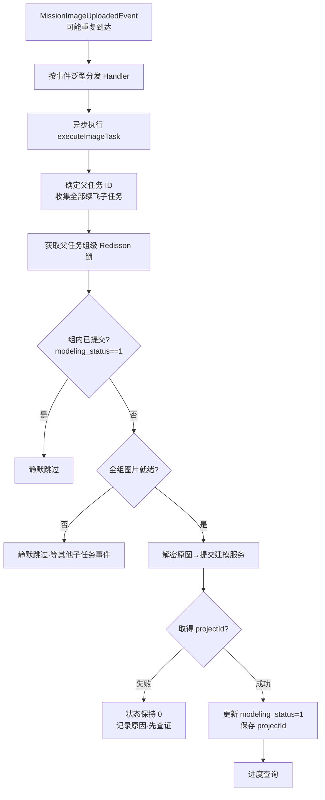

断点续飞后，一个业务建模任务可能包含父 Mission 和多个子 Mission。任何一个 Mission 图片上传完成都可能触发事件，但收到第一个事件时，其他子任务的图片不一定已经上传。如果直接建模，会出现图片不完整；如果每个事件都提交，又会重复创建多个建模服务项目。

当前实现以父任务 ID 作为任务组唯一代表，锁内完成两次关键判断：

1. 组内任一 Mission 的 `modeling_status == 1`，说明已成功提交，当前事件直接跳过。
2. 父任务及全部子任务必须满足图片上传就绪；断点续飞首次任务留下的 `TASK_CREATED` 回补记录不实际派飞，单独放行，避免永远阻塞。

通过校验后只收集原图，解密地址并提交建模服务。取得projectId后，当前代码先更新组内modeling_status，再保存区域的projectId；两步与远端提交不在同一个原子事务中。组锁防正常并发事件同时提交，状态检查防已记录成功的重复事件，不构成跨系统严格一次保证。

```text
正常：组锁→状态0且图片就绪→远端返回projectId→状态1→保存projectId。
窗口A：远端已创建项目，但响应丢失/状态落库前宕机→本地仍为0。
       下次事件再提交可能创建第二个项目，不能把超时当明确失败。
窗口B：状态1已保存，但projectId保存失败→重复事件跳过，进度关联缺失。
       当前代码报错要求管理员处理；不能宣称全部路径会自动恢复。
```

改进方案是让远端按稳定提交身份幂等创建并可查询，再持久化关联结果与对账事实。当前调用链未展示这样的远端幂等契约；响应未知时先查证并人工核对，不能把方案当成已实现能力。

本次核对的核心调用区分事件入口EVENT与用户入口USER，并另有业务触发来源。二者均执行组锁、去重和全组就绪校验；旧文档的FORCE绕过语义不能作为当前接口承诺。

- `EVENT`：图片上传事件自动触发；重复或未就绪时静默跳过，半自动任务仍等待用户操作。
- `USER`：用户操作入口，同样保留去重和全组就绪校验，拒绝原因反馈给用户。
- 重跑：须核对实际入口和重新提交身份；本次核对的核心流程没有FORCE跳过去重/就绪的分支。

### 面试官问：为什么不能收到图片上传完成事件就直接建模

> **记忆关键词：** 父任务聚合 → 组锁 → 全组就绪 → 状态去重；跨系统另查证

> 一个业务建模任务可能包含父 Mission 和多个断点续飞子 Mission，每个 Mission 都可能分别产生图片完成事件。收到其中一个事件只代表局部完成，不代表整个任务组图片齐全。如果立即提交，会出现缺图；如果每个事件都提交，又会重复建模。所以系统先按父任务聚合完整任务组，再在组锁内检查全组就绪和是否已经提交。

### 面试官问：为什么锁要按父任务 ID，而不是当前 missionId

> **记忆关键词：** 组稳定标识 · 入口收敛同锁 · 比子细防不住 · 比批次粗误伤
>
> 并发竞争发生在同一个父子任务组内。不同子 Mission 的 missionId 不同，如果分别加锁，多个事件仍可能同时通过校验并重复提交。父任务 ID 才是这次建模的业务幂等键，因此所有父子任务共用同一把组锁。
>
> 选父任务 ID 还有两层原因。一是入口收敛：不管事件来自哪条续飞腿，还是手动触发传了组内任意 missionId，`doModeling` 第一步都先归一化到 parentMissionId，所有并发入口必然落在同一把锁上；按子 missionId 加锁做不到这一点。二是粒度适中：比它粗的批次 taskId 会误伤——一个批次多个区域各自独立提交各自的山海经项目，本来就该并行，而提交环节含收集解密大量图片 URL 和一次慢 HTTP，按批次串行会把无关区域的提交白白堵住。反过来没有锁时，“检查 modeling_status”与“置 1”之间隔着收图和慢 HTTP，窗口很大，两个并发入口都读到 0、双双提交，同一组建出两个项目，projectId 相互覆盖。

### 面试官问：组锁防的并发具体从哪里来，真的会发生吗

> **记忆关键词：** 组内多事件 · 手动自动同路 · Kafka 重投 · 多实例

> 会发生，而且来源有四个。第一，组内父 Mission 和每条续飞腿传图完成都会各发一个 `MissionImageUploadedEvent`，这些异步任务在线程池里并发跑，操作同一个组的去重标记。第二，自动事件和手动触发会撞车：前端手动按钮走 `triggerModeling`，与自动链路进同一个 `doModeling`，用户点按钮时自动事件可能正在提交中。第三，事件上游是飞机或机库主动上报图片上传完成，由 open-api 服务内部投递到平台（发布方不在平台仓库内，事件类来自公共包）；同一完成动作若被重复上报或重复投递，事件就会重复到达。第四，服务多实例部署，两个事件可能落到不同实例上，JVM 内锁失效，所以必须用 Redisson 分布式锁。没有这把锁的后果是两个并发入口都通过 modeling_status 检查（置 1 只在提交成功后），双双提交山海经，同一组图片建出两个项目。

### 面试官问：tryLock 拿不到组锁为什么直接跳过，有什么代价

> **记忆关键词：** 即跳过是有意 · 持锁者替全组提交 · 残余窗口手动兜底

> 不等待是设计选择：后来者等锁没有意义——持锁者要么正在替全组提交（成功后后来者本该跳过），要么校验不过（未就绪或已提交）很快释放，由下一个到达的事件自然重试。代价是一个很小的残余窗口：持锁者读全组状态的时刻早于最后一条腿翻转到 IMAGE_UPLOAD_COMPLETED，而最后那条腿的事件恰好又在这时撞锁被跳过，两个入口都放弃，这一轮没人提交。兜底是手动触发；交接文档把“组锁被并发抢占（tryLock 即跳过是有意设计）”列为“山海经未自动触发”的排查项。要关死这个缝，可以让 EVENT 模式撞锁时短暂自旋重试一次再放弃。

### 面试官问：为什么必须提交成功后再更新 modeling_status

> **记忆关键词：** 远端返回 projectId → 标已提交 → 保存关联；远端/本地有窗口

> 提前标已提交会让明确失败被后续事件跳过；当前因此在获得projectId后才更新状态。但先调用远端也留下远端成功、本地仍为0的窗口，正常事件防重与跨系统幂等是两个问题。
>
> 明确拒绝可按契约处理失败；超时、断连和本地写入失败先标识结果未知并查证。当前调用链缺少可验证的远端幂等创建契约，不应宣传为自动重试即可保证一次。具体窗口回查1.8。

### 面试官问：事件入口和用户入口有什么区别，能绕过校验吗

> **记忆关键词：** EVENT 静默 · USER 反馈 · 两路同校验 · 当前无 FORCE 绕过

> 核对的核心流程使用EVENT/USER区分静默跳过与向用户反馈错误；两条路径都检查已提交状态、全组就绪和非空原图。半自动触发来源控制是否自动提交，是另一维度。源码注释中的“强制重跑”不能替代实现分支；当前核心方法没有FORCE绕过去重与就绪校验的逻辑。

**代码定位：** MissionOdmTaskRelationServiceImpl.executeImageTask/doModeling。** 八股扩展：** 组级幂等键、部分完成、远端受理身份与本地双写窗口。组成员ID在获取组锁前收集，锁内重查状态不等于重新收集最新成员；并发新增续飞成员的假设仍要核对。

## 1.9 v3 外部调度：谁拥有派飞权

**代码事实：** 创建批次时按样板间白名单写入 `dispatchMode`。后续根据批次已保存的模式分流，不每次重新读取白名单来改变存量任务归属。

| 阶段 | v2.5 / v3 SELF | v3 EXTERNAL |
| --- | --- | --- |
| 机库分配 | ModelingDockResolver 本地评分/优化 | SwarmDispatchService.assignDocks，保存 dockSn/droneSn/podType |
| 规划收口 | queueManager.onTaskPrepared | submitTaskGroup；成功后 markExecuting |
| 调度与补偿 | 样板间锁、候选筛选、区域 CAS | 本地候选、补偿及下发资格过滤排除 EXTERNAL |
| 暂停/继续/取消 | QueueManager 的样板间锁内操作 | 先调用远端，成功后更新本地标记 |
| 续飞 | 本地父子 Mission 执行链 | 创建 Mission 时关闭本地续飞开关，交外部闭环 |

### 面试官问：为什么配置变化只影响新批次

> **记忆关键词：** 归属固化 · 防双调度 · 存量跑完 · 灰度

一个运行中的批次不能因为白名单变化就同时被两个调度器接管。创建时固化模式，清空白名单只让新批次回到 SELF；存量 EXTERNAL 仍按原模式执行。这是调度所有权隔离，不是锁租约问题。

### 面试官问：有 taskId 就能证明外部服务提交幂等吗

> **记忆关键词：** 有身份≠有约束 · 查远端契约 · 未知结果对账

不能。taskId 出现在请求中只说明身份可传递；必须验证远端是否按身份原子去重、是否检查相同身份不同参数、能否查询原结果。SwarmClient 当前展示的是分配、提交、暂停、继续、取消接口，没有展示查询恢复入口，不能编造“超时后本地自动查询并恢复”。

### 面试官问：SELF 和 EXTERNAL 共存时还要考虑什么

> **记忆关键词：** 模式隔离≠物理资源隔离

两个模式不重复处理同一批次，但仍可能使用同一样板间的机库与空域。需要核对两个调度器共同的资源准入协议；仅有 excludeExternal 条件不足以证明物理资源互斥。远端调度器实现不在这两个分支的证据范围内。

**八股扩展：** 灰度切换的关键是持久化归属、存量兼容、回滚范围和远端受理语义。先远端后本地仍可能发生“远端成功、本地失败”，需要命令身份和对账，不能靠 HTTP 成功先后顺序构成分布式事务。


## 1.10 机库分配精读：先分清“规划绑定”和“执行占用”

这一节至1.15是面试重点精读。先读图和例子，再对着摘录复述，最后做追问。**主线始终是v2.5当前工作树**；v3 SELF沿用本地分配核心，EXTERNAL在入口改走外部机库分配。以下区域、机库名字和算例坐标都是教学数据，不是线上运行记录。

**记忆关键词：候选资格 → 规划绑定 → 航线/Mission准备 → 最新状态复检 → 空域准入 → 实际派飞。**

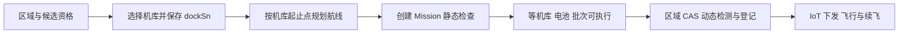

### 三种对象，三种不同的承诺

| 对象/动作 | 它承诺什么 | 它没有承诺什么 |
| --- | --- | --- |
| `task` | 一次建模批次，包含多个子区域 | 不独占样板间，也不归创建它的服务节点独占 |
| `taskArea.dockSn` | 这个区域计划使用哪个机库；据此确定规划起止点 | 不表示机库已经被领取、已经派飞、或现在只有这一个区域绑定它 |
| `missionId` | 已准备好的设备飞行任务 | 不表示设备已经接收或已完成飞行 |
| `dispatchStatus=DISPATCHING` | 当前区域行被一次条件更新领取，进入下发过程 | 不自动给其他区域行施加同机库唯一约束 |
| 活跃航线登记 | 统一碰撞服务能识别这条设备航线的占用 | 不等于命令幂等、尝试代际或旧执行者隔离 |

假设两个批次T1、T2都把区域绑定给D1，这是合法的规划结果：先准备两条从D1出发的航线，执行时再排队。同一机库能绑定多条待执行航线，不能把分配描述成“一机库只分一个区域”。真正需要避免的是**两条互不兼容的任务同时进入执行**。

绑定影响航线本身：`resolvePlanningDock`读取已分配机库，`buildPlanningPoint`用机库经纬度加建模精度对应的相对高度构造规划起止点。因此执行时临时换成另一个机库，不能只改dockSn就认为原航线仍有效；还需重新确认起止点、飞机、吊舱、航线和Mission的一致性。当前基础调度扫描主要等待既定机库恢复，没有自动做一次完整的跨库重规划。

### 候选机库到底怎样筛出来

调用链是`listPlanningDockCandidates → listPlanningDocksForCenter → listCandidateDocksForCenter → ShowroomService.getWaitingDock(..., false)`，然后由`ModelingDockAvailabilityServiceImpl`判断状态与吊舱。最后`hasRequiredPlanningDockData`检查SN、绑定飞机、经纬度。

| 检查层 | 实际代码行为 | 面试时怎样解释 |
| --- | --- | --- |
| 样板间与权限 | getWaitingDock按用户角色、机库范围、样板间查询 | 不是拿全公司所有机库直接按距离排序 |
| 搜索半径 | 使用区域中心点和配置的dockSearchRadius；DAO做范围过滤 | 是中心点附近候选，不能据此证明区域全部航点都在设备续航范围内 |
| 普通机库 | ONLINE且nestStatus为6或900，匹配机库吊舱配置 | 规划候选要有可用状态与合适能力 |
| 应急机库 | EMERGENCY且nestStatus为82，匹配配对飞机的吊舱 | 不能笼统说只有ONLINE才进入候选 |
| 吊舱编码 | 应急飞机等价码命中后返回机库侧规范码 | “能匹配”与“传给设备的编码正确”是两件事 |
| 基础数据 | SN、pairedDevice、经纬度非空 | 能规划之前必须知道起止位置和飞机绑定 |
| 下发就绪 | isDockReadyForDispatch还检查最大可用电池容量阈值 | 规划可用与现在可以派飞的条件并不完全一样 |

**指定机库是单独分支。** 当requestedDockSn不为空，`searchPlanningDock`检查存在、所属样板间、未删除、绑定飞机和坐标，并返回单元素候选；它没有重走自动候选的全部实时状态/半径/吊舱过滤。后续规划仍会解析吊舱，派飞前也会重新检查就绪与电池。答题不要把自动选择规则原封不动套到指定路径。

### 负载和忙碌惩罚并不是同一个数

`computePlanningDockLoad`统计PLANNING、READY、EXECUTING且未删除批次中的已绑定区域，排除航线、Mission创建或下发状态为FAILED的区域，按dockSn计数。查询没有额外按当前样板间过滤，靠各区域的dockSn聚合。**它统计任务记录数量，不是CPU负载、剩余飞行分钟、电量消耗或实时在飞机数。** 活跃批次中已飞完的区域也不在这里逐项扣除；因此这是一个粗略的规划负载代理。

`dockBusyExtra`则调用`isDockReadyForDispatch`：就绪为0，否则为1。在二维评分中，它按每个新分配区域累加。例如D3惩罚1且新分到两块区域，busyScore贡献2。自动候选可能满足规划状态，但电池不足导致这个惩罚为1。

两个并发批次可能读到同一份负载快照，再分别写入绑定；这会影响均衡质量。后面保存分配的本地事务只原子提交本批绑定，不会把“读负载—计算—写绑定”自动变成跨批次资源领取协议。**规划均衡的近似性与执行互斥的正确性要分开说明。**

### 面试官问：为什么先分配机库，再调度时还要重新判断

> **记忆关键词：位置依赖 · 时间变化 · 两类承诺。**
>
> 规划必须先知道从哪座机库出发、使用哪架飞机和吊舱，才能生成航线。但规划完成后可能排队、暂停或者等待充电，之前的状态会变化。所以规划绑定回答“计划由谁执行”，最终调度回答“现在是否能执行”。机库分配允许同库多个区域排队；执行时必须重新检查同库未结束链、设备与电池，并做空域准入。

### 面试官问：候选稀缺优先是不是先抢唯一名额

> **记忆关键词：无硬容量 · 决策顺序 · 保留灵活度。**
>
> 当前分配没有每机库只能分一个区域的容量限制，D1被分一次不会从后面候选中移除。候选少的先确定，让选择多的区域根据前面形成的负载与空间关系作调整；这是启发式顺序，不是抢名额。如果一个区域候选为空，先后顺序也不能凭空创造机库，只能等待重试或失败。

## 1.11 机库分配手算：三个机库、五个区域、四级评分

**先把目标写成四元组：S=(负载极差, 连接线严格交叉数, 忙碌惩罚, 总球面距离)。越小越好，按字典序逐级比较。** 它不是把四个指标乘权重加在一起。构造器虽然先接crossingCount，但真正优先级由compareTo决定。

**源码摘录 · `ModelingDockResolver.java` 第 423–438 行（v2.5当前工作树）：**

```java
@Override
public int compareTo(AssignmentScore other) {
    int compared = Long.compare(loadSpread, other.loadSpread);
    if (compared != 0) {
        return compared;
    }
    compared = Integer.compare(crossingCount, other.crossingCount);
    if (compared != 0) {
        return compared;
    }
    compared = Long.compare(busyScore, other.busyScore);
    if (compared != 0) {
        return compared;
    }
    return Double.compare(totalDistanceMeters, other.totalDistanceMeters);
}
```

例如S1=(1,3,2,8000)，S2=(2,0,0,2000)，代码选S1：第一项已经胜出，后面的交叉、惩罚、距离都不再比较。这意味着“先均衡”是严格优先级，不是“总体上大致比较重视均衡”。连接线交叉是分配阶段的软目标，不能用这种取舍直接裁决真实飞行安全。


### 把输入明确列出来

以下是便于画图的局部平面坐标，单位米。演算时映射到纬度约30°的经纬度，用源码同样的haversine公式算距离；图上距离仅表示空间关系。

| 机库 | 平面位置 | 已有规划负载 | busyExtra | 教学设定 |
| --- | --- | --- | --- | --- |
| D1 | (0,0) | 2 | 0 | 有两条存量记录，当前可派飞 |
| D2 | (1000,0) | 0 | 0 | 当前可派飞 |
| D3 | (2000,0) | 0 | 1 | 可参与规划，但当前电池未就绪 |

| 区域 | 平面中心 | 候选集 | 初始排序 |
| --- | --- | --- | --- |
| R1 | (200,600) | D1 | 1个候选，第一处理 |
| R2 | (400,1000) | D1、D2 | 2个候选，与R3按sort/id排序 |
| R3 | (1700,700) | D2、D3 | 2个候选 |
| R4 | (900,1400) | D1、D2、D3 | 3个候选 |
| R5 | (1600,1500) | D1、D2、D3 | 3个候选 |

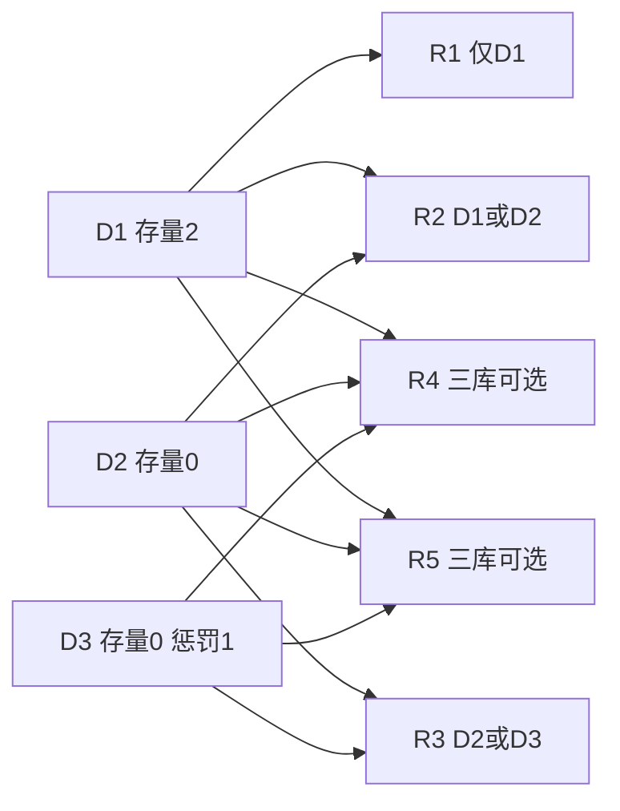

### 贪心不是“看当前区域最近的机库”

每轮把当前区域试放到一个候选，把**当前已分配的整个方案**重打分，保留最小方案。负载极差在本次候选机库并集上算，包含还没分到新区域的机库；不是只在本轮选中的机库之间比较。

| 轮次 | 各选择的有效负载(D1,D2,D3) | 决定本轮胜负的指标 | 选择 |
| --- | --- | --- | --- |
| R1 | D1→(3,0,0) | 唯一合法候选；极差3 | D1 |
| R2 | D1→(4,0,0)；D2→(3,1,0) | 极差4与3 | D2 |
| R3 | D2→(3,2,0)；D3→(3,1,1) | 极差3与2；即使D3惩罚1也先胜出 | D3 |
| R4 | D1→(4,1,1)；D2→(3,2,1)；D3→(3,1,2) | D1极差3被淘汰；D2/D3极差2、交叉0均相同，惩罚1与2 | D2 |
| R5 | D1→(4,2,1)；D2→(3,3,1)；D3→(3,2,2) | 极差3、2、1 | D3 |

最终新分配数量=(1,2,2)，加存量后=(3,2,2)，极差1，严格交叉数0，busyScore=2，haversine总距离约5516米。存量记录只进入负载，没有把它们的旧连接线与距离并入当前方案评分。R3、R5绑定D3可以先规划，**并不意味着低电量时立即起飞**；真正派飞仍会等电池。

这里还有一个很有价值的追问：如果实际要减小总工期，为什么用“条数极差”而不是“分钟数极差”？因为当前没有把每条航线预计耗时、面积、速度、换电和充电都建模成服务时间；两块区域条数相同不代表工作量相同。以预计剩余时长、设备能力与等待成本优化是可讨论的改进，不能说代码已经实现。

### 为什么还要搜索“移动”和“交换”

贪心每次只决定一个区域，后来的选择可能让先前决定变得不合适。局部优化反复考察：① 单个区域换到其候选机库；② 两个区域互换机库，且两边新机库都必须属于自己的候选集。**每轮取全邻域里最好的一次严格改进**，不是遇到第一个改善就立刻返回。

用两个机库、两个区域看交换的价值：D1=(0,0)、D2=(1000,0)，R1=(1000,1000)、R2=(0,1000)，无存量、无忙碌惩罚，两区域都允许两机库。初解D1→R1、D2→R2的负载=(1,1)，连接线交叉1。单独移动任何一个区域会变成(2,0)或(0,2)，极差从0变2，按第一目标被拒绝。**互换之后负载仍是(1,1)，交叉从1变0，因此接受交换**；图中平面总距离也由约2828米降为2000米。

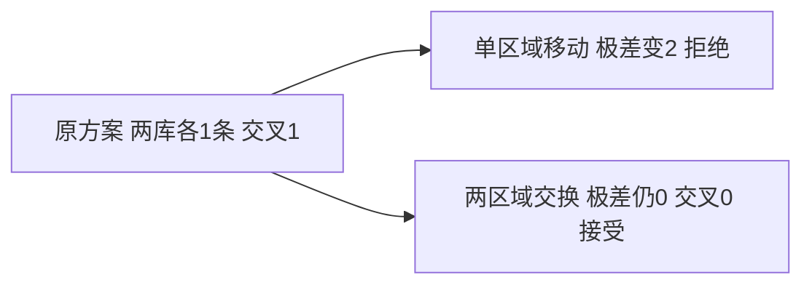

上限`max(4, 区域数×2)`限制优化轮数，无严格改善就提前停。本例五区域初解已没有更好的合法移动/交换，提前结束；并不是一定跑满10轮。有轮次上限不等于每轮便宜，更不等于达到全局最优。

### 面试官问：如何现场证明你的算法不是最近距离贪心

> **记忆关键词：四元组 · 全方案打分 · 严格优先级。**
>
> 我会先写compareTo，再举R3：已有负载(3,1,0)，分给D2变(3,2,0)、极差3；分给D3变(3,1,1)、极差2，因此选D3，即使它有忙碌惩罚。每次试放都对整个部分方案打分，而非只计算当前区域距离。这个优先级保证按当前启发式目标选择，不保证总工期最短。

### 面试官问：连接线没有交叉，为什么还可能发生碰撞

> **记忆关键词：代理指标 · 严格相交 · 完整航迹 · 动态占用。**
>
> 连接线只是机库到区域中心的线段，不包括区域内覆盖航迹、返航、时间、高度或偏航；scoreAssignment也只比较本批连接线。segmentsIntersect用两组叉积乘积严格小于0，只统计线段内部穿越，端点接触与共线重叠不计数，同机库两条线也跳过。因此交叉为0只能说明这个代理指标为0，飞行可行性还需最终统一碰撞准入。

## 1.12 机库分配源码逐步读：输入、试放、优化和事务

源码目录：`hushi-web/src/main/java/.../web/service/modeling/impl/`。摘录保留实际表达式；省略段落在正文说明。以下不是重新实现算法的伪代码。

### 第一步：调用者把“已分到”和“没分到”分开推进

**源码摘录 · `ModelingTaskServiceImpl.java` 第 217–229 行（v2.5当前工作树）：**

```java
ModelingDockResolver.PlanningDockAssignmentResult assignment = dockResolver.assignPlanningDocks(
        context.getTaskAreas(), context.getDockSn(), taskId);
log.info("建模首次机库分配结果 taskId={}, assignedCount={}, unassignedCount={}, assignedTaskAreaIds={}, unassignedTaskAreaIds={}",
        taskId, assignment.getAssignedAreas().size(), assignment.getUnassignedAreas().size(),
        assignment.getAssignedAreas().stream().map(ModelingTaskAreaEntity::getId).collect(Collectors.toList()),
        assignment.getUnassignedAreas().stream().map(ModelingTaskAreaEntity::getId).collect(Collectors.toList()));
CompletableFuture<Void> initialPlanning = submitAsyncRoutePlanningBatch(
        context, assignment.getAssignedAreas(), loginUser, "INITIAL");
CompletableFuture<Void> retryPlanning = scheduleDockAssignmentRetry(
        context, assignment.getUnassignedAreas(), loginUser, 1);
CompletableFuture.allOf(initialPlanning, retryPlanning)
        .whenComplete((ignored, throwable) -> completeAsyncRoutePlanning(
                context, loginUser, throwable));
```

已分配区域马上进入异步航线规划批次；未分配区域进入6秒间隔、最多2次的分配重试链。allOf等待两条链完成后统一收口。这是**一次初次分配加最多两次补尝试**，不要说总共只尝试两次。每次重试查数据库，只处理仍PENDING且没有dockSn的区域，避免重复处理已经推进的记录。

### 第二步：候选稀缺优先，逐个试放后评分

**源码摘录 · `ModelingDockResolver.java` 第 169–196 行（v2.5当前工作树）：**

```java
Map<Long, WaitingDockResp> assignment = new LinkedHashMap<>();
List<ModelingTaskAreaEntity> orderedAreas = new ArrayList<>(taskAreas);
orderedAreas.sort(Comparator
        .comparingInt((ModelingTaskAreaEntity area) ->
                candidatesByArea.getOrDefault(area.getId(), Collections.emptyList()).size())
        .thenComparing(ModelingTaskAreaEntity::getSort, Comparator.nullsLast(Integer::compareTo))
        .thenComparing(ModelingTaskAreaEntity::getId));
for (ModelingTaskAreaEntity area : orderedAreas) {
    WaitingDockResp bestDock = null;
    AssignmentScore bestScore = null;
    for (WaitingDockResp dock : candidatesByArea.getOrDefault(area.getId(), Collections.emptyList())) {
        if (dock == null || !docksBySn.containsKey(dock.getDeviceSn())) {
            continue;
        }
        assignment.put(area.getId(), dock);
        AssignmentScore score = scoreAssignment(
                assignment, areaPoints, docksBySn, dockLoad, dockPenalty);
        if (bestScore == null || score.compareTo(bestScore) < 0) {
            bestScore = score;
            bestDock = dock;
        }
    }
    if (bestDock == null) {
        assignment.remove(area.getId());
    } else {
        assignment.put(area.getId(), bestDock);
    }
}
```

`assignment.put`会覆盖当前区域上一次试放的机库，不会多留一份。每个候选评分都含前面已确定的区域，但不含后面尚未分配的区域。循环结束后把bestDock写回；无合法候选就移除当前区域。比较使用`<0`而不是`<=0`，完全相同分数保留先遇到的候选；区域排序有sort/id兜底，候选迭代顺序仍可能影响完全平分时的结果。

### 第三步：负载第一目标到底怎么计算

**源码摘录 · `ModelingDockResolver.java` 第 321–330 行（v2.5当前工作树）：**

```java
long minLoad = Long.MAX_VALUE;
long maxLoad = Long.MIN_VALUE;
for (String dockSn : docksBySn.keySet()) {
    long effectiveLoad = dockLoad.getOrDefault(dockSn, 0L)
            + assignedCount.getOrDefault(dockSn, 0);
    minLoad = Math.min(minLoad, effectiveLoad);
    maxLoad = Math.max(maxLoad, effectiveLoad);
}
long loadSpread = minLoad == Long.MAX_VALUE ? 0L : maxLoad - minLoad;
return new AssignmentScore(crossingCount, loadSpread, busyScore, totalDistance);
```

例如候选并集D1、D2、D3，已有负载(2,0,0)，只试放R1到D1，得到(3,0,0)，极差3。即使D2、D3当前没拿到新区域，它们仍进入min/max。距离与忙碌是本批assignment贡献，负载额外叠加数据库统计的存量。

同一方法先累加haversine距离、assignedCount和busyScore，再两两检查连接线交叉。`segmentsIntersect`是平面经纬度叉积方向判断，haversine则是球面两点距离，别把二者说成同一种距离公式。

**源码摘录 · `ModelingDockResolver.java` 第 336–347 行（v2.5当前工作树）：**

```java

private boolean segmentsIntersect(SpatialPoint firstStart, SpatialPoint firstEnd,
                                  SpatialPoint secondStart, SpatialPoint secondEnd) {
    if (firstStart == null || firstEnd == null || secondStart == null || secondEnd == null) {
        return false;
    }
    double firstDirection = direction(firstStart, firstEnd, secondStart);
    double secondDirection = direction(firstStart, firstEnd, secondEnd);
    double thirdDirection = direction(secondStart, secondEnd, firstStart);
    double fourthDirection = direction(secondStart, secondEnd, firstEnd);
    return firstDirection * secondDirection < 0D && thirdDirection * fourthDirection < 0D;
}
```

### 第四步：有界局部优化只接受严格改善

**源码摘录 · `ModelingDockResolver.java` 第 198–211 行（v2.5当前工作树）：**

```java
AssignmentScore bestScore = scoreAssignment(
        assignment, areaPoints, docksBySn, dockLoad, dockPenalty);
int maxRounds = Math.max(4, taskAreas.size() * 2);
for (int round = 0; round < maxRounds; round++) {
    AssignmentImprovement improvement = findBestAssignmentImprovement(
            orderedAreas, assignment, bestScore, candidatesByArea,
            areaPoints, docksBySn, dockLoad, dockPenalty);
    if (improvement == null) {
        break;
    }
    assignment.clear();
    assignment.putAll(improvement.assignment);
    bestScore = improvement.score;
}
```

findBestAssignmentImprovement里移动复制一份current，再替换一个区域的机库；交换复制一份，再替换两个区域。交换需要下面这些条件，既不能同机库交换，也不能把区域换到它不支持的机库。

**源码摘录 · `ModelingDockResolver.java` 第 253–277 行（v2.5当前工作树）：**

```java
for (int first = 0; first < areas.size(); first++) {
    Long firstAreaId = areas.get(first).getId();
    WaitingDockResp firstDock = current.get(firstAreaId);
    if (firstDock == null) {
        continue;
    }
    for (int second = first + 1; second < areas.size(); second++) {
        Long secondAreaId = areas.get(second).getId();
        WaitingDockResp secondDock = current.get(secondAreaId);
        if (secondDock == null || Objects.equals(firstDock.getDeviceSn(), secondDock.getDeviceSn())
                || !containsDock(candidatesByArea.get(firstAreaId), secondDock.getDeviceSn())
                || !containsDock(candidatesByArea.get(secondAreaId), firstDock.getDeviceSn())) {
            continue;
        }
        Map<Long, WaitingDockResp> trial = new LinkedHashMap<>(current);
        trial.put(firstAreaId, secondDock);
        trial.put(secondAreaId, firstDock);
        AssignmentScore score = scoreAssignment(
                trial, areaPoints, docksBySn, dockLoad, dockPenalty);
        if (score.compareTo(bestScore) < 0) {
            bestScore = score;
            bestAssignment = trial;
        }
    }
}
```

`score.compareTo(bestScore)<0`才替换当前最佳邻居，不接受平分方案，所以不会为同分来回晃动。不过存在同时移动三块区域才能改善的情况，而当前邻域只看单移动/双交换，这就是可能停在局部最优的原因。

### 第五步：二维兜底与保存绑定

区域坐标缺失时二维函数返回空方案；机库坐标缺失时先从二维候选并集中排除，无有效二维机库则返回空方案。外层只为未分配区域走buildLoadBalancedAssignment。**不是任意一座机库缺坐标就强制把整批二维方案都丢掉。** 正常自动候选此前已检查基础数据，缺数据兜底是防御性路径。

兜底也按候选数排序，但选机库的比较规则变成`存量负载+busyPenalty`，然后SN排序；每分一个区域就把内存负载加1。它没有二维交叉和距离目标，忙碌惩罚与负载在这一兜底里是相加，不能把二维字典序规则套过来。

**源码摘录 · `ModelingDockResolver.java` 第 105–110 行（v2.5当前工作树）：**

```java
TransactionTemplate tx = new TransactionTemplate(transactionManager);
tx.executeWithoutResult(status -> assignment.forEach((taskAreaId, dock) -> modelingTaskAreaDao.update(null,
        new LambdaUpdateWrapper<ModelingTaskAreaEntity>()
                .eq(ModelingTaskAreaEntity::getId, taskAreaId)
                .set(ModelingTaskAreaEntity::getDockSn, dock.getDeviceSn())
                .set(ModelingTaskAreaEntity::getUpdateTime, new Date()))));
```

事务保存后还会更新内存taskArea.dockSn，再返回assignedAreas和unassignedAreas。事务保证这批写库的提交/回滚边界，不校验机库排他占用、不冻结候选状态，也不把后续远端规划/碰撞/IoT纳入本地事务。

### 面试官问：这个算法复杂度是多少，为什么不能只说有界所以快

> **记忆关键词：候选数 · 全量评分 · 邻域枚举 · 实测。**
>
> 设n个区域、平均k个候选、m个有效机库。一轮评分有区域两两判交，约O(n²+m)。贪心约nk次评分；局部优化一轮有nk级别移动和n²级别交换，还带候选集校验与Map复制，最多max(4,2n)轮。粗略主项是O(nk(n²+m)+n(nk+n²)(n²+m))，候选成员检查若线性扫描还要额外计入成本。k固定且m同阶时最坏主项可到O(n⁵)。因此有界只是限制搜索，不代表大量区域时没有成本；应按候选数、评分次数、耗时和方案质量做测量，再决定是否增量评分或更换算法。

### 面试官问：为什么不是二分图最大匹配或匈牙利算法

> **记忆关键词：一对多 · 方案耦合 · 目标不独立。**
>
> 这里一个机库可以分到多块区域，负载极差依赖整个方案，连接线交叉又依赖两条分配边，不能直接当一对一、每条边固定代价的标准指派。可以通过容量展开、整数规划等重新建模，但不能只报一个算法名字就说已经解决。当前选择贪心加有限邻域搜索，是对实际目标和实现成本的折中。

## 1.13 调度源码精读：从触发入口走到真实派飞

**记忆关键词：多入口 → 全样板间扫描 → 两段锁 → 最新复检 → 区域CAS → 动态准入/登记 → IoT → 结果分类。**

### 调度由什么触发，队列存在哪里

| 入口 | 代码位置（v2.5工作树） | 为什么需要 |
| --- | --- | --- |
| onTaskPrepared | ModelingQueueManager第93行 | 航线与Mission准备完成，首轮调度 |
| reconcileActiveShowrooms | 第110行；@Scheduled在109行 | 漏事件、服务重启和遗留任务；默认fixedDelay120秒，各启用实例都可能执行 |
| onMissionFinished | 第131行 | 一条执行链结束后尝试补位 |
| onDockReady | 第155行 | 机库恢复、电池就绪后重新尝试 |
| 继续执行入口 | 恢复后调用scheduleShowroom | 批次从暂停恢复，重新参与扫描 |

这里的“队列”主要是数据库task/taskArea的状态和排序，候选列表是本次查询结果，**不是JVM里某个BlockingQueue持有全部飞行任务**。节点A创建T1，节点B补偿查询同一样板间的T1很正常；taskId用来定位批次，showroomId用来定位共享调度范围。

onTaskPrepared最后调用`scheduleShowroom(task.getShowroomId(), "PLAN_READY", null)`，而定时补偿也调用同一方法。它按样板间查READY/EXECUTING、未删除、未暂停的批次，批次按createTime/id排序；再查Mission创建成功、dispatch=PENDING、dockSn/missionId/routeCode完整且非终态的区域，按批次顺序、区域createTime、sort、id排序。因此一次触发可能推进其他批次，并不只调度传入taskId的区域。

### 第一段锁：先恢复遗留状态，再收集基础候选

**源码摘录 · `ModelingQueueManager.java` 第 618–627 行（v2.5当前工作树）：**

```java
List<ModelingTaskAreaEntity> reserved = executeWithShowroomScheduleLock(
        showroomId, roundSource, () -> {
    reconcileCancelledResumeChains(showroomId);
    reconcileStaleCancelledOccupancies(showroomId);
    if (roundReadyDockSn != null) {
        requeueUnstartedAreaAfterDockReady(roundReadyDockSn);
    }
    requeueStaleDispatching(showroomId);
    return reserveDispatchCandidates(showroomId, roundSource);
});
```

处理取消续飞链、取消占用、机库恢复、超时遗留，再reserveDispatchCandidates筛候选。**名字里有reserve，但当前方法没有把整个列表预写成DISPATCHING，也没有真正占住每个机库。** 第一段锁释放后，列表只是快照，其他节点可能先推进某条区域。

基础筛选先查同库未结束执行链，同库起飞超时重试候选优先于普通待发区域，再检查Mission和实时机库电池。碰撞检测留到真正下发前。没有阻塞的同一机库可能有两条PENDING同时进入列表；它们不会因为进入列表就一起发出。

### 第二段锁：逐条重读，不相信候选快照

dispatchTaskAreaRoute重新获取同一个showroom锁，调用doDispatchTaskAreaRoute。按顺序：重查最新taskArea → 已SUCCESS或非PENDING则跳过 → 检查批次未暂停/取消 → 检查其他区域的同库未结束链 → 检查Mission是否存在和仍可下发 → 检查设备/电池 → CAS领取。

检查同库执行链时会考虑续飞：原Mission返航不代表整条区域执行链结束；还要结合可执行子任务、活跃子任务与最新续飞腿。样板间范围会纳入取消批次残留占用的恢复处理。这里实现依赖持久状态与生命周期判断，不能简化成只看设备表的一个busy位。

**源码摘录 · `ModelingQueueManager.java` 第 1279–1284 行（v2.5当前工作树）：**

```java
int reserved = modelingTaskAreaDao.update(null, new LambdaUpdateWrapper<ModelingTaskAreaEntity>()
        .eq(ModelingTaskAreaEntity::getId, taskArea.getId())
        .eq(ModelingTaskAreaEntity::getDispatchStatus, ModelingDispatchStatusEnum.PENDING.getCode())
        .set(ModelingTaskAreaEntity::getDispatchStatus, ModelingDispatchStatusEnum.DISPATCHING.getCode())
        .set(ModelingTaskAreaEntity::getWaitReason, null)
        .set(ModelingTaskAreaEntity::getUpdateTime, new Date()));
```

这次UPDATE要恰好影响1行，才能继续。它把“这个区域当前仍是PENDING”变成数据库裁决，挡住同一状态下同一行被重复领取。**它的WHERE没有dockSn唯一约束，也没有attempt/version；不同区域同库竞争靠样板间锁与占用复检协调，旧调用恢复靠这一条CAS不能彻底解决。**

### 第三步：CAS之后仍要做空域动态准入

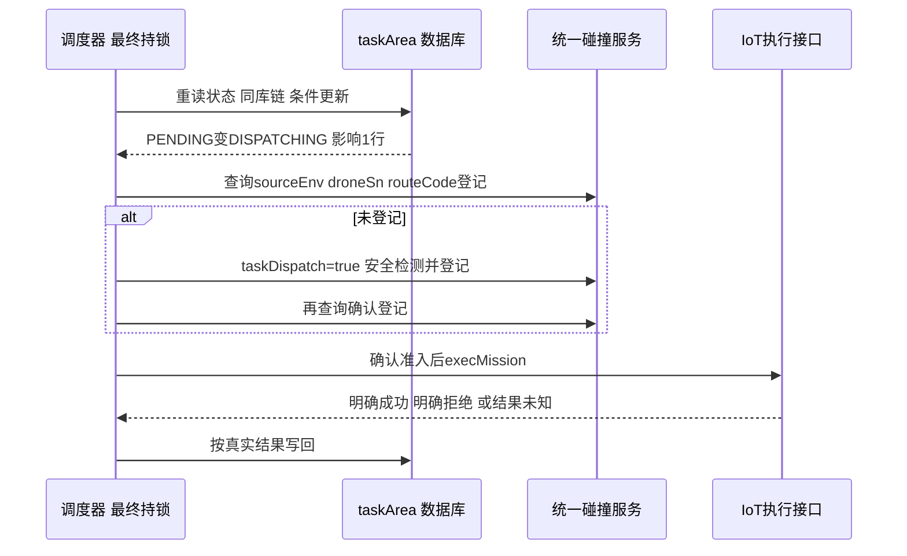

源码紧接CAS调用`checkAndRegisterBeforeDispatch(missionId, STANDARD_CHECK)`。该方法先验证任务/航线/飞机、样板间开关、sourceEnv与设备检测开关，然后按sourceEnv/droneSn/routeCode查活跃登记。已有登记直接复用；没有才进入检测和登记流程。

**源码摘录 · `MissionRouteSafetyServiceImpl.java` 第 140–163 行（v2.5当前工作树）：**

```java
CollisionCheckRequestParam checkParam = new CollisionCheckRequestParam();
checkParam.setDroneSn(drone.getDeviceSn());
checkParam.setRouteCode(route.getRouteCode());
checkParam.setTaskDispatch(true);
checkParam.setCheckHeight(true);
checkParam.setOverHeight(resolveShowroomHeightLimit(mission.getShowroomId()));
checkParam.setActiveRouteTtlType(activeRouteTtlType == null
        ? ActiveRouteTtlType.STANDARD_CHECK.getCode() : activeRouteTtlType);
com.ikingtec.hushi.common.utils.Result checkResult = checkRouteSafety(checkParam);
if (checkResult == null || !Objects.equals(
        checkResult.getFlag(), com.ikingtec.hushi.common.utils.Result.FLAG_SUCCESS)) {
    return checkResult == null
            ? com.ikingtec.hushi.common.utils.Result.error("航线安全检测响应为空")
            : checkResult;
}

Result<Boolean> registeredResult = collisionWarningGateway.activeRouteExists(queryParam);
if (registeredResult == null || !Objects.equals(registeredResult.getFlag(), 0)
        || !Boolean.TRUE.equals(registeredResult.getData())) {
    log.error("建模任务下发前活跃航线登记未确认，missionId={}, droneSn={}, routeCode={}",
            missionId, drone.getDeviceSn(), route.getRouteCode());
    return com.ikingtec.hushi.common.utils.Result.error("活跃航线登记未确认");
}
return checkResult;
```

taskDispatch=true让统一服务把当前派飞占用纳入检测/登记。创建Mission时则taskDispatch=false，只做静态模型/障碍与限高，不因排队提前占空域。检测接口技术降级可能返回允许，派飞专用方法又查一次登记，查不到或查询失败就不继续IoT。

正常错误返回中：永久模型/障碍碰撞或超高→FAILED；临时活跃冲突、服务不可用或登记未确认→释放区域DISPATCHING到PENDING并记录waitReason，等待后续事件/补偿。显式disableSafetyDetection样板间存在直接放行路径，已有登记复用也不会重新跑整套检测；因此“每次派飞一定完整检测所有项”不符合代码。

客户端发出“检测并登记”请求不等于已经证明远端原子性。若碰撞服务内部先查占用再单独写入，两个其他业务调度器仍可能一起通过；需要远端在共享资源边界原子裁决。这是服务端契约要求，当前仓库只能证实客户端调用与确认。

### 第四步：先设置图片上传模式，再尝试IoT，再分类写回

准入成功后setDockImageUploadMode同时处理设备和Mission快照，让建模使用落库后上传。真正进入execMission前设置dispatchAttempted=true，用它区分“还没尝试下发”和“可能已经产生远端副作用”。

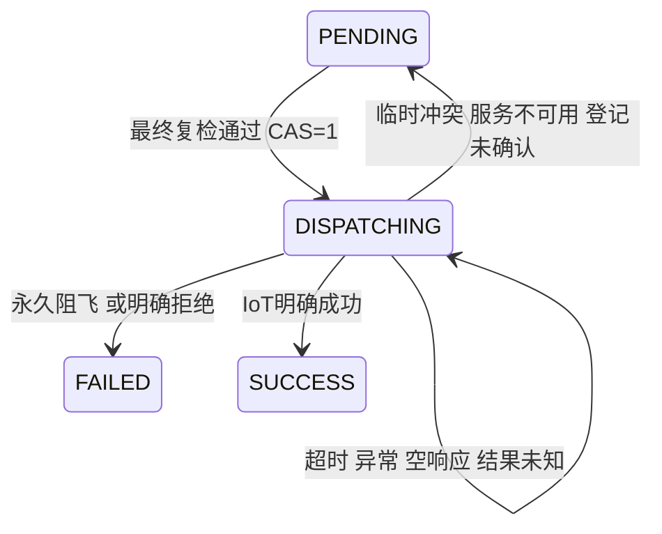

成功写SUCCESS，表示下发成功，**不是飞行完成**。明确拒绝清理活跃登记并写FAILED；IoT异常或空响应保留DISPATCHING和活跃登记，不在HTTP异常时贸然释放。外层catch也区分dispatchAttempted：未尝试时清理并FAILED，已经尝试则保留未知。所以“所有接口错误都回PENDING”“所有失败都删登记”都不正确。

### 第五步：本轮补位不是无限重试

候选for循环会继续尝试后面的区域；检查出某条明确FAILED后，scheduleShowroom再做基础扫描，给此前被同库优先关系挡住的候选补位，最多同步32轮。临时等待与结果未知不驱动无限同步重扫；其后由完成、机库就绪、继续和定时补偿推进。32是同步失败补位预算，不是机库分配2次重试，也不是起飞超时2次重发预算。

### 面试官问：为什么两段都要锁，候选阶段加一次锁不够吗

> **记忆关键词：快照会旧 · 最终副作用 · 同库跨行。**
>
> 第一次锁保护恢复和候选收集，释放后不保证名单仍可下发。每条真正派飞前再拿同一把样板间锁，重读区域、批次、同库执行链、Mission和电池；条件更新领取后做最新空域准入再调用IoT。第二段把多入口对同库、跨区域资源的正常竞争串起来，CAS再挡同一行重复领取。锁失效和旧执行者仍是另外一层问题。

### 面试官问：只按机库加锁，碰撞检测交给统一服务，能否缩小锁粒度

> **记忆关键词：设备资源 · 空域资源 · 原子裁决 · 接口时延。**
>
> 可以作为重构方向，但先验证统一碰撞服务是否原子完成检测与登记、是否覆盖所有参与者。同库还需要明确的资源归属和尝试代际；锁外IoT要有执行端fencing/幂等。只把showroom锁替换成dock锁，跨机库空域和超时恢复的竞态不会自动消失。当前先用较粗范围协调，代价是同一样板间一次网络调用慢会挡住其他派飞判断。

## 1.14 用一轮调度讲透：同库串行、跨库并飞、等待与补偿

### 四条区域的真实顺序怎么走

教学场景：同一样板间，较早批次T1有R1→D1、R2→D2，较晚批次T2有R3→D1、R4→D3。所有区域已准备Mission、PENDING，机库电池就绪。假设实际routeCode对应的R1/R2航迹互不兼容，R4与R1兼容。这里的冲突来自完整航迹准入结果，不由区域是否重叠推断。

| 步骤 | 代码读取或动作 | 区域结果 | 为什么后续还能走 |
| --- | --- | --- | --- |
| 首轮扫描 | 尚无DISPATCHING/SUCCESS未结束链，得到R1、R2、R3、R4 | 都只是候选 | 没有在名单生成时整体领取 |
| 尝试R1 | 最终锁、复检、CAS、登记成功、IoT成功 | R1=SUCCESS，D1链未结束，航线活跃 | 派飞临界区完成就解锁，飞机继续飞 |
| 尝试R2 | D2可用，CAS成功；统一服务发现与R1活跃航迹冲突 | R2回PENDING，记录空域等待 | 本轮循环continue，不会让它阻塞全部候选 |
| 尝试R3 | 最终复检看到R1占D1，即使首轮名单没看见 | R3保持PENDING，同库等待 | 没抢区域CAS，也没有发送第二条D1命令 |
| 尝试R4 | D3可用且与R1兼容，登记并下发成功 | R4=SUCCESS | D1与D3两架飞机此后可以同时飞 |

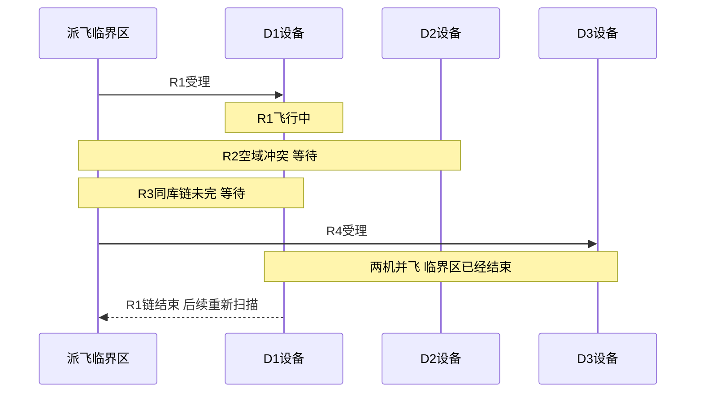

**锁串行的是“检查和发送过程”，不是让所有飞行串行。** 若R1的execMission耗时2秒，其他进入同showroom最终锁的派飞判断要等这2秒；一旦解锁，R1实际飞10分钟，也不要求D3等10分钟才能飞。飞行期间的排他与兼容性靠持久执行链、活跃登记和状态，不靠把Redis锁一直持有到降落。

### R1结束之后，是不是一定立刻发R2和R3

完成监听先尝试清理R1活跃登记，再调度全样板间。若R1没有未完成续飞腿且设备电池恢复，D1可释放给R3；R2要重新与**当前全部有效活跃登记**比较，R4可能仍在飞，也可能形成新冲突。完成事件不保证“后面所有任务现在都安全”，所以每次准入要重算最新条件。清理失败、状态滞后、电池不足都会继续等待。

批次公平性也要说准确：查询优先早批次及区域顺序，同库起飞超时任务有优先权，但不满足资格的候选可以跳过，较晚批次的兼容任务仍可执行。因此它不是“整个T1彻底完成才允许T2开始”，也不是保证每条任务固定时间内得到服务的严格公平调度。

### 按等待原因定位，不要看到PENDING就说调度没跑

| 观测组合 | 优先追查的证据 | 正确处理方向 |
| --- | --- | --- |
| PENDING + 同库链等待 | blockingTaskAreaId、父Mission、可执行续飞子Mission及当前状态 | 判断整链是否真正结束；别只改区域为成功 |
| PENDING + 电量不足 | nestStatus、dockStatus、maxBatteryCapacity和阈值 | 等机库就绪；候选绑定还在 |
| PENDING + 活跃冲突 | sourceEnv、droneSn、routeCode、blockType和登记TTL | 区分真实占用与清理滞后；不能无证据删正在飞的登记 |
| PENDING + 登记未确认 | routeSafeCheck响应、两次activeRouteExists结果 | 查询/服务故障不当安全，恢复后再准入 |
| DISPATCHING + IoT结果未知 | 同一次调用的trace/返回、Mission/设备接收事实 | 查询或可靠撤销后对账；未知不当明确失败 |
| SUCCESS + 没起飞 | Mission是否ALREADY_RECEIVED、起飞超时、机库状态 | 下发与起飞分层处理，不把SUCCESS当飞完 |

最有用的关联字段是taskId、taskAreaId、showroomId、dockSn、missionId、routeCode、source与waitReason。将“候选数→最终复检阻塞数→CAS成功数→准入阻塞类型→IoT明确/未知结果”分层统计，才能区分算法分配问题、锁等待、设备等待和碰撞服务等待。

### GC和恢复为什么仍是面试重点

正常流程中，B看到A已经DISPATCHING，会跳过同一行；看到同库执行链，也会等待。要产生重复发送，不能只说“锁到期了，所以B一定重复执行”，还要说清恢复如何把旧状态重新开放。

具体推演：A已CAS并确认登记，在execMission前长暂停；看门狗无法及时续期，锁到期。B的补偿进入，达到下发超时阈值且Mission仍WAITING，当前requeueStaleAreaToPending把区域回PENDING，B再CAS、可能复用同一三元组活跃登记并下发。A恢复后原栈继续，也下发。锁到期、状态回退、远端登记复用、旧栈续执行共同形成窗口；**默认两分钟回退阈值与实际Redis锁TTL不是同一个值，补偿执行时间还受fixedDelay和持锁时长影响**。

现有代码对普通超时保留未知占用是一种防护，但后续超时恢复仍可能重新开放，不能说系统已彻底避免重复。对应改进分三层：数据库attempt/epoch阻旧回写；机库和空域的原子资源归属阻跨行双领；副作用入口执行端fencing阻旧主人，稳定commandId幂等阻同一命令重复。处于UNKNOWN时先查询或确认撤销，再释放。详细代码与时序见第2周2.7、2.8。

### 面试官问：两个批次区域不重叠、机库不同，为什么还要等

> **记忆关键词：锁等待 · 资源等待 · 航迹不等于区域。**
>
> 两次调度进入同样板间临界区会短暂互斥；拿到锁以后，如果完整航迹兼容、设备就绪，就可以分别下发并行飞，不需要等别的批次飞完。区域不重叠只描述作业范围，去程、返航仍可能穿越同一空域。先区分拿不到锁、设备不可用、空域冲突，再判断这种等待是否合理。

### 面试官问：能不能直接把超时任务改FAILED，然后发下一条

> **记忆关键词：超时非失败 · 副作用未知 · 释放需证据。**
>
> IoT可能已经受理，只是响应丢失。把状态改FAILED并释放登记，会让下一条同库或冲突航迹获得机会，而旧命令仍可能执行。应查询设备/IoT受理状态，或通过可靠撤销确认旧命令不能再执行，再更新资源归属。当前代码保留结果未知，但基于本地状态的自动回退仍是需要加强的边界。

## 1.15 面试复述与八股扩展：能讲机制，也能指出边界

### 被问“机库怎么分配”时的90秒回答

> **记忆关键词：资格 · 存量 · 字典序 · 试放 · 移动交换 · 规划绑定。**
>
> 先按样板间权限、区域中心搜索半径、设备状态、吊舱和基础数据建立每区域候选集，指定机库单独校验。然后统计活跃批次各机库已绑定区域数量作为存量负载，获取派飞就绪0/1惩罚。区域按候选数、sort、id排序，逐个试放候选机库，对当前整体方案算四元组：负载极差、二维连接线交叉、忙碌惩罚、总haversine距离，按字典序选择。先得到贪心初解，再枚举单区域移动和合法双区域交换，每轮取最好严格改进，最多max(4,2n)轮；没有二维有效结果的区域走负载均衡兜底。最后事务保存dockSn，已分配开始规划，无候选的做有限延迟重试。
>
> 这是规划绑定，一座机库可以绑定多块区域；连接线交叉也只是代理目标。算法不保证全局最优或最短总工期，真正派飞仍要重新判断同库执行链、机库电池和最新空域安全。

### 被问“多机库怎么调度”时的2分钟回答

> **记忆关键词：多入口 · 数据库队列 · 两段锁 · CAS · 登记 · 结果未知 · 补位。**
>
> 规划完成、任务完成、机库就绪、继续及定时补偿都汇入样板间调度。数据库保存队列状态，扫描整个样板间可执行批次，按批次和区域顺序拿已创建Mission的PENDING区域。第一段样板间锁做遗留恢复和基础筛选，释放后候选只是快照。每条派飞前再次加同一把锁，重查区域状态、批次暂停取消、同库未结束链、Mission和电池，UPDATE WHERE PENDING把该区域领取成DISPATCHING，影响1行才继续。
>
> 当前v2.5接着走统一碰撞服务，已有登记复用，未登记时检测并登记，再查询确认，只有放行后才调用IoT。永久静态阻飞标失败，临时活跃冲突回PENDING等待；IoT明确成功记SUCCESS，明确拒绝清理登记并失败，异常/空响应保留未知占用。逐条循环还能尝试后面的兼容机库，明确失败会有限轮次重新扫描补位；事件和定时补偿共同恢复。
>
> 临界区串行不等于飞行串行，同库链没结束要等，不同库且航迹兼容可以同时飞。Redisson协调跨区域共享资源，CAS只领取同一行；长GC、状态回退和旧调用仍有重复发送窗口，需要代际、资源归属、执行端fencing与幂等分别完善。v3 SELF的本地JTS组合筛选、EXTERNAL的外部派飞是另外两条实现，不能混入当前v2.5回答。

### 把项目问题转成原理问题

| 面试官继续追问 | 项目切入口 | 需要说清的原理和边界 |
| --- | --- | --- |
| 贪心和动态规划的区别 | 机库试放与历史主轴单调方案 | 贪心只选当前方案最优；DP要定义状态/转移并证明子结构，历史DP也是在简化目标内求解 |
| 字典序和加权和怎么选 | 负载极差严格先于交叉 | 字典序表达不可交换优先级；加权和要处理单位/尺度，低优先级累计可能反压高优先级 |
| 为什么局部最优不等于全局最优 | 单移动/双交换邻域 | 三块联动或先变差再改善的路径不在当前严格改进搜索里；上限还可能提前截断 |
| CAS和ABA | PENDING→DISPATCHING→PENDING | CAS只知道现在又是PENDING，不知道代际；UPDATE加attempt/version才能区分旧尝试 |
| 数据库隔离级别、MVCC | 候选快照与最终条件更新 | 一致性快照用于读；设备状态仍在变化，远端副作用也不随MySQL事务回滚 |
| 分布式锁与AQS | showroom的Redisson锁 | JVM等待队列与跨进程Redis锁作用域不同；watchdog是租约续期，不能阻止旧栈恢复 |
| 幂等与fencing | 设备重复命令与旧主人 | 幂等按动作键去重复；fencing按资源代际拒绝旧主人；检查必须由实际副作用边界执行 |
| 事件为什么还需要补偿 | 完成/就绪事件及Scheduled | 事件降低响应延迟，补偿处理漏信号/重启；二者会并发，需要共享裁决和持久事实 |
| 死锁与锁粒度 | 当前一个样板间键，未来多个资源键 | 多资源固定顺序/原子领取防循环等待；粗锁易推理但持有网络调用影响吞吐 |
| 安全性与活性 | 不乱派飞与最终能推进 | 保留UNKNOWN提高安全，查询/对账提高活性；盲目超时释放会用活性换取错误并发 |
| 图论组合优化 | v3 SELF旧冲突矩阵/安全集合 | 冲突图可表达兼容性，按机库分组保证每库一条；当前v2.5顺序动态准入没有全局搜索 |

### 面试官问：如果让你改进，优先做算法还是并发安全

> **记忆关键词：事实先行 · 正确性边界 · 瓶颈数据。**
>
> 先查真实瓶颈与故障：记录分配耗时、候选数、下发临界区RTT、同库/空域等待及结果未知比例。存在重复执行风险时，先补执行幂等、资源归属/代际和未知对账，避免拿效率换错误执行。若主要慢在每轮全量几何评分，考虑增量计算；若主要慢在设备充电或远端RTT，换更复杂分配算法未必有收益。没有线上统计就不承诺提升倍数。

### 面试官问：不同版本具体区别，能不能画一条线说明

> **记忆关键词：当前工作树 · SELF历史筛选 · EXTERNAL派飞权。**
>
> v2.5当前工作树：本地负载/空间启发式分配→并行规划→静态创建检查→顺序逐条动态碰撞登记确认→IoT。v3当前提交SELF：本地分配核心相同，但保留JTS对占用和候选两两冲突筛选、按机库分组搜索；最终派飞未接新增checkAndRegisterBeforeDispatch。v3 EXTERNAL：分配入口转Swarm assignDocks，准备后submitTaskGroup，派飞权归外部，本地队列通过模式守卫排除。模式隔离本批控制权，不代表两个模式的实际设备/空域天然隔离。

### 三道现场推演，答案必须沿着代码讲

### 面试官问：首轮名单里同机库出现两条区域，是不是一定同时下发

> 不会仅因进入名单就同时下发。当前reserveDispatchCandidates没有整体CAS占库。第一条最终锁内下发后形成DISPATCHING/SUCCESS未结束链，第二条拿最终锁复检时会看到同库阻塞，保持PENDING。如果第一条明确失败并释放后，第二条则可能继续；这就是必须做最终复检的原因。这个结论依赖正常锁协调，不能外推为锁失效后的无条件保证。

### 面试官问：D3电量不足但分配评分选了它，是算法错误吗

> 要先看是否符合规划资格。busyExtra只是第三目标，前面负载极差或交叉更好就可能选电量未就绪的规划候选。它可以准备航线并等待设备恢复；最终派飞检查电池会挡住。所以不是低电量照样起飞，但这种策略是否拖慢总工期需要数据评估，条数均衡也不等于时间均衡。

### 面试官问：临时碰撞失败后，是重新给它分一个机库吗

> 当前正常错误分支releaseDispatchReservation回PENDING并记录等待，没有自动重新分配dockSn、重做航线和Mission。下一次再按既定任务与最新空域准入。如果要支持跨库改派，需要完整重规划与任务一致性流程，不能只改一个字段。明确永久阻飞则FAILED，和等待资源释放分开。

---

## 第 1 周速记

```text
先报版本：v2.5工作树已接入碰撞中心；旧提交/v3 SELF仍有JTS
创建：createOrUpdateModelingMission→静态检查，taskDispatch=false，不登记
下发：最终复检→区域CAS→checkAndRegisterBeforeDispatch→查证登记→IoT
查询登记已有则复用；新检测返回成功还要再次查证
当前准入：按顺序尝试，临时冲突继续后续候选，不保证全局最优
模型/超高失败；活跃冲突或未确认等待；IoT未知保留占用
完成先清理，起飞续签，TTL兜底不等于安全执行证明
统一碰撞登记不等于命令幂等或fencing，GC/ABA边界仍要理解
历史JTS：米制折线距离、冲突矩阵、分组搜索；版本对照而非当前主线
下游：父子图片组→组锁→就绪/去重→远端项目→状态→projectId
```

# 第 2 周：并发控制、任务预占与分布式一致性

这一周是重点。每个结论都回答五件事：**谁并发、共享什么、在哪裁决、故障后谁还能继续、最终副作用由谁防重** 。

## 2.1 任务从哪里来：没有第二个用户请求也会竞争

**代码事实：** 控制器创建并持久化任务；规划通过 `CompletableFuture` 执行；规划收口调用 `onTaskPrepared(taskId)`。taskId 是数据库批次身份，不是分配给某个节点的队列消息。

| 入口 | 实际调用 | 为什么会与其他入口相遇 |
| --- | --- | --- |
| 规划完成 | finalizeDispatchStatus → onTaskPrepared → scheduleShowroom | 收口回调与后台补偿可能并发 |
| 定时补偿 | reconcileActiveShowrooms → scheduleShowroom | 每个启用调度的实例各有本地定时方法；未见集群选主 |
| 飞行完成 | @EventListener → onMissionFinished → scheduleShowroom | 处理状态并推进下一轮 |
| 机库就绪 | onDockReady → scheduleShowroom | 电池/待命条件变化带来新机会 |
| 用户继续 | resumeTask → doResumeTask → scheduleShowroom | 恢复普通候选及续飞链 |

```text
用户只创建一次任务 T
节点 A：规划收口 → onTaskPrepared(T) → scheduleShowroom(S)
节点 B：定时扫描发现 S 有活跃任务 → scheduleShowroom(S)
两者查询同一数据库、同一样板间的候选，可能包含 T 和其他 task。
```

`@EventListener` 默认并不等于新开线程，也不等于自动跨节点广播。并发来自实际的异步回调、Web 请求、定时线程和不同 JVM。`@Scheduled(fixedDelay=120000)` 是本次执行结束后再延迟默认两分钟，不是集群全局每两分钟恰好执行一次。[Spring 调度说明](https://docs.spring.io/spring-framework/reference/integration/scheduling.html)。

### 面试官问：我的服务收到任务 X 到底是什么意思

> **记忆关键词：** 持久任务 · 多入口重扫 · 无节点归属

在这段代码里，更准确的说法是“一个入口开始调度样板间”。规划完成拿 taskId 找 showroomId；补偿直接找活跃 showroomId；它们都扫描该范围内的可派区域。不存在“创建任务的节点以后独占它”的查询条件。

### 面试官问：为什么顺序代码还会并发

> **记忆关键词：** 单调用顺序 · 多调用交错 · 多 JVM

for 循环只规定本次调用内部先后。两个节点各有自己的方法栈，能够同时执行 SELECT、计算、UPDATE。线程池也只是规划执行器，不负责集群互斥。

## 2.2 共享资源是什么：机库、空域和占用事实

**共享资源** 是机库使用权与航迹对应的空域使用权；任务行、Mission 行和续飞链记录是它们的占用依据。task 是逻辑批次，可以跨批次共享同一 dockSn。

```text
竞争同库：A(task1,dockX)、B(task2,dockX) 都看见空闲。
竞争空域：A(dockX)、B(dockY) 的航线接近，机库不同仍不能一起飞。
没有物理冲突：不同库、航迹安全，但样板间粗锁仍串行两次调度调用。
```

锁键为 `modeling:airspace:dispatch:{showroomId}`。它让遵守协议的节点轮流决策；它不让飞机停止，也不把任务表自动变成物理世界的真值。

### 面试官问：为什么按样板间而不是 task 加锁

> **记忆关键词：** 跨批次同库 · 跨机库空域 · 一个决策范围

按 task 加锁时，两个 task 分别拿各自锁仍可争同一机库。样板间锁覆盖跨批次候选和占用视图；全局锁会阻塞独立样板间。旧版JTS只查相应样板间的建模占用；当前v2.5跨业务活跃航线由远端准入协调，锁仍不自动覆盖不遵守协议的业务。

### 面试官问：机库和区域都不同也会被阻塞吗

> **记忆关键词：** 调度串行 · 发送串行 · 飞行可并行

会等待同一样板间的调度临界区，尤其是最终下发中的远端调用。下发完释放锁后，兼容任务可以开始飞行，无需等上一条飞完。不能把锁粒度解释成“同样板间只能一架飞机飞”。

### 面试官问：只改成机库级锁能提高并发吗

> **记忆关键词：** 多资源约束 · 统一裁决 · 固定顺序

机库锁只能解决同库占用，不能解决跨库航迹冲突。细化需要同时设计空域准入、候选归属和原子资源领取；多资源加锁还要固定顺序避免死锁。可以优化，但不能只替换字符串。

## 2.3 实际锁范围：选择和最终下发并非一个连续临界区

以下按v2.5当前工作树保留调用顺序，省略日志与异常处理：

```java
List<ModelingTaskAreaEntity> selected = executeWithShowroomScheduleLock(
    showroomId, source, () -> {
        reconcileCancelledResumeChains(showroomId);
        requeueStaleDispatching(showroomId);
        return reserveDispatchCandidates(showroomId, source);
    }); // 这里已经释放锁；selected 没有写成 DISPATCHING

for (ModelingTaskAreaEntity area : selected) {
    dispatchTaskAreaRoute(area, source, showroomId); // v2.5当前工作树
    // 内部重新拿同一个样板间锁 → doDispatchTaskAreaRoute → CAS → 碰撞准入 → IoT → 释放锁
}
```

| 范围 | 保护的动作 | 仍要注意 |
| --- | --- | --- |
| 第一段锁 | 取消收敛、超时恢复、基础候选与同库占用读取；旧提交/v3还有JTS组合 | 解锁后候选只是快照，尚无下发资格 |
| 两段之间 | 遍历已选对象 | 其他调度可能进入并改变占用 |
| 每条最终锁 | 重读区域、批次开关、同库链、Mission、机库电池、条件更新、IoT | 远端耗时放大锁等待；当前v2.5这里调用统一碰撞准入；v3提交版未重查JTS |
| SELF 控制锁 | 暂停、继续、取消的 QueueManager 操作 | 与最终发送互斥，但不是对设备的撤销保证 |

### 面试官问：为什么筛选阶段不立即写 DISPATCHING

> 候选是基础可派资格，设备和活跃航线仍可能变化。当前v2.5在最终阶段CAS后做碰撞准入，未确认时释放这次预占等待；已调用IoT且结果未知时保留。筛选、占用领取、远端登记与真实发送是四个不同动作。

### 面试官问：有最终复检是否所有资源都安全了

> **记忆关键词：** 当前有动态准入 · v3旧链不同 · 外部原子性仍核对

> v2.5当前工作树最终方法在区域CAS后、IoT之前调用checkAndRegisterBeforeDispatch，已把实时空域准入放入最终持锁段；不能再说当前完全没有最终空域检查。
>
> “最终没有重查JTS、两段间空域快照会旧”的分析适用于v3 SELF已提交路径与v2.5旧提交，不能套到已接入的新工作树。新路径仍需核对碰撞服务检测/登记的原子性、登记复用、TTL及旧请求；登记确认不代替执行端fencing。

### 面试官问：能否把 IoT 移到锁外缩短持锁时间

> **记忆关键词：** 先持久领取 · 外部准入 · 未知占用不能回收

可以设计，但必须先在短临界区持久化资源归属及发送意图，其他任务以该归属判占用；发送后按归属回写，未知结果保留占用。简单移出锁会允许暂停、取消和其他调度插入，还可能让旧指令在资源已转交后执行。

## 2.4 数据库条件更新：只裁决这一行这一次

**代码事实：** ModelingTaskAreaEntity 的表名为 `ik_modeling_task_area`。核心 SQL 语义如下，省略更新时间与等待原因：

```sql
UPDATE ik_modeling_task_area
SET dispatch_status = 'DISPATCHING'
WHERE id = :taskAreaId AND dispatch_status = 'PENDING';
```

只有更新一行才继续调用 IoT。对同一行、没有回退的竞争，A 成功后 B 会看到不再满足 PENDING；但对不同任务行，A 和 B 都能成功。

```text
单行：UPDATE area1 WHERE PENDING → A 得1，B 得0。
跨行：UPDATE area1 WHERE PENDING → 1；UPDATE area2 WHERE PENDING → 1。
      即使 area1、area2 同机库，单行条件都不表达“同机库无其他占用”。
```

这是 CAS 思想的乐观并发裁决，InnoDB 实现更新时仍会获取数据库锁，不能称为 CPU CAS 或“完全无锁”。[InnoDB 锁说明](https://dev.mysql.com/doc/refman/8.4/en/innodb-locking.html)。

### 面试官问：为什么锁和条件更新同时用，单用不行吗

> **记忆关键词：** 锁协调跨行 · 条件守本行 · 外部另防

锁串行化当前协议中的多任务决策，条件更新让数据库最终裁决这条任务的旧状态。只用本行条件更新不够表达跨任务机库和空域约束；只依赖租约锁则没有持久状态裁决和重复处理依据。可以采用其他正确协议，例如持久资源行加短事务与唯一约束，但不能删掉一层后让同样的普通查询自动具有原子性。

### 面试官问：如果失败影响零行，应该不断重试吗

> **记忆关键词：** 业务冲突≠瞬时技术故障

先重读原因。已领取、取消、完成时应停止这次发送；数据库死锁或版本冲突是否可重试要按操作语义决定。批次聚合 updateForward 会重读并有限重试，说明“状态条件失败一律放弃”和“version 冲突一律重试”都过于绝对。

### 面试官问：数据库锁能替代 Redisson 吗

> **记忆关键词：** 公共资源行 · 短事务 · 外部非原子

可以用同一 showroom/dock 资源行的 SELECT FOR UPDATE 或条件占用串行化数据库决策，关键是所有竞争者锁同一份资源。只锁各自 taskArea 行仍无共享互斥。不要在数据库事务中长时间等 IoT；事务提交和远端执行之间还需要身份、查证与幂等。

## 2.5 Redisson：等待时间、租约、看门狗与线程归属

**代码事实：** 样板间调度使用 `getLock` 和无租约参数的 `lockInterruptibly()`，走看门狗续期模式；不是固定 20 秒租约。父区域建批是另一把锁，使用 `tryLock(1000,20000,MILLISECONDS)`，最多等 1 秒，租约 20 秒。

| 用途 | 锁键后缀 | 实际调用 | 解释 |
| --- | --- | --- | --- |
| 子区域替换 | area:split:{parentId} | tryLock(3000,MILLISECONDS) | 最多等 3 秒，没有显式 leaseTime |
| 同父区域建批 | task:create:{parentAreaId} | tryLock(1000,20000,MILLISECONDS) | 等 1 秒，固定租约 20 秒 |
| 同航线创建 Mission | mission:create:{routeCode} | lockInterruptibly() | 可中断等待，无显式租约 |
| SELF 样板间调度及控制 | airspace:dispatch:{showroomId} | lockInterruptibly() | 候选与最终阶段分别获取 |
| 父子组提交建模 | 组前缀 + parentMissionId | tryLock() | 立即尝试；失败按 EVENT/USER 静默或反馈 |

看门狗周期延长 Redis 中锁的到期时间，降低业务尚未结束却因固定租约失效的风险；客户端无法及时续期时仍会过期。官方默认 watchdog 超时 30 秒，实际部署值、依赖版本与续期参数本次未核实。[Redisson 官方锁说明](https://redisson.pro/docs/data-and-services/locks-and-synchronizers/)。

### 面试官问：为什么 finally 检查 isHeldByCurrentThread

> **记忆关键词：** 防错误解锁 · 不停止旧业务

RLock 所有权绑定客户端和线程。当前 finally 只允许本线程释放，避免解掉别人接手的锁。这个检查发生在业务执行后，阻止错误解锁，不阻止锁已过期的 A 恢复后继续发送。

### 面试官问：lockInterruptibly 能终止已发送的设备指令吗

> **记忆关键词：** 中断等待 · 协作取消 · 设备回执

它允许加锁等待被中断。Java 中断是协作信号，不自动撤销已经运行的逻辑或远端已接收指令；捕获 InterruptedException 要恢复中断标志或传递取消，真正设备停止需要设备协议及回执。

### 面试官问：getLock 是公平锁吗，业务顺序是否有保证

> **记忆关键词：** 普通锁 · 候选排序 · 公平非完成顺序

代码使用普通 getLock，没有使用 getFairLock。获得锁的顺序与任务候选排序是两件事；即便锁公平，也不能保证任务完成顺序或解决不可飞队头。候选等待时长和任务饥饿仍需观测。

## 2.6 重复触发和结果未知：防重的保证范围

入口可以重复执行；在锁有效、状态未被回退、各写路径遵守协议时，后进入者重读非 PENDING 状态，跳过同一任务。**重复触发** 不等于上游一定按 at-least-once 投递，本次只确认代码存在多个触发源，MQ/MQTT 的具体送达契约须单独核对。

IoT success → SUCCESS；明确拒绝 → FAILED；异常/空结果 → 留在 DISPATCHING 并记未知。未知不是业务失败：可能指令没发出、已接收但响应丢失、已执行但本地未记录。

### 面试官问：为什么不能遇到超时就重试

> **记忆关键词：** 超时非未执行 · 稳定身份 · 查证再重发

调用方没有响应只能证明自己没看到结果。若设备已执行，再发就是重复副作用。需要按稳定业务身份查询或由执行端幂等；当前两分钟回退只是恢复策略，不能单凭 WAITING 证明没收到。

### 面试官问：Lua 或单行 CAS 能保证设备恰好执行一次吗

> **记忆关键词：** 状态原子≠外部效果原子

它们在各自数据存储裁决读写，不与网络和设备动作构成一个原子提交。消息可以重复、回调可以迟到，执行端要有身份去重及可查询结果；本地状态同步还需要对账。

### 面试官问：事件和补偿并发时怎么处理

> **记忆关键词：** 同锁重读 · 同行条件 · 回退另论

正常情形争同一 showroom 锁，后入者重新读取候选和占用，同一行 CAS 防重复领取。若旧执行者停顿后失去锁、任务又被补偿退回 PENDING，这个保证前提已破坏，必须按下一节推演。

## 2.7 长 GC 场景：逐行说明旧调用为什么还能继续

**故障推演：** 前提是A在条件更新成功后、`execMission`之前停顿；当前v2.5可将暂停点放在碰撞登记已经确认之后；续期中断使锁到期；B 有调度机会，观测任务更新时间已超过默认两分钟且 Mission 仍 WAITING，设备与批次条件也允许下发。不是每次 GC 都会满足这些前提。

```text
t0  A：规划完成 → scheduleShowroom(S) → 最终锁
t1  A：UPDATE area1 PENDING→DISPATCHING，影响1行
    当前v2.5：完成碰撞检测及登记确认，尚未execMission
t2  A：长暂停，尚未调用 execMission；Redis 续期停止，锁过期
t3  B：定时补偿 → 取得 S 的锁
t4  B：requeueStaleDispatching 见超时且 WAITING
       requeueStaleAreaToPending：DISPATCHING→PENDING
t5  B：最终 CAS PENDING→DISPATCHING 成功 → execMission(mission1)
t6  A：恢复，原方法栈仍在 → execMission(mission1)
       A 不会自动重新从方法入口检查状态，也不会因锁已过期被 Java 强停
```

| A 停在哪 | B 的动作 | 单行 CAS 是否足够 |
| --- | --- | --- |
| A 尚未 CAS | B 先 CAS，且状态保持 DISPATCHING | A 再 CAS 得0，停止 |
| A 已 CAS，未达到回退阈值 | B 看见已有占用 | 通常保留占用，无法由此证明所有旁路安全 |
| A 已 CAS，B 超时回退后再 CAS | 新旧两次尝试都可能发送同一 Mission | 不够；A 已通过的 CAS 不会被撤销 |
| A/B 领取不同 taskArea、竞争同库 | 两个 taskArea 各自更新1行 | 不够；需要共享资源裁决 |

统一登记的sourceEnv/droneSn/routeCode不含尝试代际；同Mission重发可能复用已有登记，不会自动撤销A的旧发送资格。任务状态经历PENDING→DISPATCHING→PENDING，形成**ABA风险** ；A 已经领取后的旧执行权限也没有被隔离。`updateDispatchSuccess/Failed` 按 routeCode 回写，没有携带尝试代际条件，旧结果也可能覆盖新尝试的记录。

两次发送是否造成两次真实起飞，取决于 IoT/设备幂等和忙碌拒绝契约。本次核对到 commonExecMission/execMissionV4 的调用边界，未验证设备端行为，不编造它已经有去重。

### 面试官问：不是有看门狗，为什么长 GC 还会有这个问题

> **记忆关键词：** 续期要运行 · Redis 独立计时 · 旧栈继续

STW 暂停期间客户端业务与续期线程无法正常推进，而独立 Redis 服务仍会让 TTL 到期。网络隔离、进程被挂起也可产生类似窗口。短暂停通常可在剩余租期内恢复，但不能凭默认 30 秒推出绝对安全。[Redis 分布式锁官方边界](https://redis.io/docs/latest/develop/clients/patterns/distributed-locks/)。

### 面试官问：只有一个用户请求为什么 B 也能进来

> **记忆关键词：** 任务持久化 · 节点独立补偿 · 同资源重扫

用户创建一次后任务就存在共享数据库。A 的规划回调和 B 的定时方法是两个执行入口，不需要用户再点一次；即使单个实例的定时执行顺序不重叠，也不限制另一 JVM 的规划回调。

### 面试官问：为什么在调用前检查一次锁不够

> **记忆关键词：** 检查后可暂停 · TOCTOU · 接收端裁决

A 检查持锁=true，下一行前暂停；B 接手；A 恢复发送。这仍是检查到动作之间的竞态。加检查能减少窗口，不能强制旧操作在远端失效。调大 TTL、降低 GC 同样是概率缓解。

## 2.8 怎么解决：数据代际、资源归属和执行端防护

**改进方案，未在这两个分支实现。** 需要分开解决数据库旧写入、资源重复分配和外部重复动作，不能只加 version 就宣布全部安全。

| 手段 | 能解决什么 | 仍解决不了什么 |
| --- | --- | --- |
| taskArea attempt/version 条件回写 | 拒绝旧尝试覆盖新状态，检测 ABA | 旧线程仍可能发送网络请求 |
| dock/showroom 资源归属 + 单调 epoch | 在短事务中裁决共享占用，释放必须带 owner/epoch | 设备不校验 epoch 时旧命令仍可能执行；机库行不覆盖跨库空域 |
| 执行入口原子校验 fencing token | 新归属生效后拒绝旧代际请求 | 不撤销已接收/已起飞动作，仍要保存占用直到结束 |
| 稳定 commandId 幂等 | 同一业务操作重发返回同一受理/结果 | 不拒绝不同 commandId 争同一资源，也不替代授权 |
| UNKNOWN + 查询/撤销确认 | 未知时保守保留占用，再按事实恢复 | 下游无查询或确认能力时可能需要人工介入 |

```text
数据库：dockX owner=T, epoch=41；下一次接管原子更新到42。
回写/释放：WHERE dock=X AND owner=T AND epoch=41 → 新归属已变，影响0行。
设备执行入口：资源已接受42后，携带41的迟到请求被原子拒绝。
同一命令再次到达：commandId 相同、参数一致 → 返回原结果，不重复执行。
```

fencing 校验必须在真正接收并裁决执行的边界生效；应用先查 DB，再发 HTTP 仍有窗口。执行侧接收命令、更新代际/命令去重记录与后续动作的衔接也要可靠，不能只存一条“成功”缓存。普通 RLock 不携带这套完整协议。

若设备能力暂不支持，保守路径是将超时占用作为 UNKNOWN，查询 Mission/设备执行事实或取得可靠撤销确认后再释放；查询“还未看到”也不等于旧请求不可能晚到。不能证明旧命令不再执行时，保持占用并人工查证，接受可用性损失。

### 面试官问：只用数据库条件更新是不是也可以

> **记忆关键词：** 将不变量落到公共资源 · 同行不是跨行

可以设计为共享资源行的原子领取和释放，配合任务尝试与发送意图的短事务。不变量必须由数据约束表达，并覆盖所有竞争路径；当前 taskArea 条件更新没有这样表达。外部执行和空域协调仍要单独解决。

### 面试官问：fencing 和幂等有什么区别

> **记忆关键词：** 旧主人拒绝 · 同命令去重

fencing 管谁还有权使用资源，commandId 管同一个动作是否已处理。新主人执行另一命令不能让旧主人继续操作；同主人因响应丢失重发也不能执行两次。两者互补，既不能以任务ID代替资源代际，也不能每次重试生成新幂等键。

### 面试官问：不自动回退会不会卡住

> **记忆关键词：** 安全与可用性取舍 · 可查询恢复 · 人工兜底

可能暂时等待，因此需要 UNKNOWN 的监控、截止时间和对账入口。超时触发调查，而不是提供“设备没执行”的证据。自动接管只有在旧命令已可靠失效或执行端可隔离旧主人时才可承诺安全；不能用一个大超时掩盖不确定性。

## 2.9 队头阻塞、公平性与粗锁吞吐

`findDispatchCandidatesForShowroom` 不是只拿 sort 最小的一条，而是扫描全样板间候选，再过滤当前资源。当前v2.5逐条动态准入；旧提交/v3 SELF还搜索组合。不可飞队头能被跳过，但旧提交/v3 SELF的组合目标也会改变选择，当前顺序准入同样受扫描顺序影响，不能承诺先到先服务。

### 面试官问：怎样区分队头阻塞与锁阻塞

> **记忆关键词：** 候选不可飞 · 临界区等待 · 两类延迟

队头阻塞是候选策略让可飞后续任务无法入选；锁阻塞是另一个调用持有同一样板间锁。当前扫描候选并逐条准入改善前者；旧提交使用组合筛选，粗锁和锁内 IoT 仍可能造成后者。分别记录候选等待原因、锁等待、持锁时间和远端耗时。

### 面试官问：怎样验证这个并发方案

> **记忆关键词：** 同任务 · 跨任务 · 旧执行者 · 未知结果

至少覆盖：同一行并发 CAS；不同 task 同库领取；两段锁间空域变化（当前v2.5由最终远端准入处理；v3旧链需重查）；CAS 后暂停再超时回退；设备已接收但响应丢失；旧结果回写；暂停取消与下发竞争；续飞子任务晚生成；EXTERNAL 提交未知。正常多线程压测不能替代这些定点交错场景。

## 第 2 周速记

```text
入口：规划完成 / 完成事件 / 机库就绪 / 继续 / 定时补偿；不需第二次用户请求
资源：跨 task 机库 + 跨机库空域；状态是占用观测
锁范围：筛选一段 + 每条最终下发一段；当前v2.5最终做碰撞准入，v3旧提交未重查JTS
正常同任务：状态未回退时只有一方 CAS 成功
不同任务：各自 CAS 能成功，不表达同机库互斥
看门狗：降低提前失效风险，长暂停仍可能过期；finally 不会杀旧调用
GC：A已CAS→暂停→B回退PENDING并重发→A恢复继续；ABA与旧权限
解决：尝试代际管旧写、资源epoch管归属、执行端fencing管旧主人、commandId管重发
UNKNOWN：先查证/可靠撤销，再放资源；时间到了不是未执行证明
调度串行 ≠ 飞行串行；粗锁吞吐与安全正确性分开分析
```

---

# 第 3 周：状态机、事件补偿与断点续飞

## 3.1 为什么状态要分层

一个建模批次包含多个区域，每个区域又经历航线生成、Mission 创建、下发、飞行和续飞。一个 status 无法同时表达所有事实。

当前状态层次包括：

### 批次状态

```text
PLANNING → READY → EXECUTING → COMPLETED / PARTIAL_FAILED / FAILED
                           ↘ CANCELLED
```

### 区域航线和 Mission 创建状态

```text
PENDING → SUCCESS / FAILED
```

### 下发状态

```text
PENDING → DISPATCHING → SUCCESS
                      ↘ FAILED
                      ↘ CANCELLED
```

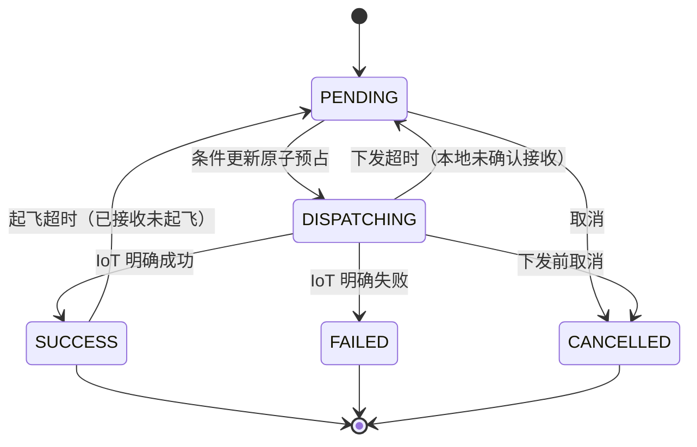

其中下发 SUCCESS 只表示设备下发链路成功，不表示飞行完成。真实飞行进度仍以 `Mission.status` 及续飞子 Mission 为准。

### 面试官问：为什么不能只使用一个任务状态

> **记忆关键词：** 批次 · 规划 · Mission · 下发 · 飞行；分层事实再聚合

> 批次、区域规划、Mission 创建、下发和真实飞行是不同层次。如果把它们压进一个字段，很容易把“航线生成成功”“任务下发成功”和“飞行完成”混为一谈。分层后每个状态只表达一个阶段事实，批次状态由区域和 Mission 状态聚合，更容易恢复和排查。

### 面试官问：批次状态具体怎么聚合的

> **记忆关键词：** 明细聚合 · PARTIAL_FAILED · updateForward · 旧状态条件 · 终态粘滞

> refreshTaskStatus 重新读取区域与 Mission，全部终态时无失败为 COMPLETED、有成功有失败为 PARTIAL_FAILED、全失败为 FAILED；未全部终态时按执行活动、规划收口计算 EXECUTING/READY/PLANNING。不能漏掉两个分支都有的 PARTIAL_FAILED。
>
> 状态写入经 updateForward：重读批次、限制阶段不倒退和终态不改成另一终态，再带旧 status 做条件更新，冲突有限重试。markExecuting、markFailed、markCancelled 也会调用同一写入方法，所以“所有状态只能通过 refreshTaskStatus 写”并不准确。
>
> 这是投影聚合及单向约束，不是所有字段不可变：同态 failReason 等仍可能更新；终态粘滞也不证明原判定一定正确。需要对账证据和纠错入口，不能用“已终态”替代设备真值。

**八股扩展：** 有限状态机、聚合投影、单调推进与条件写入。状态码单调不证明观测无误；PARTIAL_FAILED是部分成功终态，不是执行中间状态。

## 3.2 为什么不引入状态机框架

本地调度已经在使用状态机思想：显式状态、合法转移和前置条件。是否引入框架是实现取舍，不要求事件天生不重复，也不要求真值只能来自本系统；重复、乱序、持久化与对账本来就需要围绕状态模型设计。

### 真值在设备侧

数据库记录设备状态的观测与业务处理事实，设备真实行为仍在远端。状态机可以处理多个事件来源，但必须明确转移规则、观测时间和并发裁决；设备事实同步与事件去重不会因引入框架自动完成，也不会因此禁止使用状态机。

### 事件会丢失、重复、乱序

事件可能漏、重、乱序，单靠收到一次事件向前推进会留下恢复缺口。当前SELF用事件及时推进，再按持久状态定时对账；这是状态模型的恢复机制，可与显式转移表或状态机框架并存。需要持久事实、重复处理与终态规则，不应把“对账”与“状态机”当成互斥架构。

### 状态是跨节点共享的持久状态

Spring Statemachine提供状态上下文持久化、JPA/Redis/MongoDB相关集成及分布式状态扩展，不能概括成只能单实例内存。项目若引入它，仍需把设备副作用、数据库并发裁决、恢复扫描与框架转移正确衔接；分布式扩展的成熟度和部署成本需按版本评估。

[官方持久化与分布式状态文档](https://docs.spring.io/spring-statemachine/docs/current/reference/)用于核对框架能力；这不构成推荐当前项目立即迁移。

### 批次状态是聚合投影

`task.status`按区域明细汇总并施加单向/终态约束，是业务聚合投影；区域dispatchStatus则直接表达可回退的生命周期。可以让框架管理合法转移，聚合计算和设备对账仍需要业务代码。本项目保持现有实现，理由应落在接入成本与维护收益，而非断言框架无法表示聚合状态。

### 哪里用到了状态机思想

区域 `dispatchStatus` 是一张真实的状态图，而且含回退和循环：下发超时 DISPATCHING/SUCCESS 回退 PENDING，起飞超时重试也是 SUCCESS 回 PENDING 再下发。当前实现的转移规则分散在多个更新方法里，靠每个调用点自己写状态条件保证合法。合理的演进方向是显式转移表：FROM、TO、前置条件、动作，收敛到唯一转移入口；同时把现在编码在 failReason 文本里的重试次数（"第N/2次"再字符串解析还原）改成显式计数字段。这是把状态机当建模工具用，而不是引入引擎当架构。

### 面试官问：为什么不直接引入 Spring Statemachine 这样的框架

> **记忆关键词：** 现有规则/对账 · 框架适配成本 · 持久化可集成 · 副作用仍查证

> 当前SELF已用状态字段、条件更新、聚合与对账处理任务生命周期。引入框架可以集中转移规则与动作，但需要适配数据库状态、设备回调和既有补偿，不能自动消除远端副作用不确定性。
>
> 现阶段可先收敛转移入口和显式重试计数，减少规则散落；若规则与跨阶段动作继续增长，再评估框架的验证、持久化及维护收益。这个取舍不依赖“事件必须可靠且不重复”或“框架只能内存”的错误前提。

### 面试官问：那什么系统适合状态机模型

> 订单、审批、设备任务都可以用状态机表达合法生命周期，事件也可能重复和乱序。是否采用框架主要看转移规则数量、动作编排、可视化/测试需求及持久化集成成本。
>
> 例如支付成功通知重复到达，可以通过事件去重、合法转移和条件写入做到重复不再次入账；支付通知来自外部并不妨碍使用状态机。任务调度也可显式建模，同时保留设备查询和定时对账。

**八股扩展：** 状态模型是业务定义，框架是实现工具。持久化、事件去重、合法转移和设备对账都需设计；选型理由应落在维护收益，不要说框架不能持久化。

## 3.3 事件驱动加定时补偿

Mission 完成事件可以释放机库和空域，机库就绪事件可以恢复未实际起飞任务并推进队列。事件驱动能够快速开始下一轮。

设备消息、网络、处理异常和服务重启可能漏掉推进机会。当前 SELF 的 fixedDelay 默认在上次补偿执行结束后延迟两分钟，扫描 READY/EXECUTING 且未暂停的样板间，再进入同一个调度入口。多实例各有调度方法，当前没有展示集群选主；v3 查询还排除 EXTERNAL。暂停任务或扫描失败不在“下一次必恢复”的承诺内。

### 面试官问：为什么有事件还要定时任务

> 事件降低正常等待时间，补偿重读持久事实弥补漏触发。共用入口、锁和条件更新处理正常重复；锁失效、回退后旧执行者和设备确认缺失仍需查证。不能把“有补偿”说成所有故障自动恢复或所有重复都安全。

**八股扩展：** fixedDelay/fixedRate、每实例定时与集群单执行、事件通知与持久事实、补偿扫描覆盖范围。入口幂等必须限定状态世代与执行端契约，不能只背“事件快、补偿稳”。

## 3.4 下发超时和起飞超时

系统根据 Mission 状态区分不同问题：


### Mission 仍为 WAITING

WAITING表示当前持久化记录尚未确认设备接收，不证明设备一定未收到。现有SELF代码超过默认两分钟后回退PENDING并重新调度，这是恢复策略；安全性仍依赖设备任务身份、状态同步与重复指令的契约，不能由时间阈值和本地状态单独证明。

### Mission 已经 ALREADY_RECEIVED

说明飞机已经收到任务，但没有在默认五分钟内进入飞行。此时标记为起飞超时重试，优先重新下发同一个任务。

普通起飞超时最多自动重试两次，耗尽后转为 FAILED，避免无限循环。

### 面试官问：为什么 WAITING 和 ALREADY_RECEIVED 不能使用同一种恢复方式

> WAITING 是本地没有记录接收；ALREADY_RECEIVED 是已记录设备接收。当前前者超过下发阈值回退，后者按起飞超时及预算优先重发同一个任务，但两种观测都要核对设备契约。WAITING 并不是可以安全重发的充分条件，GC 与 ABA 时序见 2.7。

### 面试官问：两分钟和五分钟的阈值怎么定，回退 PENDING 安全吗

> **记忆关键词：** 确认延迟 · 起飞耗时 · 实测阈值 · 本地 WAITING 非未送达证明

> dispatch-stale-timeout-ms与takeoff-stale-timeout-ms默认两分钟、五分钟，是异常恢复配置，不是证明远端未执行的时限。需要根据设备确认、起飞耗时和回调延迟的实测分布设置。
>
> 当前SELF在样板间锁内按Mission状态回退并走最终复检；这防正常本地竞争，但WAITING可能由迟到/漏回调造成，ALREADY_RECEIVED的重发也要依赖设备语义。应注入“已接收、确认丢失”“回退后旧请求晚到”等窗口，核对同任务重发是否幂等；不能仅凭锁与条件更新宣称重试安全。

**八股扩展：** 超时不是失败、故障检测不是事实证明、ABA与旧执行者、有限重试和UNKNOWN。普通WAITING下发回退没有套用起飞“最多两次”的计数，不能说所有自动重试统一有两次上限。

## 3.5 断点续飞

父 Mission 因电量等原因未完成整条航线时，会产生续飞子 Mission。调度和完成判断不能只看父 Mission，否则可能出现：

- 父 Mission 已返航，但续飞子任务仍在等待。
- 把父任务误判为完成，提前释放机库或触发建模。
- 续飞子任务卡住后，错误地重新下发父 Mission，导致从头重复飞行。

当前实现会查询父 Mission 的续飞子任务，并只处理最新且未结束的子 Mission。续飞下发或起飞超时后，重试当前子 Mission，而不是重新下发父 Mission。

### 面试官问：断点续飞最关键的防重点是什么

> **记忆关键词：** 父子链 · 资源仍占用 · 只恢复最新子任务 · 不重发父任务

> 必须区分父 Mission 和续飞子 Mission。存在未结束续飞链时，父区域仍然占用机库和空域；恢复时只能重试最新待执行的子 Mission，不能把父 Mission 退回 PENDING 再从头下发。

### 面试官问：为什么机库、电池或航迹冲突等待不应消耗续飞重试次数

> 外部条件等待与真正再次尝试发送是两种动作。当前v2.5的续飞也调用统一碰撞准入；旧提交/v3 SELF使用本地航迹判断；等待不烧起飞重试预算，符合条件后仍有有限发送重试。重试预算不能提供幂等保证。

**八股扩展：** 父子任务聚合、资源占用生命周期与当前执行腿身份。只重试最新子Mission需要正确的排序和归属；父任务返航不是整条链完成。v3 EXTERNAL关闭本地续飞，不能套这段SELF解释。

## 3.6 暂停

暂停的业务语义不是让正在飞行的无人机立即停下，而是：

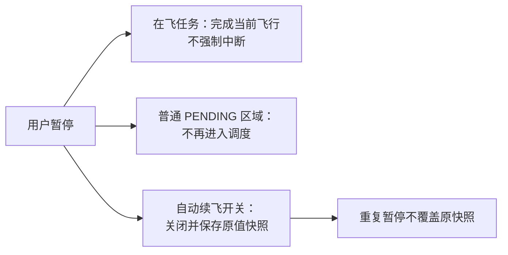

- 已经在飞的任务完成当前飞行。
- 普通 PENDING 区域不再进入调度。
- 不再自动启动新的续飞腿。

系统把批次 `paused` 条件更新为 1，并关闭每个父 Mission 的自动续飞开关。首次暂停时保存原开关快照，重复暂停时不会用已经临时关闭后的 0 覆盖原值。

### 面试官问：为什么暂停不强制终止在飞任务

> 无人机强制中断涉及飞行安全和设备能力，修改数据库状态并不能安全让飞机停下。当前暂停语义是阻止后续调度和新续飞腿，让在飞任务自然结束，风险更可控。

**八股扩展：** 暂停意图、物理副作用、快照与幂等。重复暂停保留原开关是业务幂等；它不是已起飞任务撤销，也不隔离锁失效后的旧发送。

## 3.7 继续

继续操作按下面顺序执行：

1. 恢复父 Mission 的自动续飞能力。
2. 对仍为 WAITING 的最新续飞子任务重新触发。
3. 每成功恢复一个区域，就清理对应暂停快照。
4. 所有续飞链处理成功后，最后把批次 paused 从 1 更新为 0。
5. 重新触发样板间调度，推进普通 PENDING 区域。

逐条清理快照的设计使继续操作可以重试：已经恢复成功的不会再次触发，失败的仍保留快照作为补偿依据。

### 面试官问：继续执行到一半失败怎么办

> 继续操作不是一次性把所有快照清空。每个续飞链恢复成功后才清理自己的快照，失败区域仍保留原快照；批次 paused 也要等所有恢复成功后才解除。因此再次调用继续时，可以跳过已完成部分，补偿未完成部分。

**八股扩展：** 部分成功可重入、逐项持久化与补偿。外部恢复成功、快照清理前宕机仍可能再次恢复；每项效果仍须依赖执行身份，不能从逐项清理推出严格一次。

## 3.8 取消

取消需要区分任务真实状态：

- 未下发：取消 Mission，并把区域标记 CANCELLED。
- 已下发但仍在起飞前：尝试取消 Mission，并标记区域取消。
- 已被飞机接收或已经在飞：不强制修改为未飞，等待当前飞行结束。
- 所有父 Mission：关闭自动续飞。
- 仍为 WAITING 的续飞子 Mission：批量取消。

取消请求和返航后异步生成续飞子任务之间可能存在竞态。因此每次调度前，还会重新扫描已取消批次，收敛后来生成的 WAITING 子 Mission。

### 面试官问：为什么取消不能直接把所有区域状态改成 CANCELLED

> 数据库状态不能改变飞机的真实状态。如果任务已经被飞机接收或正在飞行，直接改成 CANCELLED 会让平台误以为资源和空域已经释放，可能继续下发冲突任务。取消必须根据 Mission 真实阶段处理，已在飞任务等待自然结束，同时阻止后续任务和续飞腿。

### 面试官问：取消和返航后生成续飞子任务的竞态怎么处理

> **记忆关键词：** 取消扫表 → 子任务晚生 → 锁内 reconcile → 补取消

> 竞态场景：取消请求执行时，父任务刚好因电量返航，返航后异步流程还会生成新的 WAITING 续飞子任务——这些子任务在取消扫表之后才出生，单次取消管不到它们，不处理就会出现“批次已取消却还有子任务等着起飞”。解法是对账收敛：每次样板间调度开始、拿到锁之后的第一件事就是 reconcileCancelledResumeChains——重新扫描已取消批次，把后来生成的 WAITING 子 Mission 补充取消。和定时补偿同一个哲学：单次操作的完整性不可靠，就把“收敛已取消批次”变成调度入口的固定动作，这种对账提供下一次调度的收敛机会；若样板间无可扫描活跃任务、任务暂停或调度持续失败，不能保证两分钟内一定处理。

**八股扩展：** 业务终态与设备活动分离、异步晚生子任务、收敛扫描范围。取消释放占用必须尊重实际执行链，不能只看父任务状态。

## 3.9 八股扩展：状态机、重试与可靠消息

### 面试官问：状态机、幂等和对账各解决什么

> **记忆关键词：** 合法转移 · 重复无额外效果 · 事实修复

状态机定义可以从哪里到哪里；幂等约束同一操作重复到达的效果；对账检查本地观测与远端事实并修复。合法地再次从 PENDING 发送，不代表远端上一次没有执行；三者不能互相替代。

### 面试官问：重试怎样避免雪崩

> **记忆关键词：** 分类 · 预算 · 退避抖动 · 单处重试

先区分永久错误、临时资源等待和未知结果；仅对可安全重复的调用设预算、截止时间和退避抖动。多个服务层同时重试会乘法放大请求，重复触发与自动重发要分开统计。当前机库分配两次、起飞两次、同步补位32轮是不同预算。

### 面试官问：如果换成 MQ 就可靠了吗

> **记忆关键词：** 持久消息 · ACK · 消费幂等 · Outbox

MQ 可以改善进程内事件在宕机时的交付，但消息持久化、生产确认、消费确认和重投都要核对。数据库已提交但消息没发是双写窗口，Outbox 可在本地事务写业务记录及事件意图，再异步发送；消费者仍需业务幂等，设备动作仍需自己的执行契约。这是演进方案，本地 @EventListener 不能冒充持久队列。

### 面试官问：取消时修改状态为什么不能代表停止飞行

> **记忆关键词：** 意图与事实 · 已接收 · 撤销回执 · 占用保留

取消是业务意图，飞机的实际停止是设备事实。若指令已接收或在飞，写 CANCELLED 不能令物理世界回滚；须区分未发送、已受理、运行中并按协议撤销或等待结束。父任务取消后出现的新子任务还需收敛。

**关联原理：** 有限状态机、事件重复/乱序、消息投递语义、事务 Outbox、最终一致性与可观测性。三维建模副作用的双写窗口回查 1.8，旧执行者窗口回查 2.7—2.8。

## 第 3 周速记

```text
批次、区域处理、下发、Mission 飞行状态分层
下发成功不等于飞行完成
状态机模型与设备对账可共存；是否引入框架看转移复杂度和持久化集成成本
批次状态是聚合投影；区域转移与对账恢复协同，不能由此否定状态机模型
区域 dispatchStatus 可以显式转移表化，隐式重试计数应改成显式字段
事件负责快，定时补偿负责恢复
WAITING：本地尚未确认接收；ALREADY_RECEIVED：已记录接收，仍需核对设备状态
重试有上限，不能无限循环
续飞只重试最新子 Mission，不能重发父 Mission
暂停不强停在飞任务
继续逐条恢复并保留补偿快照
取消也必须服从设备真实状态
```

---

# 第 4 周：结合项目复习 Java、MySQL、Redis 与 Spring

这一周不单独背定义，而是把基础问题放回项目场景。

## 4.1 Java 线程池

线程池的关键参数包括核心线程数、最大线程数、空闲存活时间、任务队列、线程工厂和拒绝策略。

在自动建模中，航线规划任务相互独立，适合并行。线程池的作用是：

- 限制池内线程及排队规模；CallerRunsPolicy 使提交线程也执行，不能当作下游硬上限。
- 复用线程，降低创建和销毁开销。
- 通过队列吸收短时任务峰值。
- 使用独立执行器，避免占用通用线程池。

### 面试官问：线程池参数怎么设置

> 核心5、最大10、队列100与CallerRunsPolicy是默认配置，需按下游容量、任务等待及执行耗时压测。池内线程数与实际下游并发分开统计：CallerRuns让提交线程也执行，所以10不是硬上限。执行器关闭后的拒绝任务恢复也要验收。示例和上下文边界回查1.3。

### 面试官问：CompletableFuture.allOf 有什么作用

> 它把多个区域规划任务组合成一个收口 Future，让系统在全部异步任务结束后统一查询最新状态、创建 Mission 并启动调度。它本身不会自动返回每个任务结果，所以单任务状态仍写入数据库，收口时重新聚合。

### 面试官问：线程池的入队和扩容顺序是什么

> **记忆关键词：** 核心 → 队列 → 最大 → 拒绝

通常先创建到 coreSize，再入队；队列满才尝试扩到 maxSize，仍无法接收则执行拒绝策略。此处默认5/10/100意味着队列未满时通常只有核心线程处理；队列容量还应由容忍等待、到达率及内存占用决定，不是数字越大越稳。[ThreadPoolExecutor API](https://docs.oracle.com/en/java/javase/21/docs/api/java.base/java/util/concurrent/ThreadPoolExecutor.html)。

### 面试官问：allOf、thenCompose、whenComplete、exceptionally 如何区分

> **记忆关键词：** 收口 · 链式展开 · 观察 · 恢复

allOf 等待所有给定 Future 完成，返回 Void，不自动收集每个结果，也不把兄弟任务自动取消。thenCompose 把返回 Future 的后续步骤展开，thenApply 只是映射值；whenComplete 用于观察完成并可能因自身抛错改变后续结果，exceptionally 提供异常恢复值。当前每个区域 catch 后写 FAILED，因此 Future 正常完成也可能是业务失败，收口必须重读数据库。[CompletableFuture API](https://docs.oracle.com/en/java/javase/21/docs/api/java.base/java/util/concurrent/CompletableFuture.html)。

### 面试官问：Future 超时或 cancel 是否真的停止远程规划

> **记忆关键词：** 等待超时≠动作撤销 · 协作中断 · 晚结果隔离

等待超时只是调用方放弃等结果，CompletableFuture.cancel 不保证中断底层运行或撤销 HTTP。需要下游超时、可取消句柄及完成后的身份校验；否则超时重试后旧规划结果仍可能晚到并覆盖新结果。

### 面试官问：Semaphore 能限制集群整体并发吗

> **记忆关键词：** 本 JVM 许可 · 所有路径 · 集群配额

本地 Semaphore 可以覆盖池线程与 CallerRuns 提交线程的调用，但多个 JVM 各有自己的许可。若每节点限制10且有3节点，不能因此承诺集群最多10。集群硬上限需要共享准入，或把配额下沉到统一下游。[Semaphore API](https://docs.oracle.com/en/java/javase/21/docs/api/java.base/java/util/concurrent/Semaphore.html)。

## 4.2 CAS、锁与 volatile

`volatile` 保证可见性和一定的有序性，但不能让复合读改写操作自动具备原子性。CAS 会比较旧值，只有旧值仍符合预期才写入新值。

项目中的数据库条件更新：

```text
WHERE dispatch_status = PENDING
SET dispatch_status = DISPATCHING
```

就是一种跨线程、跨实例的 CAS 思想。

### 面试官问：为什么不用 synchronized 保护调度

> synchronized不能在多实例之间互斥。SELF以样板间Redisson锁协调跨实例决策，数据库条件更新裁决单行预占；二者有各自范围，设备侧重复指令、锁失效与跨行资源互斥还需分别核对。

### 面试官问：volatile、synchronized、ReentrantLock、CAS 的边界

> **记忆关键词：** 可见性 · 临界区 · 条件原子 · JVM 范围

volatile 写与后续读建立可见性关系，但 i++ 仍分成读、加、写；synchronized 管同一监视器的互斥并自动释放，ReentrantLock 提供显式锁、可中断/超时获取和 Condition；CAS 对一个位置做条件原子更新，失败可能重试。它们默认都只管理本 JVM，不能保护另一个节点的任务表。[JLS 内存模型](https://docs.oracle.com/javase/specs/jls/se21/html/jls-17.html#jls-17.4.5)。

### 面试官问：AQS 是什么，和 Redisson 锁是同一个机制吗

> **记忆关键词：** 同步状态 · 等待队列 · park/unpark · 分布式另协议

AQS 提供 volatile int 状态和等待队列骨架，子类定义获取/释放逻辑；争抢失败的线程排队并阻塞，释放推进等待者。ReentrantLock 表达独占，Semaphore 表达共享许可。RLock 的跨节点所有权由 Redis 协议协调，不能把本地 AQS 队列当跨 JVM 资源锁。[AQS API](https://docs.oracle.com/en/java/javase/21/docs/api/java.base/java/util/concurrent/locks/AbstractQueuedSynchronizer.html)。

### 面试官问：CPU CAS 和这里的 UPDATE 有什么不同

> **记忆关键词：** 指令位置 · 存储裁决 · DB仍加锁

AtomicInteger 等使用原子指令约束内存位置；数据库 UPDATE 把期望值放在 WHERE，在服务器执行并使用数据库锁和事务。共同点是“符合旧条件才更新”，实现机制、持久性、作用范围不同。

### 面试官问：ABA 是不是必须出现 A→B→A 这三个字母

> **记忆关键词：** 值复原 · 历史不同 · 代际不复用

ABA 指值回到观察时的值，但中间已发生别的处理。此项目是 PENDING→DISPATCHING→PENDING。状态条件无法区分这两次 PENDING；version/attempt 要随新的领取推进，旧尝试按旧代际回写。代际只能防其校验范围内的旧动作，外部命令另需 fencing。

## 4.3 MySQL 事务

事务的 ACID：

- 原子性：事务内操作全部成功或全部失败。
- 一致性：事务前后数据满足约束。
- 隔离性：并发事务之间按照隔离级别互相影响。
- 持久性：提交后结果持久保存。

但数据库事务只能约束数据库，不能回滚 IoT 设备已经执行的动作。

### 面试官问：远程下发为什么不能放在一个大事务中解决

> 数据库事务无法覆盖远程设备。即使本地事务回滚，设备可能已经收到任务；同时长事务会占用连接和数据库锁。系统应该缩短本地事务，用业务状态记录调用前后事实，再通过幂等、状态查询和补偿收敛远程结果。

### 面试官问：先查状态再更新有什么问题

> 这是典型的 check-then-act 竞态：

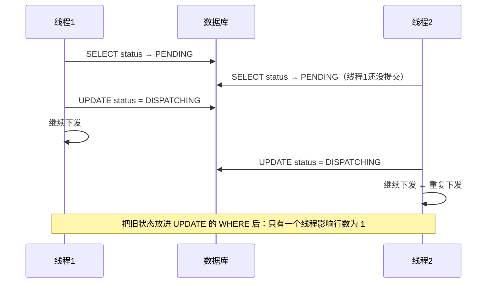

> 两个线程的判断都基于"自己读到 PENDING"这个已经过期的快照。把旧状态放进 UPDATE 的 WHERE，判断就从应用层挪到了数据库行锁上：只有一个线程影响行数为 1，另一个拿到 0 行，自然停止。

### 面试官问：MVCC 为什么不能代替下发条件更新

> **记忆关键词：** 快照读 · 历史可见性 · 当前写裁决

MVCC 用版本和读视图为一致性 SELECT 提供可见数据。RR 同事务的普通一致性读通常复用读视图，RC 每次一致性读使用新视图；UPDATE 不能仅照旧 SELECT 快照写入。任务是否还能领取应由带旧状态条件的更新在写入时裁决，不是“RR 里看见 PENDING 就一直可派”。[MySQL 隔离级别](https://dev.mysql.com/doc/refman/8.4/en/innodb-transaction-isolation-levels.html)。

### 面试官问：记录锁、间隙锁、next-key lock 如何结合这个项目讲

> **记忆关键词：** 索引记录 · 区间 · 记录加间隙 · 看SQL

记录锁保护索引记录，间隙锁约束区间插入，next-key 是二者组合。主键等值命中与范围扫描的锁范围不同，还受隔离级别、索引选择影响；不能说 WHERE 带 status 就锁全表，也不能说所有 SELECT 都锁行。无合理索引会扩大扫描和锁影响，应查看执行计划与锁等待。

### 面试官问：死锁怎么处理，能否一律重试整个调度

> **记忆关键词：** 固定顺序 · 短事务 · 重试语义

多个事务按不同顺序获取资源可形成循环等待；保持一致访问顺序、缩短事务、给查询合适索引。数据库回滚受害事务后，可对确实未产生外部副作用的数据库操作有限重试；已经发过 IoT 的整段调度不能盲目重跑。[InnoDB 死锁处理](https://dev.mysql.com/doc/refman/8.4/en/innodb-deadlocks-handling.html)。

### 面试官问：事务一致性是否自动理解一机库一任务

> **记忆关键词：** 约束要表达 · 同资源原子领取

ACID 不会从字段名推导业务规则。两行不同 taskArea 各成功写 DISPATCHING，可以都满足 SQL 和表约束却违反机库规则。要在公共资源行、唯一约束或统一调度协议中显式表达不变量。

## 4.4 MySQL 索引

自动建模常见查询条件包括：

- taskId 查询批次区域。
- showroomId 查询活跃批次。
- dispatchStatus 查询待发或已发任务。
- dockSn 查询机库占用链。
- missionId、routeCode 查询关联区域。

联合索引不能只看单字段出现次数，要结合真实 SQL 的 WHERE、ORDER BY、数据分布和执行计划。

### 面试官问：你会怎么判断索引是否合理

> 先从慢查询和高频 SQL 出发，使用 EXPLAIN 查看访问类型、使用索引、扫描行数和额外排序，再结合字段区分度设计联合索引。不能只看到查询条件就机械建立多个单列索引，也不能在没有执行计划和数据量证据时声称某个索引一定最优。

### 面试官问：联合索引、覆盖索引和回表怎么讲

> **记忆关键词：** B+树顺序 · 左前缀 · 所需列 · 写成本

联合索引按列顺序组织键值，能利用哪些列还要看等值、范围与排序。二级索引包含主键，若能直接提供所需列则可覆盖，否则通过主键找聚簇记录回表。status 低基数不代表绝对不能进联合索引，优劣要结合 showroomId/taskId、数据分布及 EXPLAIN。不要把任何范围之后所有列都“完全无用”说死。

### 面试官问：位置资产唯一索引有哪些容易漏的边界

> **记忆关键词：** NULL范围 · 活跃唯一 · 软删历史 · 存量清理

当前 checkNameUnique 在无样板间时明确用 IS NULL。MySQL 唯一索引允许多个 NULL，直接加 user_id/showroom_id/name/status 不能保证 NULL 范围的同名唯一；把软删 status 也加入唯一键，还可能阻止多条历史同名删除记录。应先明确活跃记录范围、规范化空值或生成列等约束方案，清理存量冲突，并把 DuplicateKey 转业务提示。[MySQL CREATE INDEX](https://dev.mysql.com/doc/refman/8.4/en/create-index.html)。

## 4.5 Redis Lua

智能体的异步指令状态为：

```text
RECEIVED → DISPATCHED → EXECUTING → SUCCESS / FAILED
```

如果 Java 代码先 GET，再判断，再 SET，两个并发回调可能这样执行：

```text
线程 A 读取 EXECUTING
线程 B 读取 EXECUTING
线程 A 写 SUCCESS
线程 B 写 FAILED
```

终态就被后到的旧回调覆盖。

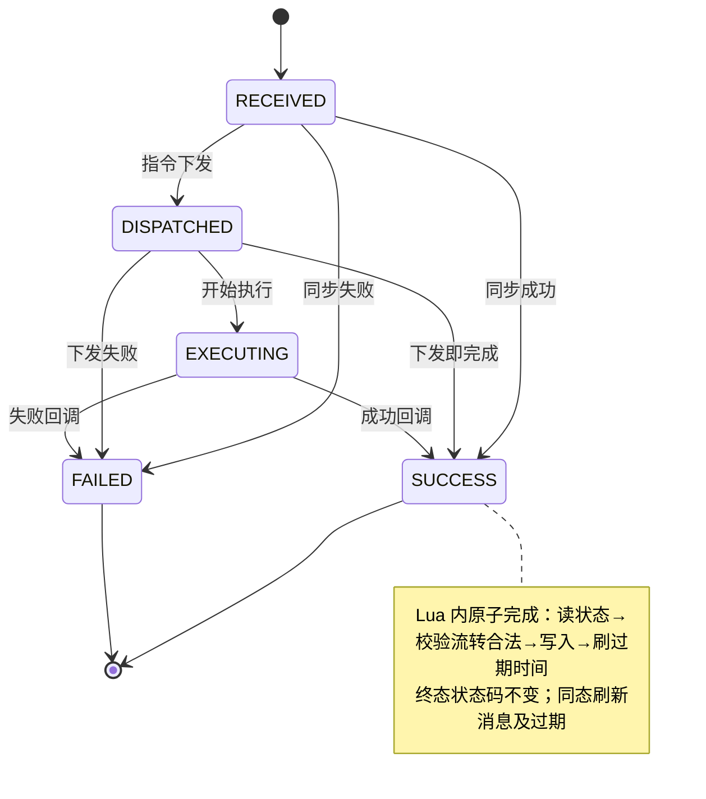

Lua 脚本在 Redis 内部一次完成：

1. GET 当前 JSON。
2. 判断状态转换是否合法。
3. 修改状态和消息。
4. SET 并刷新过期时间。

### 面试官问：Lua 为什么能保证原子性

> Redis执行脚本时不会插入其他客户端命令，因此脚本内的读取、条件判断和写入具有原子隔离。项目脚本限制终态码转到不同状态，但同态回调会刷新消息与TTL；普通SET初始化不走脚本，仍可绕过它。原子隔离也不提供脚本错误的自动回滚。

### 面试官问：Lua 能保证整个业务一致性吗

> 不能。它只保证单个 Redis key 内状态转换的原子性，不能自动解决消息丢失、Redis 故障、数据库状态和设备真实状态不一致。重要业务结果仍需要业务系统持久化，Redis 更适合短期异步状态协调和查询。

### 面试官问：这套状态机为什么放 Redis 而不是数据库表

> 指令状态key为voice:assistant:instruction:status:{messageId}，默认TTL十分钟，用于短期异步查询。Lua约束状态转换，但TTL清理也意味着状态可能消失；不存在不能直接解释成没执行或失败，重要业务结果需由业务持久层保存。
>
> 脚本先判断当前状态是否等于目标：相等直接允许，然后仍会SET EX。因此SUCCESS→SUCCESS可更新非空message并刷新TTL；SUCCESS→FAILED被拒。它保护终态状态码不转换为另一状态，不保护终态JSON全文不可变。

### 面试官问：Lua 脚本内部具体怎么写的

> **记忆关键词：** 先同态 → 再判合法转换 → 写状态/消息 → 刷 TTL；终态码非消息冻结

> 先GET并解析状态，不存在返回-1；canTransition先处理current==target，再处理各非终态允许的目标，其他转换返回0。通过后写状态、可选消息并SET EX，返回1。以下摘录关键逻辑，省略入参读取与JSON解析：
>
> ```lua
> local function canTransition(current, target)
>     if current == target then return true end
>     if current == 0 then return target == 1 or target == 3 or target == 4
>     elseif current == 1 then return target == 2 or target == 3 or target == 4
>     elseif current == 2 then return target == 3 or target == 4
>     else return false end
> end
> if not canTransition(currentStatus, targetStatus) then return 0 end
> current.status = targetStatus
> if message and message ~= '' then current.message = message end
> redis.call('SET', key, cjson.encode(current), 'EX', expireSeconds)
> return 1
> ```
>
> ```text
> 已有SUCCESS、message="首次结果"、TTL剩60s：
> SUCCESS→SUCCESS，message="重复回调"，expireSeconds=600：返回1，消息改变，TTL刷新。
> SUCCESS→FAILED：返回0，状态、消息、TTL不由本次脚本更新。
> key已过期：返回-1；无法仅凭不存在推断真实执行结果。
> ```
>
> 这里的幂等只涉及状态转换效果；重复回调并非全部字段不变。若业务要求结果不可改写，需要进一步设计相同终态回调的结果比对/只读返回，本次文档修订没有改业务Lua。

### 面试官问：为什么不用 MULTI/EXEC 事务或分布式锁来保证原子

> **记忆关键词：** MULTI 静态入队 · WATCH 冲突重试 · Lua 数据侧判断 · 短脚本

> MULTI/EXEC 串行执行已排队命令，不能在客户端收到事务中的 GET 结果后动态选择同次事务后续命令；WATCH 可以先观察、判断再提交，冲突时应用重试。Lua 把读、判断、写放在服务端，一次调用完成。分布式锁也可协调遵守协议的客户端，但单 key 状态转移通常无需增加租约协议。
>
> 原子范围不是永远“仅一 key”：Lua 可操作多个 key，Redis Cluster 下须满足同槽及脚本键声明规则；本项目脚本只用一 key。执行期间不能插入别的 Redis 命令，但脚本运行错误不提供数据库式自动回滚，因此要先验证参数与规则，再写入。[Redis Lua](https://redis.io/docs/latest/develop/programmability/eval-intro/)、[Redis 事务](https://redis.io/docs/latest/develop/using-commands/transactions/)。

### 面试官问：终态 Lua 保护了，为什么接收同一 messageId 仍可能出问题

> **记忆关键词：** 入口直接SET · 脚本外旁路 · 全链路幂等

VoiceAssistantInstructionDispatcher 每次 handle 初始化状态；initInstructionStatus 使用普通 SET 写 RECEIVED，并非 SET NX 或同脚本裁决。同 messageId 再次接收可能把 SUCCESS 重置为 RECEIVED 并再次分发，Lua 只保护之后的转移路径。完整去重需在受理边界按身份原子保存参数摘要及受理结果，执行端同样去重；这是当前边界和改进方案。

### 面试官问：Redis key 过期为什么不能当作任务没执行

> **记忆关键词：** TTL清理 · 结果丢失 · 业务持久事实

10分钟的指令状态用于短期查询，过期后返回不存在不能区分从未受理、受理后失效、已成功但缓存清理。若业务需要长期查证或重放防护，稳定结果要有持久记录，不能依赖一次 TTL。

### 面试官问：Redis 分布式锁的最小正确要素有哪些

> **记忆关键词：** 原子加锁 · 身份校验释放 · 续期 · 旧主人隔离

教学版单实例可用 SET key randomValue NX PX ttl 原子建立租约，释放用 Lua 比较随机身份后删除，不能 GET/DEL 两步误删新主人。它没有自动提供可重入或 fencing，故障切换、暂停、续期仍有边界；生产 Redisson 的内部实现及副本同步选项须按依赖版本核对，不应把这段教学命令当其全部源码。

## 4.6 Spring 事务和异步

常见 `@Transactional` 失效场景包括：

- 同类内部方法直接调用，未经过代理。
- 方法不是代理可拦截的方法。
- 异常被捕获后没有继续抛出。
- 使用错误的事务传播或异常类型配置。
- 新线程中不会自动继承原线程事务。

`@Async` 执行发生在线程池线程中，请求线程的 ThreadLocal 上下文不会自动安全继承。项目中异步航线规划会显式设置登录用户，并在 finally 中清理。

自动建模下游也使用了 `@Async`：`ExecuteImageTaskHandler` 调用另一个 Spring Bean 的 `executeImageTask`，能够经过代理进入 `ikTaskExecutor`。由于它是 `void` 异步方法，调用方返回只代表任务已交给线程池，不代表建模服务提交成功；异步线程中的异常也不会由事件处理器外层的 try-catch 接收。因此，真实处理结果必须依靠日志和持久化状态判断，不能把处理器中的“提交完成”日志理解成“建模完成”。`ikTaskExecutor` 定义在共享配置 TaskPoolConfig 中，参数全部外置到配置中心，拒绝策略同样是 CallerRunsPolicy、停机等待任务完成——与建模航线池是同一套纪律。

### 面试官问：为什么 `@Async` 要放在另一个 Bean 上调用

> Spring 的异步能力依赖代理拦截。同类内部直接调用带 `@Async` 的方法通常不会经过代理，方法仍会同步执行。当前事件处理器注入建模 Service 并调用其异步方法，调用发生在不同 Bean 之间，能够经过 Spring 代理。因为返回类型是 void，调用方不能直接取得异步结果，所以业务结果通过 modeling_status、projectId 和失败原因落库体现。

### 面试官问：为什么异步任务结束后要清理用户上下文

> 线程池复用会带来身份串用，异常路径也要清理。但 CallerRunsPolicy 会在提交线程运行；直接 clear 可能清掉原请求上下文。建议按“保存旧值→安装任务值→finally 恢复旧值或 remove”设计，并检查嵌套提交。当前代码显式 set/clear，只能说覆盖普通池线程清理，不能声称所有路径安全。

## 4.7 JVM 与 GC：为什么暂停会影响分布式协议

### 面试官问：并发 GC 为什么仍可能 STW

> **记忆关键词：** 并发阶段 · 暂停阶段 · 外部TTL继续

并发回收不是全程零暂停。G1 等仍有需要应用暂停的阶段；堆大小、分配速率、存活对象、晋升、CPU配额及失败退化都会影响停顿。GC暂停的是某个 JVM 的应用推进，不暂停另一个节点或 Redis 的租约计时。[G1 官方说明](https://docs.oracle.com/en/java/javase/21/gctuning/garbage-first-g1-garbage-collector1.html)。

### 面试官问：线上如何判断是 GC、锁等待还是网络卡住

> **记忆关键词：** GC时间线 · 栈/JFR · RedisTTL · 远端耗时

关联 taskId/taskAreaId/missionId/showroomId、节点和线程，串起领取、续期、回退与发送时间。看 GC/安全点日志或 JFR 的停顿，再看线程栈锁等待、Redis 连接及 RTT、IoT 超时。没有证据不把每次慢请求叫 Full GC，也不在真实飞行环境故意挂起进程验证。

### 面试官问：怎样避免 ThreadLocal 串用户及内存残留

> **记忆关键词：** 线程长寿 · 任务边界 · finally恢复

ThreadLocal 值跟随线程，池线程存活远长于单次请求。不正确清理会残留对象和身份；InheritableThreadLocal 在线程创建时继承，不能解决线程池每次提交时的身份传播。需要每任务显式传递并恢复，尤其考虑 CallerRuns 与异步链回调所在的线程。[ThreadLocal API](https://docs.oracle.com/en/java/javase/21/docs/api/java.base/java/lang/ThreadLocal.html)。

## 4.8 Spring 代理、异步与事务边界

### 面试官问：自调用失败是不是所有事务都会失效

> **记忆关键词：** 代理入口 · 外层事务 · 实际调用链

同类 this 调用不经过代理，内层注解的传播/隔离要求不会被新拦截；如果外层已经被代理开启事务，内层数据库操作仍可参与外层事务。AiRecognitionServiceImpl.handleRouteSaveEvent 自带事务并内部调用 bindAiRecognition，是此区别的代码例子。[Spring 事务注解说明](https://docs.spring.io/spring-framework/reference/data-access/transaction/declarative/annotations.html)。

### 面试官问：TransactionTemplate 和 @Transactional 有什么不同

> **记忆关键词：** 编程边界 · 代理边界 · 同线程数据库

TransactionTemplate 在调用处显式包裹数据库代码，适合当前 splitAndSaveAreas 和创建任务的局部事务，不依赖方法自调用代理。声明式事务更简洁，但要检查代理路径与 rollbackFor。两者都不会自动把原事务传给 runAsync 新线程，也不包含设备回滚。

### 面试官问：本地 commit 后发布事件有什么窗口

> **记忆关键词：** 提交与发布双写 · afterCommit非持久队列

提交成功后进程退出可能没发事件；提交前发事件又可能让消费者看到未提交数据。事务提交后监听改善顺序，不保证宕机后交付；重要事件可用 Outbox 加幂等消费者。当前无持久事件事实时不能宣称事件最终一定送达。

## 4.9 一个可运行的并发边界推演

以下 Python 片段是**确定性状态模型** ，用于复习三种边界，不模拟 Redis/MySQL 或真实设备，也不是生产实现测试。保存后用 Python 3 执行，断言应全部通过。

```python
def claim(rows, key):
    if rows[key] != "PENDING":
        return False
    rows[key] = "DISPATCHING"
    return True

rows = {"a": "PENDING"}
assert claim(rows, "a") and not claim(rows, "a")  # 未回退，同一行挡住重复领取

rows = {"a": "PENDING", "b": "PENDING"}
assert claim(rows, "a") and claim(rows, "b")      # 不同行都能领取，无机库约束

rows = {"a": "PENDING"}
assert claim(rows, "a")                           # A已获得资格，随后暂停
rows["a"] = "PENDING"                            # B补偿回退
assert claim(rows, "a")                           # B重新领取
sends = ["B", "A"]                              # A恢复原调用，不再执行claim
assert len(sends) == 2

current_epoch = 42
assert 41 != current_epoch                        # 旧DB回写按epoch拒绝
accepted_commands = set()
def admit(epoch, command_id):
    if epoch != current_epoch or command_id in accepted_commands:
        return False
    accepted_commands.add(command_id)
    return True
assert not admit(41, "old")                       # 资源新代际已生效
assert admit(42, "same") and not admit(42, "same") # 当前代际中同命令防重
print("single-row / cross-row / ABA / epoch / idempotency: PASS")
```

模型把判定当原子动作，真实系统必须在存储/执行端实现这种原子性；集合仅用于演示，进程重启丢记录、执行失败和收到命令后宕机的恢复也要设计。

## 第 4 周速记

```text
线程池解决资源和并发，不负责幂等
allOf 负责异步收口，业务结果仍从数据库聚合
volatile 不保证复合操作原子性
数据库条件更新体现 CAS 思想
事务不能回滚远程设备动作
索引必须看真实 SQL、数据和 EXPLAIN
项目 Lua 原子裁决单 key；接收入口普通SET是旁路，整体幂等另核对
ThreadLocal 保存/安装/恢复；CallerRuns 可能在请求线程运行
void 异步返回不等于成功；Future超时不撤销设备；GC不暂停Redis TTL
MVCC管快照读，UPDATE管写裁决；原子性不自动表达业务不变量
```

---

# 第 5 周：AI 工程化与智能体业务侧集成

## 5.1 AI 工程化项目介绍

### 面试官问：请介绍你做的 AI 部分

> 我参与的 AI 工作更偏工程落地，而不是纯算法研究。平台统一维护航线与场景识别、图片对比和巡视区配置。飞行过程中，图片上传事件触发识别；系统根据事件类型配置决定直接使用端侧检测结果，还是交给云侧 AI 工作流二次确认。
>
> 云侧流程接收图片、提示词和红外等场景变量，返回统一检测结果。后端负责校验工作流状态、转换 bbox 格式、裁剪坐标、过滤异常结果，再构造告警事件发送给告警服务。这样业务链路与具体模型解耦，检测、VLM 或其他能力可以按场景组合。
>
> 场景侧我参与了安全帽、基坑无围栏、吨袋、船只、人员临水等 5 类以上巡检场景的数据标注、模型训练评测和逻辑开发，并使用 Python 编排 YOLO、SAM、VLM。Java 侧则直接负责过航线 AI 统一配置、图像识别服务接入工作流、端侧结果云侧二次确认、RF-DETR ONNX 置信度后处理、云侧统计结果落库和 IoT 设备指令适配。

## 5.2 航线 AI 配置

一条航线可以关联：

- 场景识别类型。
- 图片对比配置。
- 巡视区域。

保存配置时，代码先删除旧关联，再新增本次完整配置，使数据库最终状态与用户提交一致。

航线重新编辑后可能生成新的 routeId，因此系统会查询原航线配置，再复制到新航线。特定类型的新航线还可以根据样板间启用的工具包自动关联默认识别事件。

任务起飞时，系统读取航线绑定的识别类型，区分端侧和云侧配置，并查询飞机实际支持的 AI 能力。只有“航线需要”与“飞机支持”的交集才会通过 IoT 下发，同时携带事件类型库中统一维护的置信度阈值。任务级识别配置写入 Redis，避免同一飞行过程中反复查询和组装；降落事件负责清理缓存中的端侧和云侧识别配置，当前代码没有显式向设备下发关闭指令。

### 面试官问：为什么把识别配置放在航线维度

> 航线是实际飞行和图片采集入口，不同航线的场景、巡视区和识别需求不同。把配置与航线关联，可以在任务起飞时一次加载本航线需要的端侧和云侧识别类型，也便于航线重新编辑后继承原配置。

### 面试官问：为什么开启端侧识别前还要查询飞机 AI 能力

> 航线配置表达业务想识别什么，飞机能力表达当前设备实际能运行什么。两者不能互相替代。系统取两者交集后再下发识别类型和置信度阈值，避免向不支持该模型的飞机发送无效指令；任务级配置写入 Redis，降落时清理本次任务的端侧和云侧识别配置缓存。当前代码没有显式下发设备关闭指令，面试时不能描述成完整的 IoT 动态启停。

### 面试官问：先删后插的保存在事务里吗，重复提交会怎样

> bindAiRecognition 带事务，把删除和插入作为本地全量替换；相同配置重复成功提交时业务最终配置相同，但自增ID或更新时间可能变化。handleRouteSaveEvent 虽内部 this 调用，外层已有事务，因此不等于全链路没有事务。
>
> 并发提交不同配置仍需要定义冲突语义或版本控制：事务提供回滚，不代表最后提交必然符合用户预期，也不自动保证没有混合关联。看具体锁、索引和隔离级别。

### 面试官问：降落事件丢了，Redis 里的识别配置怎么办

> **记忆关键词：** 降落清空 · 漏事件保留 · TTL 限时 · 不证明设备关闭

> key为mission:ai:config:{missionId}，保存cloudAi/edgeAi，默认TTL一小时。正常降落处理把字段写为空数组；若降落事件丢失，这一步并未执行，原配置可保留到过期，不能把残留描述成已清空。TTL只限制缓存残留时长，不证明所有晚到图片都不会触发识别，也不是关闭设备AI的指令；须结合任务状态和读路径核对。

**八股扩展：** 配置全量替换、事务代理、缓存TTL、设备能力交集与动态配置版本。重复配置的最终内容一致不等于多请求并发无冲突；缓存失效不等于设备功能已关闭。

## 5.3 端侧识别与云侧工作流

端侧检测速度快、通信依赖小，但复杂语义场景可能误识别。云侧工作流可以组合检测、VLM 和业务规则，但耗时、算力和部署成本更高。

因此当前策略是：

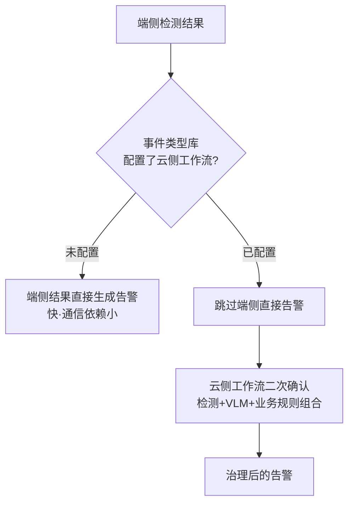

- 没有工作流配置：使用端侧结果直接生成告警。
- 配置了工作流：跳过端侧直接告警，把图片交给云侧二次确认。

这一分流以事件类型库配置为准，而不是在处理器里硬编码具体场景。因此同一个端侧检测结果可以按场景选择直接告警，也可以进入云侧工作流做语义确认。

### 面试官问：为什么不把所有场景都交给 VLM

> 简单、规则稳定的场景直接检测更快、更便宜；需要语义理解或端侧容易误识别的场景再使用工作流或 VLM 二次确认。方案需要在识别效果、推理效率和部署复杂度之间按场景权衡，不是模型越大越好。

### 面试官问：为什么需要工作流

> 工作流把模型编排从业务代码中抽出来。后端只维护统一输入输出契约，具体场景可以在流程中组合检测、分割、VLM 和规则节点。这样更换模型或调整组合时，不需要反复修改整条业务链路。

### 面试官问：你接入 AI 工作流具体做了什么

> 我参与将Java图像识别调用按事件类型路由到工作流，统一图片、提示词和场景变量的输入，以及状态和检测结果的输出。异步处理隔离主链路，失败返回由业务分支处理。当前失败/空结果通常不发告警，这是一种现有行为，不等于自动降级成功或不漏报；是否重试与告警抑制要按场景契约决定。

### 面试官问：云侧失败了会回退到端侧吗

> **记忆关键词：** 分流时跳过端侧 · 云失败无告警 · 不能证明无漏报

> 现有处理在命中云工作流配置时跳过端侧直接告警；云调用失败或无有效结果的路径通常不产生告警并记录日志，不展示自动回退。这个实现不自动代表业务已经批准“宁可漏报”，是否需要重试、待核实或降级须按场景制定。
>
> WukongAiThreadPoolConfig 实际使用 DiscardOldestPolicy，源码旁边的 CallerRuns 注释与实现不符。队列满时会丢旧排队任务，关闭时也有拒绝丢弃边界；它是现有吞吐取舍，不证明图片可以任意丢或建模 CallerRuns 永不丢。要统计受理、拒绝、识别失败和漏报路径。

**八股扩展：** 端云成本/延迟、服务降级与失败可见性、拒绝策略和背压。空结果应区分“没发现目标”与“推理失败”；业务是否允许漏报不能从continue语句自动推断。

## 5.4 AI 结果治理和告警闭环

链路如下：

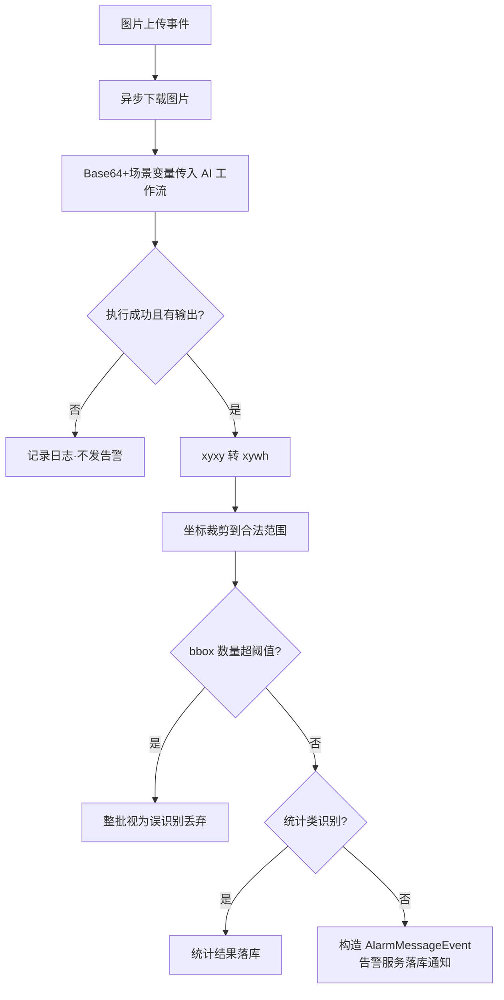

如果单张图片返回的 bbox 数量超过配置阈值，代码将整批结果视为疑似误识别并丢弃，避免异常模型输出产生大量错误告警。

统计类识别不走告警分支，而是把 missionId、imageId、识别类型、目标数量和 bbox 结果保存到统计结果表。识别主链路最终形成两类结果出口：统计结果落库和告警事件发布。

事件类型库还支持配置“到达起飞点”和“到达第一个航点”时执行的飞机指令，用于编排设备的感知与取证能力：航线绑定识别事件类型后，飞行事件触发系统读取该类型配置的 JSON 指令，通过 IoT 修改设备属性。业务上，这些指令可以开启端侧 AI 感知能力，也可以配置识别后的设备取证行为。需要注意，后端是在固定飞行阶段下发策略，并不是收到某次 AI 识别结果后临时触发该处理器。

**模型后处理扩展（原AI项目材料，并非这两个建模分支新增）：** RF-DETR ONNX后处理可先比较query的类别logits，而不是对每个类别都计算Sigmoid。后续调整为先找最大 raw logit，只对最大值执行一次 Sigmoid，再与事件类型库的置信度阈值比较。因为 Sigmoid 单调递增，最大 logit 对应的类别不会改变，但减少了无效指数运算。

### 面试官问：为什么使用事件驱动

> 图片上传、AI 推理和告警处理耗时不同。如果同步串联，会阻塞图片接入链路，也让上游强依赖下游响应。事件驱动让图片上传只发布事实，AI 异步处理，成功后再发布告警事件，既隔离耗时步骤，也便于后续增加落库、通知或 IoT 动作消费者。

### 面试官问：为什么只对最大 logit 做 Sigmoid

> Sigmoid 是单调递增函数，先比较 raw logits 找最大类别，与先把每个 logit 转成概率再找最大类别，最终类别相同。因此可以先找最大 logit，只计算一次 Sigmoid 得到置信度，再做阈值过滤，避免对所有 query 和类别重复执行指数运算。

### 面试官问：bbox 阈值是多少，整批丢弃会不会误杀真实多目标场景

> **记忆关键词：** 默认10 · 整批丢弃 · 真多目标风险 · 先评测

> AsyncVLLMService的maxBoxCount默认10，配置为业务前缀下的ai.vlm.maxBoxCount；超过阈值整批不告警。这能挡住大量异常框，也会丢掉真实多目标画面。没有场景数据不能断言超过10更常见的是误识别，阈值应按样本和业务代价调整。
>
> BboxUtils把宽高夹到0.03—0.97并约束到图内，这是现有坐标处理，会改变很小的真实目标框，不等于模型纠错。需要明确坐标域、逆变换和评测，不能把“裁剪合法”当“语义正确”。

### 面试官问：AI 工作流失败怎么处理

> **记忆关键词：** 记录异常 · 失败/空结果无告警 · 漏报取舍 · 有界重试待补

> 当前代码捕获异常并记录 missionId、imageId 和识别类型，失败或空结果不会继续发送告警。这种策略偏向避免错误告警。如果业务更关注漏报，后续可以增加有上限的重试、失败任务表或死信队列，并监控失败率。

### 面试官问：模型效果提高了多少

> 仓库能够证明的是工程链路、端云分流和结果治理，但没有完整可追溯的评测数据集、评测脚本和正式报表，所以我不会给出无法验证的百分比。我可以说明不同场景为什么选择检测或 VLM 二次确认，以及如何根据误识别样本调整流程，但量化指标以正式评测记录为准。

**八股扩展：** 输入输出契约、bbox逆变换、置信度与评测、持久化后事件发布及告警去重。结构正确不代表语义正确，识别完成不等于告警送达。

## 5.5 智能体介绍（独立项目，与平台侧代码分开）

> 口径：简历中智能体是独立项目。本人主要负责业务侧集成（Action 协议、SSE、异步状态、位置资产），开发平台 Channel 与 MCP Server，编写三维重建等 Skill，参与 OpenClaw 其他功能。模型私有化部署、企业微信通道、画面理解为系统能力或他人工作，不揽。

### 面试官问：请介绍智能体

> 该智能体是面向政企客户的无人机业务智能体，基于 OpenClaw 构建：用户通过自然语言／语音对话驱动巡检任务派发、飞行实时操控、三维重建、画面语义问答等 50 余个业务指令，模型私有化部署。我主要负责业务侧集成——参与定义并实现智能体与业务系统间的 Action 执行协议，实现指令接收确认、结果回调与轮询查询语义，通过 SSE 推送交互指令，Redis 保存短期异步状态；此外开发了平台前端与 OpenClaw 通信的 Channel 和平台端 MCP Server，编写了三维重建等业务 Skill。系统分层是：Channel 管消息与身份，MCP 管查询，Action 协议管执行，Skill 管编排，工作流管长流程。
>
> 位置资产方面，我把区域、点位、分割点位和最佳视角等空间数据按名称持久化。位置资产按用户隔离，有样板间上下文时再叠加样板间范围。当用户提到“某个点”或“某个区域”时，智能体可以用名称匹配具体坐标和视角姿态，再把位置数据交给后续业务能力调用。

## 5.6 智能体位置资产数据模型

代码中的实体名是 `AgentSceneMemoryEntity`，但从业务语义看，它保存的是智能体可以按名称引用的位置资产：

- `showroomId`：样板间范围。
- `userId`：用户隔离。
- `drawId`：关联地图标绘。
- `memoryName`：用户和智能体引用的位置名称。
- `memoryType`：ZONE 区域或 POSE 视角。
- `sceneType`：建模、违停等业务场景。
- `spatialPayload`：空间数据。

`spatialPayload` 包括：

- `points`：区域多边形点阵。
- `segmentPoints`：区域分割点位。
- `view`：经纬度、高度、俯仰角、偏航角和翻滚角。

### 面试官问：为什么把它定位为位置资产，而不是长期记忆系统

> 这里保存的不是对话内容或模型记忆，而是带名称的区域、点位、坐标和视角姿态。核心作用是把用户说的“某个点”映射到平台可以执行的具体空间位置。它没有向量检索、对话摘要、情景记忆或记忆衰减，因此更准确的表述是智能体位置资产管理，而不是大模型长期记忆系统。

### 面试官问：为什么 spatialPayload 使用 JSON

> ZONE 和 POSE 的空间结构不同，但都属于一条位置资产且生命周期一致。JSON 可以兼容 points、segmentPoints 和 view，减少大量可空列和多表查询；Java 侧仍使用 SpatialPayload 强类型对象。代价是数据库难以高效检索 JSON 内部坐标，如果未来需要高频空间查询，应考虑空间数据库或拆分索引表。

### 面试官问：名称唯一性校验有并发窗口吗

> **记忆关键词：** 先查后插 · 事务非唯一约束 · NULL与软删 · 数据层裁决

> checkNameUnique 查询当前用户、样板间范围和有效状态的同名记录，无样板间时用 IS NULL；count 为0再插入存在并发窗口。Java 实体没有声明索引不足以证明线上表没有唯一约束，本次未查看线上 DDL。
>
> 如果数据库没有对应约束，两个并发请求都可能通过。修复要明确定义有效名称唯一、NULL范围及软删历史，再设计数据约束并处理 DuplicateKey，不能机械加 (user_id,showroom_id,memory_name,status) 就宣布正确。详见4.4。

**八股扩展：** JSON灵活性与索引成本、业务唯一性、NULL/软删及数据库约束。按名称定位资产不是向量记忆系统；唯一性应由实际DDL验证。

## 5.7 用户隔离

userId 从登录上下文获取，不接受前端自由指定。查询、修改和删除都带 userId 条件；请求存在 showroomId 时，再带样板间条件。

创建位置资产时还会校验：

- 位置资产类型是否合法。
- 关联标绘是否存在。
- 标绘是否属于当前样板间。
- 同一用户、同一样板间下有效名称是否重复。

### 面试官问：用户 A 传入用户 B 的记忆 ID 会怎样

> 修改和删除不是直接按主键操作，而是先使用 id、当前 userId，以及可用的 showroomId 查询归属。查不到就返回位置资产不存在，因此用户 A 无法通过猜测 ID 修改用户 B 的数据。

**八股扩展：** 认证、授权、租户范围和对象归属不同层次。单个方法带userId不证明全模块安全；跨用户读取、回调和批量操作也要检查。

## 5.8 SSE 和 Redis 状态

SSE 用于服务端向当前用户实时推送指令和执行反馈。它适合单向通知，比前端轮询及时，也比为这个场景维护完整双向 WebSocket 更简单。

Redis 保存短期异步指令状态，Lua 保护走脚本路径的合法转移；初始化入口使用普通SET，整体受理防重不是已完成保证。详见4.5。

### 面试官问：SSE 能作为唯一状态来源吗

> **记忆关键词：** SSE 实时通知 · 持久状态真值 · 断线重查

> 不能。SSE 连接可能中断，前端也可能错过某次推送。SSE 只负责实时通知，Redis 或业务数据库中的状态才用于重新查询和恢复展示。

### 面试官问：SSE 断线期间的推送丢了怎么办

> **记忆关键词：** 平台查messageId · Java Agent补持久事件 · delta不补放 · Python内存不同

> 平台 Action 状态可以按 messageId 查询 Redis，SSE 是及时通知；状态TTL过期不提供长期结果。Java Agent 独立实现中 RunEvents.send/action 先存事件再发送，/runs/{id}/events?after=sequence 提供补拉；text_delta 仅实时发送，不逐片落库，最终回答与final事件保存。不能承诺每一片token都重放。
>
> Python Agent 的 RunEventEmitter 是内存 asyncio.Queue 加序号，不能套用 Java 事件库的持久重放结论。本次按各自固定提交区分实现；SSE原生重连及Last-Event-ID只有服务端实现保存/补发后才有完整恢复。[SSE标准](https://html.spec.whatwg.org/multipage/server-sent-events.html)。

**八股扩展：** 单向流、重连、Last-Event-ID、应用序号、持久事件重放与TTL状态查询。传输成功、客户端收到、客户端执行、设备完成四个事实要分开。

## 5.9 智能体独立项目：架构分层与两套调用体系

五部件分层：

```text
用户（平台前端，已登录）
   │ WebSocket（信封 ext：accessToken / industryType / showroomId / channelId）
   ▼
Channel（消息+鉴权）：会话路由、dmHistoryLimit 轮换、/new 重置、登录态透传
   ▼
OpenClaw Agent（模型 + 提示词 + 工具调用循环）
   │ 查询 → MCP Server（契约层）：20 工具、无状态、ToolResult+traceId
   │ 编排 → Skill（SKILL.md 状态机 + Python 脚本 + 人工确认门）
   │ 执行 → Action 协议（执行语义层）→ 平台后端分发器 → SSE 前端 / IoT 设备
   │ 长流程 → agent-scene-workflow（14 态状态机、decide 推进决策点）
```

### 面试官问：为什么既有 MCP 又有自研指令协议

> **记忆关键词：** MCP 管契约 · Action 管执行生命周期 · 长流程另编排

> MCP 是契约层：工具发现、参数 Schema、统一结果包络，这层有行业标准，任何 Agent 框架 tools/list 即可接入——我们用它承载 20 个查询类工具（任务、设备、告警、位置记忆、报告导出、航线草稿）。指令协议是执行语义层：受理确认（ack）、结果回调、状态轮询、终态保护、业务幂等与查证——这些需要应用定义，采用MCP不会自动获得；MCP也能承载有副作用的执行工具。判别四个问题：执行者能否应答（服务可，浏览器和飞机只能被推送）；参数敢不敢让模型填（查询敢，副作用指令必须技能预构造）；一次调用能否结束（秒级查询能，长流程要跨多轮对话）；失败后世界是否干净（查询可重试，动作需终态保护）。我们也真把执行包成过 MCP 工具（execute_inspection），内部仍是 commandId 受理 + 状态查询 + 取消以回执为准——恰好证明两层不可互相替代。

### 面试官问：Action 协议的完整生命周期

> **记忆关键词：** 接收 → 分发 → ACK → 回调 → 查询；同态可刷新消息/TTL

> 四个端点构成闭环：POST /{messageId, commands} 指令接收 → 分发器按 commandType 路由（front_action 经业务系统 SSE 推前端执行、drone_action 走设备）→ POST /ack/{messageId} 执行端确认 → POST /callback 结果回调 → GET /result/{messageId} 轮询（Agent 工具内最多 6 次×1 秒，status 3 成功、4 失败）。状态存 Redis，Lua 原子流转 + 脚本路径终态状态码保护（同态回调仍可刷新消息与TTL，重复受理的普通SET另有窗口）。三类 Handler 中 back_action 是协议预留扩展点（Handler 为空实现）——纯后端长流程后来演化成独立工作流服务，指令协议专注前端驱动与设备控制两个即时动作面。诚实口径：实际流量只有 front_action（约 45 个 intent）和 drone_action（约 20 个 intent）。

### 面试官问：Channel 怎么做多租户鉴权

> **记忆关键词：** 信封带上下文 → Channel 透传 → 工具附头 → 业务端验身份/租户/资源

> 用户在前端登录平台后，WebSocket 信封 ext 携带 accessToken、industryType、showroomId、channelId；Channel 存入会话上下文，运行时转为环境变量，Skill 脚本与工具统一附加 Authorization、X-Industry-Type、X-Showroom-Id、X-Agent-Channel-Id 请求头——这是身份上下文传递；业务端仍必须验证登录身份、租户归属与资源权限。会话管理：dmHistoryLimit 超限后为 peerId 追加 generation 后缀强制开新会话，防止上下文无限膨胀；/new 命令重置计数开新会话。

### 面试官问：三维重建 Skill 的确认机制

> **记忆关键词：** 预览 → 等下一轮 → 原话校验 → 防同轮/重放 → 状态转移；授权须可信

> 两阶段确认：preview 成功后写入本地 pending 仓库（stage=WAITING_PREVIEW_CONFIRMATION，记录首轮用户原话 hash 与轮次 hash），模型必须结束本轮等用户回复。confirm 前脚本做五重校验：原话必填（-u 缺失直接参数错误）；否定词黑名单（取消/算了/先别/暂缓/不执行……含"确认"但语境否定也拒）；肯定语义全句正则匹配（"如果没问题就确认吧"条件式、"我昨天确认过了"历史陈述、"确认吗？"疑问都不构成授权）；同轮拦截（当前轮次 hash 等于 preview 轮次 hash 即拒，防模型自导自演）；原话重放拦截（本轮原话等于首轮请求原话即拒）。五关全过才在文件锁内状态转移，再经指令协议下发 reconstruction_confirm_start。preview 与 confirm 本身都是 front_action 指令——工作流层嵌套指令层的又一实例。

### 面试官问：怎么管住模型不让它乱来（B/G 端高频）

> **记忆关键词：** 确认门 · 预构造指令 · 服务端校验 · 循环/副作用防重

> 四层防线：① SKILL.md 提示词层——危险动作（气象放行、航线确认、起飞）强制人工确认门，严禁同轮下发；② 运行时守卫层——dispatch_skill_prepared_command 校验指令必须逐字来自 SKILL.md 预构造的 $command，模型自拼直接拒（COMMAND_NOT_FROM_SKILL），错误信息指名该去 read 哪个 SKILL.md；③ 协议层——巡检 decide 确认必须带用户原话（-u），服务端白名单校验；④ 工具防护层——循环熔断 + 副作用工具同轮去重（同一 run 相同参数成功一次后不再执行，防模型循环重发）。

**材料范围：** 本节工具数量、业务指令数量与工作流状态数来自原独立项目介绍，本次未重新清点。** 八股扩展：** 协议契约与执行生命周期分层，MCP也可承载执行，但Schema、工具注解和提示词不自动提供权限、幂等或人工确认。

## 5.10 Channel 完整解析（agent-ws-channel，会话与工具上下文）

插件四大部分：模块级状态（connections／sessionContexts／peerSessionState 三张 Map）、消息处理 handleMessage、Channel 声明（meta／configSchema／status／gateway）、register 钩子。

### 拓扑：前端不直连 OpenClaw

```text
平台前端（浏览器）──WS 客户端──► agent-ws-server（独立微服务，Nacos 注册）◄──WS 客户端── OpenClaw Channel 插件
                                        ▲
                                        │ Feign POST /api/v1/notify（按用户推送）
                                        │
                          agent-scene-workflow（巡检进度、TTS 播报等主动通知）
```

- 前端和 OpenClaw 都是**客户端** ，各自连到中转 server；server 内部按信封 sessionId／replyTo 做双向路由转发。
- 前端侧成百上千条连接由 server 扛，OpenClaw 侧只维持**一条** 出站连接（AGENT_CHANNEL_URL），信封多路复用。
- server 还是业务侧主动推送的统一入口：工作流通过 Feign 调它给指定用户推通知。
- 设计收益：① Agent 网关不需要暴露给浏览器（它只拨出、不监听公网）；② 用户身份在 server 侧翻译成信封 ext（accessToken 等）；③ 连接潮汐与业务推送解耦。

**前端连接的真实 URL** ：`wss://api.example.com/agent/chat/{channelId}?sessionId={sessionId}`

- 域名即业务统一网关（与 PLATFORM_BASE_URL 同域）；网关路由 `Path=/agent/** → lb://agent-ws-server`（Nacos 负载均衡，StripPrefix=1），`/agent/chat/` 注册在 gateway.websocket.prefixes 做 WS 升级——部署文档 v5.2.8 实证。
- path 中的 UUID 是 **channelId** ：agent-ws-server 有独立数据库（agent_db），`/agent/channel/**` 提供通道管理 REST 接口（在网关免鉴权白名单）；每个样板间／项目／部署注册一条通道。channelId 随后出现在信封 ext.channelId，经 before_tool_call 注入为业务请求头 X-Agent-Channel-Id——业务后端据此区分请求来自哪条通道。
- query 中的 sessionId 标识会话，即信封 sessionId 与 reply 路由的键。

### 面试官问：为什么不让前端直连 OpenClaw 网关

> 一是网络与安全边界：OpenClaw 网关部署在算法内网，若直接对浏览器开放就要处理海量连接、设备鉴权和公网暴露面；现在它只作为 WS 客户端拨出一条连接到业务域的中转服务，Agent 侧零监听。二是身份翻译：中转服务持有用户会话，把"哪个浏览器在说话"翻译成信封里的 accessToken／行业／样板间上下文，OpenClaw 无需感知平台的登录体系。三是它同时是业务侧推送入口——巡检工作流经 Feign 让它给用户推进度，前端一条连接收全所有消息。

### 端到端链路

```text
前端 → WS 信封 {source, replyTo, sessionId, ext{accessToken/industryType/showroomId/channelId}, data{content}}
  ① handleMessage：解析信封 → /new 检测（重置会话，不转发 agent）
  ② 快捷回复：非问候消息立即随机回"收到/好的/马上"（partial）——压首响延迟
  ③ getEffectivePeerId：peerId = sender__sessionId__generation；dmHistoryLimit(30) 超限换 generation 强制新会话
  ④ ext + source + replyTo 存入 sessionContexts
  ⑤ resolveAgentRoute + dispatch 派发给 Agent
  ⑥ 模型工具调用 → before_tool_call：会话上下文注入
       exec 工具 → env（ACCESS_TOKEN 等环境变量 → Skill 脚本 api_helper.py 读取）
       其他工具 → args（JSON 对象，供 voice-manager 等插件读取）
  ⑦ 回复 deliver → WS reply {kind: partial/final, replyTo, sessionId}
  ⑧ session_end：删除 sessionContexts（token 不滞留内存）
```

### 连接管理（gateway.startAccount）

- **单账号模型** ：一个 default 账号连一条 WS URL，多用户靠信封 sessionId/replyTo 区分，不是每用户一条连接。
- **自管重连** ：内部 while 循环 + 固定 5 秒重连，刻意不让 startAccount 返回——避开框架 auto-restart 的指数退避（大屏/样板间常驻场景要求快速恢复）。
- **心跳保活** ：连接建立后每 5 秒 ws.ping()，防中间设备/NAT 掐空闲连接。
- **abortSignal 贯穿** ：停机时关连接并打断重连等待；stopAccount 主动关闭。

### 会话轮换三件套

1. dmHistoryLimit（配置 30）：peerSessionState 计数，超限后 count 归 1、generation=Date.now() 换新——强制开新会话，防上下文无限膨胀；首次即带 generation，网关重启后自然生成新值（旧会话不复活）。
2. /new、/reset 命令：手动重置计数并强制新会话。
3. peerId 结构 sender__sessionId__generation 支持反解析（extractBasePeerId／extractSessionId），session_end 据此清理。

### 身份注入与凭据纪律（before_tool_call）

- camelCase → SCREAMING_SNAKE_CASE（accessToken → ACCESS_TOKEN），遍历会话上下文自动转换。
- **双通道注入** ：exec/exec_command 注入 env（进程环境变量）；其他工具注入 args（JSON）。Skill 脚本的 api_helper.py 从环境变量读 ACCESS_TOKEN／INDUSTRY_TYPE／SHOWROOM_ID／CHANNEL_ID 拼 Authorization 与 X-* 请求头——多租户鉴权的完整闭环。
- 凭据只走 env，不进命令行参数、不进 exec 命令遥测（代码注释原话：Keep credentials out of shell source and exec command telemetry）。
- token 生命周期 = 会话清理钩子应在session_end删除上下文；异常退出、会话轮换和并发访问仍需核对，不能据此证明完整凭据生命周期。

### 两个全局桥

- __onWecomChunk：voice-manager 工具执行中向前端推即时短语（"开始执行"等）。
- __onHushiAgentReply：agent-bridge 直推 final 回复；turnId 优先显式传入、否则回落会话上下文保存的 turnId——**三维重建 Skill 五重校验里的"轮次"就来自这里的 turnId，跨模块串联点** 。

### 面试官问：为什么重连不用框架的自动重启

> 框架 auto-restart 通常带指数退避，断几次后重连间隔会退到分钟级；样板间大屏是常驻展示场景，断线几分钟等于不可用。所以插件自己管理重连：startAccount 内部 while 循环 + 固定 5 秒间隔、永不返回（返回才会触发框架重启）。代价是放弃退避对对端的保护，但目标是内网自建网关，可控。

### 面试官问：快捷回复为什么要随机

> 模型首响应要几秒，先回"收到/好的/马上"把首响压到毫秒级；随机化避免每条都回同一个词显得机械。细节层面的对话体验设计，被追问"你们怎么优化响应体验"时的好例子。

### 面试官问：这个 Channel 和 MCP Server、Action 协议的边界

> Channel 是 OpenClaw 与前端之间的"消息与身份层"：管连接、会话、鉴权上下文注入和回复通道，不理解任何业务。MCP 是查询契约层，Action 协议是执行语义层——后两者调用平台后端，前者只负责把消息和身份安全地送进/送出 Agent。身份在 Channel 注入一次，MCP 和 Skill 全程复用。

**补充代码定位：** 独立Channel快照2ea6729的index.ts。** 八股扩展：** 连接复用、会话路由、凭据作用域和并发上下文；内存Map与generation轮换不是持久恢复协议。

## 5.11 AI 工程八股：输入、指标、后处理与失败

这里是原理扩展，不声称新增模型训练、部署或评测已由两个建模分支证明。

### 面试官问：YOLO、SAM、VLM 为什么要组合

> **记忆关键词：** 检测框 · 分割掩码 · 语义确认 · 分层成本

检测模型定位目标并分类，SAM类分割模型提供像素区域，VLM结合图像和语言理解场景。把简单定位与复杂语义分开可以控制成本，但串联会传播上游漏检，需要保留不确定性并单独评价每一阶段。它们不是越叠越好，实际组合由场景收益决定。

### 面试官问：Precision、Recall、IoU、mAP 如何解释

> **记忆关键词：** 误报 · 漏报 · 框重叠 · 多阈值评测

Precision=TP/(TP+FP)，Recall=TP/(TP+FN)；IoU 是预测框与真值框交集/并集，不是置信度。AP汇总精确率召回率关系，mAP还要明确类别、IoU阈值及评测约定。业务可以关心每架次误报、真实事件召回与延迟，不能用训练集分数或一两个案例声称上线提升。[官方检测任务说明](https://huggingface.co/docs/transformers/tasks/object_detection)。

### 面试官问：为什么置信度阈值不能所有事件都设一样

> **记忆关键词：** 分数非准确率 · 场景代价 · 验证集校准

分数通常不是经过校准的“这条告警有多少概率正确”。提高阈值往往减少误报也增加漏报；事件严重程度、目标尺度和数据分布不同，阈值应按验证集及业务损失调优。端侧与云侧分数不可直接比较或相乘当最终置信度。

### 面试官问：bbox 接入最容易错在哪里

> **记忆关键词：** 格式 · 坐标域 · resize/pad反变换 · 裁剪

明确是xyxy、xywh还是cxcywh，以及像素还是归一化；缩放、letterbox padding、裁剪后需逆变换回原图。再验证坐标范围、宽高正值、NaN及类别映射。Java 后处理能校验结构和坐标，不能因此证明模型语义正确。

### 面试官问：NMS 和 DETR 类后处理能混用吗

> **记忆关键词：** 看输出契约 · 候选重叠 · 集合预测

NMS按置信度和IoU抑制重复候选，常见于密集检测；DETR类通常训练为集合预测，不能不看导出格式就照搬YOLO后处理。核对类别分数是否需要sigmoid/softmax、是否有背景类、框的归一化及输入输出形状，避免二次激活或错误阈值。详细模型原理在技术专栏，不由Java调用证明。

### 面试官问：数据划分为什么不能随机拆同一视频相邻帧

> **记忆关键词：** 数据泄漏 · 同航次分组 · 场景分布漂移

相邻帧高度相似，随机进入训练和验证会高估泛化。按航次、地点、时间或设备分组划分，并保留夜间、小目标、遮挡等切片。训练代码跑完不代表覆盖线上分布，发布要保留模型版本、数据和阈值证据。

## 5.12 Agent 工程八股：工具、权限与异步协议

### 面试官问：Function Calling、MCP、RAG 和 Agent 有什么关系

> **记忆关键词：** 参数提议 · 工具协议 · 检索上下文 · 执行循环

Function Calling让模型提出工具名和参数，应用验证并执行；MCP提供工具发现/调用契约；RAG检索资料补充上下文；Agent循环根据结果继续规划。技术可以组合，数据库位置资产按名查不是自动的向量RAG，工具调用也不是已获用户授权。[MCP工具规范](https://modelcontextprotocol.io/specification/2025-06-18/server/tools)。

### 面试官问：提示词里的人工确认为什么还不够

> **记忆关键词：** 可信身份 · 绑定参数 · 单次消费 · 过期

提示词是行为指导，模型可以输出“用户已确认”。执行端需要从可信用户通道取得授权，并绑定具体动作/参数摘要、用户和租户、确认身份与有效期，原子消费并防重放。原话关键词和轮次hash能约束流程，但不证明模型传入的文本真实来自用户。

### 面试官问：Token 透传等于多租户隔离吗

> **记忆关键词：** 验身份 · 验租户 · 验资源归属 · 默认拒绝

Channel带登录态只提供上下文，业务端仍要验证token、租户/样板间权限及资源归属。不能相信模型或前端任意填userId/showroomId；读、写、事件补拉、回调每条路径都要核对。ThreadLocal只是进程内上下文载体，不是授权机制。

### 面试官问：为什么 SSE、WebSocket 和轮询并存

> **记忆关键词：** 传输方向 · 受理协议 · 真值与补拉

SSE适合服务端单向事件，WebSocket适合双向持续会话，轮询用于断线查当前结果。选传输不会自动提供业务幂等或持久重放；seq/messageId负责关联，持久记录和授权检查负责恢复。代理缓冲、心跳、连接限制与背压也影响流式可用性。[Spring异步请求](https://docs.spring.io/spring-framework/reference/web/webmvc/mvc-ann-async.html)。

### 面试官问：runId、messageId、commandId、traceId 能共用吗

> **记忆关键词：** 运行 · 协议消息 · 业务动作 · 诊断链路

它们作用不同：一次Agent运行可以产生多个命令，trace用于观测，commandId用于业务受理防重，messageId用于协议关联。重试应保留同一动作身份，重新运行可能产生新runId；不能每次HTTP重试都换commandId，或把traceId当权限凭据。

**进一步阅读：** [Agent与工具协议原理](resume-tech-agent-principles.html)、[流式通信与前后端协作](resume-tech-fullstack-principles.html)、[Python与视觉AI](resume-tech-vision-principles.html)。专栏是原理材料，不替代项目版本证据。

## 第 5 周速记

```text
AI 部分定位为工程落地，不冒充纯算法研究
航线统一关联识别、图片对比和巡视区
端侧检测快，复杂场景再走云侧工作流二次确认
后端负责统一契约、bbox 转换、异常过滤和告警事件
没有正式评测证据就不报提升百分比
智能体独立项目五部件：Channel 消息鉴权 / MCP 查询 / Action 执行 / Skill 编排 / 工作流长流程
查询走 MCP、执行走协议；back_action 是预留空壳，后端长流程归工作流
三维重建两阶段确认五重校验：必填原话/否定黑名单/全句匹配/同轮拦截/重放拦截
身份传递 = 会话上下文注入四个请求头；租户授权须由业务端核验（Authorization/X-Industry-Type/X-Showroom-Id/X-Agent-Channel-Id）
位置资产用于把用户提及的名称映射到具体坐标和视角，不是大模型长期记忆
userId 必须来自登录上下文
Redis Lua 防止终态被并发回调覆盖
```

---

# 专题：违章停车多轮复核

> 贡献边界先说清楚：违停的两轮复核基础（判定框架、图片收口状态机、报告链路、车牌匹配规则）是团队既有实现。本人主导的是**多轮化架构改造** （收敛驱动模型、判定泛化、Temporal 循环编排）、**取证链路扩展** （缺陷事件详情反查）以及边界场景的方案设计。面试时按此口径讲，既有内容可以作为"我深入理解并改造过的系统"来阐述设计，但不要说成从零实现。

## A.1 业务全链路

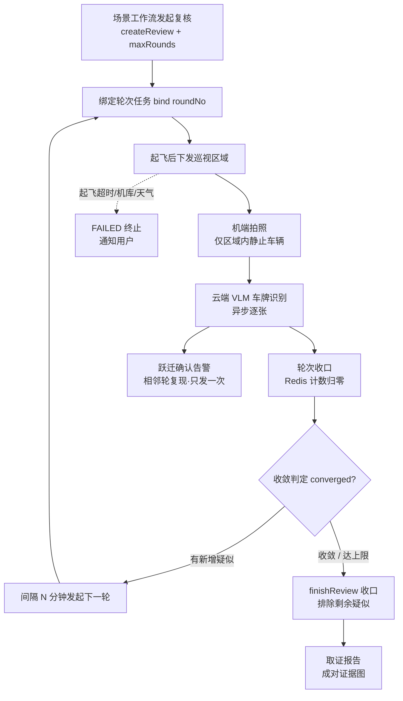

```text
场景工作流（Temporal）发起违停巡检复核
  → 创建 review + 绑定第 1 轮飞行任务
  → 起飞后向飞机下发巡视区域
  → 机端仅对区域内静止车辆拍照上传（端侧过滤运动目标）
  → 云端 AI 逐张识别车牌（异步事件驱动，识别属性含车牌/颜色/朝向）
  → 每轮识别收口后判定：
      相邻轮次车牌复现 → CONFIRMED（确认违停，发告警）
      新出现车牌       → SUSPECTED（新的待复核目标）
  → 仍有新增疑似 → 间隔 N 分钟发起下一轮
  → 无新增疑似   → 收敛：剩余疑似排除为 NOT_CONFIRMED，收口出报告
```

端云协同的语义分层：端侧判"瞬时静止"（区域内、那一刻停着的车才拍），云端多轮复现判"持续静止"（隔一轮还在）。两者互补：端侧可减少上云图片量，跨轮复现增加确认依据；等红灯或中途离开再返回仍需业务规则判别，两次拍照存在不证明全程持续静止。

### 面试官问：请介绍违章停车多轮复核

> **记忆关键词：** 端侧拍照 → 云端识牌 → 相邻复现 → 新目标驱动 → 收敛/轮数上限

> 违停巡检是端云协同的判定链路：飞机在巡视区域内对静止车辆拍照，云端识别车牌做多轮复核。我接手时是固定两轮模型——第一轮识别疑似、第二轮复现确认。业务上新问题出现了：闹市场景每轮都可能停进新车，固定两轮不够用。我主导把它改造成"收敛驱动"的多轮模型：相邻轮次车牌复现即确认，新出现的车牌作为新的待复核目标驱动追加巡检轮次，某轮没有新增目标就自动收敛收口，同时配最大轮数护栏防止永不收敛。改造覆盖判定状态机、识别收口、Temporal 编排和跨服务取证全链路，改完后原来的两级行为变成多轮的特例，存量测试全绿。

**八股扩展：** 生产者确认、消费确认、幂等与跨服务数据归属。飞行结束、图片完整、识别完成、业务收敛和报告完成是不同屏障。

## A.2 判定模型：从固定两轮到收敛驱动

三态状态模型：

```text
SUSPECTED     首次出现（任意轮），待下一轮复核
CONFIRMED     相邻轮次复现，确认违停（终态）
NOT_CONFIRMED 收口时仍未复现，排除
```

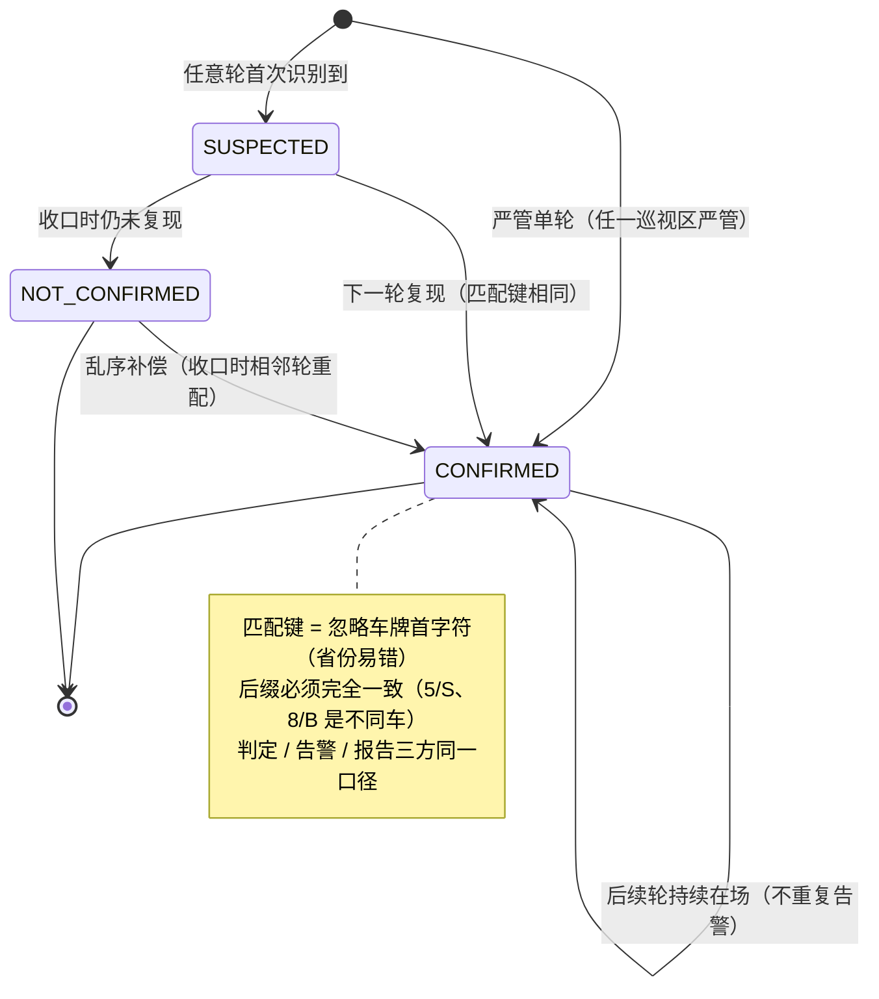

关键设计点：

1. **判定基准是"相邻上一轮"** ：第 i 轮新记录与第 i-1 轮同车牌（按匹配键）比对，复现即 CONFIRMED 并回写上一轮记录（两轮证据成对确认），否则本轮新车牌 SUSPECTED。原有的 SECOND_ROUND_ONLY 状态退役——任何轮次首次出现的车统一 SUSPECTED，模型从"两轮特判"泛化成"滑动窗口"。
2. **收敛条件** ：最新一轮识别收口且该轮无新增 SUSPECTED（每轮全量识别，本轮疑似即本轮新增）。收敛后剩余 SUSPECTED 统一排除——收口后没有下一轮了，未复现即排除。
3. **护栏** ：max_rounds（默认 5），bind 时超限直接拒绝；达到上限强制收敛。
4. **告警只在跃迁时发** ：已确认车辆后续轮次持续在场，新记录仍判 CONFIRMED 但不算"跃迁"，不重复告警。告警幂等键 reviewId+车牌，双保险。
5. **乱序补偿** ：第 i 轮图片识别回调可能晚于第 i+1 轮（当时判成新车牌 SUSPECTED），收口时按相邻轮次对全量重配补判。
6. **区域严管属性与判定策略** ：严管/非严管是**巡视区域的属性** （每个区域带 manageType）。编排发起复核时判定策略：** 只要任一巡视区标记严管，整单复核即按严管策略执行——第一轮识别收口直接确认，跳过全部复飞轮次** ；全部区域非严管才走多轮复核。注意两个细节：一是代码注释写的是“全部为严管”但实现是 `anyMatch`（任一即真），以实现为准；二是混合区域（一个严管 + 一个普通）时，普通区识别到的车也会被单轮确认——当前判定粒度是整单而非区域，车辆记录上的 `manage_type` 字段为将来演进成“严管区单轮、普通区多轮”的区域级判定预留了数据基础。

### 面试官问：多轮怎么终止，永远有新车牌怎么办

> **记忆关键词：** 收敛停 · 轮数护栏 · 明确失败停 · 等待截止另补

> 平台按无新增疑似车、严管策略、终态及max_rounds提供停止条件，执行异常可走FAILED。轮数有上限，不代表总等待时间有上限：工作流waitForRoundRecognitionCompleted仍是while(true)加Workflow.sleep轮询，本次核对的方法未展示轮内截止时间；pending残留或状态无法收口时可能一直等待。
>
> 因此最坏总工期不能只用轮数乘间隔估算。改进应给每轮识别等待设截止与UNKNOWN/FAILED分支并查证未完成身份；这与已设计未实施的超时防护一致，不能说现有系统任何异常都有限时间结束。

### 面试官问：为什么用"相邻轮复现"而不是"累计出现 N 轮"

> 相邻轮要求前一轮和当前轮都出现匹配目标；累计出现会把中间消失又返回的车辆算进来。连续观察仍不能证明物理车辆从未离开，算法只是业务判据。
>
> 代码查询roundNo-1的候选。漏检一轮会打断相邻关系；例如第1、3轮出现但第2轮缺失，第3轮不能直接凭第1轮确认，第3、4轮连续出现后才可能确认。历史疑似保留与相邻轮可匹配是不同概念。

### 面试官问：确认车辆后续轮次还在，会不会重复告警

> 正常后续轮次中，alreadyConfirmedBefore区分首次确认与持续出现，返回新增确认记录以减少重复告警。其他告警入口还需核对其业务身份与持久去重，不能将一次布尔判断或Redis去重键当跨系统恰好一次。
>
> 两个并发识别处理都读到“未确认”、事件发送后本地写失败、去重状态过期等仍是应验证窗口。事件状态更新与告警发布的可靠衔接见3.9。

## A.3 车牌匹配：忽略首字符

匹配键规则：车牌去空白转大写后，去掉第一个字符（省份简称），剩余部分只保留字母数字。原因：大模型识别省份简称错误率高（冀/翼、苏/肃形近字），但同一辆车两轮后缀也可能识别错误，忽略首字符仅处理一种误差来源。判定、告警配对、取证报告共用同一条规则，保证三方口径一致。

### 面试官问：为什么不全文匹配或者编辑距离

> 全文匹配会把省份字符识别差异判成两辆车，复现判定永远失败。编辑距离能容错但会把"差一个字符的不同车"也匹配上（5/S、8/B 在真实车牌空间里是不同车），误确认的代价在违停场景不可接受。忽略首字符是在"识别误差的分布"（省份字符集中出错）和"匹配的严格性"（后缀必须完全一致）之间取的精确平衡，且规则极简可解释。

**八股扩展：** 字符串规范化、Unicode码点与匹配键碰撞。忽略省份字符降低某类误差，也增加跨省同尾号误匹配风险；匹配键不是车辆物理唯一身份。

## A.4 图片识别收口：事件不可信的三种形态

收口状态机（团队既有设计，我做多轮适配时深入分析过）：

```text
RUNNING → WAITING_UPLOAD → UPLOAD_CLOSED → RECOGNITION_COMPLETED
            (任务飞行完成)   (上传关闭)       (Redis 计数归零)
```

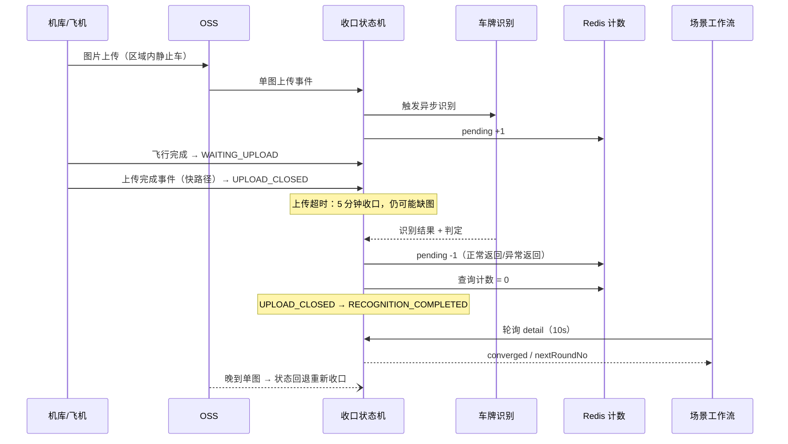

**收口边界：** 上传事件提供及时性，pending跟踪已受理识别任务的未完成数。计数为0只说明没有尚未完成的已登记任务，不证明预期图片全都上传，也不证明该轮取证完整；超时结束等待必须保留数据缺失与结果未知的语义。

| 事件故障形态 | 兜底机制 |
|---|---|
| 丢失 | 30 秒一扫的定时任务，WAITING_UPLOAD 超 5 分钟强制 UPLOAD_CLOSED |
| 早到（图没传完） | pending只覆盖已受理识别任务；晚到图可重开收口，但预期图片完整性还需上传清单/数量证据 |
| 重复 | 状态与车辆记录去重；识别受理/完成也需按任务身份核对，计数成对加减不等于跨故障严格一次 |
| 假完成（说传完实际缺图） | 缺图可能漏掉疑似车并提前收敛；0图校验仅是最低保护，完整性校验与未知结果处理仍需另设计，现有防护方案未实施 |

### 面试官问：图片链路卡住了怎么办，是继续复核还是超时

> **记忆关键词：** 上传等待与识别完成分开 · finally 非进程保障 · 计数非图片完整

> 上传事件漏失时，现有专题描述的扫描会把超时WAITING_UPLOAD转为UPLOAD_CLOSED；这关闭上传等待，不保证识别任务已完成。正常异常返回可执行finally减计数，但进程退出、永久挂起或Redis写入失败不在这一保证内。
>
> ```text
> 受理图A并pending+1→识别进程退出→finally未执行→pending可能残留。
> 识别已完成但完成记录/减计数失败→需要按任务身份查证，不能盲目再次扣计数。
> 仅图B到达且没有新车牌→不能据此证明图A应有的疑似车已消失。
> pending=0与图片完整、车辆不存在是三个不同判断。
> ```
>
> 恢复方案应记录可查询的识别任务身份和完成事实，设置任务/轮次截止时间，对账修复或进入失败/未知分支。整轮0图防护已设计未实施；有图但不完整同样需要证据校验。本次只修正文档，不声称这些补偿已落地。

### 面试官问：Redis 计数的键和过期怎么设计，计数减到负数怎么办

> **记忆关键词：** 轮次计数 · INCR原子非业务原子 · 缺失/异常返回0 · 不能当完整

> illegal-parking-0928 的计数key按missionId隔离，INCR后单独EXPIRE一天；两条Redis操作不是整体原子，进程可在中间退出。recognitionFinished减到负值会reset为0。
>
> 更关键的是 pendingCount 当前在key缺失、解析或Redis读取异常时返回0，completeIfNoPendingRecognition 可在UPLOAD_CLOSED且计数不大于0时标识别完成。这是当前恢复边界：未知被折成0，不能证明所有受理任务已完成。需要可查询识别任务身份、去重完成、明确UNKNOWN与截止对账，不能只靠归零。

**八股扩展：** 分布式计数、TTL、任务身份及重复完成。INCR原子不保证“登记任务+执行+减计数”整体原子；计数为0、上传闭合与完整图片分别需要证据。

## A.5 Temporal 编排：版本桩与双端解耦

多轮循环在工作流侧：

```text
第 1 轮（必飞，全是新车牌）→ 第 2 轮（必飞）→ 第 2 轮起每轮收口后查 converged
  ├─ converged=true  → finishReview 收口出报告
  └─ converged=false → sleep(间隔) → 发起 nextRoundNo 轮 → 循环
```

两个关键工程决策：

1. **Workflow.getVersion 版本桩** ：Temporal 的 workflow 是事件溯源重放的——代码结构变更后，升级瞬间在途的旧 workflow 用新代码重放会 non-determinism 报错。改编排逻辑必须用版本桩把新路径与历史路径隔离：旧 workflow 重放走 DEFAULT_VERSION（原固定两轮代码），新启动的走 v1（循环）。严管单轮的改造也是同样的桩模式。
2. **双端解耦发版** ：工作流先升级、平台后升级的窗口期，detail 响应里没有 converged 字段——编排检测到字段缺失自动退回固定两轮行为。两端可以独立发版互不阻塞。

### 面试官问：为什么改编排必须加版本桩

> **记忆关键词：** 历史重放 · 确定性 · 版本分叉 · 旧历史旧路 · 新实例新路

> Temporal workflow 的执行历史是事件日志，worker 重启或升级后要用当前代码重放历史来恢复状态。如果我直接把"固定两轮"的顺序代码改成"while 循环"，一个升级前启动、飞到第二轮的工作流，用新代码重放它的历史时，事件序列对不上，直接 non-determinism 失败。Workflow.getVersion 在代码里打一个版本分叉点：重放历史走到分叉点时按历史里记录的版本走旧分支，新启动的走新分支，两套代码路径互不污染。这是 Temporal 改造在途逻辑的标准安全措施。

### 面试官问：平台和工作流怎么协调发版

> 靠响应字段缺失降级。多轮决策依赖平台 detail 接口的 converged/nextRoundNo 字段，编排检测到这两个字段为 null（旧版平台没有）就退回固定两轮。所以发版顺序无关紧要：平台先上、工作流后上，或反过来，行为都正确退化。这比“两个服务必须同时发版”的耦合方案运维成本低得多。

### 面试官问：轮询等待和轮间 sleep 会不会占用工作线程

> **记忆关键词：** Workflow.sleep 持久计时 · Activity 执行占资源 · SDK 上下文仍有成本

> Workflow.sleep通过Temporal的持久化定时器暂停工作流进展，到期产生后续Workflow Task；不能用Thread.sleep替代它。等待时间不等于持续执行一个Worker任务，但Java SDK缓存和工作流执行上下文仍有资源成本，不能概括成“不占任何线程”。
>
> 轮内轮询用Activity获取业务detail，再用Workflow.sleep安排下次查询；Activity调用仍占用对应执行资源并需要超时。重启恢复依靠事件历史与确定性重放，[官方Tasks说明](https://docs.temporal.io/tasks)用于区分计时与任务执行。本次没有做Temporal运行验证。

**八股扩展：** 确定性历史、Activity重试、持久定时器和版本兼容。Workflow.sleep不是Thread.sleep，Activity重试也不代表设备可安全重复。

## A.6 跨服务取证：缺陷事件详情反查

链路：确认告警（boxDesc 含车牌）→ 告警服务转缺陷事件（description 存车牌文本）→ 用户点开事件详情 → emergency 从 description 正则抽车牌 → Feign 调平台 evidence 接口 → 按“告警任务所在轮 + 其相邻上一轮”动态配对两条 CONFIRMED 记录 → 返回证据图（图、bbox、拍照时间）。调用失败 catch 降级为 null，不阻塞详情主流程。两个边界：严管单轮确认没有相邻上一轮，first 证据为 null，只返回告警轮一条记录；同一车牌两轮识别存在省份字符差异的多条记录时取首条，与判定口径一致。

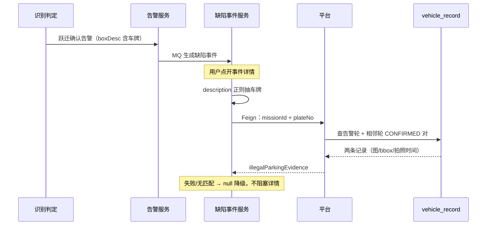

方案取舍：最初实现是 emergency 直查平台数据库（建 entity/dao），后来改为 Feign——核心理由是**判定规则单一维护** ：车牌匹配键、配对逻辑都在平台一处，平台改规则不会和 emergency 静默不一致；其次表归属清晰，平台改表结构不波及 emergency。代价是详情页多一次内网调用（低频场景可忽略）。

### 面试官问：为什么 Feign 而不是直查库

> 直查库要复制三样东西到另一个服务：表映射、车牌匹配规则、证据组装逻辑（图片回退、RSA 解密、坐标还原）。其中匹配规则是最危险的耦合——平台哪天调整规则，emergency 不会知道，事件详情展示的车和判定确认的车会静默对不上。Feign 把这些收敛在被数据所属的服务里，跨服务只剩一个 HTTP 契约。详情页低频，多一次内网调用的代价可以接受；调用失败降级 null，不阻塞详情主流程。

**八股扩展：** 服务契约、数据所有权、超时/降级与信息丢失。详情返回null保持主流程可用，但证据可能缺失，应监控失败并允许重查；不能称查询失败为完整取证成功。

## A.7 我的贡献边界（诚实口径）

### 面试官问：这个模块哪些是你做的

> 两轮复核的基础是团队既有实现：判定框架、图片收口状态机、报告生成链路、车牌匹配规则。我做的是：多轮化的判定模型泛化（收敛语义定义、相邻轮判定、状态简化、告警跃迁控制）、Temporal 循环编排与版本桩、双端降级发版方案、跨服务取证链路、以及一批边界场景的方案设计（0 图误收敛防护、轮次等待超时）。既有机制我在改造时深入分析过，能讲清它的设计为什么是这样，但我不会说成从零实现。

## A.8 Temporal 与异步计数的八股扩展

专题平台固定 `illegal-parking-0928@ade75009e`；工作流补充核对 `9f755ae` 的 AbstractSceneWorkflow。它们是独立版本，不能拿 SELF 样板间锁解释 Temporal 的执行语义。

### 面试官问：Temporal 重放会再次调用设备吗

> **记忆关键词：** Workflow历史 · Activity结果 · 重试副作用

Workflow按历史重放已记录的命令和结果，不等于每次重放重新执行已完成Activity。但Activity可能因超时、Worker退出或结果未被记录而再次执行，因此设备调用仍需稳定身份与幂等；“Temporal可靠”不等于外部动作exactly-once。[Temporal重试策略](https://docs.temporal.io/encyclopedia/retry-policies)。

### 面试官问：Workflow 代码为什么不能直接用当前时间和随机数

> **记忆关键词：** 确定性 · SDK API · 历史结果

重放必须产生与历史兼容的命令序列。时间、随机和外部读取应走SDK支持的确定性API，外部I/O放Activity。sideEffect可把不确定值记录到历史，但不能代替Activity执行任意外部副作用；捕获异常也不能修复历史不一致。[Java sideEffect说明](https://docs.temporal.io/develop/java/workflows/side-effects)。

### 面试官问：getVersion、Worker升级、双端字段兼容是不是同一问题

> **记忆关键词：** 历史兼容 · 执行版本 · 接口契约

getVersion管理同一Workflow历史中的代码分叉；Worker版本/部署策略管理哪个执行版本处理任务；字段缺失降级管理平台与工作流接口兼容。当前代码converged缺失回到固定两轮，不能推广为任意字段变化都兼容；要保留旧路径与历史重放测试。[Java版本控制](https://docs.temporal.io/develop/java/workflows/versioning)。

### 面试官问：pending=0 为什么不等于图片齐全

> **记忆关键词：** 只数已受理 · 上游未到 · 成对不去重

计数只表达已登记且未完成的识别量，没有证明预期图片都到达。重复完成可以多减，重复受理可以多加，key过期/异常又可能读成0。图片清单、任务身份和轮次收口是不同证据，不能把计数当分布式屏障。

### 面试官问：一轮有多个 Mission 时 anyMatch 是什么边界

> **记忆关键词：** 任一完成≠全量完成 · 业务假设需固定

当前 latestRoundRecognitionCompleted 对该轮Mission用anyMatch。若业务保证每轮只有一个有效Mission可解释；若一轮实际包含多个必须完成的Mission，任一完成会提前满足轮次判断。应在手册明确这个假设，核对数据约束，不能把anyMatch讲成“所有Mission全部完成”。

**关联原理：** 确定性重放、Activity至少一次尝试、幂等、版本兼容、分布式计数与数据完整性。[Temporal专栏](resume-tech-temporal-principles.html)提供进一步原理。

## 专题速记

```text
判定三态：SUSPECTED（任意轮首现）/ CONFIRMED（相邻轮复现）/ NOT_CONFIRMED（收口排除）
新车牌驱动继续飞，无新增即收敛；max_rounds 护栏 + 执行失败 FAILED 终止
区域严管属性：任一巡视区严管 → 整单单轮确认（实现是 anyMatch，注释写"全部"以实现为准）
告警只发跃迁轮：返回值语义收紧 + 幂等键双保险
车牌匹配：忽略首字符（省份易错），判定/告警/报告同一口径
收口：事件及时推进；超时结束等待，计数只覆盖已登记任务，完整性与宕机补偿另核对
0 图轮误收敛是已知边界，防护=converged 加图片数校验
Temporal 改编排必加版本桩：历史重放走旧分支，新启走新分支
双端解耦：converged 字段缺失自动退回两轮，发版顺序无关
取证：description 抽车牌 → Feign → 告警轮+相邻轮动态配对，失败降级 null
贡献边界：基础是团队的，我主导多轮化改造与取证扩展
```

---

# 第 6 周：完整面试表达与高频答案

这一周的内容可以直接反复阅读，形成最终表达。

## 6.1 30 秒核心业务介绍

> 我的核心模块是自动建模与多机库调度，从区域拆分、机库分配、异步规划和任务准备，到飞行/续飞、图片回传及组级建模。当前v2.5把本地航迹判断迁到统一碰撞服务，创建时静态检查、真实下发前动态准入和登记确认；多入口多实例通过样板间锁及区域条件更新协调。能讲清服务接入、结果未知、GC和恢复边界，比只背用了什么框架更重要。个人贡献以确实参与的改动为准。

## 6.2 自动建模 3 分钟完整回答

> 用户圈定区域后系统保存子区域和任务，按候选稀缺度、机库负载与空间偏好分配，线程池并行规划，成功航线创建Mission。当前v2.5工作树通过建模专用入口做模型/障碍物及限高检查，创建时不登记活跃航线。
>
> 规划完成、飞行完成、机库就绪、继续和定时补偿会调度同一样板间，任务不归创建节点独占。先在样板间锁内筛基础候选，再每条重拿锁，重读批次、同库执行链、Mission和电池，条件更新PENDING为DISPATCHING。
>
> 最终阶段随后调用checkAndRegisterBeforeDispatch：检查配置与设备开关，查询已有登记；不存在时调用统一碰撞服务，检测并登记，成功还要再次查证登记结果。只有准入确认才调用IoT；暂时冲突或未确认等待，模型/超高永久阻飞标失败。当前是顺序准入，不再本地JTS组合搜索，也不承诺全局最优。
>
> IoT结果未知时保留DISPATCHING和活跃登记，明确拒绝才清理；起飞续签、完成优先清理后补位。TTL和本地WAITING都不是设备未执行证明，活跃登记三元组也不是尝试代际或命令幂等键。长GC在登记确认后暂停，补偿回退重发、旧线程恢复仍可能形成重复发送，需分开讲数据代际、资源归属、执行端fencing与幂等。
>
> 续飞保留父子链占用，暂停不强停在飞，继续逐项恢复，取消收敛晚生待发子任务；图片上传后组锁内校验全组就绪和已提交，调用建模服务保存projectId，跨系统未知仍需对账。v3提交版SELF仍是静态创建检查与本地JTS筛选，EXTERNAL归外部服务，两种版本和模式不能混讲。

## 6.3 自动建模模块最难的地方

> 最难的是物理设备、数据库观测和异步调用不能一次原子提交。跨task机库和空域需要共同裁决；同一行领取需要条件更新；锁失效、任务回退和旧执行者又是另一类问题。
>
> 我会用代码画出入口、两段锁、CAS、IoT和回写，再推演“已CAS后GC”“远端成功响应丢失”“续飞晚生成”。当前机制解决了正常协调及恢复入口，但我不会说看门狗永不失效或CAS能保证设备严格一次。

## 6.4 你在平台中负责什么

> 按我实际参与的改动解释区域拆分、多机库评分、异步规划、统一碰撞服务接入、活跃航线生命周期、并发下发、续飞及图片组级建模。当前v2.5工作树接入与尚未迁移的v3提交版要区分，不能把旧JTS或未来fencing方案当作全部当前实现。AI/Agent仍按各自代码及责任边界讲。

## 6.5 为什么锁按样板间而不是机库

> 同一样板间不同task可使用同库，不同机库的航线也可能冲突；各入口扫描同一范围的候选和占用，所以当前用showroomId协调本地决策。锁粒度较粗，独立任务也会等待锁内IoT调用，但释放后兼容航线可以同时飞。细化成机库锁还要重设计空域准入及资源领取，不能只换key。

## 6.6 为什么 Redisson 锁和数据库条件更新都要用

> 样板间锁让遵守协议的多节点轮流做跨任务决策，数据库条件更新裁决某条任务仍为PENDING才允许发送。只用各自任务行CAS，两条同库任务都可以成功；只用租约锁，缺少持久状态防重且可能出现旧持有者。
>
> 这不是严格一次保证。A已CAS后暂停，B超时回退并重新领取，A恢复仍能继续发送；需要按尝试代际隔离旧写、公共资源归属保护跨任务，执行端fencing和稳定命令身份防旧操作与重复动作。详见2.4—2.8。

## 6.7 服务在 DISPATCHING 后宕机怎么办

> 宕机与暂停不同：真正退出的旧进程不会恢复原调用，但它之前发出的请求可能晚到，且远端可能已受理。当前SELF补偿按Mission记录和阈值回退或有限重试；WAITING不证明未收到。
>
> 长GC则旧进程还活着，会恢复原方法栈。若任务被补偿回退后重新领取，单行CAS不撤销旧发送资格。没有执行端幂等/隔离契约时，未知应先查证并保留占用；v3 EXTERNAL本地补偿排除，远端恢复不能凭空补充。

## 6.8 当前顺序准入与历史安全组合能保证最优吗

> 当前v2.5工作树按顺序动态准入，不再搜索本地安全组合，因此不承诺全局并发最优；扫描顺序、远端RTT及冲突分布决定效率。旧提交/v3 SELF使用JTS矩阵和按机库分组搜索，预计剩余轮次是贪心估计，也不保证最短总工期。先讲版本再讲算法目标。

## 6.9 为什么暂停不终止飞机

> 数据库暂停不能等同于安全终止真实飞行。当前暂停语义是让在飞任务完成，不再调度普通待发任务，也不再启动新的续飞腿，这比强制中断更符合设备和飞行安全约束。

## 6.10 为什么事件和定时补偿要并存

> SELF事件及时推进，补偿按持久状态提供恢复入口。共用锁与条件更新控制正常并发和同任务重复触发，不覆盖锁失效、设备确认丢失及跨系统未知结果的全部窗口。应按不同故障身份核对，而非承诺重复触发在任何故障下都绝对安全。

## 6.11 AI 工程化 2 分钟回答

> AI 部分我主要做工程落地。场景侧参与了安全帽、基坑无围栏、吨袋、船只和人员临水等 5 类以上场景的数据标注、模型训练评测和 Python 多模型编排；Java 侧设计了航线级 AI 统一配置，关联场景识别、图片对比和巡视区。任务起飞时结合航线需求与飞机 AI 能力，通过 IoT 开启端侧识别并下发置信度阈值；同时支持按起飞点和首航点下发设备策略，联动端侧感知与识别后取证能力。
>
> 图片上传事件到达后，端侧结果可以直接告警，也可以按事件类型配置交给云侧工作流二次确认。后端异步调用工作流，校验结果后完成 bbox 格式转换和坐标裁剪；统计类结果落库，告警类结果发布事件。整个设计把模型执行和业务结果处理解耦，可以按场景在效果、效率和部署成本之间权衡。

## 6.12 智能体 2 分钟回答

> 该智能体是面向政企客户的无人机智能体，基于 OpenClaw 构建，用户通过对话驱动巡检派发、飞行操控、三维重建、画面问答等 50 余个业务指令，模型私有化部署。我负责业务侧集成，并开发了通信 Channel 和 MCP Server。
>
> 分层上：Channel 承接前端 WebSocket 会话，透传登录态并注入行业、样板间等租户上下文；查询类能力走 MCP——我用 Spring AI MCP 把任务、设备、告警等封装成 20 个标准化工具；执行类动作走自研 Action 协议——我参与定义并实现，受理确认、结果回调、轮询查询四端点闭环，Redis Lua保护脚本更新的合法转移与终态状态码，重复受理初始化另有窗口；长流程巡检走独立工作流服务，14 个状态、决策点靠用户确认推进。我还写了三维重建业务 Skill，核心是两阶段人工确认：预览后必须等用户下一轮明确确认，脚本侧做否定词黑名单、全句语义匹配、同轮与重放拦截五重校验，这些守卫约束确认流程；授权还需来自可信用户输入，不能只相信模型传入的原话或轮次。
>
> 位置资产管理把区域、点位和最佳视角按名称持久化，按用户和样板间隔离，智能体可以按名称匹配出坐标和视角姿态。

## 6.13 你的方案还有哪些不足

> 当前统一碰撞准入依赖远端检测与登记契约，已确认登记可被复用、TTL可到期，且显式关闭检测有绕过路径。锁内远端调用会放大等待，顺序准入不保证最优，GC/状态回退和设备确认缺失仍没有完整fencing和幂等保证。
>
> v3提交版还保留本地JTS，最终不重查该空域快照；EXTERNAL模式要核对与SELF共享资源的准入。应监控等待、RTT、登记失败、未知下发、TTL/事件清理和旧结果，按版本做交错验证，不能把统一服务接入当安全问题全部解决。

## 6.14 为什么简历不写量化提升

> 这些工程实现能从仓库中验证，但效果提升百分比、召回率和速度倍数需要对应数据集、评测脚本和正式报告。没有完整证据时不写数字，避免面试追问时无法解释。可以重点讲问题、方案、异常处理和工程边界。

## 6.15 项目难点、亮点与个人贡献

技术面试通常不会只问实现细节，还会要求候选人自己提炼项目价值。回答“难点”和“亮点”时要区分：

- **难点** ：业务中最难处理的约束或不确定性，以及你如何解决。
- **亮点** ：与普通增删改查相比，最能体现设计、取舍和工程价值的部分。
- **个人贡献** ：你具体分析、设计或实现了什么，不能把整个团队成果都归到自己名下。

推荐统一使用下面的表达顺序：

```text
业务背景 → 核心问题 → 我的处理 → 最终能力 → 方案边界
```

### 面试官问：自动建模项目最大的亮点是什么

> 把准备阶段静态检查与真实派飞前动态碰撞准入分开，将安全规则和活跃航线生命周期收口到统一服务；调度、CAS、续飞和组级建模保持各自职责。JTS作为技术演进和v3旧提交对照，远端准入不替代命令幂等或fencing。个人参与范围须有实际提交或工作树改动佐证。

### 面试官问：这个项目最难的地方是什么

> 最难的是服务端状态、设备真实状态和异步事件并不总是一致。一次下发调用超时，不代表设备一定没有收到；任务完成事件可能重复、延迟或丢失；暂停、取消和调度也可能同时发生。如果简单地把异常理解成失败并立即重试，就可能重复下发甚至重复飞行。
>
> 我的处理思路是先划分批次、区域任务、下发状态和 Mission 真实状态的职责，再根据真实状态决定恢复动作。调度入口通过分布式锁收敛，单任务流转通过数据库条件更新防重，正常流程由事件推进，异常流程由定时任务对账补偿。这样即使某次事件缺失或服务重启，任务仍有恢复出口。

### 面试官问：你个人在项目中做了什么

> 按确实参与的区域拆分、机库分配、异步规划、统一碰撞接入、活跃生命周期、并发恢复或组级建模讲。当前v2.5改动还在工作树，不能用旧提交解释成未接入，也不能把全部平台能力归个人。

### 面试官问：没有量化数据，怎么说明项目产生了价值

> 我不会使用没有评测依据的百分比，但可以说明系统新增或稳定支持了哪些能力：多机库任务可以按照航迹安全约束并行执行；重复调度由锁和条件更新共同拦截；暂停、继续、取消、断点续飞和超时任务都有恢复路径；父子任务图片完成后可按组控制正常重复事件，跨系统严格一次仍需远端幂等契约与对账。
>
> 这些属于可以结合代码、状态和业务流程验证的结果。如果面试官需要性能或效果数字，我会明确说明当前没有完整监控报表或正式评测记录，而不是临时估算。

### 面试官问：你遇到过最棘手的问题，怎么定位和解决

> 可以用一个确有证据的问题讲排查：按节点、任务、机库、状态更新时间串起规划、事件、补偿、CAS与IoT，而不是先猜“多线程”。当前多入口通过共同调度锁与状态更新协调；进一步分析能找到分段快照、长GC回退和旧结果窗口。没有线上事故证据时说“代码推演发现”，不要把推演编成亲历事故。

### 面试官问：AI 工程化部分的难点和亮点是什么

> 难点是不同场景对准确率、速度和部署成本的要求不同，不能只依赖一种模型。规则清晰、目标明确的场景优先使用目标检测；需要精确区域时增加分割；语义复杂、误识别代价较高的场景再使用 VLM 二次确认。
>
> 我的工作重点是把 YOLO、SAM、VLM 等能力组合成可落地的场景流程，并处理空间关系判断、结果过滤和误识别治理。Java 业务侧再把识别配置、设备能力、IoT 指令、结果落库和告警动作串联起来。亮点在于能够根据场景选择模型组合，并把模型输出转化为业务结果。

### 面试官问：智能体部分的亮点是什么

> 一是把区域、点位和最佳视角等空间数据按用户和业务场景持久化，形成智能体可以查询和引用的位置业务上下文；二是使用统一指令结构和 messageId 串联指令接收、ack、执行回调和结果查询；三是使用 Redis Lua 原子维护异步状态，增加终态保护和状态转换防重，阻止不同状态覆盖终态；同状态回调仍可更新消息与TTL。
>
> 这部分的价值是让智能体不只生成文本，还能查询真实业务数据并触发无人机平台能力，同时让异步执行过程可以跟踪和恢复。

### 面试官问：如果重新设计一次，你会改进什么

> 先补锁等待、远端检测/登记/查询耗时、登记失败及未知下发率，核对碰撞服务检测与登记的原子性、TTL和生命周期；再按IoT能力设计资源归属、尝试代际、命令幂等及fencing。v3是否迁移需要按外部调度归属与资源契约评估，不能只删除JTS方法。

### 面试官问：你从这个项目中学到了什么

> 我最大的收获是，复杂业务的关键不只是让正常流程跑通，而是先识别哪些状态属于服务端、哪些属于设备真实状态，以及失败后从哪里恢复。技术方案也不能只看框架名称，要明确锁保护什么范围、条件更新防什么竞争、事件和定时补偿各自解决什么问题。这个项目让我从实现单个接口，逐渐转向理解完整链路和设计异常恢复。

## 6.16 AI Coding 时代的软技能与项目表达

AI Coding 降低了代码生成成本，但没有替代工程师判断需求、识别风险、选择方案和验证结果的责任。面试中真正有区分度的，不是泛泛地说“沟通能力强”，而是能用真实项目证明自己具备以下能力：

```text
把模糊需求定义清楚
→ 识别业务约束和异常场景
→ 比较方案并说明取舍
→ 与上下游确认接口和责任边界
→ 推动联调、上线和问题闭环
→ 对最终结果负责
```

硬技能仍然是基础。AI 可以生成代码，但工程师必须判断并发是否安全、事务边界是否合理、失败后能否恢复、生成代码是否符合业务语义。对我而言，软技能不是脱离技术，而是把技术用于解决真实问题的能力。

### 需求开始前：先回答四个问题

接到任务后，不要立即进入编码。先用下面四行明确问题：

```text
目标：最终要解决什么业务问题？
约束：设备、数据、并发和上下游有哪些限制？
异常：失败、超时、重复、乱序和服务重启时怎么办？
验收：用什么现象或数据证明任务完成？
```

以自动建模为例：

```text
目标：让多个区域尽可能安全、连续地完成数据采集并提交建模。
约束：单机库单轮只能执行一条任务，不同机库航迹也要符合当前碰撞准入，设备状态不完全受服务端控制。
异常：可能重复触发、远程调用结果未知、未起飞、续飞卡住、图片事件重复或丢失。
验收目标：正常并发不重复领取，异常可查证与恢复，全组图片就绪才提交；锁失效、远端未知及旧尝试要单独验收，不能假定已满足严格一次。
```

这四个问题体现的是问题定义能力。它能把“开发了一个接口”提升为“理解并解决了一个完整业务问题”。

### 介绍项目：固定使用五段式结构

项目表达统一采用：

```text
背景 → 问题 → 方案 → 结果 → 取舍
```

以 Redis Lua 状态管理为例：

> 智能体指令存在 ack、结果回调并发到达以及重复回调的问题，普通的先读后写可能让迟到请求覆盖成功或失败终态。因此我把当前状态校验和更新放进 Redis Lua 中原子执行，同时增加终态保护和重复回调幂等。这保护的是走脚本更新的状态码，普通SET初始化仍可能重置已有指令，不能声称整条指令不会倒退。脚本也不能保证Redis与数据库或设备的分布式事务。

准备每个核心项目时，至少形成两个版本：

- 两分钟版本：说明背景、核心问题、关键方案和结果。
- 五分钟版本：补充并发场景、异常恢复、方案取舍和改进方向。

### 技术决策：重点准备“为什么”

不能只记住用了什么技术。每个方案都要能回答：

```text
为什么选择它？
不用它会出现什么问题？
替代方案是什么？
为什么没有选择替代方案？
当前方案有什么缺点和边界？
什么情况下需要升级？
```

结合平台，重点练习以下问题：

1. 为什么使用 Redisson 分布式锁后，还需要数据库条件更新？
2. 为什么采用事件及时推进，同时保留定时补偿？
3. 为什么复杂 AI 场景使用 VLM 二次确认，而不是所有场景都使用 VLM？
4. 为什么任务状态很多，却没有直接引入完整状态机框架？
5. 为什么远程调用超时后不能立即回退状态并重新下发？
6. 为什么智能体位置数据叫位置资产，而不是大模型长期记忆？

这些问题在前面章节已有完整答案。复习时不要逐字背诵，要先说业务问题，再说选择和边界。

### 跨团队协作：用事实和结论推进

自动建模会涉及前端、IoT、航线规划、设备和三维建模服务；AI 场景还会涉及算法和训练平台。协作时需要主动确认：

- 上下游接口的输入、输出、超时和错误语义。
- 哪一方保存最终状态，哪一方负责重试。
- 重复请求、回调乱序和服务不可用时如何处理。
- 联调完成的判断标准以及各方负责人。

重要讨论结束后，可以使用下面的简短模板同步结论：

```text
已确认：A 接口按某种语义返回；B 系统负责保存最终状态；超时后先查询、不直接重试；双方在某日前完成联调。
待确认：某异常码的业务含义，由某负责人补充。
风险：如果回调没有幂等键，可能产生重复处理。
```

这比说“我善于沟通”更有说服力，因为它体现了信息对齐、责任划分和风险管理。

### 建立业务全链路视角

不要只记住自己修改的类和方法，还要能说明它们位于业务链路的什么位置：

```text
用户圈定区域
→ 区域拆分与航线规划
→ 机库、飞机执行采集
→ 图片上传
→ 提交三维建模
→ 查询建模进度和结果
```

当出现问题时，先判断问题属于业务输入、平台调度、设备执行、数据回传还是建模服务，再进入代码排查。具备完整链路视角后，才能从“接口开发者”逐渐成长为能够负责业务模块的工程师。

### 面试官问：AI Coding 普及后，工程师最重要的能力是什么

> AI 可以提高代码实现和信息检索效率，但需求理解、方案取舍、风险识别和结果验证仍然需要工程师负责。我使用 AI 辅助生成局部代码、梳理调用链和排查问题，但会检查业务语义、并发安全、事务边界、异常处理和既有代码规范，并通过编译、测试、日志或实际链路验证结果。我认为 AI Coding 时代更重要的是把问题定义清楚，并能够判断生成结果是否真正解决了业务问题。

### 面试官问：需求不清楚时你怎么处理

> **记忆关键词：** 目标/验收 → 约束/异常 → 接口/状态 → 责任 → 阻塞项与默认项

> 我会先确认业务目标和验收标准，再列出正常流程、关键约束和异常情况。涉及上下游时，会明确接口语义、状态归属、超时与重试责任，并把结论用简短文字同步。如果部分细节暂时无法确定，我会先区分必须阻塞确认的问题和可以采用默认方案的问题，避免一边等待所有信息，一边又在错误方向上投入大量开发。

### 面试官问：你如何推动跨团队问题解决

> **记忆关键词：** 日志时间线 → 链路事实 → 影响/负责人 → 联合验证 → 防重与补偿

> 我会先通过日志、请求参数、状态变化和时间线确认事实，把问题定位到具体链路，而不是直接判断是哪一方的问题。然后明确当前影响、各方待办、负责人和验证方式；修复后再共同验证正常场景和异常场景。对于可能重复发生的问题，我会补充必要日志、幂等保护或补偿入口，让问题不仅被临时处理，也有后续恢复和排查手段。

### 一个月最小训练方案

每周只做三件事：

1. 复盘一个真实问题，写清背景、问题、方案、结果和取舍。
2. 录音讲解一个简历项目，分别练习两分钟和五分钟版本，删除术语堆砌和流水账。
3. 主动推动一件跨角色事项，结束后留下负责人、结论、风险和验证方式。

现阶段最值得优先提升的是：结构化表达、方案取舍、跨团队推动和结果意识。目标不是包装“软技能”，而是让面试官从具体行为中自然判断出这些能力。

## 6.17 HR 初筛电话与求职动机

HR 初筛通常不深挖算法和代码，主要判断五件事：经历是否真实、求职动机是否合理、稳定性是否可接受、薪资和到岗时间是否匹配、沟通是否清晰。回答控制在 30～60 秒，先说结论，再补一两点依据。

### HR 问：请简单介绍一下自己

> 您好，我硕士毕业于天津工业大学，目前在所在公司从事 Java 后端开发。我的主要工作是无人机自动建模的数据采集调度，包括区域拆分、机库分配、异步航线规划、任务下发和异常恢复，同时参与智能体业务侧集成及 AI 巡检场景落地。我的职业方向还是以 Java 后端为主，希望继续做复杂业务流程、任务调度和系统集成相关工作。

HR 版本不需要展开 JTS、Lua 或资源占用细节，除非对方继续追问。

### HR 问：为什么考虑离职或看新的机会

> 我目前仍然在职，这次看机会主要是职业发展方面的考虑。现在的工作让我积累了无人机任务调度、并发控制、异常恢复、AI 工程化和智能体接入等经验，也让我确定自己希望继续走 Java 后端方向。下一阶段我希望岗位更加聚焦后端复杂业务和系统设计，有机会在更完整的工程协作和业务场景中持续积累，所以开始了解与这个方向更匹配的机会。

这个回答包含三层：肯定当前经历、说明下一阶段方向、解释目标岗位为什么匹配。实际原因中即使包含薪资、加班或管理问题，也不建议把抱怨作为主线。

### HR 问：工作才一年左右，为什么这么快就想换

> 工作时间确实不算长，所以我不是因为短期情绪仓促离开。我已经参与了从需求开发、联调上线到异常治理的完整链路，也逐渐明确了长期方向。现在看机会，是希望下一份工作能够更加聚焦 Java 后端和复杂业务系统，并长期积累。我会认真判断岗位匹配度，不会因为有机会就频繁变动。

这道题的重点是说明这次选择经过思考，并传递稳定性。不要回答“现在公司学不到东西”，因为你的简历本身展示了很多当前公司的成长。

### HR 问：为什么想做 Java 后端，你不是还做了很多 AI 工作吗

> 我的核心岗位一直是 Java 后端。AI 场景经历主要提升了我与算法服务、设备和业务系统集成的能力，但我的优势仍然是复杂任务流程、并发控制、状态管理和系统接入。未来我希望以 Java 后端为主，同时保留 AI 工程化能力，形成差异化，而不是转成纯算法岗位。

### HR 问：为什么选择我们公司或这个岗位

回答前至少了解职位描述、公司产品和团队业务，然后从下面三点中选择两点：

```text
业务匹配：岗位涉及的业务链路与自己已有经验能够衔接。
能力匹配：任务调度、异步处理、系统集成等要求与自己的项目一致。
发展匹配：岗位能够继续积累 Java 后端、分布式系统或复杂业务设计能力。
```

可以这样回答：

> 我看过职位描述，这个岗位除了 Spring Boot 和 MySQL、Redis 等基础技术，还比较重视复杂业务流程和系统稳定性，这与我在自动建模调度、异常恢复和智能体集成中的经验比较匹配。同时贵公司的核心业务是长期建设型系统，不只是一次性交付，我希望在这样的场景中继续提升后端设计和工程能力。

最后一句必须根据目标公司的真实业务调整，不能所有公司都使用同一段话。

### HR 问：你的优势是什么

> 我的优势是能够处理跨系统、长链路的业务问题。除了完成接口开发，我会关注并发触发、状态一致性、远程调用结果未知以及失败后如何恢复。自动建模项目中，我参与了从区域拆分、任务调度、设备执行到图片提交建模的完整链路；同时我也能与前端、算法、IoT 和建模服务协作推进联调。

### HR 问：你的不足是什么

> 我目前正式工作年限还不长，系统规模和线上经验仍需要继续积累。以前处理需求时会比较快进入实现，现在会先明确业务目标、状态边界、异常场景和验收标准，再确定方案。我也在通过项目复盘和代码阅读补足系统设计与基础知识。

不足要真实但可改善，不要说“过于追求完美”“工作太认真”这种模板，也不要主动暴露会直接影响岗位胜任的问题。

### HR 问：你的职业规划是什么

> 未来两三年我希望继续深耕 Java 后端，重点积累复杂业务流程、任务调度、分布式一致性和系统稳定性方面的经验，先成长为能够独立负责业务模块的后端工程师。AI 工程化和智能体集成会作为我的补充能力，但主要方向仍然是后端开发。

### HR 问：现在是否离职，什么时候可以到岗

如果仍然在职：

> 我目前仍在职。确定录用后需要按照公司流程完成交接，预计需要 **X 周** ，我会尽量提前安排并及时同步具体时间。

如果已经离职，就直接说明离职日期和最早到岗时间。不要为了推进面试承诺无法兑现的日期。

### HR 问：目前薪资和期望薪资是多少

提前统一税前月薪、奖金、补贴、年终奖和总包口径，确保不同轮次说法一致：

> 我目前的固定月薪是 **X** ，另外有 **奖金／补贴／年终奖情况** ，税前年总收入大约是 **X** 。结合这个岗位的职责、职级和市场情况，我期望的范围是 **X～X** ，也会综合考虑岗位匹配度、发展空间和整体薪酬结构。

不要虚报当前薪资，也不要只说“按公司标准”。给出合理区间，同时保留结合职级和总包沟通的空间。

### HR 问：目前还有哪些面试或 Offer

> 目前确实在了解一些 Java 后端机会，有几家公司处于 **沟通／技术面试／结果等待** 阶段。我会综合考虑岗位内容、团队方向和发展空间。贵公司的岗位与我的项目经历匹配度比较高，所以我也希望认真推进后续流程。

按真实进度回答即可，不需要虚构 Offer，也不必透露其他公司的具体名称。

### HR 问：能否接受加班、出差或某个工作地点

先区分偶发业务需要和长期固定状态：

> 项目上线、故障处理等阶段性的加班我可以配合。我也希望提前了解团队日常节奏和加班频率，以便双方确认是否匹配。

出差、地点和工作制度要根据自己的真实底线回答。接受不了的条件应尽早说明，避免入职后产生冲突。

### HR 问：为什么应该选择你

> 我的经验和岗位方向比较一致。我有 Java 后端基础，也实际处理过多入口并发调度、分布式锁、数据库条件更新、异步状态和异常补偿；同时具备无人机、AI 服务和智能体的跨系统集成经验。虽然工作年限不长，但我参与的业务链路比较完整，能够讲清楚问题、方案、边界和恢复方式，也愿意持续补足基础和系统设计能力。

### 可以反问 HR 的问题

初筛结束时选择两三个问题即可：

1. 这个岗位所属团队主要负责什么业务，当前最希望新人解决什么问题？
2. 岗位的汇报关系、团队规模和前后端人员配置大致怎样？
3. 后续面试有几轮，各轮主要考察什么？
4. 这个岗位的职级范围、薪酬结构和试用期政策是怎样的？
5. 工作地点、作息、出差和加班的大致情况怎样？

### HR 初筛前检查清单

```text
确认目标公司的产品、岗位职责和技术要求
准备 45 秒自我介绍
统一离职原因与职业规划
算清当前薪资和期望区间
确认通知期、最早到岗时间和工作地点底线
准备两个选择该岗位的具体理由
准备两到三个反问 HR 的问题
确保各招聘平台、简历和口头时间线一致
```

### 不建议使用的回答

```text
领导不行、同事不好相处
公司没有任何值得学习的地方
工作太累，只想找轻松的
主要就是想涨工资
AI 已经能写代码，所以技术不重要
先拿到 Offer 再说，什么岗位都可以
虚构其他 Offer、薪资或离职时间
```

## 6.18 简历技术追问：从代码到原理的复述路线

**P0 必须讲透：** 不用翻资料解释一次正常调度、一次同任务竞争、一次跨任务同库竞争、一次CAS后长GC、一次IoT响应丢失。回答顺序固定为“业务约束→真实入口→共享资源→裁决代码→故障边界→可验证改进”，不要只背框架名。

| 简历技术 | 必须能定位的项目点 | 八股扩展 | 自测追问 |
| --- | --- | --- | --- |
| Java并发 | runAsync/allOf、modelingRouteExecutor、用户上下文 | JMM、AQS、拒绝、ThreadLocal、取消 | 池最大10为何下游可超10？ |
| Redisson/Redis | 多种锁重载、Lua与普通SET初始化 | 租约、watchdog、GC、TTL、Lua原子边界 | 锁过期后旧线程会停吗？ |
| MySQL | 区域CAS、updateForward、事务创建、名称检查 | MVCC、行/间隙锁、索引、唯一约束 | 两条同库任务为何都CAS成功？ |
| 调度/几何 | 当前碰撞登记、历史冲突矩阵、二维评分 | 图约束、回溯、贪心估计、投影 | 顺序准入/历史组合为何不等于最短工期？ |
| Spring | @EventListener、@Scheduled、@Async、TransactionTemplate | 代理、自调用、线程绑定事务、事件持久性 | 一个用户请求为何两个节点调度？ |
| 分布式一致性 | 未知下发、超时回退、组级提交、模式隔离 | ABA、幂等、fencing、Outbox、对账 | version管住了数据库，设备怎么办？ |
| AI工程 | 工作流分流、bbox治理、阈值/能力配置 | Precision/Recall、数据泄漏、输出契约 | 无检测与推理失败如何区别？ |
| Agent/通信 | Action/Lua、Channel、SSE、位置资产 | MCP、授权边界、序号、重放、租户 | messageId存在是否等于幂等？ |
| Temporal/违停 | 多轮收敛、版本桩、Activity、pending | 确定性、重试、计时、计数完整性 | pending=0能否证明车辆不存在？ |

**P1 深入追问：** 细化锁、短事务资源领取、UNKNOWN恢复、候选搜索成本、数据库执行计划、SSE断线、AI数据切片。** P2 继续扩展：** 可靠事件Outbox、集群准入、跨业务空域、工作流部署版本；未实现时按方案解释。

原理专栏可按类补充：[Java](resume-tech-java-principles.html)、[Spring](resume-tech-spring-principles.html)、[数据库](resume-tech-data-principles.html)、[Redis与一致性](resume-tech-redis-principles.html)、[消息与事件](resume-tech-messaging-principles.html)、[基础OS与网络](foundations-os-network-column.html)。这些是扩展阅读，手册中的核心问题已有可直接复述的答案。

## 6.19 反问面试官：常见问题与问法

> 反问环节不是礼节性收尾：面试官用它判断你对岗位的认真程度，你用它完成双向筛选。准备三到五个问题按轮次选用——技术面问业务与架构，主管面问团队与决策，HR 面问流程与匹配。三个原则：问"做过这份工作的人才会想到的问题"；不问官网和招聘页能查到的信息；薪资话题留给 HR 面或 Offer 阶段。

### 业务与产品方向

### 反问：这个岗位未来半年最重要的目标是什么——扩新业务场景，还是把现有链路的稳定性做深？

> 把个人贡献和团队目标对齐；从回答能判断岗位是增长型还是维护型，直接影响入职后做的事情有没有成长空间。如果对方答得含糊，本身就是信号。

### 反问：这套系统目前的复杂度主要在哪一端——调度与规划算法、设备接入，还是现场环境的不确定性？

> 展示你理解这类系统的难点分布；答案直接决定入职后打交道最多的代码在哪一层，也是判断面试官水平的窗口。

### 反问：AI 识别的误报治理，目前是人审为主还是已经走自动化闭环？下一步的重点是什么？

> 呼应本项目"识别结果治理 + 告警闭环"的经验，面试官会知道你做过同类的事；同时摸清 AI 在对方业务里是核心资产还是演示功能。

### 技术与架构

### 反问：核心链路（如下发—飞行—回传）的一致性保障，事件驱动和定时补偿目前是怎么分工的？

> 用自己踩过坑的语言体系提问，对方会立刻意识到你做过分布式系统；从回答能听出这套系统是被事故教育过的，还是纸面设计。

### 反问：现在最想重做的模块或技术债最重的地方是哪里？

> 判断团队有没有清醒的技术判断力；入职后你很可能就被派去还这笔债，先知道是什么债。问"重做什么"比问"有什么问题"更积极。

### 反问：目前的发布节奏和回滚预案是怎样的——固定周期发布还是按需发布？

> 判断工程成熟度：有回滚预案和灰度意识的团队，晚上睡得着觉；从回答也能估算入职后的值班压力。

### 反问：团队怎么看 AI Coding 工具进入开发流程？有没有已经落地的实践？

> 展示技术敏感度；从回答判断团队文化是开放试错还是保守稳重，也预演了自己入职后能否继续用顺手的工作方式。

### 团队与协作

### 反问：团队现在多少人和分工比例？我入职后协作最紧密的是谁？

> 了解协作网络和自己的位置；如果后端只有一两个人支撑全业务，强度和成长都可想而论，提前心里有数。

### 反问：一个需求从提出到上线，典型路径是什么样的？优先级由谁定？

> 判断流程是否规范、工程师在决策链里有没有话语权；回答里若出现"全靠老板拍板"，掂量一下执行噪音的比重。

### 反问：线上值班的真实节奏是怎样的——有没有轮换机制，频率大概如何？

> 用"了解节奏"的口吻问，不要用"怕不怕加班"的口吻问；分布式系统岗的值班频率直接决定生活质量，这是合理且专业的问题。

### 成长与评估

### 反问：这个岗位做得好和做得一般，半年后分别是什么样子？评估标准是什么？

> 把"转正/晋升"翻译成具体画面；能清晰回答的团队说明有认真的绩效体系，答不出来的团队靠感觉打分。

### 反问：团队里技术最强的工程师，您觉得强在哪里？

> 从侧面看团队的天花板和团队欣赏什么样的人；面试官回答时的骄傲程度，也能看出这个团队是否真的尊重技术。

### 反问：后续还有几轮面试？大概什么时间能有结果？

> 收尾必问，方便自己安排时间线和跟进节奏；显得有条理、有其他选择在推进，但语气是询问不是催促。

### 面向巡检 / 无人机 / 平台类公司的定制反问

### 反问：机库和接入设备的量级现在是什么规模？并发调度的瓶颈最先出现在哪一层？

> 展示对业务量级的敏感；答案能判断对方是在做真平台还是单点项目，也预判了自己经验里"多机库调度"的价值能发挥几成。

### 反问：断点续飞、任务补偿这类能力，现场实际使用频率如何——是常态能力还是极端情况兜底？

> 区分"PPT 能力"和"生产能力"；兜底型能力意味着系统整体可靠性已较好，常态型则说明现场环境比想象中恶劣，两种答案对应不同的工作重心。

### 反问：端侧识别和云侧工作流的算力边界现在划在哪里？往后有下沉或上移的计划吗？

> 呼应本项目端云分流的经验；这类边界问题只有真正做过的人会问，是技术深度最自然的展示窗口。

### 不建议反问的问题

```text
官网、招聘页就能查到的基本信息
第一轮技术面就追问薪资、期权、加班费（留给 HR 面和 Offer 阶段）
"我多久能转管理岗 / 调岗"（先证明技术价值）
"公司会不会裁员、业务行不行"（换成问业务目标和增长方向）
一次抛出七八个问题，把反问变成审问
```

## 6.20 最终速记卡

```text
版本先讲：v2.5当前工作树已统一碰撞接入（未提交）；旧提交/v3 SELF仍有JTS
创建：建模专用入口→模型/障碍物/限高→taskDispatch=false，不提前登记
下发：最终复检→CAS→checkAndRegisterBeforeDispatch→登记确认→IoT
已有登记复用；新检查成功后再查登记，未确认不派飞（显式关闭检测另列）
当前顺序准入，历史JTS组合搜索，两者都不能承诺最短工期
未知保留DISPATCHING和活跃登记；完成先清理，起飞续签，TTL不是事实证明
入口：规划/完成/机库/继续/补偿；一次用户请求也有多节点竞争
共享资源：跨task机库、跨库空域；三元组登记不含尝试epoch
GC：CAS与准入确认后暂停→失锁→补偿回退→B重发→A恢复原调用
attempt防旧回写，资源epoch管归属，fencing管旧主人，commandId管重发
线程池5/10/100非下游硬上限；CallerRuns含提交线程和停机边界
MVCC管快照，UPDATE管写裁决，事务不能回滚设备
图片组锁/就绪→远端项目→状态→projectId，跨系统未知另查证
v3 EXTERNAL本地不接手，远端受理/恢复/共享资源契约未验证
Lua只保护更新路径，普通SET初始化是旁路；SSE重连不自动可靠重放
AI：阈值/坐标/数据切片与失败治理；Temporal：重放、重试、版本、计数完整性
```
