# 无人机巡检平台后端 · 六周直读复习手册

> 依据内部平台仓库当前分支代码整理；发布版已对公司与项目名称做匿名化处理。
>
> 这是一份直接阅读的复习材料，不是学习任务清单。内容已经按照六周顺序组织，每一周都包含知识讲解、项目中的真实实现和可以直接参考的面试回答。

## 使用说明

六周并不是要求你完成额外作业，而是帮你控制复习顺序：

- 第 1 周：先把自动建模端到端链路、机库分配和航线动态准入读懂。
- 第 2 周：理解并发控制、任务预占和分布式一致性。
- 第 3 周：理解状态机、事件补偿、暂停继续取消和断点续飞。
- 第 4 周：结合项目复习 Java、MySQL、Redis、Spring。
- 第 5 周：复习 AI 工程化和智能体业务侧集成。
- 专题：违章停车多轮复核（配合第 5 周阅读，简历新增模块，面试追问概率高）。
- 第 6 周：直接阅读完整项目话术和高频面试答案。

仓库能够验证你的工程实现，但不能验证“召回率 85%”“效果从 30% 提升到 80%”“速度提升 4 倍”等数据，因此本文不会使用这些数字。

---

# 第 1 周：自动建模端到端链路、机库分配与航线动态准入

## 1.1 先理解整个业务

自动建模的业务目标是：用户在地图上圈定一块区域后，系统尽量自动完成区域拆分、机库选择、航线规划、飞行任务创建、任务下发、图片上传和三维建模。

完整链路如下：

```text
用户圈定父区域
  → 拆分并保存子区域
  → 创建建模批次和区域任务
  → 为每个区域分配机库
  → 线程池并行规划航线
  → 创建飞行 Mission
  → 进入样板间滚动调度
  → 筛选机库、Mission、电池均可用的候选
  → 按优先级逐条进行航线碰撞检测与活跃航线登记
  → 最终复检并原子预占
  → 调用 IoT 下发飞行任务
  → 飞行、续飞和图片上传
  → 图片上传完成事件
  → 按父任务聚合整个续飞任务组
  → 全组就绪后提交三维建模
  → 保存 projectId 并查询建模进度
  → 事件推进下一轮，定时任务负责补偿
```

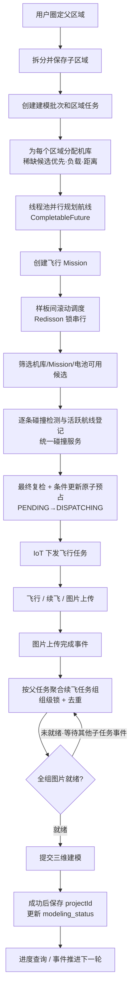

### 面试官问：请介绍一下自动建模模块

你可以这样回答：

> 自动建模是无人机巡检平台中的核心业务模块，目标是让用户圈定区域后，平台自动完成区域拆分、航线规划、机库和飞机选择、飞行任务执行、图片回传以及后续建模。我参与打通了区域拆分、异步航线规划、Mission 创建、任务下发、图片回传后自动触发三维建模和进度查询链路，并重点处理了多机库调度、航迹冲突、批次暂停继续取消、断点续飞、下发和起飞超时恢复，以及父子任务组重复触发建模的问题。
>
> 父区域会先拆成多个子区域，每个子区域对应一条规划航线和一个区域任务。系统为子区域分配机库后，通过线程池并行规划航线。所有可用航线和 Mission 准备完成后，进入样板间级滚动调度。
>
> 调度时不能只判断机库是否空闲，因为不同机库的航线也可能与正在执行的航线冲突。系统把安全判断拆成两个阶段：Mission 创建时只校验静态模型、障碍物和限高；真实下发前调用统一碰撞检测服务，检测并登记活跃航线，登记结果可确认后才允许调用 IoT。候选按现有优先级逐条准入，同机库由执行链互斥控制，样板间级 Redisson 锁和数据库条件更新共同防止重复下发。
>
> Mission 完成和机库就绪事件会推进下一轮，同时使用定时补偿处理漏事件和服务重启后的遗留状态。对于远程调用结果未知、未起飞、起飞超时和续飞卡住等场景，系统根据 Mission 状态进行有限重试和恢复。
>
> 飞行结束并不代表业务链路结束。图片上传完成后，事件处理器会异步进入自动建模流程。由于断点续飞会形成父子 Mission，同一任务组可能收到多个完成事件，所以系统按父任务 ID 加组级分布式锁，在锁内重新检查是否已经提交以及全组图片是否上传就绪。满足条件后汇总原图提交建模服务，只有外部提交成功才更新建模状态并保存 projectId，后续再通过 projectId 查询建模进度。

## 1.2 为什么要拆分区域

一个大区域直接生成一条航线，可能超过单块电池的飞行能力，也无法让多个机库并行工作。因此系统把父区域拆成多个子区域，每个子区域作为后续航线规划、机库分配、任务执行和失败恢复的最小单元。

并发拆分时可能出现两个请求同时删除旧子区域并创建新子区域的问题。代码使用父区域 ID 构造 Redisson 锁，让同一个父区域的拆分操作串行执行，避免生成重复子区域。

### 面试官问：为什么不直接为整个区域生成一条航线

> 大区域可能无法由一次飞行完成，也不利于多机库并行调度。拆成子区域后，可以把飞行负载分散到不同机库；单个区域规划失败时也只影响局部任务，不需要让整个批次全部失败。同时，子区域任务为暂停、恢复和进度聚合提供了清晰粒度。

## 1.3 为什么航线规划使用线程池

每个子区域的航线规划相对独立，而且包含外部规划和航线保存操作。如果串行执行，总耗时接近所有子区域规划耗时之和。

当前代码将每个已分配机库的区域提交到 `modelingRouteExecutor`，通过 `CompletableFuture.runAsync` 并行执行，再使用 `CompletableFuture.allOf` 等待一批任务结束。单区域异常在自己的异步任务中捕获并写入失败状态，不会直接中断其他区域。

### 面试官问：使用线程池后怎么处理异常

> 每个区域的规划任务独立捕获异常，失败时只把对应区域的 routeStatus 标记为 FAILED，并记录失败原因。`allOf` 负责等待整批异步任务收口；收口时重新查询数据库中的最新区域状态，再为规划成功的航线创建 Mission。因此一个区域失败不会把其他已成功区域一起回滚。

### 面试官问：线程池能防止任务重复执行吗

> 不能。线程池只解决并行和资源隔离，不解决幂等。重复创建批次由父区域级锁和活跃任务校验控制；任务正式下发的防重则由样板间级分布式锁和数据库状态条件更新保证。

线程池的实际参数在 `ModelingRouteThreadPoolConfig` 中定义：核心 5、最大 10、队列 100、空闲存活 300 秒，线程名前缀 `modeling-route-`，拒绝策略 CallerRunsPolicy，停机时等待任务完成（最长 300 秒）。参数通过 `modeling.route.thread-pool.*` 前缀暴露为配置，可按环境调整。

### 面试官问：这些参数为什么这么设

> 航线规划是 IO 混合型任务（外部规划服务、数据库、网络），线程数可以高于 CPU 核数，但真正的上限是下游外部规划服务的容量。小核心（5）保平稳，中峰值（10）扛批量，队列（100）吸收整批提交的瞬时峰值——单批次区域数远小于队列容量，一整批都能先入队。CallerRunsPolicy 保证池满时任务不会被拒绝丢弃。具体数值不能只靠公式，最终以压测和监控（活跃线程、队列长度、执行耗时、拒绝次数）为准。

### 面试官问：拒绝策略为什么选 CallerRunsPolicy

> 批次创建是用户发起的一次性动作：Abort 抛异常会让整批残缺，Discard 静默丢任务更危险，两者都意味着人工补救。CallerRuns 让提交线程自己执行，最坏情况是提交变慢，形成天然反压。代价是提交线程（可能是 Web 请求线程）被占用，所以参数必须调到池满不是常态。

### 面试官问：异步规划里的登录用户上下文怎么处理

> runAsync 切换线程后，请求线程的 ThreadLocal 不会自动继承。代码把 loginUser 显式带进每个异步任务：任务开头 LoginUserContextHolder.setUser，finally 中 clear。开头设置保证保存航线时操作人正确，finally 清理防止池化线程复用把上一个任务的用户身份串给下一个任务。

### 面试官问：收口时为什么重查数据库，不直接用内存里的结果

> 每个区域的规划任务各自写库，机库分配的延迟重试链还会中途补进区域，allOf 只承诺“这批 Future 都结束了”，不承诺“提交前的内存快照等于最终状态”。收口后按 taskId 重查全量区域、只取 routeStatus=SUCCESS 的航线创建 Mission，是以数据库为事实源的聚合，天然容忍重试链的补写。

### 面试官问：为什么不用虚拟线程

> 项目运行在 JDK 25 上，虚拟线程早已稳定，不用它是设计取舍而不是版本限制。这里线程池不只是执行器，还是限流器：核心 5、最大 10 就是对外部规划服务的并发保护；虚拟线程“每任务一线程”的默认模型对下游是无界并发，直接替换会打垮外部服务，还得再用 Semaphore 手写限流，等于把线程池免费提供的背压重做一遍，CallerRunsPolicy 的反压语义也没有对应物。当前量级也远没到平台线程不够用的程度，平台线程池行为可预期、监控成熟、参数可配。如果未来单批次区域涨到数百上千、下游容量充裕，虚拟线程加信号量限流才是更优解。

## 1.4 机库分配逻辑

系统先为每个子区域查询候选机库，考虑机库是否在线、距离范围、规划数据是否完整、绑定飞机和吊舱能力是否满足要求。

分配时优先处理候选机库较少的区域，避免先把稀缺机库分给选择很多的区域，导致后面的区域无机库可用。

当前二维分配评分顺序是：

1. 机库最终负载差值更小。
2. 机库到区域的连接线交叉数量更少。
3. 机库忙碌惩罚更低。
4. 总距离更短。

初始分配后，系统通过有界的单区域移动和两区域交换寻找更优方案。二维数据不完整时，再回退为简单的负载均衡分配。

### 机库分配的演进：从主轴单调到负载优先

当前算法是第二版。早期版本（提交 `264029414` 之前）是"主轴单调分配"：

1. 选主轴：比较区域群的经度跨度（乘以 cos 平均纬度折算成真实距离）与纬度跨度，取更长的方向作为主轴，即区域分布的长轴方向。
2. 区域和机库都按主轴上的投影排序。
3. 用动态规划求总代价最小的分配，单项代价 = haversine 距离 + 位置惩罚 + 负载惩罚 + 忙碌惩罚。其中位置惩罚等于"机库序号与期望序号差值的绝对值 × 2000 米"，期望序号按 areaIndex × dockCount / areaCount 计算——区域序列沿主轴被均分成机库数量的段，每段连续区域的期望机库是同一个。

这套设计的意图是构造性保证空间连续：相邻区域被强压到同一个机库（偏离自己的段每错一格罚 2 公里，比绝大多数真实距离都重），且指派沿主轴单调递进，"左机库飞最右区域、右机库飞中间区域"的交叉指派在结构上不可能出现，不需要显式计算交叉。

被替换的原因是优先级反了：空间连续是硬结构，负载均衡只是每任务 1000 米的软惩罚，还排在位置惩罚（每格 2000 米）之后。区域沿主轴分布不均时（例如一堆区域挤在某一侧），近侧机库照单全收、远侧机库闲置，任务量差距拉不开；某个区域的期望机库不在它的候选列表里时，只能在惩罚下被迫偏离，动态规划的单调约束还会连锁劣化。现方案把优先级倒了过来：负载极差成为字典序第一目标，交叉从构造保证降级为计数的软目标，交给贪心初始解加移动/交换的局部优化去消除，先保证多机库真正并行干活，再保空间质量。

### 面试官问：机库分配方案做过什么演进，为什么放弃主轴单调分配

> 最早是主轴单调分配：先比较区域群在经纬度两个方向的铺展宽度选出主轴，区域和机库都按主轴投影排序，再用动态规划求总代价最小的分配。代价里用"期望机库序号"把区域序列均分成机库数量的段，每段连续区域压向同一个机库，偏离一格罚两千米的等效距离。它的优点是构造性零交叉：相邻区域同机库、指派沿主轴单调，交叉指派结构上不可能出现，也不需要显式算交叉。问题在于目标优先级：空间连续是硬约束，负载均衡只是排在位置惩罚后面的软项，区域分布不均时一侧机库全收、另一侧闲置，多机库并行的好处出不来；期望机库不在候选列表时也只能带惩罚偏离。后来把优先级倒过来，负载极差成为第一目标，交叉降级为计数软目标，由贪心加移动交换的局部优化消除，先均衡再讲空间质量。

### 面试官问：为什么不直接选择最近机库

> 只选择最近机库可能让大量任务集中到同一个机库，其他机库空闲，反而延长总完成时间。系统首先平衡任务量，再考虑空间交叉、设备忙碌程度和总距离，是对整体完成效率和后续飞行安全的综合权衡。

### 面试官问：这个分配算法是全局最优吗

> 不是严格的全局最优。代码先贪心生成初始分配，再通过有限轮次的移动和交换做局部优化，优点是实现清晰、计算规模可控。当前单批次区域和机库数量有限，这种启发式方案足够实用。如果未来规模明显增大，或者业务要求严格最优，可以考虑整数规划或更完整的组合优化算法。

### 面试官问：分不到机库的区域怎么处理

> 初次分配没拿到机库的区域不会立即失败，而是进入延迟重试链：间隔 6 秒、最多重试 2 次，重试同样复用 modelingRouteExecutor（delayedExecutor）。每次重试前先重查数据库，只处理仍为 PENDING 且未分配机库的区域，状态已被其他流程改变的区域自动跳过；重试中分配成功的照常进入航线规划批次，2 次耗尽仍未分配的标记 FAILED，原因写“机库状态重试2次后仍未找到可用机库”。整条重试链与首批规划一起被 allOf 收口，批次准备完成时不会有漏网区域。用延迟而不是立即重试，是因为机库不满足通常是外部瞬时状态（正在充电、占用未释放），立即重试只会看到同样结果。

### 面试官问：评分和局部优化的代码具体怎么实现的

> 三个层次。① 打分函数一次算四个维度：把每个“机库→区域”连成线段两两判交数交叉数（同一机库的多条线不互判）；距离用 haversine 球面距离求和（米）；忙碌惩罚是所选机库的 penalty 之和；负载差 = 全部机库“存量负载＋本批已分配”的最大值减最小值。四个数按字典序比较：负载差最小优先，其次交叉更少、惩罚更低、总距离更短。② 初始解是“试放-打分”贪心：区域按候选机库数升序（稀缺优先），每个区域把每个候选放进当前方案全量打一次分，取最优——不是只看距离的就近贪心。③ 局部优化每轮搜索两个邻域：单区域换机库的移动，和两区域互换机库的交换（要求互换后各自仍在对方候选集内），取全邻域最优改进，无改进即停，轮次上限 max(4, 区域数×2)——所以叫“有界”局部优化，最坏时间可控。经纬度先做偏移还原再参与计算；区域或机库缺坐标时整个二维分配放弃，回退负载均衡兜底。

## 1.5 为什么从本地 JTS 升级为统一碰撞检测服务

早期方案在建模模块内读取航点，将经纬度转换为局部米制坐标，再使用 JTS 计算两条二维折线的最小水平距离。它能解决“航点不相交但航段相交”的问题，也便于构建冲突矩阵和搜索安全组合。

但这个方案有四个边界：

1. 只能表达二维距离阈值，无法统一覆盖模型、障碍物和限高。
2. 只看建模模块自己的候选和数据库状态，无法天然感知其他业务已经登记的活跃航线。
3. 调度模块复制了一套安全判定，容易与平台统一规则漂移。
4. 按机库分组的组合搜索最坏呈指数增长，复杂度与收益不匹配。

当前实现删除本地 JTS 冲突矩阵和组合搜索，让建模任务复用平台统一碰撞检测服务。简历中可以把 JTS 作为“历史方案与技术演进”来讲，但不能再描述为当前调度实现。

### 面试官问：为什么说这是升级，而不是简单删除算法

> 本地 JTS 解决的是二维几何距离，统一碰撞服务解决的是生产环境的安全准入，包括静态模型、障碍物、限高以及跨业务活跃航线。删除的是重复且边界有限的判断，保留的是调度、资源互斥和失败恢复；安全结论收口到统一服务后，规则一致性和跨系统可见性更强。

### 面试官问：改走远程服务后，时延和可用性不是变差了吗

> 时延没有净变差，因为删掉的不只是本地几何计算，还有按机库分组的指数级组合搜索——本地方案的复杂度大头在搜索而不是单次距离计算。现在碰撞检测是逐条候选的线性远程调用，只发生在真实下发前，耗时以 elapsed 记录在日志中可观测。可用性上确实是新依赖，所以调用方有完整的 fail-close 纪律：检测或登记确认失败保持 PENDING 等待，绝不带着未知安全状态下发，两分钟补偿保证服务恢复后自动补位。这笔交易是用可观测、可恢复的时延，换掉不可扩展的组合搜索和跨系统规则漂移。

## 1.6 两阶段安全校验与活跃航线登记

安全校验被拆成两个阶段：

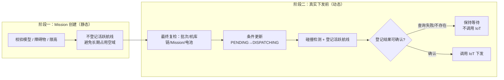

1. **Mission 创建阶段：** 只校验静态模型、障碍物和限高，不登记活跃航线。Mission 可能提前准备，如果此时登记，会在真正下发前长期占用空域。
2. **真实下发阶段：** 携带无人机、航线和 TTL 类型调用碰撞服务，检查当前活跃航线并登记本次航线；随后再次查询登记结果，只有确认登记成功才调用 IoT。

碰撞服务网关的历史降级逻辑会在远程异常时返回“允许”。建模调度不能接受这种 fail-open 语义，因此在检测返回成功后又查询一次活跃航线；查询失败或登记不存在，都按暂不可用处理，不执行真实下发。

Mission 完成时，活跃航线清理监听器按最高优先级先删除登记，再由建模完成监听器触发下一轮调度，避免新候选仍被刚完成的航线阻塞。

### 面试官问：为什么 Mission 创建时不直接登记活跃航线

> Mission 创建只代表任务准备完成，并不等于马上飞行。提前登记会把尚未执行的任务当成空域占用，降低并发，还可能因暂停、等待电池等原因长期阻塞其他任务。因此创建阶段只做静态安全检查，活跃航线在最靠近 IoT 下发的位置登记。

### 面试官问：为什么检测成功后还要查询登记结果

> 因为网关的通用降级策略可能在远程异常时返回兼容性的成功结果。飞行安全不能把技术异常当成安全，所以建模链路要求登记结果可查询确认；未确认时保持 PENDING 等待补偿，不调用 IoT。

### 面试官问：活跃航线为什么用 sourceEnv、droneSn、routeCode 三元组做键，只用 routeCode 不行吗

> routeCode 只能定位“哪条航线”，定位不了“哪次占用”。sourceEnv 是命名空间：碰撞中心是跨环境共享的独立服务，routeCode 只在本平台库内唯一，不隔离就会出现一套环境复用另一套环境的检测记录、完成事件误删别人的登记。droneSn 是生命周期归属：航线可复用、换机重派常见，登记、起飞续签、完成删除都跟着“某架无人机的某次执飞”走；只按 routeCode 会让后一架无人机复用前一架未过期的登记，前一架完成删除后，后一架还在飞但空域占用已经消失。碰撞检测本身对全部已登记活跃航线做几何比对，不依赖三元组匹配，因此键的精细化只提升查询、删除、续签的精确性，不影响安全性。

## 1.7 顺序候选准入与失败分类

调度先按任务创建时间、区域顺序等现有优先级取出全部 PENDING 候选，再过滤暂停或取消、同机库执行链、Mission 状态、机库状态和电池阈值。通过基础条件的候选按顺序逐条尝试：

1. 下发前再次检查批次、同机库占用、Mission、机库状态及电池。
2. 条件更新将 PENDING 原子切换为 DISPATCHING。
3. 调用碰撞服务检测并登记活跃航线。
4. 登记确认后立即调用 IoT。

同一机库可以有多个候选进入扫描列表：前一个成功后会形成实时占用，后续候选在最终复检时被挡住；如果前一个与活跃航线冲突，系统允许继续尝试同机库后续候选，避免固定队头阻塞。

碰撞结果按语义分类：

- 模型或障碍物碰撞、超高：确定性问题，区域标记 FAILED。
- 活跃航线冲突：临时资源冲突，回到 PENDING 等待完成事件重新调度。
- 服务异常、查询失败或登记未确认：安全性未知，保持等待，不调用 IoT。
- IoT 明确失败：删除刚登记的活跃航线并标记失败。
- IoT 抛异常或返回空：设备是否收到指令不明确，保留 DISPATCHING 和活跃航线，由设备状态与 TTL 兜底。

断点续飞也复用相同的下发前检查。机库或电池不满足、活跃航线冲突、碰撞服务暂不可用时都不增加续飞重试次数。

### 面试官问：不搜索一组最优组合，还能保证总体效率吗

> 当前规模大约是百个区域、二十台机库，任务时长接近。系统先通过机库分配平衡长期负载，再让碰撞中心对实时活跃航线逐条准入；每次完成事件立即释放航线并补位。相比指数级组合搜索，线性扫描实现更简单，决策依据也更新，能获得接近的有效并发，但不会宣称严格全局最优。

### 面试官问：为什么技术异常不能直接标记失败

> 技术异常不代表航线本身永久不可飞。标记 FAILED 会让暂时的网络或服务故障变成业务终态；直接放行又违反飞行安全。保持 PENDING 等待事件或两分钟补偿重试，才能同时满足 fail-close 和可恢复性。

## 1.8 图片回传后的自动建模闭环

多机库调度解决的是“哪些任务可以安全派飞”，但自动建模的业务结果是产出三维模型。因此，任务下发和飞行只是上游，图片回传后的三维建模才是下游闭环。

代码中的真实流程是：

```text
MissionImageUploadedEvent
  → MissionEventDispatcher 按事件泛型找到 ExecuteImageTaskHandler
  → ExecuteImageTaskHandler 组装 missionId、routeId
  → 异步调用 executeImageTask
  → 查询完整 Mission，校验任务类型是否三维建模（missionType==ODM_MODEL，子任务类型为空时回溯父任务）
  → 半自动触发方式的任务等待手动提交，再检查全局自动触发开关
  → 确定父任务 ID
  → 收集父任务及全部续飞子任务
  → 以父任务 ID 获取组级 Redisson 锁
  → 锁内检查 modeling_status，防止重复提交
  → 检查全组图片是否上传完成
  → 收集并解密所有原图地址
  → 提交建模服务并取得 projectId
  → 提交成功后更新 modeling_status、保存 projectId
  → 前端查询建模进度
```

这里最重要的不是调用一次外部接口，而是处理“一个建模任务组会产生多个图片完成事件”的并发问题。


断点续飞后，一个业务建模任务可能包含父 Mission 和多个子 Mission。任何一个 Mission 图片上传完成都可能触发事件，但收到第一个事件时，其他子任务的图片不一定已经上传。如果直接建模，会出现图片不完整；如果每个事件都提交，又会重复创建多个建模服务项目。

当前实现以父任务 ID 作为任务组唯一代表，锁内完成两次关键判断：

1. 组内任一 Mission 的 `modeling_status == 1`，说明已成功提交，当前事件直接跳过。
2. 父任务及全部子任务必须满足图片上传就绪；断点续飞首次任务留下的 `TASK_CREATED` 回补记录不实际派飞，单独放行，避免永远阻塞。

通过校验后，只查询 `isSrcImage == 1` 的原图，将加密地址解密并转换为建模服务可访问的 OSS 直链。系统把图片地址文件提交给建模服务，取得 `projectId` 后才把组内 `modeling_status` 更新为 1，并将 `projectId` 关联到建模区域任务。提交失败时保持状态为 0，并记录失败原因，使后续事件或人工操作仍有重试入口。

系统还区分三种触发模式：

- `AUTO`：图片上传事件自动触发；命中重复、未就绪等条件时静默跳过。
- `MANUAL`：人工触发，但仍保留去重和全组就绪校验；失败原因同步反馈给用户。
- `FORCE`：用户明确强制重跑，允许绕过去重和全组就绪校验，但仍使用组锁避免并发提交。

### 面试官问：为什么不能收到图片上传完成事件就直接建模

> 一个业务建模任务可能包含父 Mission 和多个断点续飞子 Mission，每个 Mission 都可能分别产生图片完成事件。收到其中一个事件只代表局部完成，不代表整个任务组图片齐全。如果立即提交，会出现缺图；如果每个事件都提交，又会重复建模。所以系统先按父任务聚合完整任务组，再在组锁内检查全组就绪和是否已经提交。

### 面试官问：为什么锁要按父任务 ID，而不是当前 missionId

> 并发竞争发生在同一个父子任务组内。不同子 Mission 的 missionId 不同，如果分别加锁，多个事件仍可能同时通过校验并重复提交。父任务 ID 才是这次建模的业务幂等键，因此所有父子任务共用同一把组锁。

### 面试官问：为什么必须提交成功后再更新 modeling_status

> 如果先把状态置为已提交，再调用建模服务，一旦外部调用失败，后续自动事件会因为已提交状态直接跳过，任务就会卡死。当前流程只有取得 projectId 后才更新状态；失败保持为 0，并记录失败原因，这样仍可由后续事件、手动触发或强制重跑恢复。

### 面试官问：自动触发、手动触发和强制重跑有什么区别

> 三种入口共用同一套核心建模流程和组锁。自动触发面向异步事件，未就绪或重复时静默返回；手动触发保留去重和就绪校验，但把原因同步反馈给用户；强制重跑代表用户明确要求重新提交，因此绕过去重和就绪校验，但仍不能绕过并发锁和图片为空校验。

## 第 1 周速记

```text
机库分配：稀缺候选优先→负载→连接线交叉→忙碌状态→距离→移动/交换优化
分配演进：主轴单调分段(相邻同库/构造零交叉)→负载优先+交叉软目标(264029414)
Mission 创建：模型、障碍物、限高静态校验，不登记活跃航线
真实下发：最终复检→PENDING CAS DISPATCHING→碰撞检测并登记→确认登记→IoT
模型碰撞/超高失败；活跃航线冲突等待；技术异常 fail-close
IoT 明确失败删除登记；结果未知保留 DISPATCHING 和活跃航线
完成事件先删除活跃航线，再滚动补位
续飞等待机库、电池或空域时不增加重试次数
下游：图片事件→父子任务组→组锁→去重→全组就绪→建模服务→projectId→进度
建模状态只在外部提交成功后更新，失败保留重试入口
```

---

# 第 2 周：并发控制、任务预占与分布式一致性

## 2.1 调度为什么按样板间加锁

调度入口不止一个：

- 航线和 Mission 准备完成。
- Mission 完成事件。
- 机库恢复待命事件。
- 用户继续批次。
- 定时补偿。

这些入口最终都会触发 `scheduleShowroom`。同一个事件也可能重复到达，不同服务实例还可能同时处理同一样板间。

系统使用下面的锁键：

```text
modeling:airspace:dispatch:{showroomId}
```

锁的范围是样板间，而不是单个机库。原因是一个样板间内有多个调度入口，会共同读取候选、机库占用并登记活跃航线。如果只锁单机库，不同入口可能基于旧快照同时推进任务；样板间锁负责把本地调度决策串行化，统一碰撞服务再负责跨机库、跨业务的空域安全准入。

### 面试官问：为什么选择 Redisson

> 系统是多实例部署，JVM 本地锁只能保护单个进程。Redisson 的 RLock 可以让不同实例围绕同一个 showroomId 串行执行调度。当前代码使用可中断加锁，并由看门狗自动续期，避免固定租约在远程下发尚未结束时提前过期；finally 中只由当前持锁线程释放。

### 面试官问：读候选、算优先级、下发本来就是串行代码，加锁有什么用

> "串行"是一个线程内代码的形状，不是执行的事实。调度入口有五个（航线就绪、Mission 完成、机库恢复、用户继续、定时补偿），随时可能并发进入，集群部署下还在不同 JVM 里同时执行同一段顺序代码。没有锁时的真实时间线：

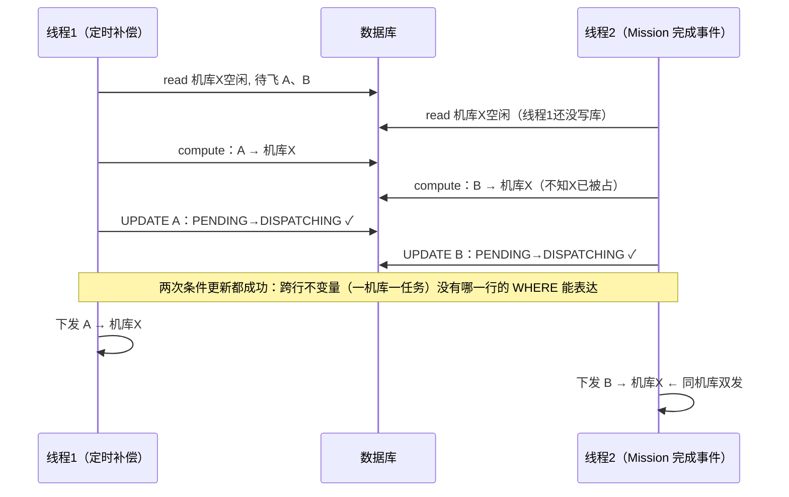

> 关键在于：就算这里对 A、B 各做一次条件更新，两次都会成功——A 的 PENDING→DISPATCHING 合法，B 的也合法。条件更新只能裁决单行流转，守不住"机库X同一时刻只执行一个任务"这种跨行不变量：它跨越多行记录加机库状态，没有哪一行的 WHERE 能表达它。锁的作用就是把"读机库状态＋读候选＋算＋写"整段变成原子，后进场的线程重新读，看到机库忙就换目标或退出。
>
> 反过来说，如果这段代码真的只会有一个线程进（单实例、单一触发源），锁就是冗余的。知道锁什么时候多余，才说明知道它什么时候必需。

### 面试官问：为什么不用 SELECT FOR UPDATE 代替分布式锁

> 数据库行锁也能串行化，但这个临界区要同时涉及区域、机库、Mission 多张表的多行，持锁期间还夹着远程下发调用，长事务会放大连接占用和死锁风险。分布式锁把决策临界区从数据库事务里拿出来，本地事务保持短小；真到写状态那一步，仍由条件更新兜底。

### 面试官问：为什么要设计这么多调度入口

> 因为“可以往前调度了”这个条件会在五个互不相识的子系统里成立：任务诞生（航线和 Mission 准备完成）、资源释放（Mission 完成事件）、资源恢复（机库回到待命）、约束解除（用户继续批次）、事件丢失兜底（定时补偿）。它们的触发者分别是异步流程回调、设备事件、用户请求和定时器，没有共同的触发点，除非引入一个轮询一切的中央循环，而那正是事件驱动要避免的。事件驱动负责及时性——只靠两分钟一次的补偿，任务完成后机库平均空转一个周期，活跃航线还占着 TTL；定时补偿负责可恢复性——设备消息丢失、消费者异常、服务重启都会丢事件，补偿扫描的是数据库持久化状态，与事件是否送达无关。砍掉任何一个入口都有明确代价：砍完成事件则每次飞完机库闲置到下轮补偿，砍补偿则一次事件丢失就是永久卡死。五个入口全部收敛到同一个 `scheduleShowroom`，在样板间锁内基于实时状态执行条件更新，所以并发触发、重复触发都是幂等安全的——入口多且必然并发，这正是必须加锁的原因。

### 面试官问：锁的粒度为什么是样板间，更细或更粗行不行

> 锁的粒度等于它要保护的不变量的范围。锁内的决策——`findDispatchCandidatesForShowroom` 读取全样板间跨批次的候选并统一排序，`findBlockingIssuedAreasByDock` 反查每个机库的实时占用——是跨机库、跨候选的全局计算，“一机库同时只跑一个任务、候选按优先级准入”这些不变量张在样板间整张网上。锁单机库挡不住两个机库同时预占同一个候选，负载均衡也会基于对方未提交的旧快照决策；锁全局又把物理上独立的空域白白串行——样板间之间没有任何共享状态。样板间之上、跨业务之间的空域冲突由统一碰撞中心在登记活跃航线时做几何裁决，不归这把锁管：本地锁管决策一致性，远程服务管空域安全性，两层各管一段。

### 面试官问：多个批次同时调度，每个批次一把锁不行吗

> 批次是用户视角的逻辑分组，机库、电池、空域这些物理资源挂在样板间上，批次之间共享。调度把同一样板间所有批次的候选合成一个按“批次创建时间→区域创建时间→sort”排序的队列，机库占用也从全样板间的已下发区域反查。按批次加锁，两个批次各持各的锁同时读到同一机库空闲，各自的行级条件更新都成功（更新的是不同的行），结果就是同机库双发——与上文时序图是同一个竞争，只是主角换成两个批次。全局优先级同样失效：后建批次在各自锁内独立调度，可以插队抢走先建批次正在等的机库。批次控制操作印证了这一点：取消、暂停、继续是批次级操作，但它们都拿样板间锁执行，因为取消批次会释放机库、暂停会摘除候选，这些变化立刻影响其他批次的调度视角。机库就绪和定时补偿两个入口本身就不属于任何批次，事件到达时连“该拿哪把批次锁”都无法回答。

## 2.2 为什么还需要数据库条件更新

正式下发前，代码执行类似下面的条件更新：

```sql
UPDATE modeling_task_area
SET dispatch_status = 'DISPATCHING'
WHERE id = ?
  AND dispatch_status = 'PENDING';
```

只有影响行数为 1，当前线程才拥有下发资格。状态已被其他线程、暂停或取消流程改变时，更新失败，本次停止。

### 面试官问：有分布式锁了，为什么还需要数据库条件更新

> 锁管过程，条件更新管结果，两者失效的来源不同。
>
> 锁把"读候选、最终复检、碰撞登记、下发"串行化，但它管不住三件事：
>
> 1. 旁路写入方。取消、暂停、Mission 回调、定时补偿修改区域状态时不持调度锁，随时可能把 PENDING 改走。
> 2. 锁自身是尽力而为。tryLock 有租约，GC 停顿或慢 SQL 超过租约后锁自动释放、第二个线程进入，第一个线程还以为自己持锁；Redis 主从切换也可能直接丢锁。
> 3. "所有写入方都拿同一把锁"是靠纪律维持的约定，新增一个写入方忘了拿锁就破了。条件更新把流转条件写进数据本身，谁来写都绕不过。
>
> 代价也不对称：锁失效的代价是重复计算一次候选，条件更新失效才会造成重复下发。所以最后一道防线必须建在数据库——影响行数为 1 的那个线程，才拥有下发资格。

### 面试官问：锁已经把调度串行了，状态怎么会被别人改

> "串行"只覆盖持锁的调度线程。取消和暂停走的是另一个入口，不拿调度锁；设备回调、定时补偿也是独立入口。锁串行化的是"走锁的那批人"，管不了旁路。而且就算所有入口都拿锁，锁也会因租约超时或 Redis 切换失效——正确性不能建立在"锁永远不丢"的假设上。

### 面试官问：让取消流程也拿锁不就行了

> 能减少竞态概率，换不来正确性保证，还引入新问题：取消要等调度临界区走完，锁等待时间变大；分布式锁本质是约定，不是约束——下一个新增的写入方忘了拿锁，防线就没了。条件更新是数据层约束，不依赖任何调用方自觉，两道防线本来就不该合并成一道。

### 面试官问：这算乐观锁吗

> 算 CAS 式乐观并发：期望旧状态写入 WHERE，影响行数判断抢占是否成功。但它和 version 乐观锁的失败语义不同——version 冲突说明你看到的不是最新值，重读重试是合法的；状态冲突说明 PENDING→DISPATCHING 这次流转在业务上已经不合法（被取消、被暂停、被别人下发），应该放弃而不是重试。
>
> 如果追问 ABA：这里确实存在回退（下发超时 DISPATCHING 会回 PENDING），理论上构成 ABA，但它是无害的——回退本身就说明上一次下发已死、任务重新可派。条件更新保证的是"此刻仍可派"，不是"从未被派过"；基于旧快照的组合决策由下发前的最终复检兜底。

## 2.3 为什么筛选候选时不立即写 DISPATCHING

候选筛选与真正调用 IoT 之间还有一段时间。如果筛选完成后立即把所有候选写成 DISPATCHING，随后服务异常退出，就会留下“从未真正下发，但长期占用机库”的孤儿状态。

因此当前实现分为两步：

1. 在锁内筛出基础条件满足的候选，但暂时不修改为 DISPATCHING。
2. 对每条候选正式下发前重新读取最新状态，完成最终复检，再原子切换为 DISPATCHING，并立即执行碰撞登记和 IoT 下发。

最终复检包括：

- 批次仍允许调度，没有暂停或取消。
- 同机库不存在未结束任务链。
- Mission 存在且仍允许下发。
- 机库此刻仍处于可调度待命状态，且存在达到阈值的电池。
- 航线碰撞检测通过，活跃航线登记可确认。

### 面试官问：为什么需要最终复检，前面不是检查过了吗

> 调度锁只串行化了调度线程之间。候选计算到实际下发之间，不持锁的旁路写入方——用户暂停或取消、设备回调改变机库状态——随时可能把前提改掉。最终复检把判断推到离副作用（调用 IoT）最近的位置，用此刻的最新状态做决定，而不是依赖临界区开头读过、可能已经过期的快照。原则是：检查离副作用越近越可信。

## 2.4 远程调用结果未知

IoT 下发可能有三种结果：

1. 明确成功：更新为 SUCCESS。
2. 明确失败：更新为 FAILED，并记录原因。
3. 抛异常或返回空：结果未知，保留 DISPATCHING。

第三种情况最容易答错。调用方超时只能证明“没有拿到响应”，不能证明设备没有收到任务。如果立即回退为 PENDING，下一轮可能再次下发，造成重复飞行。

### 面试官问：为什么下发异常后不直接重试

> 因为这是非幂等的设备操作。网络异常时设备可能已经收到任务，只是响应丢失。立即重试可能造成重复执行。系统把结果未知与明确失败分开，结果未知时保留 DISPATCHING，等待 Mission 状态、设备事件或超时补偿进一步确认。

### 面试官问：为什么不用数据库事务包住远程调用

> 数据库事务无法回滚设备已经收到的指令。长事务还会长期占用数据库连接和锁。正确做法是用本地状态记录调用前后的事实，把远程结果分成成功、明确失败和未知，再通过设备状态和补偿流程最终收敛。

## 2.5 事件重复为什么不会重复下发

Mission 完成、机库就绪和定时补偿都可能重复触发调度，这是预期设计。

防重依赖三层：

1. 所有入口汇聚到相同的 `scheduleShowroom`。
2. 同一样板间由 Redisson 锁串行。
3. 单条任务只有 PENDING 才能条件更新为 DISPATCHING。

### 面试官问：定时补偿和事件同时触发怎么办

> 两个入口最终竞争同一个样板间锁，因此不会同时完成候选计算和下发。后进入的调度会重新查询数据库最新状态；已经被前一个流程抢占的任务不再满足 PENDING 条件，所以不会重复下发。

### 面试官问：事件为什么会重复，来源有哪些

> 重复是常态而不是异常：调度入口有五个（航线就绪、Mission 完成、机库恢复、用户继续、定时补偿），任何两个先后到达就是一次重复触发；设备侧事件是 at-least-once 语义，网络重投就会重复送达；服务重启后补偿扫描与遗留事件也会并发。所以设计上不追求“事件恰好一次”，而是让每次触发都安全：入口收敛到同一个 scheduleShowroom、样板间锁串行、条件更新裁决单行流转。宁可重复触发再被幂等挡住，也不为了去重而冒丢触发的风险。

## 2.6 队头阻塞

如果调度严格只看 sort 最小的队头任务，当队头航线冲突或机库不可用时，后面本来可以安全执行的任务也会被阻塞。

当前实现查询样板间所有满足条件的 PENDING 区域，先过滤：

- 同机库存在未结束任务链。
- Mission 不可下发。
- 机库不可用。
- 电池不满足下发阈值。

然后按现有优先级逐条尝试碰撞中心准入。sort 只作为稳定排序，不再是不可跳过的刚性队头。

### 面试官问：如何解决队头阻塞

> 调度从“只判断队头”改成“扫描整个样板间的可执行候选集合”。队头无法执行时记录等待原因，但允许继续尝试后面的候选；一条任务通过碰撞检测并登记后，后续候选会基于最新活跃航线判断。Mission 完成、机库就绪或定时补偿都会重新扫描。

## 第 2 周速记

```text
锁粒度是样板间，因为调度入口和机库占用决策跨任务、跨机库
锁管过程：串行化多行决策，保护跨行不变量（一机库一任务）
条件更新管结果：裁决单行 PENDING→DISPATCHING
锁管不住三件事：旁路写入方、租约超时/Redis 切换、调用方纪律
代价不对称：锁失效重算一次候选，条件更新失效才重复下发
version 冲突该重试，状态冲突该放弃
筛选阶段不提前写 DISPATCHING，避免预占残留
下发前再次检查批次、机库链、Mission、机库、电池和航线登记——检查离副作用越近越可信
明确失败可以失败；结果未知不能盲目回退
事件允许重复，入口必须幂等
```

---

# 第 3 周：状态机、事件补偿与断点续飞

## 3.1 为什么状态要分层

一个建模批次包含多个区域，每个区域又经历航线生成、Mission 创建、下发、飞行和续飞。一个 status 无法同时表达所有事实。

当前状态层次包括：

### 批次状态

```text
PLANNING → READY → EXECUTING → COMPLETED
                           ↘ FAILED
                           ↘ CANCELLED
```

### 区域航线和 Mission 创建状态

```text
PENDING → SUCCESS / FAILED
```

### 下发状态

```text
PENDING → DISPATCHING → SUCCESS
                      ↘ FAILED
                      ↘ CANCELLED
```

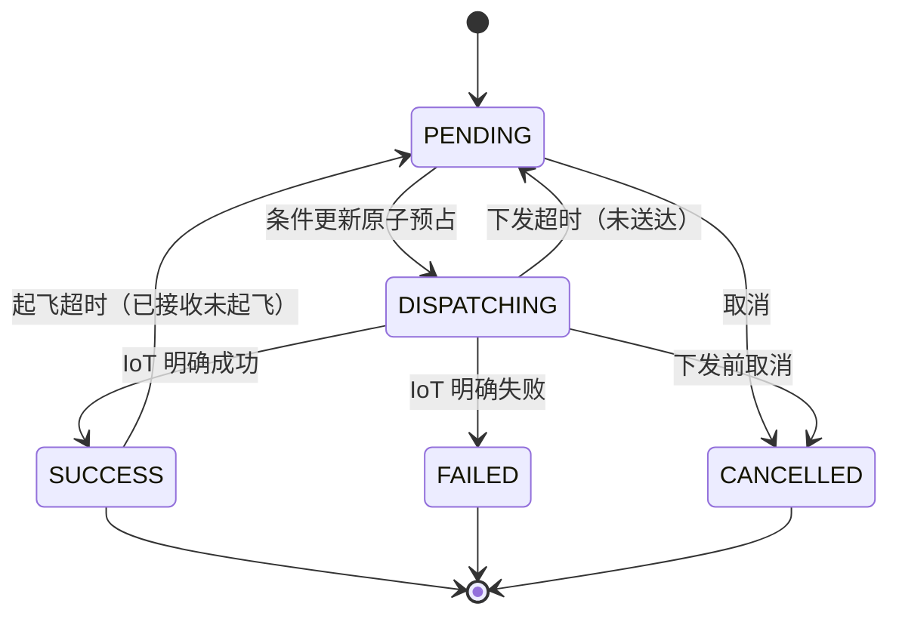

其中下发 SUCCESS 只表示设备下发链路成功，不表示飞行完成。真实飞行进度仍以 `Mission.status` 及续飞子 Mission 为准。

### 面试官问：为什么不能只使用一个任务状态

> 批次、区域规划、Mission 创建、下发和真实飞行是不同层次。如果把它们压进一个字段，很容易把“航线生成成功”“任务下发成功”和“飞行完成”混为一谈。分层后每个状态只表达一个阶段事实，批次状态由区域和 Mission 状态聚合，更容易恢复和排查。

### 面试官问：批次状态具体怎么聚合的

> 有一个唯一写入口 ModelingTaskStatusService.refreshTaskStatus，任何事件（下发、完成、取消、补偿）想更新批次状态都必须走它，它每次全量重算而不是增量改。决策树是：逐区域判终态——飞行完成且无失败计成功，路由/Mission/下发任一字段 FAILED 或 CANCELLED 计失败；全部区域终态时，无失败为 COMPLETED、有成功有失败为 PARTIAL_FAILED、全失败为 FAILED；未全部终态时，有任一区域离开 PENDING 就算 EXECUTING，航线全部规划完是 READY，否则 PLANNING。写入时两条纪律：只进不退（状态只能沿生命周期向前），终态粘滞（已是终态且目标不同则保持不变只记日志）。原因还是并发：刷新会被多个入口并发触发，如果允许回退，后到的旧快照会把 EXECUTING 拉回 READY，前端状态闪烁，调度按状态筛候选（queueEligibleCodes）也会被扰乱；终态粘滞则保证迟到的失败事件不会把已完成批次改判。这是“聚合投影 + 单写入口 + 单向流转”的组合，和区域级条件更新是同一套哲学在不同粒度上的应用。

## 3.2 为什么不引入状态机框架

状态要分层，很容易让人想到用状态机框架（Spring Statemachine、工作流引擎）来统一管理。但当前系统刻意没有这样做。状态机模型成立需要三个前提：状态是权威的、事件是可靠且不重复的、转移函数是状态的唯一写者。建模调度这三条都不满足。

### 真值在设备侧

数据库状态是无人机和机库真实状态的最佳努力镜像。下发 SUCCESS 只代表设备已接收，不代表飞行完成；Mission 状态由设备消息回调等代码路径推进，不是只由调度器这一个写者修改。状态机假设"状态只随显式事件转移"，而这里的事件来源和写入方都不止一个。

### 事件会丢失、重复、乱序

设备断联、网络抖动和服务重启都会丢事件。纯事件驱动的状态机丢掉一次转移事件后，会永远停在错误状态等待人工干预。当前设计是"事件负责及时、定时补偿负责恢复"：补偿每两分钟按数据库持久化状态重新计算一遍，向正确状态收敛。这更接近 Kubernetes 控制器的水平触发对账（level-triggered reconcile），而不是状态机的边沿触发转移（edge-triggered）。对账模式天然容忍漏事件，这是保留它的根本原因。

### 状态是跨节点共享的持久状态

Spring Statemachine 这类框架是单实例内存模型，持久化支持很弱。而这里的状态存在 MySQL，由多个服务节点共享，并发正确性靠样板间级 Redisson 锁加数据库条件更新保证。引入引擎后，锁和条件更新一样都不能省，只是多一层间接，没有减少任何真实复杂度。

### 批次状态是聚合投影

`task.status` 由区域明细汇总而来：全部区域终态则批次终态，任一区域开始下发则 EXECUTING，全部航线终态则 READY，并且只进不退。它表达的是"批次曾到达的最高阶段"，是被计算出来的投影，不是被事件一步步推进的机器状态。硬套状态机需要发明大量中间事件，机器内部仍然要做同样的聚合，只增加间接层。

### 哪里用到了状态机思想

区域 `dispatchStatus` 是一张真实的状态图，而且含回退和循环：下发超时 DISPATCHING/SUCCESS 回退 PENDING，起飞超时重试也是 SUCCESS 回 PENDING 再下发。当前实现的转移规则分散在多个更新方法里，靠每个调用点自己写状态条件保证合法。合理的演进方向是显式转移表：FROM、TO、前置条件、动作，收敛到唯一转移入口；同时把现在编码在 failReason 文本里的重试次数（"第N/2次"再字符串解析还原）改成显式计数字段。这是把状态机当建模工具用，而不是引入引擎当架构。

### 面试官问：为什么不直接引入 Spring Statemachine 这样的框架

> 状态机框架的三个前提在这里都不成立。第一，真值在设备侧，数据库状态是镜像，Mission 状态还会被设备消息等其他代码路径修改，做不到唯一写者。第二，设备事件会丢失和重复，纯事件驱动的状态机丢事件后会停在错误状态，必须保留定时补偿做对账收敛，所以整个系统是水平触发的控制循环，不是状态机。第三，状态是跨节点共享的持久状态，框架是单实例内存模型，引入后分布式锁和条件更新一样不能少，反而多一层间接。这个系统的复杂度在事件不可靠、真值在远端、多写者并发，状态机框架一个问题都不解决。

### 面试官问：那什么系统适合状态机模型

> 事件可靠、单一写者、状态转移本身就是核心业务规则的系统，典型是订单和审批流：待支付到已支付到已发货，事件由本系统事务内产生不会丢，转移合法性就是业务规则本身，用状态机能把非法转移变成结构上不可能。建模调度不同，它的核心复杂度是漏事件恢复、设备真值同步和多节点并发，这些靠对账、锁和条件更新解决。所以这里只用状态机思想管理单个字段的生命周期，不用它做整体架构。

## 3.3 事件驱动加定时补偿

Mission 完成事件可以释放机库和空域，机库就绪事件可以恢复未实际起飞任务并推进队列。事件驱动能够快速开始下一轮。

但设备消息、网络、消费者异常和服务重启都可能导致事件丢失。因此系统还有默认每两分钟执行一次的低频补偿，扫描 READY/EXECUTING 且未暂停的样板间，再执行同一个调度入口。

### 面试官问：为什么有事件还要定时任务

> 事件负责及时性，定时任务负责可恢复性。事件正常时可以立即推进，不需要等待轮询；事件丢失或服务重启时，定时补偿会重新扫描持久化状态并恢复调度。因为调度入口本身具备锁和状态幂等，重复触发是安全的。

## 3.4 下发超时和起飞超时

系统根据 Mission 状态区分不同问题：

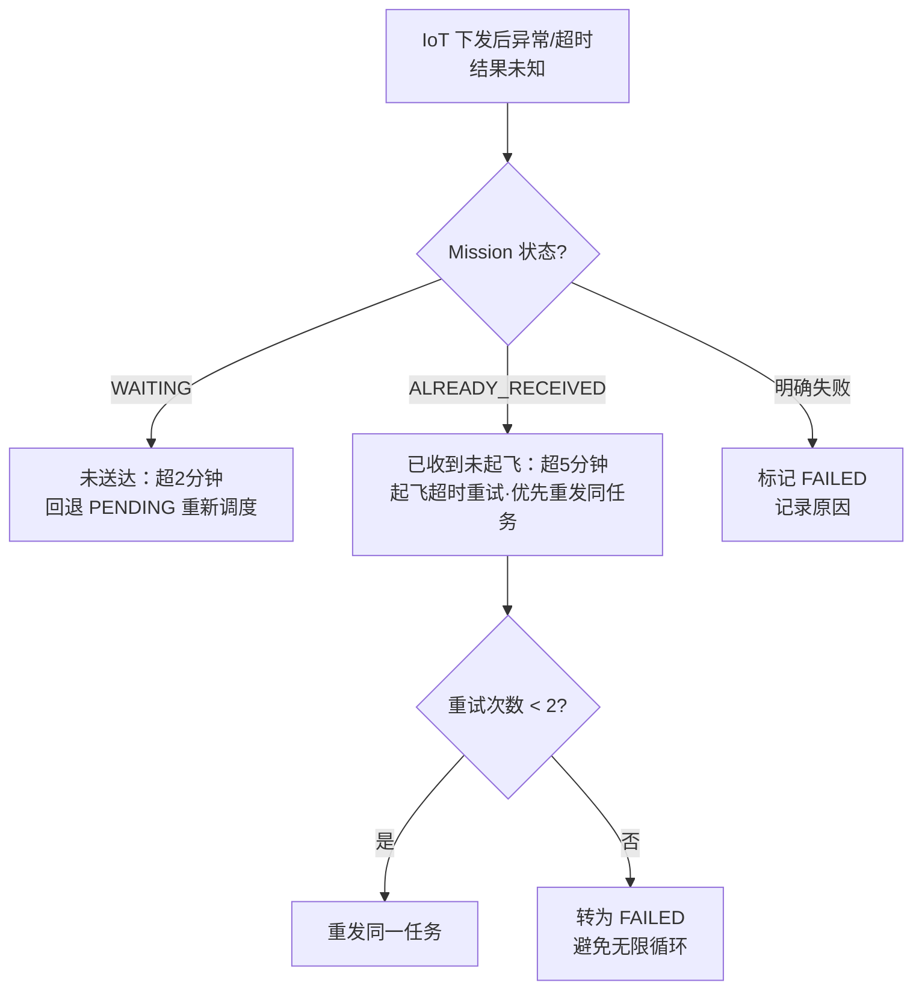

### Mission 仍为 WAITING

说明任务没有被飞机确认接收。超过默认两分钟后，可以把区域回退为 PENDING，重新进入调度。

### Mission 已经 ALREADY_RECEIVED

说明飞机已经收到任务，但没有在默认五分钟内进入飞行。此时标记为起飞超时重试，优先重新下发同一个任务。

普通起飞超时最多自动重试两次，耗尽后转为 FAILED，避免无限循环。

### 面试官问：为什么 WAITING 和 ALREADY_RECEIVED 不能使用同一种恢复方式

> WAITING 更接近指令尚未送达，可以回退后重新发送；ALREADY_RECEIVED 表示设备已经确认收到，重复发送风险更高，需要按照起飞超时单独记录和限制重试。状态不同，能够确定的事实不同，所以恢复策略也不同。

### 面试官问：两分钟和五分钟的阈值怎么定，回退 PENDING 安全吗

> 两个阈值都做成配置（dispatch-stale-timeout-ms / takeoff-stale-timeout-ms），默认 2 分钟和 5 分钟，可按环境调整。定法是“远超正常耗时”的异常线：下发链路正常秒级返回，2 分钟已覆盖网络抖动和服务重试余量；起飞包含出库、自检、滑跑等物理流程，正常也是分钟级，门槛放宽到 5 分钟。回退安全靠两点：回退本身也是条件更新，只回收仍处于 DISPATCHING/SUCCESS 的行；且回收逻辑在样板间调度锁内执行，回退后的重新下发与其他调度一样走完整最终复检，不存在绕过检查的“直接重发”。起飞超时重试上限 2 次，耗尽转 FAILED，防止设备持续异常时无限循环。

## 3.5 断点续飞

父 Mission 因电量等原因未完成整条航线时，会产生续飞子 Mission。调度和完成判断不能只看父 Mission，否则可能出现：

- 父 Mission 已返航，但续飞子任务仍在等待。
- 把父任务误判为完成，提前释放机库或触发建模。
- 续飞子任务卡住后，错误地重新下发父 Mission，导致从头重复飞行。

当前实现会查询父 Mission 的续飞子任务，并只处理最新且未结束的子 Mission。续飞下发或起飞超时后，重试当前子 Mission，而不是重新下发父 Mission。

### 面试官问：断点续飞最关键的防重点是什么

> 必须区分父 Mission 和续飞子 Mission。存在未结束续飞链时，父区域仍然占用机库和空域；恢复时只能重试最新待执行的子 Mission，不能把父 Mission 退回 PENDING 再从头下发。

### 面试官问：为什么机库、电池不满足或碰撞服务不可用时不计入续飞重试次数

> 续飞链的下发前检查与普通任务相同，但这几类情况不消耗重试预算，因为它们是外部瞬时条件，不是这个任务本身的问题：机库正在充电、别的航线占着空域、碰撞服务抖了一下，过一会儿可能就满足。如果把这类等待烧掉重试预算，任务会在“完全可以飞”的状态下被误判失败。真正计入重试的是起飞超时这类“重发了也不一定好”的情况，上限 2 次。区分标准是：可自行恢复的等待不计数，重发才可能解决的异常才计数。

## 3.6 暂停

暂停的业务语义不是让正在飞行的无人机立即停下，而是：

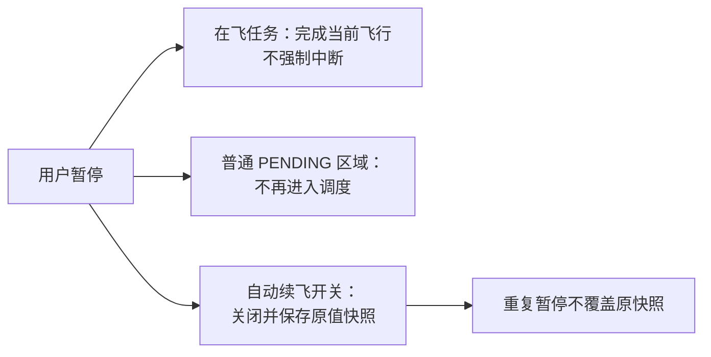

- 已经在飞的任务完成当前飞行。
- 普通 PENDING 区域不再进入调度。
- 不再自动启动新的续飞腿。

系统把批次 `paused` 条件更新为 1，并关闭每个父 Mission 的自动续飞开关。首次暂停时保存原开关快照，重复暂停时不会用已经临时关闭后的 0 覆盖原值。

### 面试官问：为什么暂停不强制终止在飞任务

> 无人机强制中断涉及飞行安全和设备能力，修改数据库状态并不能安全让飞机停下。当前暂停语义是阻止后续调度和新续飞腿，让在飞任务自然结束，风险更可控。

## 3.7 继续

继续操作按下面顺序执行：

1. 恢复父 Mission 的自动续飞能力。
2. 对仍为 WAITING 的最新续飞子任务重新触发。
3. 每成功恢复一个区域，就清理对应暂停快照。
4. 所有续飞链处理成功后，最后把批次 paused 从 1 更新为 0。
5. 重新触发样板间调度，推进普通 PENDING 区域。

逐条清理快照的设计使继续操作可以重试：已经恢复成功的不会再次触发，失败的仍保留快照作为补偿依据。

### 面试官问：继续执行到一半失败怎么办

> 继续操作不是一次性把所有快照清空。每个续飞链恢复成功后才清理自己的快照，失败区域仍保留原快照；批次 paused 也要等所有恢复成功后才解除。因此再次调用继续时，可以跳过已完成部分，补偿未完成部分。

## 3.8 取消

取消需要区分任务真实状态：

- 未下发：取消 Mission，并把区域标记 CANCELLED。
- 已下发但仍在起飞前：尝试取消 Mission，并标记区域取消。
- 已被飞机接收或已经在飞：不强制修改为未飞，等待当前飞行结束。
- 所有父 Mission：关闭自动续飞。
- 仍为 WAITING 的续飞子 Mission：批量取消。

取消请求和返航后异步生成续飞子任务之间可能存在竞态。因此每次调度前，还会重新扫描已取消批次，收敛后来生成的 WAITING 子 Mission。

### 面试官问：为什么取消不能直接把所有区域状态改成 CANCELLED

> 数据库状态不能改变飞机的真实状态。如果任务已经被飞机接收或正在飞行，直接改成 CANCELLED 会让平台误以为资源和空域已经释放，可能继续下发冲突任务。取消必须根据 Mission 真实阶段处理，已在飞任务等待自然结束，同时阻止后续任务和续飞腿。

### 面试官问：取消和返航后生成续飞子任务的竞态怎么处理

> 竞态场景：取消请求执行时，父任务刚好因电量返航，返航后异步流程还会生成新的 WAITING 续飞子任务——这些子任务在取消扫表之后才出生，单次取消管不到它们，不处理就会出现“批次已取消却还有子任务等着起飞”。解法是对账收敛：每次样板间调度开始、拿到锁之后的第一件事就是 reconcileCancelledResumeChains——重新扫描已取消批次，把后来生成的 WAITING 子 Mission 补充取消。和定时补偿同一个哲学：单次操作的完整性不可靠，就把“收敛已取消批次”变成调度入口的固定动作，竞态窗口最长只活到下一次调度。

## 第 3 周速记

```text
批次、区域处理、下发、Mission 飞行状态分层
下发成功不等于飞行完成
不引入状态机框架：真值在设备侧、事件会丢、状态是跨节点共享的持久状态
批次状态是聚合投影，系统是对账收敛的控制循环，不是事件驱动的状态机
区域 dispatchStatus 可以显式转移表化，隐式重试计数应改成显式字段
事件负责快，定时补偿负责恢复
WAITING：未送达；ALREADY_RECEIVED：已收到但未起飞
重试有上限，不能无限循环
续飞只重试最新子 Mission，不能重发父 Mission
暂停不强停在飞任务
继续逐条恢复并保留补偿快照
取消也必须服从设备真实状态
```

---

# 第 4 周：结合项目复习 Java、MySQL、Redis 与 Spring

这一周不单独背定义，而是把基础问题放回项目场景。

## 4.1 Java 线程池

线程池的关键参数包括核心线程数、最大线程数、空闲存活时间、任务队列、线程工厂和拒绝策略。

在自动建模中，航线规划任务相互独立，适合并行。线程池的作用是：

- 限制并发量，避免为每个区域随意创建线程。
- 复用线程，降低创建和销毁开销。
- 通过队列吸收短时任务峰值。
- 使用独立执行器，避免占用通用线程池。

### 面试官问：线程池参数怎么设置

> 要先区分 CPU 密集还是 IO 密集。航线规划链路既有计算，也包含外部规划和数据库、网络调用，更偏混合和 IO 等待，线程数可以高于 CPU 核数，但不能只凭公式决定。应该结合单任务耗时、外部服务容量、队列等待和拒绝次数压测调整，并监控活跃线程、队列长度和执行耗时。项目实际配置是核心 5、最大 10、队列 100、CallerRunsPolicy，上限对齐外部规划服务的承载能力（详见 1.3 节）。

### 面试官问：CompletableFuture.allOf 有什么作用

> 它把多个区域规划任务组合成一个收口 Future，让系统在全部异步任务结束后统一查询最新状态、创建 Mission 并启动调度。它本身不会自动返回每个任务结果，所以单任务状态仍写入数据库，收口时重新聚合。

## 4.2 CAS、锁与 volatile

`volatile` 保证可见性和一定的有序性，但不能让复合读改写操作自动具备原子性。CAS 会比较旧值，只有旧值仍符合预期才写入新值。

项目中的数据库条件更新：

```text
WHERE dispatch_status = PENDING
SET dispatch_status = DISPATCHING
```

就是一种跨线程、跨实例的 CAS 思想。

### 面试官问：为什么不用 synchronized 保护调度

> synchronized 只在单个 JVM 内有效，系统多实例部署时，另一个实例仍能同时进入。样板间调度需要跨实例互斥，所以使用 Redisson 分布式锁；数据库条件更新再提供最终持久化防重。

## 4.3 MySQL 事务

事务的 ACID：

- 原子性：事务内操作全部成功或全部失败。
- 一致性：事务前后数据满足约束。
- 隔离性：并发事务之间按照隔离级别互相影响。
- 持久性：提交后结果持久保存。

但数据库事务只能约束数据库，不能回滚 IoT 设备已经执行的动作。

### 面试官问：远程下发为什么不能放在一个大事务中解决

> 数据库事务无法覆盖远程设备。即使本地事务回滚，设备可能已经收到任务；同时长事务会占用连接和数据库锁。系统应该缩短本地事务，用业务状态记录调用前后事实，再通过幂等、状态查询和补偿收敛远程结果。

### 面试官问：先查状态再更新有什么问题

> 这是典型的 check-then-act 竞态：

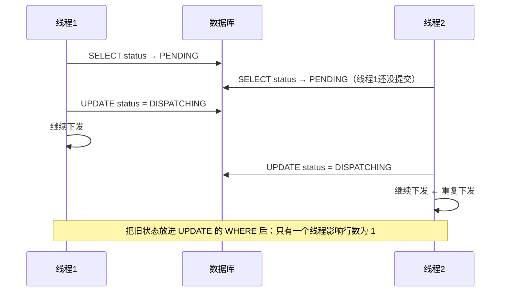

> 两个线程的判断都基于"自己读到 PENDING"这个已经过期的快照。把旧状态放进 UPDATE 的 WHERE，判断就从应用层挪到了数据库行锁上：只有一个线程影响行数为 1，另一个拿到 0 行，自然停止。

## 4.4 MySQL 索引

自动建模常见查询条件包括：

- taskId 查询批次区域。
- showroomId 查询活跃批次。
- dispatchStatus 查询待发或已发任务。
- dockSn 查询机库占用链。
- missionId、routeCode 查询关联区域。

联合索引不能只看单字段出现次数，要结合真实 SQL 的 WHERE、ORDER BY、数据分布和执行计划。

### 面试官问：你会怎么判断索引是否合理

> 先从慢查询和高频 SQL 出发，使用 EXPLAIN 查看访问类型、使用索引、扫描行数和额外排序，再结合字段区分度设计联合索引。不能只看到查询条件就机械建立多个单列索引，也不能在没有执行计划和数据量证据时声称某个索引一定最优。

## 4.5 Redis Lua

智能体智能体的异步指令状态为：

```text
RECEIVED → DISPATCHED → EXECUTING → SUCCESS / FAILED
```

如果 Java 代码先 GET，再判断，再 SET，两个并发回调可能这样执行：

```text
线程 A 读取 EXECUTING
线程 B 读取 EXECUTING
线程 A 写 SUCCESS
线程 B 写 FAILED
```

终态就被后到的旧回调覆盖。


Lua 脚本在 Redis 内部一次完成：

1. GET 当前 JSON。
2. 判断状态转换是否合法。
3. 修改状态和消息。
4. SET 并刷新过期时间。

### 面试官问：Lua 为什么能保证原子性

> Redis 在执行 Lua 脚本期间不会穿插执行其他命令，所以读取、判断和更新作为一个整体完成。这样可以防止 SUCCESS、FAILED 等终态被并发旧回调覆盖。

### 面试官问：Lua 能保证整个业务一致性吗

> 不能。它只保证单个 Redis key 内状态转换的原子性，不能自动解决消息丢失、Redis 故障、数据库状态和设备真实状态不一致。重要业务结果仍需要业务系统持久化，Redis 更适合短期异步状态协调和查询。

### 面试官问：这套状态机为什么放 Redis 而不是数据库表

> 具体实现：key 是 `voice:assistant:instruction:status:{messageId}`，值为状态 JSON，TTL 默认 10 分钟；Lua 脚本（update_instruction_status.lua）收到目标状态码后先校验流转合法性（RECEIVED→DISPATCHED/终态，DISPATCHED→EXECUTING/终态，EXECUTING→终态），终态一律拒绝改写，非法流转返回 0，Java 侧把 0 当幂等处理只记日志。放 Redis 的原因是这是分钟级的异步协调状态：生命周期短、回调频率高，TTL 到期自动清理，不必为每条指令在数据库建行、更新、再清理；真正的业务结果由指令背后的业务动作自己持久化，Redis 只回答“这条指令现在到哪一步了”。

### 面试官问：Lua 脚本内部具体怎么写的

> 脚本 62 行，结构是“读→判→写”三段。入参 KEYS[1]=key、ARGV=目标状态码/消息/过期秒数；先 GET 取 JSON，key 不存在返回 -1；cjson 解析出当前状态后走一张硬编码的转移表 canTransition：同状态重复回调直接放行（幂等），EXECUTING 只能去终态，SUCCESS/FAILED 一律 return false——这就是终态粘滞的实现；校验不过返回 0，过了就改 JSON 用 SET EX 写回并刷新 TTL，返回 1。返回值协议 1/0/-1 对应成功、非法流转、状态不存在，Java 侧用 DefaultRedisScript 加载脚本文件按码分流，0 只记日志不报错。面试时能把这张转移表和三段结构说出来，比背“Lua 保证原子性”有说服力得多。

### 面试官问：为什么不用 MULTI/EXEC 事务或分布式锁来保证原子

> MULTI/EXEC 的致命限制是事务里不能“读值做条件分支”——入队的命令是静态的，表达不了“当前是 EXECUTING 才允许写 SUCCESS”，配 WATCH 乐观锁可以做到，但冲突后要自己重试整段判断逻辑，复杂度反超 Lua。分布式锁包住 Java 侧的读-判-写也能对，但一次状态更新多出加锁、解锁两次往返，还引入锁超时、看门狗等失效面，对单 key 内部一致性是大炮打蚊子。Lua 的本质优势是把判断逻辑搬到数据持有方：Redis 单线程串行执行整个脚本，GET 到 SET 之间不可能穿插其他命令，一个往返解决，没有锁可失效。边界也要交代：原子范围仅单 key、脚本必须短（执行期间阻塞整个 Redis）、集群下操作的 key 必须同 slot（本场景单 key 天然满足）。

## 4.6 Spring 事务和异步

常见 `@Transactional` 失效场景包括：

- 同类内部方法直接调用，未经过代理。
- 方法不是代理可拦截的方法。
- 异常被捕获后没有继续抛出。
- 使用错误的事务传播或异常类型配置。
- 新线程中不会自动继承原线程事务。

`@Async` 执行发生在线程池线程中，请求线程的 ThreadLocal 上下文不会自动安全继承。项目中异步航线规划会显式设置登录用户，并在 finally 中清理。

自动建模下游也使用了 `@Async`：`ExecuteImageTaskHandler` 调用另一个 Spring Bean 的 `executeImageTask`，能够经过代理进入 `ikTaskExecutor`。由于它是 `void` 异步方法，调用方返回只代表任务已交给线程池，不代表建模服务提交成功；异步线程中的异常也不会由事件处理器外层的 try-catch 接收。因此，真实处理结果必须依靠日志和持久化状态判断，不能把处理器中的“提交完成”日志理解成“建模完成”。`ikTaskExecutor` 定义在共享配置 TaskPoolConfig 中，参数全部外置到配置中心，拒绝策略同样是 CallerRunsPolicy、停机等待任务完成——与建模航线池是同一套纪律。

### 面试官问：为什么 `@Async` 要放在另一个 Bean 上调用

> Spring 的异步能力依赖代理拦截。同类内部直接调用带 `@Async` 的方法通常不会经过代理，方法仍会同步执行。当前事件处理器注入建模 Service 并调用其异步方法，调用发生在不同 Bean 之间，能够经过 Spring 代理。因为返回类型是 void，调用方不能直接取得异步结果，所以业务结果通过 modeling_status、projectId 和失败原因落库体现。

### 面试官问：为什么异步任务结束后要清理用户上下文

> 线程池线程会复用。如果 ThreadLocal 中的用户没有清理，下一个任务可能读取到上一个用户，产生越权或数据串用。必须在 finally 中清除，保证异常时也能执行。

## 第 4 周速记

```text
线程池解决资源和并发，不负责幂等
allOf 负责异步收口，业务结果仍从数据库聚合
volatile 不保证复合操作原子性
数据库条件更新体现 CAS 思想
事务不能回滚远程设备动作
索引必须看真实 SQL、数据和 EXPLAIN
Redis Lua 保证单 key 状态转换原子性
线程池复用时 ThreadLocal 必须 finally 清理
void 异步调用返回不等于业务成功，结果要靠持久化状态确认
```

---

# 第 5 周：AI 工程化与智能体业务侧集成

## 5.1 AI 工程化项目介绍

### 面试官问：请介绍你做的 AI 部分

> 我参与的 AI 工作更偏工程落地，而不是纯算法研究。平台统一维护航线与场景识别、图片对比和巡视区配置。飞行过程中，图片上传事件触发识别；系统根据事件类型配置决定直接使用端侧检测结果，还是交给云侧 AI 工作流二次确认。
>
> 云侧流程接收图片、提示词和红外等场景变量，返回统一检测结果。后端负责校验工作流状态、转换 bbox 格式、裁剪坐标、过滤异常结果，再构造告警事件发送给告警服务。这样业务链路与具体模型解耦，检测、VLM 或其他能力可以按场景组合。
>
> 场景侧我参与了安全帽、基坑无围栏、吨袋、船只、人员临水等 5 类以上巡检场景的数据标注、模型训练评测和逻辑开发，并使用 Python 编排 YOLO、SAM、VLM。Java 侧则直接负责过航线 AI 统一配置、图像识别服务接入工作流、端侧结果云侧二次确认、RF-DETR ONNX 置信度后处理、云侧统计结果落库和 IoT 设备指令适配。

## 5.2 航线 AI 配置

一条航线可以关联：

- 场景识别类型。
- 图片对比配置。
- 巡视区域。

保存配置时，代码先删除旧关联，再新增本次完整配置，使数据库最终状态与用户提交一致。

航线重新编辑后可能生成新的 routeId，因此系统会查询原航线配置，再复制到新航线。特定类型的新航线还可以根据样板间启用的工具包自动关联默认识别事件。

任务起飞时，系统读取航线绑定的识别类型，区分端侧和云侧配置，并查询飞机实际支持的 AI 能力。只有“航线需要”与“飞机支持”的交集才会通过 IoT 下发，同时携带事件类型库中统一维护的置信度阈值。任务级识别配置写入 Redis，避免同一飞行过程中反复查询和组装；降落事件负责清理缓存中的端侧和云侧识别配置，当前代码没有显式向设备下发关闭指令。

### 面试官问：为什么把识别配置放在航线维度

> 航线是实际飞行和图片采集入口，不同航线的场景、巡视区和识别需求不同。把配置与航线关联，可以在任务起飞时一次加载本航线需要的端侧和云侧识别类型，也便于航线重新编辑后继承原配置。

### 面试官问：为什么开启端侧识别前还要查询飞机 AI 能力

> 航线配置表达业务想识别什么，飞机能力表达当前设备实际能运行什么。两者不能互相替代。系统取两者交集后再下发识别类型和置信度阈值，避免向不支持该模型的飞机发送无效指令；任务级配置写入 Redis，降落时清理本次任务的端侧和云侧识别配置缓存。当前代码没有显式下发设备关闭指令，面试时不能描述成完整的 IoT 动态启停。

### 面试官问：先删后插的保存在事务里吗，重复提交会怎样

> 在。bindAiRecognition 带 @Transactional(rollbackFor)，巡视区-航线关系和场景识别配置两张表的删除、插入包在同一事务里，中途失败整体回滚，不会留下删了一半的配置。全量替换语义天然幂等：重复提交同一份配置，最终状态一致。事件路径里还有个 @Transactional 失效的活例子：handleRouteSaveEvent 内部 this.bindAiRecognition 是同类自调用，方法上的事务注解不经过代理不生效——但外层 handleRouteSaveEvent 自带 @Transactional，所以仍受保护。这正好呼应 4.6 的失效场景清单。

### 面试官问：降落事件丢了，Redis 里的识别配置怎么办

> 有 TTL 兜底：key 是 `mission:ai:config:{missionId}`（hash 存 cloudAi/edgeAi），写入时设置过期时间，默认 1 小时。降落清理的实现是把两个字段覆盖为空数组（不删 key 也不重置 TTL），MissionFinishedEvent 只清视频识别不清这个 key，所以事件丢失时唯一的回收手段就是 TTL。残留的影响有限：读到空数组等价于“本任务无识别配置”，后续逻辑按无配置处理，不会误触发识别；只是 1 小时内多占一个 key。

## 5.3 端侧识别与云侧工作流

端侧检测速度快、通信依赖小，但复杂语义场景可能误识别。云侧工作流可以组合检测、VLM 和业务规则，但耗时、算力和部署成本更高。

因此当前策略是：

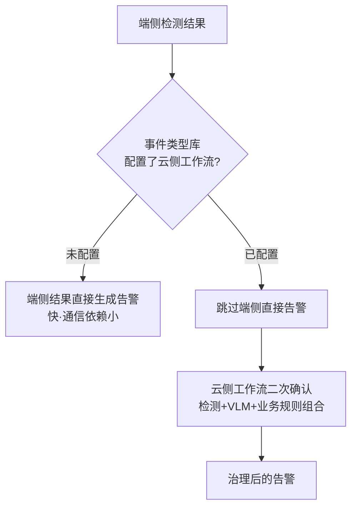

- 没有工作流配置：使用端侧结果直接生成告警。
- 配置了工作流：跳过端侧直接告警，把图片交给云侧二次确认。

这一分流以事件类型库配置为准，而不是在处理器里硬编码具体场景。因此同一个端侧检测结果可以按场景选择直接告警，也可以进入云侧工作流做语义确认。

### 面试官问：为什么不把所有场景都交给 VLM

> 简单、规则稳定的场景直接检测更快、更便宜；需要语义理解或端侧容易误识别的场景再使用工作流或 VLM 二次确认。方案需要在识别效果、推理效率和部署复杂度之间按场景权衡，不是模型越大越好。

### 面试官问：为什么需要工作流

> 工作流把模型编排从业务代码中抽出来。后端只维护统一输入输出契约，具体场景可以在流程中组合检测、分割、VLM 和规则节点。这样更换模型或调整组合时，不需要反复修改整条业务链路。

### 面试官问：你接入 AI 工作流具体做了什么

> 我重构了原有的 Java 图像识别调用链。系统不再在业务代码中固定调用某个模型，而是根据事件类型配置取得工作流标识，动态选择对应流程；调用时统一传入图片、提示词和场景变量，并用统一响应结构接收执行状态和检测结果。由于推理耗时且下游服务可能失败，我采用异步执行隔离主链路，并为远程调用增加降级处理。这样业务代码只负责触发和消费结果，模型组合可以在工作流侧调整。

### 面试官问：云侧失败了会回退到端侧吗

> 不会。端侧跳过发生在分流时而不是云侧失败后：事件命中云侧工作流配置，端侧结果在遍历时直接 continue，同一张图不会再走端侧告警。云侧调用失败（Feign 降级返回 failed→业务转 null→按空结果处理）时这张图完全不产生告警，只留日志。取舍是宁可漏报不可误报，与告警治理的整体策略一致。配套的异步池也体现了同一场景下的不同选择：wukongAiExecutor 是核心 5、最大 15、队列 200、拒绝策略 DiscardOldestPolicy——图片识别是海量事件流，池满时丢最旧一条比让提交线程陪跑更合理；而建模批次创建池用 CallerRunsPolicy，因为批次任务一条都不能丢。同样是拒绝策略，按业务可丢弃性选型。

## 5.4 AI 结果治理和告警闭环

链路如下：

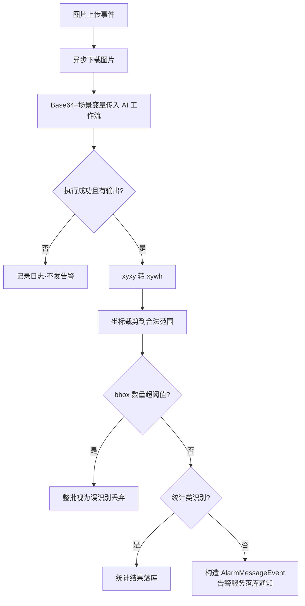

如果单张图片返回的 bbox 数量超过配置阈值，代码将整批结果视为疑似误识别并丢弃，避免异常模型输出产生大量错误告警。

统计类识别不走告警分支，而是把 missionId、imageId、识别类型、目标数量和 bbox 结果保存到统计结果表。识别主链路最终形成两类结果出口：统计结果落库和告警事件发布。

事件类型库还支持配置“到达起飞点”和“到达第一个航点”时执行的飞机指令，用于编排设备的感知与取证能力：航线绑定识别事件类型后，飞行事件触发系统读取该类型配置的 JSON 指令，通过 IoT 修改设备属性。业务上，这些指令可以开启端侧 AI 感知能力，也可以配置识别后的设备取证行为。需要注意，后端是在固定飞行阶段下发策略，并不是收到某次 AI 识别结果后临时触发该处理器。

RF-DETR ONNX 后处理曾经对每个 query 的全部类别 logits 执行 Sigmoid。后续调整为先找最大 raw logit，只对最大值执行一次 Sigmoid，再与事件类型库的置信度阈值比较。因为 Sigmoid 单调递增，最大 logit 对应的类别不会改变，但减少了无效指数运算。

### 面试官问：为什么使用事件驱动

> 图片上传、AI 推理和告警处理耗时不同。如果同步串联，会阻塞图片接入链路，也让上游强依赖下游响应。事件驱动让图片上传只发布事实，AI 异步处理，成功后再发布告警事件，既隔离耗时步骤，也便于后续增加落库、通知或 IoT 动作消费者。

### 面试官问：为什么只对最大 logit 做 Sigmoid

> Sigmoid 是单调递增函数，先比较 raw logits 找最大类别，与先把每个 logit 转成概率再找最大类别，最终类别相同。因此可以先找最大 logit，只计算一次 Sigmoid 得到置信度，再做阈值过滤，避免对所有 query 和类别重复执行指数运算。

### 面试官问：bbox 阈值是多少，整批丢弃会不会误杀真实多目标场景

> 阈值默认 10，配置项 ai.vlm.maxBoxCount 可按场景调整；坐标治理还有一层：xyxy 转 xywh 后，宽高夹到 [0.03, 0.97]、框整体夹到 [0,1]，防越界坐标。误杀在理论上存在——真实停了十几辆车的画面会被整批丢弃，但巡检视角下单帧检测出超过 10 个目标，更常见的解释是模型异常输出（重复框、碎片框），整批丢弃是防误报告警风暴的保护。阈值放成配置就是为了按场景实测调整：误杀多的场景调大，误报多的场景调小。

### 面试官问：AI 工作流失败怎么处理

> 当前代码捕获异常并记录 missionId、imageId 和识别类型，失败或空结果不会继续发送告警。这种策略偏向避免错误告警。如果业务更关注漏报，后续可以增加有上限的重试、失败任务表或死信队列，并监控失败率。

### 面试官问：模型效果提高了多少

> 仓库能够证明的是工程链路、端云分流和结果治理，但没有完整可追溯的评测数据集、评测脚本和正式报表，所以我不会给出无法验证的百分比。我可以说明不同场景为什么选择检测或 VLM 二次确认，以及如何根据误识别样本调整流程，但量化指标以正式评测记录为准。

## 5.5 智能体智能体介绍（107 版口径：独立项目）

> 口径：简历中智能体智能体是独立项目。本人主要负责业务侧集成（Action 协议、SSE、异步状态、位置资产），开发平台 Channel 与 MCP Server，编写三维重建等 Skill，参与 OpenClaw 其他功能。模型私有化部署、企业微信通道、画面理解为系统能力或他人工作，不揽。

### 面试官问：请介绍智能体智能体

> 该智能体是面向政企客户的无人机业务智能体，基于 OpenClaw 构建：用户通过自然语言／语音对话驱动巡检任务派发、飞行实时操控、三维重建、画面语义问答等 50 余个业务指令，模型私有化部署。我主要负责业务侧集成——参与定义并实现智能体与业务系统间的 Action 执行协议，实现指令接收确认、结果回调与轮询查询语义，通过 SSE 推送交互指令，Redis 保存异步状态；此外开发了平台前端与 OpenClaw 通信的 Channel 和平台端 MCP Server，编写了三维重建等业务 Skill。系统分层是：Channel 管消息与身份，MCP 管查询，Action 协议管执行，Skill 管编排，工作流管长流程。
>
> 位置资产方面，我把区域、点位、分割点位和最佳视角等空间数据按名称持久化。位置资产按用户隔离，有样板间上下文时再叠加样板间范围。当用户提到“某个点”或“某个区域”时，智能体可以用名称匹配具体坐标和视角姿态，再把位置数据交给后续业务能力调用。

## 5.6 智能体位置资产数据模型

代码中的实体名是 `AgentSceneMemoryEntity`，但从业务语义看，它保存的是智能体可以按名称引用的位置资产：

- `showroomId`：样板间范围。
- `userId`：用户隔离。
- `drawId`：关联地图标绘。
- `memoryName`：用户和智能体引用的位置名称。
- `memoryType`：ZONE 区域或 POSE 视角。
- `sceneType`：建模、违停等业务场景。
- `spatialPayload`：空间数据。

`spatialPayload` 包括：

- `points`：区域多边形点阵。
- `segmentPoints`：区域分割点位。
- `view`：经纬度、高度、俯仰角、偏航角和翻滚角。

### 面试官问：为什么把它定位为位置资产，而不是长期记忆系统

> 这里保存的不是对话内容或模型记忆，而是带名称的区域、点位、坐标和视角姿态。核心作用是把用户说的“某个点”映射到平台可以执行的具体空间位置。它没有向量检索、对话摘要、情景记忆或记忆衰减，因此更准确的表述是智能体位置资产管理，而不是大模型长期记忆系统。

### 面试官问：为什么 spatialPayload 使用 JSON

> ZONE 和 POSE 的空间结构不同，但都属于一条位置资产且生命周期一致。JSON 可以兼容 points、segmentPoints 和 view，减少大量可空列和多表查询；Java 侧仍使用 SpatialPayload 强类型对象。代价是数据库难以高效检索 JSON 内部坐标，如果未来需要高频空间查询，应考虑空间数据库或拆分索引表。

### 面试官问：名称唯一性校验有并发窗口吗

> 有，诚实讲：当前实现是 check-then-insert——先按 userId（有样板间再叠加）查同名有效记录，count 为 0 再插入，包在 @Transactional 里但事务挡不住并发，实体上也没有唯一索引、没有加锁。两个请求同时创建同名位置资产时都读到 count=0，会双双插入成功。当前场景是低频的人工创建，风险可接受；正确修法是给 (user_id, showroom_id, memory_name, status) 建唯一索引兜底，捕获 DuplicateKey 异常转成“名称已存在”的业务提示，让数据层约束替 check-then-act 收口——和调度用条件更新替代先查后改是同一个原则。

## 5.7 用户隔离

userId 从登录上下文获取，不接受前端自由指定。查询、修改和删除都带 userId 条件；请求存在 showroomId 时，再带样板间条件。

创建位置资产时还会校验：

- 位置资产类型是否合法。
- 关联标绘是否存在。
- 标绘是否属于当前样板间。
- 同一用户、同一样板间下有效名称是否重复。

### 面试官问：用户 A 传入用户 B 的记忆 ID 会怎样

> 修改和删除不是直接按主键操作，而是先使用 id、当前 userId，以及可用的 showroomId 查询归属。查不到就返回位置资产不存在，因此用户 A 无法通过猜测 ID 修改用户 B 的数据。

## 5.8 SSE 和 Redis 状态

SSE 用于服务端向当前用户实时推送指令和执行反馈。它适合单向通知，比前端轮询及时，也比为这个场景维护完整双向 WebSocket 更简单。

Redis 保存异步指令状态，Lua 保证状态合法流转和终态幂等。

### 面试官问：SSE 能作为唯一状态来源吗

> 不能。SSE 连接可能中断，前端也可能错过某次推送。SSE 只负责实时通知，Redis 或业务数据库中的状态才用于重新查询和恢复展示。

### 面试官问：SSE 断线期间的推送丢了怎么办

> 两套实现两个答案。平台侧指令反馈：断线不补推，重连后前端用 messageId 调 result 接口从 Redis 重查当前状态——推送只是加速，权威在 Redis。智能体侧运行事件：每条事件先落库拿到自增序号、再 emitter.send，发送失败记“已持久化但 SSE 已断开”；断线恢复后前端带 after=序号 从数据库按序补拉。两个模式共同的骨架是“先持久化再推送、推送丢了按持久层补”，SSE 从设计上就不承担可靠传输职责。

## 5.9 智能体独立项目：架构分层与两套调用体系（107 版新增）

五部件分层：

```text
用户（平台前端，已登录）
   │ WebSocket（信封 ext：accessToken / industryType / showroomId / channelId）
   ▼
Channel（消息+鉴权）：会话路由、dmHistoryLimit 轮换、/new 重置、登录态透传
   ▼
OpenClaw Agent（模型 + 提示词 + 工具调用循环）
   │ 查询 → MCP Server（契约层）：20 工具、无状态、ToolResult+traceId
   │ 编排 → Skill（SKILL.md 状态机 + Python 脚本 + 人工确认门）
   │ 执行 → Action 协议（执行语义层）→ 平台后端分发器 → SSE 前端 / IoT 设备
   │ 长流程 → agent-scene-workflow（14 态状态机、decide 推进决策点）
```

### 面试官问：为什么既有 MCP 又有自研指令协议

> MCP 是契约层：工具发现、参数 Schema、统一结果包络，这层有行业标准，任何 Agent 框架 tools/list 即可接入——我们用它承载 20 个查询类工具（任务、设备、告警、位置记忆、报告导出、航线草稿）。指令协议是执行语义层：受理确认（ack）、结果回调、状态轮询、终态保护、幂等——MCP 的请求-响应模型不定义这些。判别四个问题：执行者能否应答（服务可，浏览器和飞机只能被推送）；参数敢不敢让模型填（查询敢，副作用指令必须技能预构造）；一次调用能否结束（秒级查询能，长流程要跨多轮对话）；失败后世界是否干净（查询可重试，动作需终态保护）。我们也真把执行包成过 MCP 工具（execute_inspection），内部仍是 commandId 受理 + 状态查询 + 取消以回执为准——恰好证明两层不可互相替代。

### 面试官问：Action 协议的完整生命周期

> 四个端点构成闭环：POST /{messageId, commands} 指令接收 → 分发器按 commandType 路由（front_action 经业务系统 SSE 推前端执行、drone_action 走设备）→ POST /ack/{messageId} 执行端确认 → POST /callback 结果回调 → GET /result/{messageId} 轮询（Agent 工具内最多 6 次×1 秒，status 3 成功、4 失败）。状态存 Redis，Lua 原子流转 + 终态粘滞 + 回调幂等。三类 Handler 中 back_action 是协议预留扩展点（Handler 为空实现）——纯后端长流程后来演化成独立工作流服务，指令协议专注前端驱动与设备控制两个即时动作面。诚实口径：实际流量只有 front_action（约 45 个 intent）和 drone_action（约 20 个 intent）。

### 面试官问：Channel 怎么做多租户鉴权

> 用户在前端登录平台后，WebSocket 信封 ext 携带 accessToken、industryType、showroomId、channelId；Channel 存入会话上下文，运行时转为环境变量，Skill 脚本与工具统一附加 Authorization、X-Industry-Type、X-Showroom-Id、X-Agent-Channel-Id 请求头——按会话隔离即多租户隔离。会话管理：dmHistoryLimit 超限后为 peerId 追加 generation 后缀强制开新会话，防止上下文无限膨胀；/new 命令重置计数开新会话。

### 面试官问：三维重建 Skill 的确认机制

> 两阶段确认：preview 成功后写入本地 pending 仓库（stage=WAITING_PREVIEW_CONFIRMATION，记录首轮用户原话 hash 与轮次 hash），模型必须结束本轮等用户回复。confirm 前脚本做五重校验：原话必填（-u 缺失直接参数错误）；否定词黑名单（取消/算了/先别/暂缓/不执行……含"确认"但语境否定也拒）；肯定语义全句正则匹配（"如果没问题就确认吧"条件式、"我昨天确认过了"历史陈述、"确认吗？"疑问都不构成授权）；同轮拦截（当前轮次 hash 等于 preview 轮次 hash 即拒，防模型自导自演）；原话重放拦截（本轮原话等于首轮请求原话即拒）。五关全过才在文件锁内状态转移，再经指令协议下发 reconstruction_confirm_start。preview 与 confirm 本身都是 front_action 指令——工作流层嵌套指令层的又一实例。

### 面试官问：怎么管住模型不让它乱来（B/G 端高频）

> 四层防线：① SKILL.md 提示词层——危险动作（气象放行、航线确认、起飞）强制人工确认门，严禁同轮下发；② 运行时守卫层——dispatch_skill_prepared_command 校验指令必须逐字来自 SKILL.md 预构造的 $command，模型自拼直接拒（COMMAND_NOT_FROM_SKILL），错误信息指名该去 read 哪个 SKILL.md；③ 协议层——巡检 decide 确认必须带用户原话（-u），服务端白名单校验；④ 工具防护层——循环熔断 + 副作用工具同轮去重（同一 run 相同参数成功一次后不再执行，防模型循环重发）。

## 5.10 Channel 完整解析（agent-ws-channel，约 530 行）

插件四大部分：模块级状态（connections／sessionContexts／peerSessionState 三张 Map）、消息处理 handleMessage、Channel 声明（meta／configSchema／status／gateway）、register 钩子。

### 拓扑：前端不直连 OpenClaw

```text
平台前端（浏览器）──WS 客户端──► agent-ws-server（独立微服务，Nacos 注册）◄──WS 客户端── OpenClaw Channel 插件
                                        ▲
                                        │ Feign POST /api/v1/notify（按用户推送）
                                        │
                          agent-scene-workflow（巡检进度、TTS 播报等主动通知）
```

- 前端和 OpenClaw 都是**客户端**，各自连到中转 server；server 内部按信封 sessionId／replyTo 做双向路由转发。
- 前端侧成百上千条连接由 server 扛，OpenClaw 侧只维持**一条**出站连接（AGENT_CHANNEL_URL），信封多路复用。
- server 还是业务侧主动推送的统一入口：工作流通过 Feign 调它给指定用户推通知。
- 设计收益：① Agent 网关不需要暴露给浏览器（它只拨出、不监听公网）；② 用户身份在 server 侧翻译成信封 ext（accessToken 等）；③ 连接潮汐与业务推送解耦。

**前端连接的真实 URL**：`wss://api.example.com/agent/chat/{channelId}?sessionId={sessionId}`

- 域名即业务统一网关（与 PLATFORM_BASE_URL 同域）；网关路由 `Path=/agent/** → lb://agent-ws-server`（Nacos 负载均衡，StripPrefix=1），`/agent/chat/` 注册在 gateway.websocket.prefixes 做 WS 升级——部署文档 v5.2.8 实证。
- path 中的 UUID 是 **channelId**：agent-ws-server 有独立数据库（agent_db），`/agent/channel/**` 提供通道管理 REST 接口（在网关免鉴权白名单）；每个样板间／项目／部署注册一条通道。channelId 随后出现在信封 ext.channelId，经 before_tool_call 注入为业务请求头 X-Agent-Channel-Id——业务后端据此区分请求来自哪条通道。
- query 中的 sessionId 标识会话，即信封 sessionId 与 reply 路由的键。

### 面试官问：为什么不让前端直连 OpenClaw 网关

> 一是网络与安全边界：OpenClaw 网关部署在算法内网，若直接对浏览器开放就要处理海量连接、设备鉴权和公网暴露面；现在它只作为 WS 客户端拨出一条连接到业务域的中转服务，Agent 侧零监听。二是身份翻译：中转服务持有用户会话，把"哪个浏览器在说话"翻译成信封里的 accessToken／行业／样板间上下文，OpenClaw 无需感知平台的登录体系。三是它同时是业务侧推送入口——巡检工作流经 Feign 让它给用户推进度，前端一条连接收全所有消息。

### 端到端链路

```text
前端 → WS 信封 {source, replyTo, sessionId, ext{accessToken/industryType/showroomId/channelId}, data{content}}
  ① handleMessage：解析信封 → /new 检测（重置会话，不转发 agent）
  ② 快捷回复：非问候消息立即随机回"收到/好的/马上"（partial）——压首响延迟
  ③ getEffectivePeerId：peerId = sender__sessionId__generation；dmHistoryLimit(30) 超限换 generation 强制新会话
  ④ ext + source + replyTo 存入 sessionContexts
  ⑤ resolveAgentRoute + dispatch 派发给 Agent
  ⑥ 模型工具调用 → before_tool_call：会话上下文注入
       exec 工具 → env（ACCESS_TOKEN 等环境变量 → Skill 脚本 api_helper.py 读取）
       其他工具 → args（JSON 对象，供 voice-manager 等插件读取）
  ⑦ 回复 deliver → WS reply {kind: partial/final, replyTo, sessionId}
  ⑧ session_end：删除 sessionContexts（token 不滞留内存）
```

### 连接管理（gateway.startAccount）

- **单账号模型**：一个 default 账号连一条 WS URL，多用户靠信封 sessionId/replyTo 区分，不是每用户一条连接。
- **自管重连**：内部 while 循环 + 固定 5 秒重连，刻意不让 startAccount 返回——避开框架 auto-restart 的指数退避（大屏/样板间常驻场景要求快速恢复）。
- **心跳保活**：连接建立后每 5 秒 ws.ping()，防中间设备/NAT 掐空闲连接。
- **abortSignal 贯穿**：停机时关连接并打断重连等待；stopAccount 主动关闭。

### 会话轮换三件套

1. dmHistoryLimit（配置 30）：peerSessionState 计数，超限后 count 归 1、generation=Date.now() 换新——强制开新会话，防上下文无限膨胀；首次即带 generation，网关重启后自然生成新值（旧会话不复活）。
2. /new、/reset 命令：手动重置计数并强制新会话。
3. peerId 结构 sender__sessionId__generation 支持反解析（extractBasePeerId／extractSessionId），session_end 据此清理。

### 身份注入与凭据纪律（before_tool_call）

- camelCase → SCREAMING_SNAKE_CASE（accessToken → ACCESS_TOKEN），遍历会话上下文自动转换。
- **双通道注入**：exec/exec_command 注入 env（进程环境变量）；其他工具注入 args（JSON）。Skill 脚本的 api_helper.py 从环境变量读 ACCESS_TOKEN／INDUSTRY_TYPE／SHOWROOM_ID／CHANNEL_ID 拼 Authorization 与 X-* 请求头——多租户鉴权的完整闭环。
- 凭据只走 env，不进命令行参数、不进 exec 命令遥测（代码注释原话：Keep credentials out of shell source and exec command telemetry）。
- token 生命周期 = 会话生命周期，session_end 即清理。

### 两个全局桥

- __onWecomChunk：voice-manager 工具执行中向前端推即时短语（"开始执行"等）。
- __onHushiAgentReply：agent-bridge 直推 final 回复；turnId 优先显式传入、否则回落会话上下文保存的 turnId——**三维重建 Skill 五重校验里的"轮次"就来自这里的 turnId，跨模块串联点**。

### 面试官问：为什么重连不用框架的自动重启

> 框架 auto-restart 通常带指数退避，断几次后重连间隔会退到分钟级；样板间大屏是常驻展示场景，断线几分钟等于不可用。所以插件自己管理重连：startAccount 内部 while 循环 + 固定 5 秒间隔、永不返回（返回才会触发框架重启）。代价是放弃退避对对端的保护，但目标是内网自建网关，可控。

### 面试官问：快捷回复为什么要随机

> 模型首响应要几秒，先回"收到/好的/马上"把首响压到毫秒级；随机化避免每条都回同一个词显得机械。细节层面的对话体验设计，被追问"你们怎么优化响应体验"时的好例子。

### 面试官问：这个 Channel 和 MCP Server、Action 协议的边界

> Channel 是 OpenClaw 与前端之间的"消息与身份层"：管连接、会话、鉴权上下文注入和回复通道，不理解任何业务。MCP 是查询契约层，Action 协议是执行语义层——后两者调用平台后端，前者只负责把消息和身份安全地送进/送出 Agent。身份在 Channel 注入一次，MCP 和 Skill 全程复用。

## 第 5 周速记

```text
AI 部分定位为工程落地，不冒充纯算法研究
航线统一关联识别、图片对比和巡视区
端侧检测快，复杂场景再走云侧工作流二次确认
后端负责统一契约、bbox 转换、异常过滤和告警事件
没有正式评测证据就不报提升百分比
智能体独立项目五部件：Channel 消息鉴权 / MCP 查询 / Action 执行 / Skill 编排 / 工作流长流程
查询走 MCP、执行走协议；back_action 是预留空壳，后端长流程归工作流
三维重建两阶段确认五重校验：必填原话/否定黑名单/全句匹配/同轮拦截/重放拦截
多租户 = 会话上下文注入四个请求头（Authorization/X-Industry-Type/X-Showroom-Id/X-Agent-Channel-Id）
位置资产用于把用户提及的名称映射到具体坐标和视角，不是大模型长期记忆
userId 必须来自登录上下文
Redis Lua 防止终态被并发回调覆盖
```

---

# 专题：违章停车多轮复核

> 贡献边界先说清楚：违停的两轮复核基础（判定框架、图片收口状态机、报告链路、车牌匹配规则）是团队既有实现。本人主导的是**多轮化架构改造**（收敛驱动模型、判定泛化、Temporal 循环编排）、**取证链路扩展**（缺陷事件详情反查）以及边界场景的方案设计。面试时按此口径讲，既有内容可以作为"我深入理解并改造过的系统"来阐述设计，但不要说成从零实现。

## A.1 业务全链路

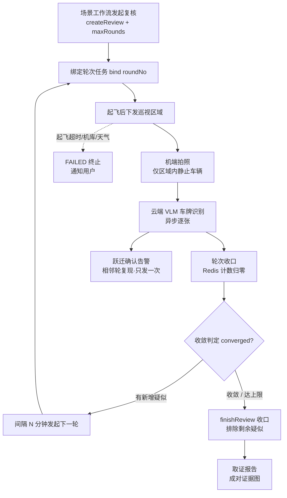

```text
场景工作流（Temporal）发起违停巡检复核
  → 创建 review + 绑定第 1 轮飞行任务
  → 起飞后向飞机下发巡视区域
  → 机端仅对区域内静止车辆拍照上传（端侧过滤运动目标）
  → 云端 AI 逐张识别车牌（异步事件驱动，识别属性含车牌/颜色/朝向）
  → 每轮识别收口后判定：
      相邻轮次车牌复现 → CONFIRMED（确认违停，发告警）
      新出现车牌       → SUSPECTED（新的待复核目标）
  → 仍有新增疑似 → 间隔 N 分钟发起下一轮
  → 无新增疑似   → 收敛：剩余疑似排除为 NOT_CONFIRMED，收口出报告
```

端云协同的语义分层：端侧判"瞬时静止"（区域内、那一刻停着的车才拍），云端多轮复现判"持续静止"（隔一轮还在）。两者互补：端侧把上云图片量压到最小，云端复现天然消化端侧误拍（等红灯的车下一轮就消失，判 NOT_CONFIRMED 排除）。

### 面试官问：请介绍违章停车多轮复核

> 违停巡检是端云协同的判定链路：飞机在巡视区域内对静止车辆拍照，云端识别车牌做多轮复核。我接手时是固定两轮模型——第一轮识别疑似、第二轮复现确认。业务上新问题出现了：闹市场景每轮都可能停进新车，固定两轮不够用。我主导把它改造成"收敛驱动"的多轮模型：相邻轮次车牌复现即确认，新出现的车牌作为新的待复核目标驱动追加巡检轮次，某轮没有新增目标就自动收敛收口，同时配最大轮数护栏防止永不收敛。改造覆盖判定状态机、识别收口、Temporal 编排和跨服务取证全链路，改完后原来的两级行为变成多轮的特例，存量测试全绿。

## A.2 判定模型：从固定两轮到收敛驱动

三态状态模型：

```text
SUSPECTED     首次出现（任意轮），待下一轮复核
CONFIRMED     相邻轮次复现，确认违停（终态）
NOT_CONFIRMED 收口时仍未复现，排除
```

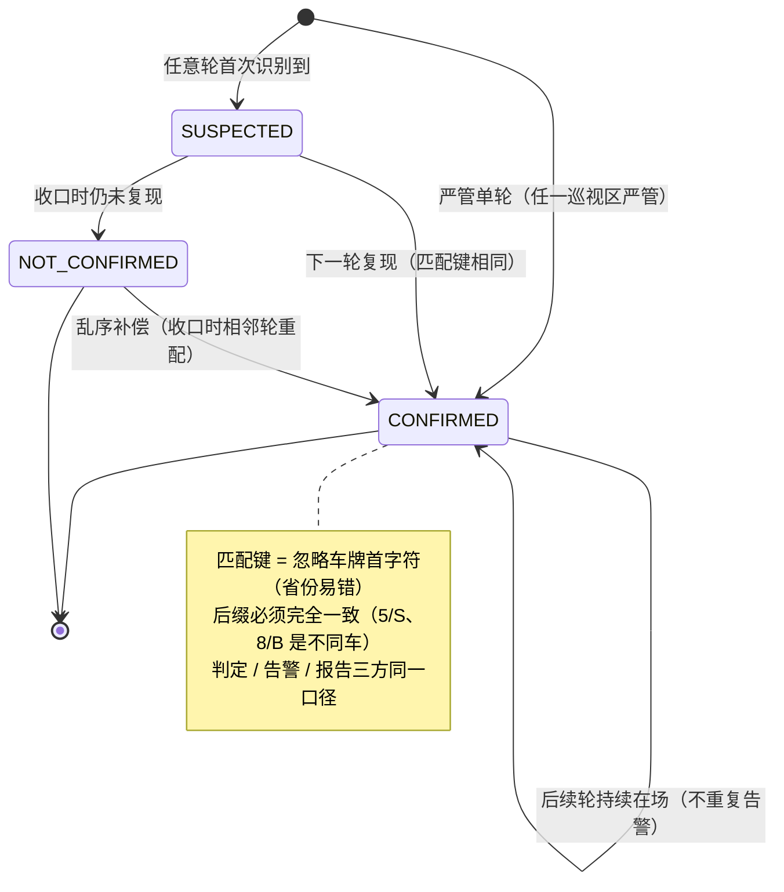

关键设计点：

1. **判定基准是"相邻上一轮"**：第 i 轮新记录与第 i-1 轮同车牌（按匹配键）比对，复现即 CONFIRMED 并回写上一轮记录（两轮证据成对确认），否则本轮新车牌 SUSPECTED。原有的 SECOND_ROUND_ONLY 状态退役——任何轮次首次出现的车统一 SUSPECTED，模型从"两轮特判"泛化成"滑动窗口"。
2. **收敛条件**：最新一轮识别收口且该轮无新增 SUSPECTED（每轮全量识别，本轮疑似即本轮新增）。收敛后剩余 SUSPECTED 统一排除——收口后没有下一轮了，未复现即排除。
3. **护栏**：max_rounds（默认 5），bind 时超限直接拒绝；达到上限强制收敛。
4. **告警只在跃迁时发**：已确认车辆后续轮次持续在场，新记录仍判 CONFIRMED 但不算"跃迁"，不重复告警。告警幂等键 reviewId+车牌，双保险。
5. **乱序补偿**：第 i 轮图片识别回调可能晚于第 i+1 轮（当时判成新车牌 SUSPECTED），收口时按相邻轮次对全量重配补判。
6. **区域严管属性与判定策略**：严管/非严管是**巡视区域的属性**（每个区域带 manageType）。编排发起复核时判定策略：**只要任一巡视区标记严管，整单复核即按严管策略执行——第一轮识别收口直接确认，跳过全部复飞轮次**；全部区域非严管才走多轮复核。注意两个细节：一是代码注释写的是“全部为严管”但实现是 `anyMatch`（任一即真），以实现为准；二是混合区域（一个严管 + 一个普通）时，普通区识别到的车也会被单轮确认——当前判定粒度是整单而非区域，车辆记录上的 `manage_type` 字段为将来演进成“严管区单轮、普通区多轮”的区域级判定预留了数据基础。

### 面试官问：多轮怎么终止，永远有新车牌怎么办

> 三层保障。软的是收敛条件——某轮无新增待复核车牌即停；硬的是 max_rounds 护栏——达到上限强制收口，最坏总时长可预估（轮数×(间隔+单轮时长)；再硬的是每轮执行链路的失败终止——机库没电、起飞超时（10 分钟）、天气不达标，任何一步异常整个复核以 FAILED 收口，用户收到通知。所以不存在无限复核，只存在"确认延后"或"失败终止"。另有区域严管属性：任一巡视区标记严管，整单第一轮识别收口即全部确认、跳过复飞——这是产品上"严管区从快处置"的差异化策略。

### 面试官问：为什么用"相邻轮复现"而不是"累计出现 N 轮"

> 相邻复现的语义是"持续占位没有中断"，和违停的执法取证语义一致；累计出现允许中间缺席，车开走又回来的场景会被误确认。代价是对漏检敏感（一轮遮挡就断连续），但这由"收口时才排除、中间不排除"兜住——缺席一轮的车保留疑似，下轮复现仍可确认，只是延后。

### 面试官问：确认车辆后续轮次还在，会不会重复告警

> 不会。判定时区分"跃迁确认"（上一轮是疑似、本轮复现，首次确认）和"持续在场"（上一轮已 CONFIRMED）。保存接口的返回值语义收紧为只返回跃迁确认的记录，告警发送方按返回值触发，一行没改就做到了"确认时告警一次"。幂等键 reviewId+车牌作为第二道保险。

## A.3 车牌匹配：忽略首字符

匹配键规则：车牌去空白转大写后，去掉第一个字符（省份简称），剩余部分只保留字母数字。原因：大模型识别省份简称错误率高（冀/翼、苏/肃形近字），但同一辆车两轮识别的后缀必然一致。判定、告警配对、取证报告共用同一条规则，保证三方口径一致。

### 面试官问：为什么不全文匹配或者编辑距离

> 全文匹配会把省份字符识别差异判成两辆车，复现判定永远失败。编辑距离能容错但会把"差一个字符的不同车"也匹配上（5/S、8/B 在真实车牌空间里是不同车），误确认的代价在违停场景不可接受。忽略首字符是在"识别误差的分布"（省份字符集中出错）和"匹配的严格性"（后缀必须完全一致）之间取的精确平衡，且规则极简可解释。

## A.4 图片识别收口：事件不可信的三种形态

收口状态机（团队既有设计，我做多轮适配时深入分析过）：

```text
RUNNING → WAITING_UPLOAD → UPLOAD_CLOSED → RECOGNITION_COMPLETED
            (任务飞行完成)   (上传关闭)       (Redis 计数归零)
```

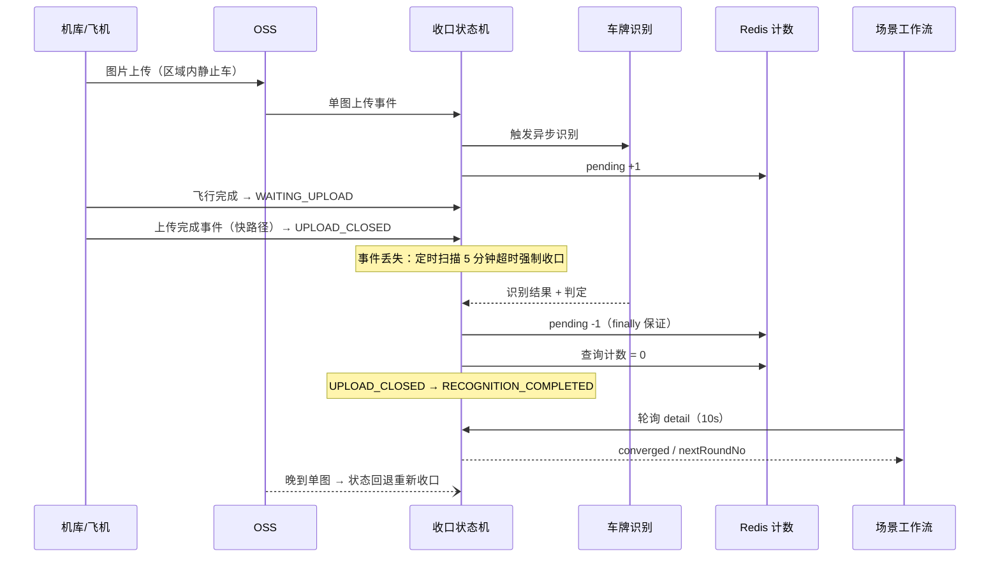

设计哲学一句话：**"上传完成"事件只是加速器，超时保活性、计数保正确性、幂等保重复安全**。

| 事件故障形态 | 兜底机制 |
|---|---|
| 丢失 | 30 秒一扫的定时任务，WAITING_UPLOAD 超 5 分钟强制 UPLOAD_CLOSED |
| 早到（图没传完） | 收口权威是 Redis pending 计数（每张实际到达的图识别回调 +1/-1）；晚到图触发识别时把已收口状态回退重等 |
| 重复 | 状态设置幂等、车辆按 review+轮次+车牌判重、计数成对加减 |
| 假完成（说传完实际缺图） | 无张数校验——缺图轮表现为车辆缺席，判新车牌驱动下一轮（无害）；已知边界是整轮 0 图会被误判收敛，防护方案已设计（converged 加"本轮图片数>0"条件）|

### 面试官问：图片链路卡住了怎么办，是继续复核还是超时

> 不会卡住，多层超时自动收口，代价只是数据缺失或确认延后：上传完成事件丢了 5 分钟强制收口；部分图片丢了，缺席的车判新车牌下一轮复现即确认；识别回调异常有 finally 保证计数必然减一。只有“整轮 0 图”是已知缺口——数据上和“真的没车”无法区分，会被误判收敛，防护方案是收敛判定加图片数校验（已设计未实施）。

### 面试官问：Redis 计数的键和过期怎么设计，计数减到负数怎么办

> key 是 `illegal-parking:recognition:pending:{missionId}`，按轮隔离，写入时设 1 天过期——即使整个复核链异常终止，计数键也会自然过期，不需要人工清理。pending 在每张图识别开始前 +1、在识别处理的 finally 里 -1，异常路径也保证成对；减到负数时归零，防重复回调把计数打穿。晚到图片到达时若轮状态已是 RECOGNITION_COMPLETED，会先回退成 UPLOAD_CLOSED 重新计数收口，不会出现“图到了但轮已结束、识别结果丢失”。超时扫描默认 30 秒一次，WAITING_UPLOAD 超过 5 分钟强制 UPLOAD_CLOSED。

## A.5 Temporal 编排：版本桩与双端解耦

多轮循环在工作流侧：

```text
第 1 轮（必飞，全是新车牌）→ 第 2 轮（必飞）→ 第 2 轮起每轮收口后查 converged
  ├─ converged=true  → finishReview 收口出报告
  └─ converged=false → sleep(间隔) → 发起 nextRoundNo 轮 → 循环
```

两个关键工程决策：

1. **Workflow.getVersion 版本桩**：Temporal 的 workflow 是事件溯源重放的——代码结构变更后，升级瞬间在途的旧 workflow 用新代码重放会 non-determinism 报错。改编排逻辑必须用版本桩把新路径与历史路径隔离：旧 workflow 重放走 DEFAULT_VERSION（原固定两轮代码），新启动的走 v1（循环）。严管单轮的改造也是同样的桩模式。
2. **双端解耦发版**：工作流先升级、平台后升级的窗口期，detail 响应里没有 converged 字段——编排检测到字段缺失自动退回固定两轮行为。两端可以独立发版互不阻塞。

### 面试官问：为什么改编排必须加版本桩

> Temporal workflow 的执行历史是事件日志，worker 重启或升级后要用当前代码重放历史来恢复状态。如果我直接把"固定两轮"的顺序代码改成"while 循环"，一个升级前启动、飞到第二轮的工作流，用新代码重放它的历史时，事件序列对不上，直接 non-determinism 失败。Workflow.getVersion 在代码里打一个版本分叉点：重放历史走到分叉点时按历史里记录的版本走旧分支，新启动的走新分支，两套代码路径互不污染。这是 Temporal 改造在途逻辑的标准安全措施。

### 面试官问：平台和工作流怎么协调发版

> 靠响应字段缺失降级。多轮决策依赖平台 detail 接口的 converged/nextRoundNo 字段，编排检测到这两个字段为 null（旧版平台没有）就退回固定两轮。所以发版顺序无关紧要：平台先上、工作流后上，或反过来，行为都正确退化。这比“两个服务必须同时发版”的耦合方案运维成本低得多。

### 面试官问：轮询等待和轮间 sleep 会不会占用工作线程

> 不会，这正是用 Temporal 而不是自建 while 加 Thread.sleep 的原因。Workflow.sleep 是持久化定时器：调用后 worker 线程直接释放，计时由 Temporal 服务端负责，到点后 worker 用事件历史重放恢复到 sleep 之后的代码行——等待一小时不占任何线程，进程重启也不丢状态。轮内等识别收口是 10 秒一次轮询 detail，轮与轮之间是分钟级 sleep，都是同一个机制。降级分支也更精确：converged 字段缺失时，若当前已到第 2 轮直接收口，否则只再追加一轮——等价于“最多两轮”的旧行为。版本桩实际有三个，分别管统一识别、严管单轮、多轮循环三个特性的独立开关，升级节奏互不绑定。

## A.6 跨服务取证：缺陷事件详情反查

链路：确认告警（boxDesc 含车牌）→ 告警服务转缺陷事件（description 存车牌文本）→ 用户点开事件详情 → emergency 从 description 正则抽车牌 → Feign 调平台 evidence 接口 → 按“告警任务所在轮 + 其相邻上一轮”动态配对两条 CONFIRMED 记录 → 返回证据图（图、bbox、拍照时间）。调用失败 catch 降级为 null，不阻塞详情主流程。两个边界：严管单轮确认没有相邻上一轮，first 证据为 null，只返回告警轮一条记录；同一车牌两轮识别存在省份字符差异的多条记录时取首条，与判定口径一致。

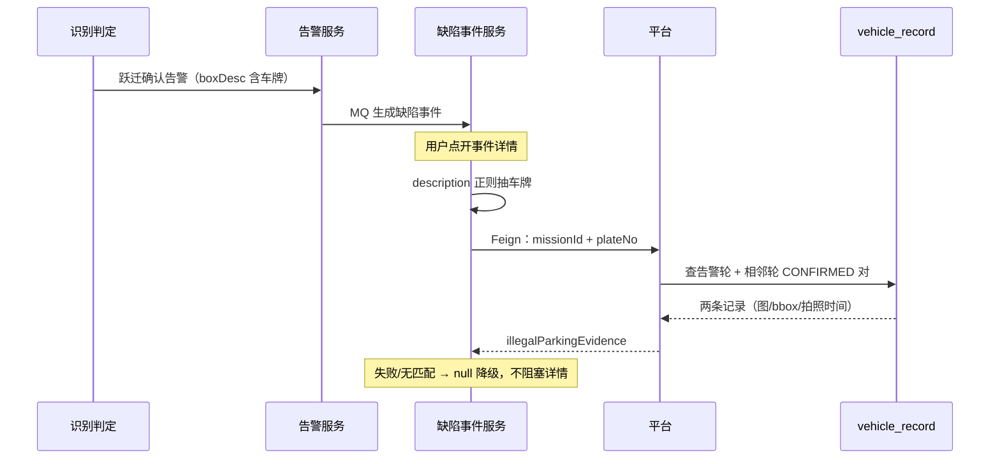

方案取舍：最初实现是 emergency 直查平台数据库（建 entity/dao），后来改为 Feign——核心理由是**判定规则单一维护**：车牌匹配键、配对逻辑都在平台一处，平台改规则不会和 emergency 静默不一致；其次表归属清晰，平台改表结构不波及 emergency。代价是详情页多一次内网调用（低频场景可忽略）。

### 面试官问：为什么 Feign 而不是直查库

> 直查库要复制三样东西到另一个服务：表映射、车牌匹配规则、证据组装逻辑（图片回退、RSA 解密、坐标还原）。其中匹配规则是最危险的耦合——平台哪天调整规则，emergency 不会知道，事件详情展示的车和判定确认的车会静默对不上。Feign 把这些收敛在被数据所属的服务里，跨服务只剩一个 HTTP 契约。详情页低频，多一次内网调用的代价可以接受；调用失败降级 null，不阻塞详情主流程。

## A.7 我的贡献边界（诚实口径）

### 面试官问：这个模块哪些是你做的

> 两轮复核的基础是团队既有实现：判定框架、图片收口状态机、报告生成链路、车牌匹配规则。我做的是：多轮化的判定模型泛化（收敛语义定义、相邻轮判定、状态简化、告警跃迁控制）、Temporal 循环编排与版本桩、双端降级发版方案、跨服务取证链路、以及一批边界场景的方案设计（0 图误收敛防护、轮次等待超时）。既有机制我在改造时深入分析过，能讲清它的设计为什么是这样，但我不会说成从零实现。

## 专题速记

```text
判定三态：SUSPECTED（任意轮首现）/ CONFIRMED（相邻轮复现）/ NOT_CONFIRMED（收口排除）
新车牌驱动继续飞，无新增即收敛；max_rounds 护栏 + 执行失败 FAILED 终止
区域严管属性：任一巡视区严管 → 整单单轮确认（实现是 anyMatch，注释写"全部"以实现为准）
告警只发跃迁轮：返回值语义收紧 + 幂等键双保险
车牌匹配：忽略首字符（省份易错），判定/告警/报告同一口径
收口哲学：事件只加速，超时保活、计数保对、幂等保重
0 图轮误收敛是已知边界，防护=converged 加图片数校验
Temporal 改编排必加版本桩：历史重放走旧分支，新启走新分支
双端解耦：converged 字段缺失自动退回两轮，发版顺序无关
取证：description 抽车牌 → Feign → 告警轮+相邻轮动态配对，失败降级 null
贡献边界：基础是团队的，我主导多轮化改造与取证扩展
```

---

# 第 6 周：完整面试表达与高频答案

这一周的内容可以直接反复阅读，形成最终表达。

## 6.1 30 秒核心业务介绍

> 我目前主要做 Java 后端，参与无人机巡检平台的自动建模、AI 巡检和智能体业务侧集成。自动建模是我最核心的模块，我参与了区域拆分、异步航线规划、多机库资源分配、任务下发和异常恢复，并推动航迹校验从本地 JTS 启发式方案升级为统一碰撞检测服务的动态准入；飞行完成后，再按父子任务组校验图片就绪，自动触发三维建模并提供进度查询。AI 方面主要做识别工作流和业务闭环，智能体方面做业务能力接入、位置资产管理和异步状态管理；近期主导了违章停车复核的多轮化改造，把固定两轮演进为收敛驱动的多轮模型。

## 6.2 自动建模 3 分钟完整回答

> 自动建模的业务目标是用户圈定区域后，平台自动完成区域拆分、航线规划、机库分配、飞行任务执行和后续建模。
>
> 首先，系统把父区域拆成多个子区域，每个子区域保存为一个区域任务。为区域筛选候选机库时，会考虑距离、在线状态、吊舱能力和已有负载；分配时优先平衡机库任务量，再考虑空间交叉、设备忙碌和总距离。航线规划是耗时操作，所以把各子区域提交到专用线程池并行处理，单个区域失败只影响自身。全部规划任务收口后，为成功航线创建 Mission，再进入样板间滚动调度。
>
> 调度的核心约束是同一机库同时只能执行一条任务，不同机库航线还要与平台当前活跃航线保持安全。系统把校验拆成两阶段：Mission 创建时只校验模型、障碍物和限高，不提前占用空域；真实下发前再调用统一碰撞检测服务，检测并登记活跃航线，确认登记成功后才调用 IoT。候选按优先级逐条准入，前一个候选冲突时仍可继续尝试后续候选，避免固定队头阻塞。
>
> 为避免多实例重复下发，系统以 showroomId 使用 Redisson 锁，把候选筛选、最终复检、碰撞登记和下发串行化；正式下发前，再用数据库条件更新把 PENDING 原子切换到 DISPATCHING。Mission 完成时先释放活跃航线再推进下一轮，机库就绪事件负责及时补位，低频定时任务补偿漏事件和服务重启遗留状态。
>
> 对设备链路的不确定性，系统区分明确失败和结果未知。IoT 明确失败时删除活跃航线并记录失败；调用异常或空响应时保留 DISPATCHING 和活跃航线，避免设备已收到任务后再次下发。普通下发和续飞统一要求机库就绪且电池达到阈值，因电池或空域等待时不消耗续飞重试次数。批次还支持暂停、继续和取消，在飞任务不强停，主要阻止后续普通任务和续飞腿启动。
>
> 飞行和图片回传完成后进入建模下游。图片完成事件会异步触发建模服务，系统以父任务 ID 聚合父 Mission 和全部续飞子 Mission，并使用组级 Redisson 锁串行处理多个完成事件。锁内先判断是否已经提交，再校验全组图片是否就绪，随后汇总原图并提交建模服务。只有成功取得 projectId 后才更新 modeling_status 并保存项目关联，失败则保留为可重试状态，同时支持手动触发、强制重跑和进度查询。这样整个链路不是停在任务下发，而是从区域规划一直闭环到模型生产。

## 6.3 自动建模模块最难的地方

> 最难的不是某个框架，而是设备真实状态、数据库状态和异步事件之间的一致性。远程下发可能超时但设备实际收到，事件可能丢失，暂停和调度可能并发，断点续飞还会生成子 Mission；飞行完成后，父子 Mission 又会分别产生图片完成事件，但整个任务组只能向建模服务提交一次。
>
> 我的处理思路是先把批次、区域处理、下发和真实飞行状态分层；再用样板间级分布式锁控制调度临界区，用数据库条件更新做最终防重；最后通过设备状态、事件推进和定时补偿让异常状态可以恢复。建模下游则以父任务作为幂等边界，用组锁、锁内去重和全组就绪校验解决多事件并发，并坚持外部提交成功后才更新本地建模状态。

## 6.4 你在平台中负责什么

> 从我实际修改的代码看，我主要参与自动建模链路的开发和稳定性治理，包括区域拆分防重、多机库资源分配、异步航线规划、航迹校验从本地 JTS 到统一碰撞服务的升级、活跃航线生命周期、任务下发防重、批次暂停继续取消、续飞和超时恢复；同时打通图片回传后的自动建模下游，处理父子任务组聚合、并发防重、传图就绪校验、建模服务提交、失败恢复和进度查询。此外，我还参与了航线 AI 配置、AI 工作流接入，以及智能体智能体位置资产和异步状态管理。
>
> 我不会把整个团队系统描述成个人独立完成，面试中会重点讲自己直接修改过并能结合类、方法和异常场景解释的部分。

## 6.5 为什么锁按样板间而不是机库

> 同一样板间的航线准备完成、Mission 完成、机库就绪、用户继续和定时补偿都会触发调度，而且会共同读取机库占用并尝试登记活跃航线。样板间锁负责把这些本地决策串行化；跨机库、跨业务的空域安全由统一碰撞服务判断，所以锁键仍使用 showroomId，而不是每个机库各算各的。

## 6.6 为什么 Redisson 锁和数据库条件更新都要用

> 两者保护不同的原子性。锁串行化"读候选、最终复检、碰撞登记、下发"这段多行决策，保护"一个机库同时只有一条执行链"这类跨行不变量——没有哪一行的 WHERE 能表达这种约束。条件更新裁决单条任务的 PENDING→DISPATCHING 流转，拦截不持锁的旁路写入和锁自身失效窗口。锁失效最多让候选重新判断，条件更新失效才可能造成重复下发，所以最后一道防线必须建在数据库。

## 6.7 服务在 DISPATCHING 后宕机怎么办

> 任务会暂时停在 DISPATCHING。定时补偿会结合 Mission 状态判断：仍为 WAITING 且超过阈值，说明可能未送达，可以回退 PENDING；已经被飞机接收则不能直接当作未下发；续飞链只处理最新子 Mission。这里优先避免重复飞行，再通过状态和补偿恢复。

## 6.8 顺序准入能保证全局并发最优吗

> 不能承诺严格全局最优。长期负载先由机库分配算法平衡，实时空域再由碰撞中心按当前活跃航线逐条准入，任务完成后立即补位。当前约百个区域、二十台机库且任务时长接近，这种有界扫描的复杂度和实时性更合适；只有监控证明总体工期受候选顺序明显影响时，才需要增加前瞻搜索。

## 6.9 为什么暂停不终止飞机

> 数据库暂停不能等同于安全终止真实飞行。当前暂停语义是让在飞任务完成，不再调度普通待发任务，也不再启动新的续飞腿，这比强制中断更符合设备和飞行安全约束。

## 6.10 为什么事件和定时补偿要并存

> 事件正常时可以立即推进，提高实时性；事件丢失或服务重启时，定时任务重新扫描持久化状态，提供恢复出口。因为入口有样板间锁和状态条件更新，重复触发不会重复下发。

## 6.11 AI 工程化 2 分钟回答

> AI 部分我主要做工程落地。场景侧参与了安全帽、基坑无围栏、吨袋、船只和人员临水等 5 类以上场景的数据标注、模型训练评测和 Python 多模型编排；Java 侧设计了航线级 AI 统一配置，关联场景识别、图片对比和巡视区。任务起飞时结合航线需求与飞机 AI 能力，通过 IoT 开启端侧识别并下发置信度阈值；同时支持按起飞点和首航点下发设备策略，联动端侧感知与识别后取证能力。
>
> 图片上传事件到达后，端侧结果可以直接告警，也可以按事件类型配置交给云侧工作流二次确认。后端异步调用工作流，校验结果后完成 bbox 格式转换和坐标裁剪；统计类结果落库，告警类结果发布事件。整个设计把模型执行和业务结果处理解耦，可以按场景在效果、效率和部署成本之间权衡。

## 6.12 智能体智能体 2 分钟回答

> 该智能体是面向政企客户的无人机智能体，基于 OpenClaw 构建，用户通过对话驱动巡检派发、飞行操控、三维重建、画面问答等 50 余个业务指令，模型私有化部署。我负责业务侧集成，并开发了通信 Channel 和 MCP Server。
>
> 分层上：Channel 承接前端 WebSocket 会话，透传登录态并注入行业、样板间等租户上下文；查询类能力走 MCP——我用 Spring AI MCP 把任务、设备、告警等封装成 20 个标准化工具；执行类动作走自研 Action 协议——我参与定义并实现，受理确认、结果回调、轮询查询四端点闭环，Redis Lua 保证状态原子流转和终态保护；长流程巡检走独立工作流服务，14 个状态、决策点靠用户确认推进。我还写了三维重建业务 Skill，核心是两阶段人工确认：预览后必须等用户下一轮明确确认，脚本侧做否定词黑名单、全句语义匹配、同轮与重放拦截五重校验，模型无法绕过或伪造确认。
>
> 位置资产管理把区域、点位和最佳视角按名称持久化，按用户和样板间隔离，智能体可以按名称匹配出坐标和视角姿态。

## 6.13 你的方案还有哪些不足

> 当前航线安全依赖统一碰撞服务，服务异常时建模调度采用 fail-close，会牺牲可用性；活跃航线释放仍需要完成事件和 TTL 双重兜底；顺序候选准入不保证全局并发最优。此外，规划耗时、碰撞等待时间、活跃航线登记失败率和总体完工时间还缺少完整监控，后续应先补可观测性，再决定是否需要更复杂的调度优化。
>
> 如果继续优化，我会先补充规划耗时、锁等待、候选规模、下发未知率和超时重试率等可观测性，再根据真实瓶颈升级算法或可靠消息机制，而不是直接重写系统。

## 6.14 为什么简历不写量化提升

> 这些工程实现能从仓库中验证，但效果提升百分比、召回率和速度倍数需要对应数据集、评测脚本和正式报告。没有完整证据时不写数字，避免面试追问时无法解释。可以重点讲问题、方案、异常处理和工程边界。

## 6.15 项目难点、亮点与个人贡献

技术面试通常不会只问实现细节，还会要求候选人自己提炼项目价值。回答“难点”和“亮点”时要区分：

- **难点**：业务中最难处理的约束或不确定性，以及你如何解决。
- **亮点**：与普通增删改查相比，最能体现设计、取舍和工程价值的部分。
- **个人贡献**：你具体分析、设计或实现了什么，不能把整个团队成果都归到自己名下。

推荐统一使用下面的表达顺序：

```text
业务背景 → 核心问题 → 我的处理 → 最终能力 → 方案边界
```

### 面试官问：自动建模项目最大的亮点是什么

> 我认为最大的亮点不是单独使用某个库，而是把多机库数据采集做成了一条能够分配资源、动态安全准入、避免重复下发并从异常中恢复的完整链路。
>
> 资源层面，机库分配按候选稀缺度优先，综合负载、连接线交叉、设备忙碌状态和距离，并通过有限移动、交换做局部优化。安全层面，我推动航迹校验从本地 JTS 距离阈值与组合搜索升级为统一碰撞服务的动态准入，把静态校验和真实下发前的活跃航线登记分开。并发层面使用样板间级 Redisson 锁保护跨任务决策，再通过数据库条件更新完成单任务预占。
>
> 飞行完成后，还需要聚合父任务和续飞子任务的图片，通过组级锁、锁内去重和全组就绪校验，保证同一批采集数据只提交一次建模。这个模块的价值在于把飞行安全、并发一致性、异常恢复和建模提交连接成了业务闭环。

### 面试官问：这个项目最难的地方是什么

> 最难的是服务端状态、设备真实状态和异步事件并不总是一致。一次下发调用超时，不代表设备一定没有收到；任务完成事件可能重复、延迟或丢失；暂停、取消和调度也可能同时发生。如果简单地把异常理解成失败并立即重试，就可能重复下发甚至重复飞行。
>
> 我的处理思路是先划分批次、区域任务、下发状态和 Mission 真实状态的职责，再根据真实状态决定恢复动作。调度入口通过分布式锁收敛，单任务流转通过数据库条件更新防重，正常流程由事件推进，异常流程由定时任务对账补偿。这样即使某次事件缺失或服务重启，任务仍有恢复出口。

### 面试官问：你个人在项目中做了什么

> 我主要参与自动建模数据采集链路的开发和稳定性治理，具体包括区域拆分防重、机库分配与局部优化、异步航线规划、统一碰撞服务动态准入、活跃航线生命周期、下发预占、批次暂停继续取消、断点续飞和超时恢复。
>
> 在建模下游，我处理了父任务与续飞子任务的聚合、图片就绪校验、并发防重、建模服务提交、失败记录和进度查询。我还参与了 AI 识别配置、云侧工作流接入，以及智能体智能体的位置资产和异步指令状态管理。面试中我会明确哪些是自己直接实现的，哪些是与团队共同完成的。

### 面试官问：没有量化数据，怎么说明项目产生了价值

> 我不会使用没有评测依据的百分比，但可以说明系统新增或稳定支持了哪些能力：多机库任务可以按照航迹安全约束并行执行；重复调度由锁和条件更新共同拦截；暂停、继续、取消、断点续飞和超时任务都有恢复路径；父子任务图片完成后只会形成一次有效建模提交。
>
> 这些属于可以结合代码、状态和业务流程验证的结果。如果面试官需要性能或效果数字，我会明确说明当前没有完整监控报表或正式评测记录，而不是临时估算。

### 面试官问：你遇到过最棘手的问题，怎么定位和解决

> 比较棘手的是调度入口并不只有一个：航线规划完成、Mission 完成、机库恢复、用户继续和定时补偿都可能同时触发。如果只看单个方法，代码是顺序执行的，但放到多实例和多事件环境中，就会出现两个线程同时读取到机库空闲并重复下发的问题。
>
> 我先根据日志、任务状态和事件时间梳理完整时间线，再把所有入口追到共同的调度方法，确认竞争发生在“读取候选、最终复检、任务预占、碰撞登记和下发”之间。最终使用样板间级分布式锁保护整体决策，再用数据库条件更新做最终预占；同时保留定时补偿，处理锁之外的服务重启和漏事件问题。

### 面试官问：AI 工程化部分的难点和亮点是什么

> 难点是不同场景对准确率、速度和部署成本的要求不同，不能只依赖一种模型。规则清晰、目标明确的场景优先使用目标检测；需要精确区域时增加分割；语义复杂、误识别代价较高的场景再使用 VLM 二次确认。
>
> 我的工作重点是把 YOLO、SAM、VLM 等能力组合成可落地的场景流程，并处理空间关系判断、结果过滤和误识别治理。Java 业务侧再把识别配置、设备能力、IoT 指令、结果落库和告警动作串联起来。亮点在于能够根据场景选择模型组合，并把模型输出转化为业务结果。

### 面试官问：智能体智能体部分的亮点是什么

> 一是把区域、点位和最佳视角等空间数据按用户和业务场景持久化，形成智能体可以查询和引用的位置业务上下文；二是使用统一指令结构和 messageId 串联指令接收、ack、执行回调和结果查询；三是使用 Redis Lua 原子维护异步状态，增加终态保护和回调幂等，避免迟到或重复回调覆盖已完成结果。
>
> 这部分的价值是让智能体不只生成文本，还能查询真实业务数据并触发无人机平台能力，同时让异步执行过程可以跟踪和恢复。

### 面试官问：如果重新设计一次，你会改进什么

> 我会先补齐可观测性，包括规划耗时、锁等待时间、候选任务规模、下发结果未知率、超时重试次数和建模提交失败率。只有拿到这些数据，才能判断瓶颈到底在规划、调度、设备链路还是外部建模服务。
>
> 调度方面，我会先补齐候选等待原因、碰撞服务耗时、活跃航线登记失败率、机库利用率和批次总工期，再判断顺序准入是否需要前瞻优化。可靠性方面，可以继续完善碰撞服务熔断告警、活跃航线对账和建模提交的持久化重试，但不会在没有监控证据时重新引入复杂组合搜索。

### 面试官问：你从这个项目中学到了什么

> 我最大的收获是，复杂业务的关键不只是让正常流程跑通，而是先识别哪些状态属于服务端、哪些属于设备真实状态，以及失败后从哪里恢复。技术方案也不能只看框架名称，要明确锁保护什么范围、条件更新防什么竞争、事件和定时补偿各自解决什么问题。这个项目让我从实现单个接口，逐渐转向理解完整链路和设计异常恢复。

## 6.16 AI Coding 时代的软技能与项目表达

AI Coding 降低了代码生成成本，但没有替代工程师判断需求、识别风险、选择方案和验证结果的责任。面试中真正有区分度的，不是泛泛地说“沟通能力强”，而是能用真实项目证明自己具备以下能力：

```text
把模糊需求定义清楚
→ 识别业务约束和异常场景
→ 比较方案并说明取舍
→ 与上下游确认接口和责任边界
→ 推动联调、上线和问题闭环
→ 对最终结果负责
```

硬技能仍然是基础。AI 可以生成代码，但工程师必须判断并发是否安全、事务边界是否合理、失败后能否恢复、生成代码是否符合业务语义。对我而言，软技能不是脱离技术，而是把技术用于解决真实问题的能力。

### 需求开始前：先回答四个问题

接到任务后，不要立即进入编码。先用下面四行明确问题：

```text
目标：最终要解决什么业务问题？
约束：设备、数据、并发和上下游有哪些限制？
异常：失败、超时、重复、乱序和服务重启时怎么办？
验收：用什么现象或数据证明任务完成？
```

以自动建模为例：

```text
目标：让多个区域尽可能安全、连续地完成数据采集并提交建模。
约束：单机库单轮只能执行一条任务，不同机库航迹不能冲突，设备状态不完全受服务端控制。
异常：可能重复触发、远程调用结果未知、未起飞、续飞卡住、图片事件重复或丢失。
验收：任务不会重复下发，异常后能够恢复，父子任务图片齐全后只提交一次建模。
```

这四个问题体现的是问题定义能力。它能把“开发了一个接口”提升为“理解并解决了一个完整业务问题”。

### 介绍项目：固定使用五段式结构

项目表达统一采用：

```text
背景 → 问题 → 方案 → 结果 → 取舍
```

以 Redis Lua 状态管理为例：

> 智能体指令存在 ack、结果回调并发到达以及重复回调的问题，普通的先读后写可能让迟到请求覆盖成功或失败终态。因此我把当前状态校验和更新放进 Redis Lua 中原子执行，同时增加终态保护和重复回调幂等。这样保证了单条指令状态不会倒退。它的边界是只能保证 Redis 内一次脚本执行的原子性，不能自动保证 Redis 与数据库或外部设备之间的分布式事务。

准备每个核心项目时，至少形成两个版本：

- 两分钟版本：说明背景、核心问题、关键方案和结果。
- 五分钟版本：补充并发场景、异常恢复、方案取舍和改进方向。

### 技术决策：重点准备“为什么”

不能只记住用了什么技术。每个方案都要能回答：

```text
为什么选择它？
不用它会出现什么问题？
替代方案是什么？
为什么没有选择替代方案？
当前方案有什么缺点和边界？
什么情况下需要升级？
```

结合平台，重点练习以下问题：

1. 为什么使用 Redisson 分布式锁后，还需要数据库条件更新？
2. 为什么采用事件及时推进，同时保留定时补偿？
3. 为什么复杂 AI 场景使用 VLM 二次确认，而不是所有场景都使用 VLM？
4. 为什么任务状态很多，却没有直接引入完整状态机框架？
5. 为什么远程调用超时后不能立即回退状态并重新下发？
6. 为什么智能体位置数据叫位置资产，而不是大模型长期记忆？

这些问题在前面章节已有完整答案。复习时不要逐字背诵，要先说业务问题，再说选择和边界。

### 跨团队协作：用事实和结论推进

自动建模会涉及前端、IoT、航线规划、设备和三维建模服务；AI 场景还会涉及算法和训练平台。协作时需要主动确认：

- 上下游接口的输入、输出、超时和错误语义。
- 哪一方保存最终状态，哪一方负责重试。
- 重复请求、回调乱序和服务不可用时如何处理。
- 联调完成的判断标准以及各方负责人。

重要讨论结束后，可以使用下面的简短模板同步结论：

```text
已确认：A 接口按某种语义返回；B 系统负责保存最终状态；超时后先查询、不直接重试；双方在某日前完成联调。
待确认：某异常码的业务含义，由某负责人补充。
风险：如果回调没有幂等键，可能产生重复处理。
```

这比说“我善于沟通”更有说服力，因为它体现了信息对齐、责任划分和风险管理。

### 建立业务全链路视角

不要只记住自己修改的类和方法，还要能说明它们位于业务链路的什么位置：

```text
用户圈定区域
→ 区域拆分与航线规划
→ 机库、飞机执行采集
→ 图片上传
→ 提交三维建模
→ 查询建模进度和结果
```

当出现问题时，先判断问题属于业务输入、平台调度、设备执行、数据回传还是建模服务，再进入代码排查。具备完整链路视角后，才能从“接口开发者”逐渐成长为能够负责业务模块的工程师。

### 面试官问：AI Coding 普及后，工程师最重要的能力是什么

> AI 可以提高代码实现和信息检索效率，但需求理解、方案取舍、风险识别和结果验证仍然需要工程师负责。我使用 AI 辅助生成局部代码、梳理调用链和排查问题，但会检查业务语义、并发安全、事务边界、异常处理和既有代码规范，并通过编译、测试、日志或实际链路验证结果。我认为 AI Coding 时代更重要的是把问题定义清楚，并能够判断生成结果是否真正解决了业务问题。

### 面试官问：需求不清楚时你怎么处理

> 我会先确认业务目标和验收标准，再列出正常流程、关键约束和异常情况。涉及上下游时，会明确接口语义、状态归属、超时与重试责任，并把结论用简短文字同步。如果部分细节暂时无法确定，我会先区分必须阻塞确认的问题和可以采用默认方案的问题，避免一边等待所有信息，一边又在错误方向上投入大量开发。

### 面试官问：你如何推动跨团队问题解决

> 我会先通过日志、请求参数、状态变化和时间线确认事实，把问题定位到具体链路，而不是直接判断是哪一方的问题。然后明确当前影响、各方待办、负责人和验证方式；修复后再共同验证正常场景和异常场景。对于可能重复发生的问题，我会补充必要日志、幂等保护或补偿入口，让问题不仅被临时处理，也有后续恢复和排查手段。

### 一个月最小训练方案

每周只做三件事：

1. 复盘一个真实问题，写清背景、问题、方案、结果和取舍。
2. 录音讲解一个简历项目，分别练习两分钟和五分钟版本，删除术语堆砌和流水账。
3. 主动推动一件跨角色事项，结束后留下负责人、结论、风险和验证方式。

现阶段最值得优先提升的是：结构化表达、方案取舍、跨团队推动和结果意识。目标不是包装“软技能”，而是让面试官从具体行为中自然判断出这些能力。

## 6.17 HR 初筛电话与求职动机

HR 初筛通常不深挖算法和代码，主要判断五件事：经历是否真实、求职动机是否合理、稳定性是否可接受、薪资和到岗时间是否匹配、沟通是否清晰。回答控制在 30～60 秒，先说结论，再补一两点依据。

### HR 问：请简单介绍一下自己

> 您好，我硕士毕业于天津工业大学，目前在所在公司从事 Java 后端开发。我的主要工作是无人机自动建模的数据采集调度，包括区域拆分、机库分配、异步航线规划、任务下发和异常恢复，同时参与智能体业务侧集成及 AI 巡检场景落地。我的职业方向还是以 Java 后端为主，希望继续做复杂业务流程、任务调度和系统集成相关工作。

HR 版本不需要展开 JTS 演进、Lua 或活跃航线登记细节，除非对方继续追问。

### HR 问：为什么考虑离职或看新的机会

> 我目前仍然在职，这次看机会主要是职业发展方面的考虑。现在的工作让我积累了无人机任务调度、并发控制、异常恢复、AI 工程化和智能体接入等经验，也让我确定自己希望继续走 Java 后端方向。下一阶段我希望岗位更加聚焦后端复杂业务和系统设计，有机会在更完整的工程协作和业务场景中持续积累，所以开始了解与这个方向更匹配的机会。

这个回答包含三层：肯定当前经历、说明下一阶段方向、解释目标岗位为什么匹配。实际原因中即使包含薪资、加班或管理问题，也不建议把抱怨作为主线。

### HR 问：工作才一年左右，为什么这么快就想换

> 工作时间确实不算长，所以我不是因为短期情绪仓促离开。我已经参与了从需求开发、联调上线到异常治理的完整链路，也逐渐明确了长期方向。现在看机会，是希望下一份工作能够更加聚焦 Java 后端和复杂业务系统，并长期积累。我会认真判断岗位匹配度，不会因为有机会就频繁变动。

这道题的重点是说明这次选择经过思考，并传递稳定性。不要回答“现在公司学不到东西”，因为你的简历本身展示了很多当前公司的成长。

### HR 问：为什么想做 Java 后端，你不是还做了很多 AI 工作吗

> 我的核心岗位一直是 Java 后端。AI 场景经历主要提升了我与算法服务、设备和业务系统集成的能力，但我的优势仍然是复杂任务流程、并发控制、状态管理和系统接入。未来我希望以 Java 后端为主，同时保留 AI 工程化能力，形成差异化，而不是转成纯算法岗位。

### HR 问：为什么选择我们公司或这个岗位

回答前至少了解职位描述、公司产品和团队业务，然后从下面三点中选择两点：

```text
业务匹配：岗位涉及的业务链路与自己已有经验能够衔接。
能力匹配：任务调度、异步处理、系统集成等要求与自己的项目一致。
发展匹配：岗位能够继续积累 Java 后端、分布式系统或复杂业务设计能力。
```

可以这样回答：

> 我看过职位描述，这个岗位除了 Spring Boot 和 MySQL、Redis 等基础技术，还比较重视复杂业务流程和系统稳定性，这与我在自动建模调度、异常恢复和智能体集成中的经验比较匹配。同时贵公司的核心业务是长期建设型系统，不只是一次性交付，我希望在这样的场景中继续提升后端设计和工程能力。

最后一句必须根据目标公司的真实业务调整，不能所有公司都使用同一段话。

### HR 问：你的优势是什么

> 我的优势是能够处理跨系统、长链路的业务问题。除了完成接口开发，我会关注并发触发、状态一致性、远程调用结果未知以及失败后如何恢复。自动建模项目中，我参与了从区域拆分、任务调度、设备执行到图片提交建模的完整链路；同时我也能与前端、算法、IoT 和建模服务协作推进联调。

### HR 问：你的不足是什么

> 我目前正式工作年限还不长，系统规模和线上经验仍需要继续积累。以前处理需求时会比较快进入实现，现在会先明确业务目标、状态边界、异常场景和验收标准，再确定方案。我也在通过项目复盘和代码阅读补足系统设计与基础知识。

不足要真实但可改善，不要说“过于追求完美”“工作太认真”这种模板，也不要主动暴露会直接影响岗位胜任的问题。

### HR 问：你的职业规划是什么

> 未来两三年我希望继续深耕 Java 后端，重点积累复杂业务流程、任务调度、分布式一致性和系统稳定性方面的经验，先成长为能够独立负责业务模块的后端工程师。AI 工程化和智能体集成会作为我的补充能力，但主要方向仍然是后端开发。

### HR 问：现在是否离职，什么时候可以到岗

如果仍然在职：

> 我目前仍在职。确定录用后需要按照公司流程完成交接，预计需要 **X 周**，我会尽量提前安排并及时同步具体时间。

如果已经离职，就直接说明离职日期和最早到岗时间。不要为了推进面试承诺无法兑现的日期。

### HR 问：目前薪资和期望薪资是多少

提前统一税前月薪、奖金、补贴、年终奖和总包口径，确保不同轮次说法一致：

> 我目前的固定月薪是 **X**，另外有 **奖金／补贴／年终奖情况**，税前年总收入大约是 **X**。结合这个岗位的职责、职级和市场情况，我期望的范围是 **X～X**，也会综合考虑岗位匹配度、发展空间和整体薪酬结构。

不要虚报当前薪资，也不要只说“按公司标准”。给出合理区间，同时保留结合职级和总包沟通的空间。

### HR 问：目前还有哪些面试或 Offer

> 目前确实在了解一些 Java 后端机会，有几家公司处于 **沟通／技术面试／结果等待** 阶段。我会综合考虑岗位内容、团队方向和发展空间。贵公司的岗位与我的项目经历匹配度比较高，所以我也希望认真推进后续流程。

按真实进度回答即可，不需要虚构 Offer，也不必透露其他公司的具体名称。

### HR 问：能否接受加班、出差或某个工作地点

先区分偶发业务需要和长期固定状态：

> 项目上线、故障处理等阶段性的加班我可以配合。我也希望提前了解团队日常节奏和加班频率，以便双方确认是否匹配。

出差、地点和工作制度要根据自己的真实底线回答。接受不了的条件应尽早说明，避免入职后产生冲突。

### HR 问：为什么应该选择你

> 我的经验和岗位方向比较一致。我有 Java 后端基础，也实际处理过多入口并发调度、分布式锁、数据库条件更新、异步状态和异常补偿；同时具备无人机、AI 服务和智能体的跨系统集成经验。虽然工作年限不长，但我参与的业务链路比较完整，能够讲清楚问题、方案、边界和恢复方式，也愿意持续补足基础和系统设计能力。

### 可以反问 HR 的问题

初筛结束时选择两三个问题即可：

1. 这个岗位所属团队主要负责什么业务，当前最希望新人解决什么问题？
2. 岗位的汇报关系、团队规模和前后端人员配置大致怎样？
3. 后续面试有几轮，各轮主要考察什么？
4. 这个岗位的职级范围、薪酬结构和试用期政策是怎样的？
5. 工作地点、作息、出差和加班的大致情况怎样？

### HR 初筛前检查清单

```text
确认目标公司的产品、岗位职责和技术要求
准备 45 秒自我介绍
统一离职原因与职业规划
算清当前薪资和期望区间
确认通知期、最早到岗时间和工作地点底线
准备两个选择该岗位的具体理由
准备两到三个反问 HR 的问题
确保各招聘平台、简历和口头时间线一致
```

### 不建议使用的回答

```text
领导不行、同事不好相处
公司没有任何值得学习的地方
工作太累，只想找轻松的
主要就是想涨工资
AI 已经能写代码，所以技术不重要
先拿到 Offer 再说，什么岗位都可以
虚构其他 Offer、薪资或离职时间
```

## 6.18 最终速记卡

```text
核心模块：自动建模与多机库调度
主链路：拆分→分配→并行规划→Mission→调度→下发→飞行→传图→建模→进度

资源分配：
候选稀缺度优先→负载→连接线交叉→忙碌状态→距离→移动/交换优化

安全准入：
Mission 静态校验→最终复检→PENDING CAS DISPATCHING→碰撞检测与登记→确认后下发
历史 JTS 方案用于讲技术演进，不再作为当前实现

并发：
样板间 Redisson 锁 + PENDING 条件更新 + 碰撞中心活跃航线
锁管多行决策与跨行不变量（一机库一任务），条件更新管单行流转与旁路写入
锁失效重算一次候选，条件更新失效才重复下发

恢复：
事件及时推进 + 定时补偿
结果未知不盲目回退
WAITING 与 ALREADY_RECEIVED 分档处理
续飞只处理最新子 Mission
机库、电池或空域等待不消耗续飞重试次数
状态机框架不引入：真值在设备、事件会丢、共享持久状态，对账循环优于事件转移

建模下游：
图片完成事件→按父任务聚合父子 Mission→组锁→锁内去重→全组就绪
汇总原图→提交建模服务→成功后更新 modeling_status→保存 projectId→查询进度
AUTO 静默跳过，MANUAL 同步反馈，FORCE 明确重跑

批次控制：
暂停不强停在飞任务
继续先恢复续飞链再解除 paused
取消服从设备真实状态

AI：
配置与设备：航线配置→按设备能力启用端侧 AI→阶段事件下发策略→感知 / 取证
端云与结果：图片事件→端云分流→工作流→bbox 治理→统计落库 / 告警事件

智能体：
业务侧集成 + SSE + Redis Lua 状态 + 智能体位置资产

违停多轮复核（illegal-parking-0928 分支）：
端云协同：巡视区内静止车拍照 → 云端车牌识别 → 多轮复核
三态判定 + 新车牌驱动 + 无新增收敛 + max_rounds 护栏
告警只发跃迁轮；车牌匹配忽略首字符，三方同口径
收口：事件只加速，超时保活、Redis 计数保对、幂等保重
Temporal 版本桩隔离在途重放；converged 缺失自动退回两轮
取证：事件描述抽车牌 → Feign → 告警轮+相邻轮配对，失败降级
贡献边界：基础是团队的，我主导多轮化改造与取证扩展

边界：
碰撞服务异常时 fail-close、顺序准入非全局最优、无评测证据不报百分比
违停 0 图轮误收敛为已知边界，防护方案已设计未实施
```
